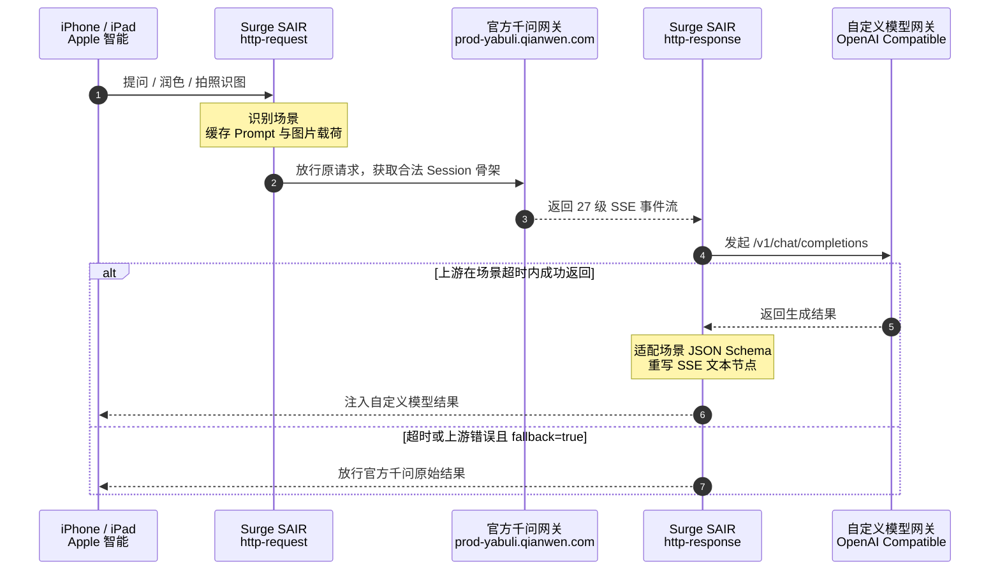

<div align="center">


<br />

[](#环境要求)
[](#手动安装-surge-模块)
[](#手动安装-loon-插件)
[](#手动安装-stash-覆写)
[](#手动安装-shadowrocket-模块)
[](#手动安装-quantumult-x-snippet)
[](#手动安装-egern-模块)
[](#主流服务商配置示例)
[](docs/protocol_analysis.md)
[](https://linux.do)
[](LICENSE)

<p align="center">
  <b>Your Intelligence. Your Models.</b><br />
  专为中国大陆版 Apple 智能（iOS 27.3+）打造的轻量化、零依赖自定义大模型请求重写插件与模组
</p>

<p align="center">
  <b>简体中文</b> &nbsp;｜&nbsp; <a href="README_EN.md">English</a>
</p>

<p align="center">
  <a href="#核心特性">核心特性</a> ·
  <a href="#工作原理与架构">工作原理</a> ·
  <a href="#快速开始">快速开始</a> ·
  <a href="#一键安装">一键安装</a> ·
  <a href="#参数与配置参考">参数配置</a> ·
  <a href="#主流服务商配置示例">配置示例</a> ·
  <a href="#常见问题">常见问题</a>
</p>

</div>

---

## 项目简介

**SAIR** 本质上是一个面向主流代理客户端的**国行 Apple 智能请求重写与响应适配插件 / 模组**（而非网络层路由器）。

国行版 **Apple 智能（Apple Intelligence）** 在调用第三方扩展能力时，会由系统通过标准 HTTPS 请求阿里云通义千问网关（`prod-yabuli.qianwen.com`）。SAIR 利用 **Surge、Loon、Stash、Shadowrocket、Quantumult X 与 Egern** 的本地中间人解密（MITM）与双阶段脚本重写能力，在设备本地透明完成：
1. **请求拦截与协议转接**：捕获 Apple 智能发出的上下文、系统提示词与相机控制多模态图像，转换为标准的 OpenAI `/v1/chat/completions` 请求并转接至你指定的大模型 API；
2. **响应伪造与流式重写**：将第三方模型返回的文本或流式响应，重新组装并伪造为符合国行 Apple 智能原生规范的 27 级 SSE 事件流与 JSON Schema 载荷后喂回系统。

配置启用后，系统级**写作工具**、**Siri 智能问答**和**视觉智能相机**依然保持 100% 的原生系统交互与视觉动效，但底层大模型已完全透明替换为你偏好的 OpenAI、Gemini、Claude、DeepSeek、聚合 API 或本地自建模型。

> [!TIP]
> 想先体验功能，直接从[快速开始](#快速开始)开始；想了解完整数据契约和 27 级 SSE 状态机，再阅读 [`docs/protocol_analysis.md`](docs/protocol_analysis.md)。

## 核心特性

<div align="center">
  
</div>

| 能力 | 说明 |
| :--- | :--- |
| **三大原生场景** | 覆盖写作工具、Siri 语音/文本问答和视觉智能识图，并保留原生 UI 动效与交互。 |
| **27 级 SSE 重写** | 保留 Apple 智能原始事件流骨架，只替换最终文本载荷和场景所需的 JSON Schema。 |
| **多模态直通** | 递归提取相机控制产生的 Base64 图片或图片 URL，转换为 OpenAI Vision 兼容的 `image_url` 消息。 |
| **按场景超时** | 为 Siri、视觉智能和写作工具分别设置超时窗口，减少客户端提前断开。 |
| **官方回退保护** | 自定义网关超时或返回错误时，可自动放行官方千问原始回包。 |
| **Safari 诊断入口** | 通过 `/sair/status` 查看脱敏运行配置，通过 `/sair/models` 探测上游模型列表。 |

### 原生场景适配

- **写作工具（`compose_selectedAndAllText`）**：输出 `{"body": "...", "refinements": ["..."]}`，保留正文和原生润色建议按钮。
- **Siri 问答（`siri.tqa`）**：输出 `{"content": "...", "suggestions": ["..."], "summary": "..."}`，驱动摘要卡片、语音朗读和追问气泡。
- **视觉智能（`siri.visualIntelligenceCamera`）**：识别相机图像输入，并组装为标准多模态消息后交给上游模型。

## 工作原理与架构



完整网络拓扑、事件层级和 JSON 数据契约见 [`docs/protocol_analysis.md`](docs/protocol_analysis.md)。

## 快速开始

### 环境要求

1. **设备与系统**：运行 iOS 27.3+、已启用国行 Apple 智能的 iPhone 或 iPad。
2. **代理客户端**：Surge iOS 5.x+、Loon 3.5.1+、Stash 2.5+、Shadowrocket 最新版、Quantumult X 1.0.30+ 或 Egern 最新版（开启 **MITM** 与 **脚本/重写** 功能）。
3. **证书信任**：在“设置 → 通用 → 关于本机 → 证书信任设置”中完全信任所选客户端的 MITM CA 根证书。
4. **模型凭证**：准备一个支持 OpenAI `/v1/chat/completions` 的上游服务和 API Key。

### 一键安装

> [!TIP]
> 🚀 **[点击打开 Web 在线安装中心（支持 Safari 一键唤醒导入各客户端）](https://boitar.github.io/sair/)**
> 在 iOS Safari 中访问该页面，点击一键安装即可无缝调起 Surge、Loon、Stash、Egern、Quantumult X 与 Shadowrocket 自动导入配置。

你也可以直接使用各客户端专属的 **一键安装快捷 URL Scheme**（在 Safari、快捷指令或支持自定义 Scheme 的应用中触发）：

| 客户端 | 快捷安装入口 (URL Scheme · 支持一键无缝更新) | 手动直链配置 (GitHub Raw) | CDN 镜像 (Fastly jsDelivr) |
| :--- | :--- | :--- | :--- |
| **Surge** | [点击一键安装 Surge 模块](surge:///install-module?url=https%3A%2F%2Fraw.githubusercontent.com%2Fboitar%2Fsair%2Fmain%2Fsgmodule%2Fsair.sgmodule)<br />`surge:///install-module?url=https%3A%2F%2Fraw.githubusercontent.com%2Fboitar%2Fsair%2Fmain%2Fsgmodule%2Fsair.sgmodule` | [`sair.sgmodule`](https://raw.githubusercontent.com/boitar/sair/main/sgmodule/sair.sgmodule) | [`Fastly CDN`](https://fastly.jsdelivr.net/gh/boitar/sair@main/sgmodule/sair.sgmodule) |
| **Loon** | [点击一键安装 Loon 插件](loon://import?plugin=https%3A%2F%2Fraw.githubusercontent.com%2Fboitar%2Fsair%2Fmain%2Floon%2Fsair.plugin)<br />`loon://import?plugin=https%3A%2F%2Fraw.githubusercontent.com%2Fboitar%2Fsair%2Fmain%2Floon%2Fsair.plugin` | [`sair.plugin`](https://raw.githubusercontent.com/boitar/sair/main/loon/sair.plugin) | [`Fastly CDN`](https://fastly.jsdelivr.net/gh/boitar/sair@main/loon/sair.plugin) |
| **Stash** | [点击一键安装 Stash 覆写](stash://install-override?url=https%3A%2F%2Fraw.githubusercontent.com%2Fboitar%2Fsair%2Fmain%2Fstash%2Fsair.stoverride)<br />`stash://install-override?url=https%3A%2F%2Fraw.githubusercontent.com%2Fboitar%2Fsair%2Fmain%2Fstash%2Fsair.stoverride` | [`sair.stoverride`](https://raw.githubusercontent.com/boitar/sair/main/stash/sair.stoverride) | [`Fastly CDN`](https://fastly.jsdelivr.net/gh/boitar/sair@main/stash/sair.stoverride) |
| **Egern** | [点击一键安装 Egern 模块](egern:///modules/new?url=https%3A%2F%2Fraw.githubusercontent.com%2Fboitar%2Fsair%2Fmain%2Fegern%2Fsair.yaml)<br />`egern:///modules/new?url=https%3A%2F%2Fraw.githubusercontent.com%2Fboitar%2Fsair%2Fmain%2Fegern%2Fsair.yaml` | [`sair.yaml`](https://raw.githubusercontent.com/boitar/sair/main/egern/sair.yaml) | [`Fastly CDN`](https://fastly.jsdelivr.net/gh/boitar/sair@main/egern/sair.yaml) |
| **Quantumult X** | [点击一键安装 QX Snippet](quantumult-x:///add-resource?remote-resource=%7B%22rewrite_remote%22%3A%5B%22https%3A%2F%2Fraw.githubusercontent.com%2Fboitar%2Fsair%2Fmain%2Fquantumultx%2Fsair.snippet%22%5D%7D)<br />`quantumult-x:///add-resource?remote-resource={"rewrite_remote":["https://raw.githubusercontent.com/boitar/sair/main/quantumultx/sair.snippet"]}` | [`sair.snippet`](https://raw.githubusercontent.com/boitar/sair/main/quantumultx/sair.snippet) | [`Fastly CDN`](https://fastly.jsdelivr.net/gh/boitar/sair@main/quantumultx/sair.snippet) |
| **Shadowrocket** | [点击一键安装 Shadowrocket 模块](shadowrocket://install?module=https%3A%2F%2Fraw.githubusercontent.com%2Fboitar%2Fsair%2Fmain%2Fshadowrocket%2Fsair.sgmodule)<br />`shadowrocket://install?module=https%3A%2F%2Fraw.githubusercontent.com%2Fboitar%2Fsair%2Fmain%2Fshadowrocket%2Fsair.sgmodule` | [`sair.sgmodule`](https://raw.githubusercontent.com/boitar/sair/main/shadowrocket/sair.sgmodule) | [`Fastly CDN`](https://fastly.jsdelivr.net/gh/boitar/sair@main/shadowrocket/sair.sgmodule) |

### 手动安装 Surge 模块

**安装路径**：`首页 > 修改 > 模块 > 安装新模块`（或 `配置 > 模块 > 安装新模块`）

**模块下载地址 (推荐 GitHub Raw，支持一键无缝更新)**：
```text
https://raw.githubusercontent.com/boitar/sair/main/sgmodule/sair.sgmodule
```
*(备用 CDN 镜像：`https://fastly.jsdelivr.net/gh/boitar/sair@main/sgmodule/sair.sgmodule`)*

模块会自动追加 MITM 主机名，并注册 SAIR 的请求与响应双阶段脚本。

### 手动安装 Loon 插件

**安装路径**：`配置 > 插件 > 插件`（右上角加号）

**插件下载地址 (推荐 GitHub Raw，支持一键无缝更新)**：
```text
https://raw.githubusercontent.com/boitar/sair/main/loon/sair.plugin
```
*(备用 CDN 镜像：`https://fastly.jsdelivr.net/gh/boitar/sair@main/loon/sair.plugin`)*

启用插件后，Loon 会显示 SAIR 的可调参数。

### 手动安装 Stash 覆写

**安装路径**：`首页 > 覆写 > 安装覆写`（或 `覆写 > 从 URL 下载`）

**覆写下载地址 (推荐 GitHub Raw，支持一键无缝更新)**：
```text
https://raw.githubusercontent.com/boitar/sair/main/stash/sair.stoverride
```
*(备用 CDN 镜像：`https://fastly.jsdelivr.net/gh/boitar/sair@main/stash/sair.stoverride`)*

### 手动安装 Shadowrocket 模块

**安装路径**：`配置 > 模块 > 右上角加号`

**模块下载地址 (推荐 GitHub Raw，支持一键无缝更新)**：
```text
https://raw.githubusercontent.com/boitar/sair/main/shadowrocket/sair.sgmodule
```
*(备用 CDN 镜像：`https://fastly.jsdelivr.net/gh/boitar/sair@main/shadowrocket/sair.sgmodule`)*

### 手动安装 Quantumult X Snippet

**安装路径**：`重写 > 引用`（右上角加号添加远程资源）

**Snippet 下载地址 (推荐 GitHub Raw，支持一键无缝更新)**：
```text
https://raw.githubusercontent.com/boitar/sair/main/quantumultx/sair.snippet
```
*(备用 CDN 镜像：`https://fastly.jsdelivr.net/gh/boitar/sair@main/quantumultx/sair.snippet`)*

### 手动安装 Egern 模块

**安装路径**：`工具 > 模块`（右上角添加 / Add Module from URL）

**模块下载地址 (推荐 GitHub Raw，支持一键无缝更新)**：
```text
https://raw.githubusercontent.com/boitar/sair/main/egern/sair.yaml
```
*(备用 CDN 镜像：`https://fastly.jsdelivr.net/gh/boitar/sair@main/egern/sair.yaml`)*

### 配置模型网关

各客户端均提供了便捷的原生或可视化调参方案：

1. **Surge 原生参数调节**：在 **模块 → SAIR → 编辑参数** 中，可通过 Surge 原生 UI 表单直接修改 `endpoint`、`api_key`、`model`、`notify`、`fallback` 及场景超时参数。
2. **Loon 原生插件面板**：在 **配置 → 插件 → SAIR** 中，Loon 原生卡片提供了各参数输入框与开关选择器。
3. **Shadowrocket 原生参数面板**：在 **配置 → 模块 → SAIR → 编辑参数** 中，支持与 Surge 一致的原生表单参数修改。
4. **全客户端通用：Safari 原生 Liquid Glass 可视化控制台**：
   代理启动后，在 Safari 中直接打开自定义域名：
   ```text
   http://sair.box (或 http://sair.hub)
   ```
   *(备用回退地址：`https://prod-yabuli.qianwen.com/sair`)*

   将呈现自包含的 Apple Liquid Glass 风格 Web 控制台，内置专属人格切换（🌸 妹系专属、💼 极简高效、🐱 傲娇陪伴、🤖 默认）、常用模型服务商预设（OpenAI、DeepSeek、Gemini、Moonshot、Ollama）、表单即时保存与上游模型列表探针，修改后自动写入持久化存储并立即生效，无需手动改写任何规则代码（Surge / Loon / Stash / Quantumult X / Shadowrocket / Egern 全平台通用）。

如需清除持久化配置恢复模块默认值，可随时在控制台中点击重置，或在 Safari 访问：
```text
https://prod-yabuli.qianwen.com/sair/reset
```

### 在线验证

保持所选代理客户端运行，在 Safari 中访问：

- **运行状态与生效配置**：[`https://prod-yabuli.qianwen.com/sair/status`](https://prod-yabuli.qianwen.com/sair/status)
- **上游模型列表**：[`https://prod-yabuli.qianwen.com/sair/models`](https://prod-yabuli.qianwen.com/sair/models)

`/sair/status` 只展示脱敏后的 API Key；如果页面无法打开，优先检查 MITM 主机名和证书信任。

## 参数与配置参考

### 模块 / 插件参数

| 参数 | 默认值 | 说明 |
| :--- | :--- | :--- |
| `endpoint` | `https://api.openai.com/v1/chat/completions` | OpenAI 兼容的对话补全地址；可以填写 `/v1` 基础路径。 |
| `api_key` | *(空)* | 上游 API Key，脚本会作为 `Bearer` Token 写入请求头。 |
| `model` | `gpt-4o-mini` | 目标模型名称；视觉智能场景需要模型支持图片输入。 |
| `notify` | `error` | `error` 只通知错误/回退，`all` 通知全部阶段，`none` 完全静默。 |
| `fallback` | `true` | `true` 时超时或错误会放行官方千问；`false` 时返回 HTTP `504`。 |
| `timeout_siri` | `7` | Siri 问答超时秒数，默认值适配约 6~8 秒的客户端等待窗口。 |
| `timeout_vision` | `10` | 视觉智能超时秒数。 |
| `timeout_writing` | `15` | 写作工具超时秒数。 |

### 配置优先级

同一配置项同时存在时，优先级为：

```text
$persistentStore 覆写 > 客户端模块 / 插件参数 > 脚本默认值
```

可用的持久化 Key：

| 持久化 Key | 对应参数 | 示例值 |
| :--- | :--- | :--- |
| `SAIR_ENDPOINT` | `endpoint` | `https://api.deepseek.com/v1/chat/completions` |
| `SAIR_API_KEY` | `api_key` | `sk-...` |
| `SAIR_MODEL` | `model` | `deepseek-chat` |
| `SAIR_NOTIFY` | `notify` | `error` / `all` / `none` |
| `SAIR_FALLBACK` | `fallback` | `true` / `false` |

### 当前固定的上游请求参数

以下参数目前由 [`scripts/sair_adapter.js`](scripts/sair_adapter.js) 固定写入上游请求，不属于模块参数：

| 参数 | 当前值 |
| :--- | :--- |
| `reasoning_effort` | `low` |
| `max_tokens` | `400` |
| `temperature` | `0.7` |

## 主流服务商配置示例

> [!TIP]
> Siri 对第三方扩展存在严格的 6~8 秒等待窗口，建议优先选择首字延迟低的模型；视觉智能场景还需要上游模型支持图像输入。

**OpenAI 官方**

```ini
endpoint=https://api.openai.com/v1/chat/completions&api_key=sk-proj-xxxx&model=gpt-4o-mini&notify=error&fallback=true
```

**Google Gemini（OpenAI 兼容接口）**

```ini
endpoint=https://generativelanguage.googleapis.com/v1beta/openai/chat/completions&api_key=AIzaSyXXXX&model=gemini-2.5-flash&notify=error&fallback=true
```

**DeepSeek 官方**

```ini
endpoint=https://api.deepseek.com/v1/chat/completions&api_key=sk-xxxx&model=deepseek-chat&notify=error&fallback=true
```

**OpenRouter 聚合网关**

```ini
endpoint=https://openrouter.ai/api/v1/chat/completions&api_key=sk-or-v1-xxxx&model=google/gemini-2.5-flash&notify=error&fallback=true
```

## 兼容性与已知限制

### 客户端支持情况

| 客户端 | 状态 | 导入入口 | 说明 |
| :--- | :---: | :--- | :--- |
| **Surge** | ✅ 完整支持 | [一键安装](#一键安装) · [直链下载](https://github.com/boitar/sair/releases/latest/download/sair.sgmodule) | 官方推荐主客户端，支持请求 / 响应双阶段拦截、参数编辑和 16MB 大请求体缓存。 |
| **Loon** | ✅ 完整支持 | [一键安装](#一键安装) · [直链下载](https://github.com/boitar/sair/releases/latest/download/sair.plugin) | 专用插件定义，原生表单参数可视化配置，新版 Script 语法双阶段拦截。 |
| **Stash** | ✅ 完整适配 | [一键安装](#一键安装) · [直链下载](https://github.com/boitar/sair/releases/latest/download/sair.stoverride) | 专用 `.stoverride` 规则覆盖，支持参数传递与 16MB 大请求体多模态图片。 |
| **Shadowrocket** | ✅ 完整适配 | [一键安装](#一键安装) · [直链下载](https://github.com/boitar/sair/releases/latest/download/sair.sgmodule) | 专用模块配置，完全兼容 Surge 模块规范与参数配置。 |
| **Quantumult X** | ✅ 完整适配 | [一键安装](#一键安装) · [直链下载](https://github.com/boitar/sair/releases/latest/download/sair.snippet) | 专用 `.snippet` 重写，内置兼容层适配 `$task.fetch` / `$prefs`，支持 Safari 动态传参。 |
| **Egern** | ✅ 完整适配 | [一键安装](#一键安装) · [直链下载](https://github.com/boitar/sair/releases/latest/download/sair.yaml) | 专用 YAML 模块定义，适配 `ctx` 对象模型与持久化存储。 |

- SAIR 已提供覆盖 6 大主流客户端的专用配置文件，由同一定制的跨平台适配脚本 [`scripts/sair_adapter.js`](scripts/sair_adapter.js) 统一驱动。
- 在未提供图形化模块参数编辑面板的客户端（如 Quantumult X），可在 Safari 中访问 `/sair/config?...` 动态保存与生效配置。
- 系统必须仍能访问官方千问通道；SAIR 需要原始请求和 SSE 会话骨架来完成响应重写。
- Siri 场景的等待窗口较短，复杂推理模型可能触发官方回退。
- 视觉智能图片会占用代理脚本请求体缓冲区；Surge 模块已将 `max-size` 配置为 `16777216`（16 MB）。
- 项目只处理兼容 OpenAI Chat Completions 的上游接口，不负责把非兼容协议转换成 OpenAI 格式。

## 项目结构

```text
SAIR/
├── assets/
│   └── banner.svg              # README 头图与重写架构视觉
├── docs/
│   └── protocol_analysis.md    # 网络拓扑与 27 级 SSE 协议分析
├── scripts/
│   └── sair_adapter.js         # Surge / Loon 双阶段适配器与 SSE 重写脚本
├── sgmodule/
│   └── sair.sgmodule           # Surge iOS 模块定义
├── loon/
│   └── sair.plugin             # Loon 插件定义与可调参数
├── stash/
│   └── sair.stoverride         # Stash 覆写规则配置
├── shadowrocket/
│   └── sair.sgmodule           # Shadowrocket 专用模块
├── quantumultx/
│   └── sair.snippet            # Quantumult X 重写片段
├── egern/
│   └── sair.yaml               # Egern 模块定义
├── index.html                  # Web 在线一键安装中心 (GitHub Pages)
├── LICENSE                     # MIT 开源许可证
├── README.md                   # 中文主文档
└── README_EN.md                # English documentation
```

## 常见问题

<details>
<summary><b>1. 为什么 Siri 有时仍然回答官方千问的内容？</b></summary>
<br />

通常是上游模型超过 `timeout_siri`（默认 7 秒）仍未完成，或 API 返回了错误，SAIR 因 `fallback=true` 自动放行了官方千问回包。可以临时将 `notify` 设为 `all` 查看通知原因，或换用更快的模型。
</details>

<details>
<summary><b>2. 访问 /sair/status 打不开或提示证书错误怎么办？</b></summary>
<br />

确认所选客户端的 MITM 已开启、`prod-yabuli.qianwen.com` 已在 MITM 主机名列表中，并且系统证书信任设置已完全信任对应 CA 根证书。
</details>

<details>
<summary><b>3. 哪些客户端可以直接使用？</b></summary>
<br />

Surge、Loon、Stash、Shadowrocket、Quantumult X 与 Egern 均已完成专用配置适配与统一脚本运行时支持，直接通过上方表格导入对应文件即可使用。
</details>

## 免责声明

本项目仅用于网络协议逆向分析、网络安全评估与个人技术研究。

- **Apple**、**iOS**、**Siri**、**Apple Intelligence** 均为 Apple Inc. 的注册商标；**通义千问**为阿里巴巴集团注册商标。
- 本项目与上述公司不存在任何官方关联或商业合作。使用者应遵守所在地法律法规及各 API 服务商的使用条款，因使用本项目产生的一切风险与后果由使用者自行承担。

## 开源许可

本项目基于 [MIT License](LICENSE) 开源。Copyright © 2026 boitar.
