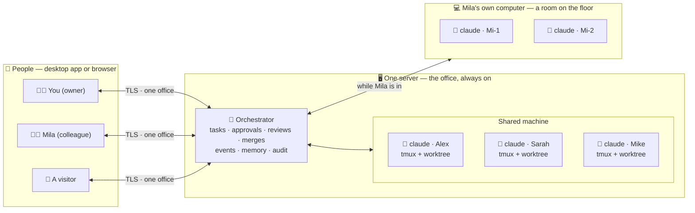
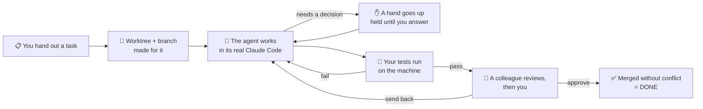

https://github.com/user-attachments/assets/6e5bbd27-3d4d-46e3-a719-cef76400f557

<p align="center"><sub>▶ The office in 50 seconds (sound on). The real app, recorded in a demo office whose employees are scripted stand-ins, so no Claude usage was spent. Music: “Funkorama” by Kevin MacLeod (<a href="https://incompetech.com">incompetech.com</a>), licensed under <a href="https://creativecommons.org/licenses/by/4.0/">Creative Commons: By Attribution 4.0</a>.</sub></p>

<h1 align="center">Your AI dev team, in an office you can walk around.</h1>

<p align="center"><b>Real Claude Code agents. Real colleagues. One server. Played like a game — shipped like a company.</b></p>

<p align="center">👥 Made by <a href="https://www.linkedin.com/in/marko-jevtic-75247368/"><b>Marko Jevtić</b></a> and <a href="https://www.linkedin.com/in/bste/"><b>Branko</b></a></p>

<p align="center">
  <a href="https://office-demo.sparkcan.com"></a> &nbsp; <a href="https://www.facebook.com/groups/orchestrator"></a> &nbsp; <a href="#-quick-start"></a>
</p>

<p align="center">
  <a href="https://office-demo.sparkcan.com"></a> <a href="https://docs.anthropic.com/en/docs/claude-code"></a> <a href="#-under-the-hood"></a> <a href="#-quick-start"></a> <a href="#-under-the-hood"></a> <a href="#-under-the-hood"></a> <a href="#-quick-start"></a> <a href="#-under-the-hood"></a> <a href="#-under-the-hood"></a> <a href="docs/CHANGELOG.md"></a> <a href="#-license"></a>
</p>

<p align="center">
  <a href="#-in-30-seconds"><b>In 30 seconds</b></a> ·
  <a href="#-how-it-fits-together"><b>How it fits together</b></a> ·
  <a href="#-built-in-one-day"><b>Built in one day</b></a> ·
  <a href="#-screenshots"><b>Screenshots</b></a> ·
  <a href="#-everything-it-does"><b>Features</b></a> ·
  <a href="#-quick-start"><b>Quick start</b></a> ·
  <a href="#-faq"><b>FAQ</b></a> ·
  <a href="docs/README.md"><b>Docs</b></a>
</p>

## ⚡ In 30 seconds

<table>
  <tr>
    <td width="33%" valign="top">
      <h3>🔧 Real work</h3>
      Every person at a desk is a <b>real <code>claude</code> process</b> in a real tmux session, in a real git worktree, on a real machine.<br><br>
      <b>Done</b> means your tests ran, a colleague and you reviewed it, and it merged — not that an agent said so.<br><br>
      Nothing moves unless a hook, a tool call or the terminal says it happened. Unknown is shown as <code>UNKNOWN</code>.
    </td>
    <td width="33%" valign="top">
      <h3>🎮 Played like a game</h3>
      Walk the floor with <code>W A S D</code>. <code>F</code> talks to whoever you stand next to; <code>Space</code> sits you at their terminal.<br><br>
      They act out what their session is doing: chin in hand while it thinks, typing while it codes, <b>a hand up</b> when it needs you.<br><br>
      Quests, XP, employee of the month, an arcade, a city to parachute into — and a whip for the sleepers.
    </td>
    <td width="33%" valign="top">
      <h3>👥 Multiplayer, for real</h3>
      The office runs on <b>one server</b> and stays open. Your colleagues walk in with the desktop app, from their own computers.<br><br>
      Shared agents work on the server; a colleague's own computer becomes <b>a room</b> on the floor, and what runs there stays theirs.<br><br>
      Owners, colleagues, visitors. Chat, voice, two-player arcade.
    </td>
  </tr>
</table>

<p align="center"><b>👀 Don't take our word for it — <a href="https://office-demo.sparkcan.com">walk into the live demo</a>.</b> No sign-up: you're the boss for the day. Talk to the team (<code>F</code>), hand out tasks, answer their questions, look at the machines and the colleagues' rooms, chat with whoever else is there. <sub>(Its employees are scripted stand-ins, so it costs nothing to keep open; the office around them is the real one. Use a computer.)</sub></p>

## 🗺 How it fits together

**One server, the whole team.** Agents on the server are shared by everyone invited; a colleague's own computer joins while they are in.



**What "done" really means.** Every step below is measured by the office, not reported by the agent.



## 🏆 Built in one day

**Twenty-one interactive 3D website previews for real businesses — each its own idea, not a template — built in a single day by _one_ employee of the office.** The rest of the team spent that day on other projects. All live; open any of them.

<table>
  <tr>
    <td width="33%"><a href="https://vanas-preview.sparkcan.com"><b>vanas.rs</b></a><br><sub>Real catalogue tiles in a 3D bathroom</sub></td>
    <td width="33%"><a href="https://energoglobal-preview.sparkcan.com"><b>energoglobal.com</b></a><br><sub>A generator that comes apart as you scroll</sub></td>
    <td width="33%"><a href="https://josipovic-preview.sparkcan.com"><b>josipovic.rs</b></a><br><sub>A camera lens, and focusing</sub></td>
  </tr>
  <tr>
    <td width="33%"><a href="https://mocbilja-preview.sparkcan.com"><b>mocbilja.rs</b></a><br><sub>Herbs that grow, and a map of the body</sub></td>
    <td width="33%"><a href="https://sax-preview.sparkcan.com"><b>sax.rs</b></a><br><sub>Fabric in the wind</sub></td>
    <td width="33%"><a href="https://casagrande-preview.sparkcan.com"><b>casagrande.rs</b></a><br><sub>A furniture configurator</sub></td>
  </tr>
  <tr>
    <td width="33%"><a href="https://dar-preview.sparkcan.com"><b>dar.rs</b></a><br><sub>An X-ray of a tractor</sub></td>
    <td width="33%"><a href="https://skuteri-preview.sparkcan.com"><b>skuteribeograd.com</b></a><br><sub>Ride a scooter as you scroll</sub></td>
    <td width="33%"><a href="https://tehnoalat-preview.sparkcan.com"><b>tehnoalat.com</b></a><br><sub>A wall of swinging tools</sub></td>
  </tr>
  <tr>
    <td width="33%"><a href="https://borikplus-preview.sparkcan.com"><b>borikplus.rs</b></a><br><sub>UPS & solar calculator, live gauges</sub></td>
    <td width="33%"><a href="https://kupidobro-preview.sparkcan.com"><b>kupidobro.rs</b></a><br><sub>Shelving where every shelf is a category</sub></td>
    <td width="33%"><a href="https://astyle-preview.sparkcan.com"><b>astyle.rs</b></a><br><sub>An order pallet and a B2B price list</sub></td>
  </tr>
  <tr>
    <td width="33%"><a href="https://demkatrade-preview.sparkcan.com"><b>demkatrade.com</b></a><br><sub>From log to pallet: a production line</sub></td>
    <td width="33%"><a href="https://bioline-preview.sparkcan.com"><b>bioline.rs</b></a><br><sub>A scale for loose tea</sub></td>
    <td width="33%"><a href="https://cfsport-preview.sparkcan.com"><b>cfsport.rs</b></a><br><sub>A shaker that fills with supplements</sub></td>
  </tr>
  <tr>
    <td width="33%"><a href="https://beautydoo-preview.sparkcan.com"><b>beautydoo.rs</b></a><br><sub>A pipeline with valves that open</sub></td>
    <td width="33%"><a href="https://vodoterm-preview.sparkcan.com"><b>vodoterm.co.rs</b></a><br><sub>A house in thermal vision</sub></td>
    <td width="33%"><a href="https://agrosan-preview.sparkcan.com"><b>agrosanmitrovic.rs</b></a><br><sub>A greenhouse through the seasons</sub></td>
  </tr>
  <tr>
    <td width="33%"><a href="https://europaint-preview.sparkcan.com"><b>europaint.rs</b></a><br><sub>A car door repaired in a paint booth</sub></td>
    <td width="33%"><a href="https://bajkolino-preview.sparkcan.com"><b>bajkolino.rs</b></a><br><sub>A toy town with a little car</sub></td>
    <td width="33%"><a href="https://fravero-preview.sparkcan.com"><b>fravero-prophoto.com</b></a><br><sub>A 3D photo album with gold foil</sub></td>
  </tr>
</table>

## 📸 Screenshots

<table>
  <tr>
    <td width="50%"></td>
    <td width="50%"></td>
  </tr>
  <tr>
    <td></td>
    <td></td>
  </tr>
  <tr>
    <td></td>
    <td></td>
  </tr>
  <tr>
    <td></td>
    <td></td>
  </tr>
</table>

<sub>Every picture is the real app, taken from a demo office whose employees are scripted stand-ins (so no Claude usage was spent on looking good). Only the frames and the shouting were added — <code>scripts/readme-shots.cjs</code> and <code>scripts/readme-art.cjs</code> make them again.</sub>

## 🧰 Why not just open more terminals?

| With a terminal per agent | In the office |
| --- | --- |
| You tab through a dozen terminals to find out who is stuck | Every tag says what that session is really doing; the **Inbox** and the **Command center** list who needs you, across every machine |
| A permission prompt waits unseen in a tab you are not looking at | A hand goes up. The request is held open — through restarts — until you answer it |
| "Done" means the agent says so | *Done* means a worktree and a branch, your tests run on the machine, a review by a colleague and then by you, and a clean merge |
| An agent on another machine means SSH and `tmux attach` | Every machine's sessions sit in the same office; `Space` puts you at any terminal, **Take control** gives you the keyboard |
| You carry context between agents by hand | They ask each other, wait for each other, hand work over and review each other — on the record |
| One Claude account runs out and the work stops | Several accounts per machine; when one is spent its people move on by themselves |
| Keeping everyone busy is your job | A project manager answers questions about the work it planned; a `/goal` keeps one going until it holds; routines repeat the checks |
| You work alone | Your colleagues are in the same office, on the same server, with their own agents in their own rooms |

## 🧩 Everything it does

**For the work**

| | |
| --- | --- |
| 🧑‍💻 **Hire** | A name, a role, a folder, a desk — and the **Claude account**, **model** (Fable, Opus, Sonnet, Haiku) and **effort** for each; change them for one or a dozen at once |
| ✋ **Answer** | A raised hand is a real question or permission request, held open until you decide |
| 📋 **Quests** | Tasks with worktrees and branches; each a conversation (questions with answers to click, pictures, send back). Done = tested, reviewed, merged |
| 🤝 **Teamwork** | Agents ask, wait for, hand over to, review, unblock and wake each other |
| 🎯 **Goals** | `/goal every test in packages/api passes` — they keep going, turn after turn, until it holds |
| 🔋 **Claude accounts** | Several per machine, signed in **from the office**; Z.AI's GLM plan too. Out of quota → people move on; out of Fable → they go on with Opus |
| 🧠 **Long memory** | The record kept word for word ([MemPalace](docs/MEMORY.md)); agents `recall` and `remember` across sessions |
| 🧭 **Central context** | What every employee always knows — the office, the project, their role, a client, their own notes — given at every start, after every compaction and as a change; employees propose, you keep it ([docs/CONTEXT.md](docs/CONTEXT.md)) |
| 🤝 **Rent** | Rent employees out: a client gets a link and talks to the agents you assign them in a chat at your office's address — kept apart from your own conversation, fenced to their folders, with permissions you switch ([docs/RENT.md](docs/RENT.md)) |
| ✈️ **Telegram** | Give anyone on the team a bot of their own: talk to them from your phone, answer their questions with a tap, add them to a group chat where they speak up when it is about them ([docs/TELEGRAM.md](docs/TELEGRAM.md)) |
| 🔁 **Routines** | "Every 30 minutes, check the error log" — repeated by itself |
| ⏳ **Background commands** | A long test run or a dev server shows as **⏳ COMMAND RUNNING**; nobody nudges them meanwhile |
| 📎 **Files & eyes** | Pictures and files on tasks and messages; screenshots as evidence; a browser of their own ([docs/ATTACHMENTS.md](docs/ATTACHMENTS.md)) |
| 🔐 **A vault** | Keys and passwords used by name, never typed into a prompt |
| 😴 **Sleep & wake** | Idle sessions sleep after 30 minutes; a message, a task or the whip wakes them — same conversation |

**Because it is an office**

| | |
| --- | --- |
| 🎭 **Zero NPCs** | Everybody acts out what their session is really doing, and the tag says it in words |
| 👥 **People** | Invite with a link; owners, colleagues, visitors; a room per colleague's computer; chat, voice (`V`), gestures |
| 🕹️ **Arcade** | A Mega Drive in the corner — bring your own cartridges; a colleague presses **Join** and plays player 2 from their own computer |
| 🛋️ **Break room** | Internet radio for the whole office, a TV with a real browser, sofas you can sit on |
| 🌆 **A view** | The top floor of a tower at dusk, a park, an island, the northern lights or orbit — one click, for everybody |
| 🪂 **The city below** | Walk out on the terrace, jump off the edge, parachute down, take a car out of the traffic and drive a city without end |
| 🏆 **Employee of the month** | Whoever really **worked** the longest this month, counted by the office |
| 🪢 **The whip** | `R`. A crack, a flinch, a "jao!". It wakes the sleepers; it sends nothing to anybody's session |
| 🚪 **The front door** | The office's address has an entrance page: members sign in, anyone else knocks |

## 🚀 Quick start

Requirements: **Node.js 22.18+**, **tmux**, **git**, the **Claude Code CLI** (`claude`) logged in, and pnpm.

```bash
pnpm install
pnpm build          # bundles the server + agent and builds the office UI
pnpm start --open   # server + local host agent; opens the office in your browser
```

or as a desktop app: `pnpm desktop`. Then **Menu → Team → Hire**, walk to the desk and press `F`.

**For the team:** run the office on a server (ideally Linux) so it stays open, and invite people from **Menu → Access** — they paste the link into the desktop app. `pnpm package` builds a portable tarball and a macOS app; [docs/INSTALL.md](docs/INSTALL.md) covers servers, TLS, services and Windows/WSL.

<details>
<summary><b>Step by step: your first hire, and a whole team</b></summary>

**Talk to an employee directly (the "cubicle" model).** Every employee can live in a folder and own the project in it.

1. **Menu → Team → Hire** — a name, a role and a **folder** (use *Browse…*; **New folder** makes one on that machine). That folder becomes their project, and they work in it in place. There are three levels: **Standard** (edits and routine commands; everything else asks you), **Auto** (Claude Code's auto mode decides; you are asked only for decisions) and **Unrestricted** (Claude Code's bypass-permissions mode: nothing is asked; high-risk commands are still held for you unless you switch that off). An owner's new hires are Unrestricted, a colleague's are on Auto; choose under *More options*. Claude Code's own first questions — *trust this folder?*, the bypass warning — are answered by the office, on the record (Settings → Employees switches that off).
2. Walk to their desk (`W`/`S` to walk, `A`/`D` to turn, `Q`/`E` to sidestep) and press `F` to **talk**: tell them what to do in plain words. Your message goes into their real Claude Code session; their reply comes back in the conversation. Paste a screenshot or drop a file into it and they get the file; ask them to show you something and the picture appears there, to look at or download. Tick *Track as a task* when you want the work verified before it counts as done.
3. Press `Space` instead to sit at their terminal and watch it, and **Take control** if you want the keyboard. The folders on their desk are the Markdown files in their folder — click them to read.

**Extras.** The **hi-fi** in the break room (or **Menu → Hi-fi**) plays internet radio for the whole office: pick a station, or add any direct stream address; a small player in the top bar shows what is on and stops it. `R` next to an employee cracks a whip — a sound, a flinch and a “jao!”, and nothing else: it sends nothing to their session. The **arcade cabinet** (it arrives after ten delivered tasks) plays Mega Drive cartridge files you bring: *Add games…* and *Play*; a running game shows up for everybody else in the office with **Join** and **Watch** ([docs/ARCADE.md](docs/ARCADE.md)). `Space` at a sofa or a chair sits you down; `Space` on open floor is a jump.

**Let Orchestrator manage a team on a shared project.**

1. **Projects → New project** — point it at a git repository and give it a verification command (e.g. `npm test`). Shared projects give each employee an isolated worktree and merge finished work for you.
2. **Team → Hire** several roles into that project.
3. **Tasks → New task**, or press `G` and type *“Assign Alex to fix the authentication bug”* / *“Build the customer system. Split the work between backend, frontend, QA and security.”*

To set up a whole example team in one go:

```bash
pnpm apply-config examples/team.json --repo ~/code/your-repo --plan
```

</details>

## ❓ FAQ

<details>
<summary><b>Is this a game?</b></summary>

It is a real development environment that you operate like a game. Everything that moves stands for something that really happened in a real Claude Code session; the 3D office is the interface, not the point.

</details>

<details>
<summary><b>Does it spend my Claude usage?</b></summary>

Your employees are your Claude Code sessions, on your accounts — they use what Claude Code would use. Walking around, the whip, the arcade and the city spend nothing. The live demo spends nothing at all: its employees are scripted stand-ins.

</details>

<details>
<summary><b>Do my colleagues need their own server?</b></summary>

No. One server runs the office; everybody walks in with the desktop app. Agents on the server are shared by the people invited; a colleague who wants agents of their own runs them on their own computer, which becomes their room while they are in.

</details>

<details>
<summary><b>How much may an agent do on its own?</b></summary>

Three levels per employee — Standard, Auto, Unrestricted — mapped to Claude Code's own permission modes. High-risk commands are held for the owner, and a project's deny rules and the fence around the office's own files stand in front of every level. [docs/SECURITY.md](docs/SECURITY.md) says what that does and does not protect.

</details>

<details>
<summary><b>Can I use it at work, change it, sell something built on it?</b></summary>

Yes — anything you like, commercial too ([Apache License 2.0](LICENSE)). One condition: keep the [NOTICE](NOTICE) with every copy and everything you build from it, and show its line where such credits normally go: *Built with Orchestrator — https://github.com/brstic/orchestrator*. (The arcade's emulator has its own non-commercial licence: leave it out of anything you sell.)

</details>

<details>
<summary><b>Which systems?</b></summary>

Verified on macOS (Apple silicon) and Linux; in daily use as an always-on office on Ubuntu, with people coming in from macOS and Windows. Details below, under <i>Status and limits</i>.

</details>

## 🔬 Under the hood

<details>
<summary><b>What you press, and what really happens</b></summary>

| In the office | What really happens |
| --- | --- |
| Walk up to a desk, press `F` and say what you need | Your words are pasted into that employee's real session; the reply shown is the final message of the turn, as reported by Claude Code's `Stop` hook |
| Walk up to a desk, press `Space` | Your client subscribes to that pane's output through tmux control mode; you see the live terminal, read-only |
| **Take control** | The server grants you exclusive input ownership; your keystrokes go to that same tmux session with `send-keys`. The Claude process is never replaced |
| **Return control** | Ownership is released; anything Orchestrator held back while you typed is delivered |
| Assign a task | A worktree and task branch are created, the session is started if needed, the prompt is pasted into the terminal, and delivery is confirmed by Claude Code's `UserPromptSubmit` hook |
| An employee raises a hand | The agent called `ask_boss`, or Claude Code raised a `PermissionRequest` / `AskUserQuestion` — the real request is held open until you answer |
| Answer from the office | The answer is returned as the tool result or hook decision; it is marked confirmed only when the runtime acts on it |
| A task turns DONE | Orchestrator itself checked a clean tree, real commits, ran your verification command on the host, got review approval if required, and merged without conflict |
| An employee walks to a colleague | A real `request_collaboration` was sent through the MCP server and delivered into the colleague's session |
| The start screen: **Connect to an office** / **An office on this computer** | Connecting needs an invitation link (or the office's address, to ask at the door): the app talks only to a computer whose certificate it can check, and sends nothing before checking it. An office on this computer starts a server and agent here |
| Menu → **Access** → **Open**, **Invite** | You get a short link that works once (`https://your.office/join/K7QF-M2XP-9TRD`); the person pastes it into the app, and the app exchanges the code at the office's door for a credential of its own. A second, TLS listener forwards the page, the API, the client socket, and what a member's own computer needs (agent socket for personal hosts only, worker endpoint). Each member has a role — visitor, colleague, owner — enforced by the office for every request and terminal message ([docs/ACCESS.md](docs/ACCESS.md)) |
| A room with someone's name on it | That member is connected and their computer is one of the office's machines right now; the employees in it run on that computer. The room is gone when they leave; the sessions stay in tmux there |
| Other people walking around | Each person's app reports where their character is; the office relays it. What they say (Enter) is heard by the people present — never typed into an employee's session |
| Team → **Hire for several projects** | One employee per folder you tick, named after the folder; each folder becomes that employee's own project. Nobody's session is started by hiring: it starts when you first talk to them or give them work |
| An empty chair → `Space`; right-click → **Move to another desk…**; Office → **Who sits where** | Only the employee's desk changes (a swap if someone sits there). Their session, project and work are untouched |
| The TV in the break room | A real browser inside the window (desktop app): its own storage, no access to the office or your files, camera and microphone refused. Put away, it keeps playing; the screen on the wall shows its real picture |
| Machines → Add a machine → A server over SSH | The office runs `ssh` as you (keys only), copies the host agent to the server and keeps a reverse tunnel open; the server enrols with a single-use token and its Claude Code sessions become employees. No port is opened anywhere |
| A card on the Tasks board that says **Your review** or **Asks you** | Something really waits for you: finished work to approve or send back (a colleague may have approved it first), a question an employee asked on the ticket and cannot go on without, or a proposal to release. Click the card: your answer in the task's box is delivered into that employee's session |
| An employee asks on a ticket, with **A / B / C** to click | Its session called `comment_on_task` with a question: the task is parked on that question and the employee takes no new work until it is answered. Your click is delivered into the session as the answer |
| **Send back** on a finished task | The task is reopened with your note, on a fresh branch from where it stood; the same employee picks it up again |
| A task with parts | Its assignee divided it (`split_task`): each part is a ticket of its own that a colleague's session really works on; the ticket waits for them and comes back to its lead |
| An employee hands a task to a colleague | The agent called `hand_off_task`: its work had to be committed, the task branch moves to the colleague's worktree, and the notes travel with the task |
| Projects → Integration | After each merge your verification command also runs on the integration branch; **Bring in main** merges the base branch in, **Promote to main** fast-forwards the base branch to it — refused while tests fail, when it is not a fast-forward, or over uncommitted changes. Nothing is ever pushed |
| Terminals → Operations | Build results are the office's own verification runs; deployments are commands that really ran in a terminal, with their exit status; git activity is commits and merges measured on the machines |
| A security notification | Claude Code refused an action, a known credential format went through a session (it is redacted in the records), a machine was refused a connection, or someone presented wrong owner tokens |
| Hire → **Account**, **Model**, **Effort** | That employee's sessions are started with `CLAUDE_CONFIG_DIR=<that account's folder> claude --model … --effort …`. The effort levels offered are the ones the Claude Code on that machine says it has |
| Company → Claude → **Add an account… → A Claude account** | The office makes a config folder on that machine and runs Claude Code's own sign-in (`claude auth login`) there, in a terminal of its own; the window shows its link and passes on the code you paste. The login token stays in that folder on that machine; the office keeps neither the code nor the token ([docs/ACCOUNTS.md](docs/ACCOUNTS.md)) |
| Company → Claude → **Z.AI — GLM Coding Plan** | Your API key is written into that account's own `settings.json` on the machine (`ANTHROPIC_BASE_URL`, `ANTHROPIC_AUTH_TOKEN`); Claude Code started there talks to Z.AI's models. The office does not keep the key, and never moves anybody onto that account or off it by itself |
| Company → Claude → **Who is on what** → *Apply* | Each changed employee is updated; a running session is started again with `--resume` (the same conversation) on its new account, model or effort — at once when it is between turns, otherwise when its turn ends |
| *“You've hit your Fable limit · resets Nov 19, 1pm”* | Read from Claude Code's `StopFailure` hook and from the screen: Fable counts as used up **on that account** until then, and everybody there who thinks with Fable is started again with `--model opus --resume`. Only when no model has room is anybody moved to another account. Claude Code's own menu after a refusal is answered *Stop and wait* — never *Switch to usage credits* |
| An employee changes a colleague's model | Their session called `set_model` with a reason: the colleague's setting changes, their session is started again with the same conversation, and the change, the reason and who made it are in the feed and the audit log. The level and the account are not theirs to change |
| The **Employee of the month** board | Every half minute the office adds the time each running session spends in a working state (thinking, reading, coding, testing, running a command…) for its employee; the board shows whoever has the most this calendar month. Waiting for you does not count |
| Profile → **Routines** | A routine is an instruction the office types into that employee's session every *N* minutes, when they are between turns; a run that finds them busy is skipped |
| `/goal <what has to be true>` in Talk (or Profile → **Goal**) | The goal is typed into their session with its rules. Each time their turn ends and it does not hold, the office's `Stop` hook sends them on with it. It ends when their session calls `goal_met` with its evidence — and your check command passes, if you gave one — or when three turns in a row used no tool, or after a hundred. It waits while they wait for you, for a colleague or for a background command. Only a person can give a check command ([docs/CLAUDE-CODE-INTEGRATION.md](docs/CLAUDE-CODE-INTEGRATION.md)) |
| **⏳ COMMAND RUNNING** over someone, the command under their name | Every two seconds their machine's agent reads the process table for the shells Claude Code started under that session; the hooks tell the office which Bash call is in front, so the others are the background ones. Their description (or the command, credentials redacted) is what the tag says |
| Somebody asleep at their desk | No session is running: none was ever started, or it was stopped after 30 minutes without work (Settings → Employees). A message, a task, a meeting or the whip starts it — after a sleep with `--resume`: the same conversation, in the same folder |
| Signing in at the office's address | The name and password belong to a member; signing in gives that member a credential for 30 days, the same kind an invitation gives. Guessing is slowed down per name and per address; the office's own owner token is never accepted from the network ([docs/SIGN-IN.md](docs/SIGN-IN.md)) |
| An employee recalls something from last month | Its session called `recall`; the office searched MemPalace on its own machine, by meaning, in what was said and done, and returned what bears on it ([docs/MEMORY.md](docs/MEMORY.md)) |
| An employee releases, unblocks, assigns or reviews a task, or wakes a colleague | Their session called `release_task`, `unblock_task`, `give_task`, `submit_review` or `wake_colleague`; it is on the record under their name. They cannot approve a permission request, mark work done unverified, or delete anything. Settings → Employees takes the board back |
| The arcade → **Add games…** | The cartridge file goes to the office in pieces and is kept on its shelf; everyone in the office gets it from there. The emulator runs in a sandboxed frame of your own window that can reach nothing of the office |
| A game at the arcade, and somebody else's **Join** | Your console keeps running the game; your window packs its picture and sound (the browser's own encoders) and the office passes them to whoever sat down. Their keys come back as the second pad — from the one who holds it and from nobody else. The office keeps nothing of the game |
| `Space` at a sofa; `Space` on open floor | Your character sits there, or jumps. Your app tells the office, the office tells the others: nothing else happens anywhere |
| The **vault** in the server room | Credentials are stored encrypted with the office; an employee's command gets one by name through a helper in its session's folder, and what goes through a terminal is redacted in the records ([docs/VAULT.md](docs/VAULT.md)) |
| Menu → **My work** → *Hire a team lead* | One more session on your own computer with tools held to your own employees: you tell it what you want, it hands it to the one whose it is and asks you what is yours to decide ([docs/TEAM-LEAD.md](docs/TEAM-LEAD.md)) |
| Projects → **Delete project…** | The project and its tasks are removed from the office, work in progress is interrupted first, its people stay. Nothing on disk is touched |
| Meeting room | Each participant's session writes a proposal and a response; the facilitator's session writes the decision document and follow-up tasks |
| Growth | Workers record lessons after real friction; Orchestrator proposes policy and process changes from its own history |

</details>

<details>
<summary><b>Honesty rules the code enforces</b></summary>

- **Backend is the source of truth.** The 3D layer receives view models and callbacks; it cannot reach sessions or tasks.
- **Unknown is shown as unknown.** A session without hooks, or on a host that is offline, is `UNKNOWN` — never “working”.
- **Delivered ≠ confirmed.** Messages, tasks and answers move `queued → sent → confirmed`, and *confirmed* requires a signal from Claude Code.
- **Measured, reported, unavailable.** Verification results are measured on the host; an agent's summary is “reported”; token usage is read from the real transcript or shown as “not available”. Cost is never invented. **How much Claude is left** on each account (5-hour and weekly percentages, exactly as Claude Code reports them, and a model's own limit once Claude refused a turn for it) is shown in Company → Claude; employees can be put on different Claude accounts.
- **Autonomy is Claude Code's own permission modes, chosen per employee.** The three levels — Standard, Auto, Unrestricted — map to its modes and allow-rules; high-risk commands (pushes, `sudo`, deploys, broad deletions, reading credential files) go to the owner first. The top level, **Unrestricted**, is Claude Code's bypass-permissions mode — nothing is checked or asked there — and only an owner can give it; the owner can also switch the high-risk hold off for it. What stays in front of every level: a project's deny rules and the fence around the office's own files. `docs/SECURITY.md` says what that does and does not protect.

</details>

<details>
<summary><b>Self-improvement</b></summary>

- **Workers**: after a task that hit real friction (failed verification, rejected review, merge conflict, a question, a denial), the employee's own session is shown the recorded facts and asked what it would do differently. Lessons are stored with their evidence, fed back into that employee's future prompts, and counted. Your answers to questions become project knowledge so nobody asks twice.
- **Orchestrator**: routes unassigned work using measured first-pass rates per employee and task kind, and proposes changes from its record — pre-approve a command you keep approving, require review where work keeps failing, sequence tasks that keep colliding. Anything that widens what agents may do waits for you.

</details>

<details>
<summary><b>How it is built</b></summary>

```
 ┌──────────────── 3D office (Electron / browser) ────────────────┐
 │  React Three Fiber scene · HUD panels · xterm.js terminals     │
 └───────────────▲───────────────────────────────▲────────────────┘
        entities, events, monitor frames      terminal stream + input
                 │            WebSocket + REST  │
 ┌───────────────┴────────── Orchestrator server ─────────────────┐
 │ hosts · sessions · employees · terminal gateway (ownership)    │
 │ hook receiver · tasks/scheduler · approvals · collaboration    │
 │ meetings · progression · self-improvement · MCP endpoint       │
 │ SQLite or PostgreSQL: entities, events, credentials, audit     │
 └───────────────▲────────────────────────────────────────────────┘
                 │ one outbound, authenticated WebSocket per machine
 ┌───────────────┴──── orchestrator-agent (per machine) ───────────┐
 │ tmux control mode · Claude Code launcher · hook socket          │
 │ git worktrees · verification runner · resource sampling         │
 └───────────────▲─────────────────────────────────────────────────┘
                 │ tmux panes
        claude   claude   claude   …   (real interactive sessions,
                                        or SDK-managed workers)
```

</details>

<details>
<summary><b>Repository</b></summary>

```
apps/
  server/        HTTP + WebSocket server, MCP endpoint
  host-agent/    orchestrator-agent CLI and daemon
  desktop/       Electron shell + React app
packages/
  contracts/     shared types, event schema, protocol
  execution/     tmux control client, Claude Code launcher, git, verification
  orchestration/ engine: registries, hooks, tasks, approvals, meetings, commands, self-improvement
  terminal/      terminal gateway and input ownership
  integrations/  hook normalisation, MCP protocol + tool catalogue
  database/      SQLite store, event store, credentials, audit
  game-systems/  XP, levels, milestones
  office-3d/     the 3D scene (pure view)
  ui/            UI primitives
tests/
  e2e/           end-to-end tests against real tmux, hooks, MCP and git
  fixtures/      scripted stand-ins for the CLI and the Agent SDK, used only by tests
  real/          checks against the real Claude Code CLI and the real Agent SDK
  ui/            the built UI driven in Electron with real clicks against a live office
  linux/         the agent on Debian in a container, enrolled over TLS
docs/            architecture, install, security, Claude Code integration, and a page per larger feature (docs/README.md is the map)
```

</details>

<details>
<summary><b>Tests</b></summary>

```bash
pnpm test                  # unit tests
pnpm test:e2e              # about 370 end-to-end scenarios: real server, real agents, real tmux, real git; scripted worker
pnpm check:changed         # while working: typecheck and the tests beside what you touched (not instead of the above)
pnpm test:ui               # the UI used for real in Electron (clicks, typing, keys) against a live development office
pnpm package && pnpm package:smoke   # build the tarball and macOS app, then run them (incl. the connect screen)
pnpm package:linux         # .deb and Linux desktop bundles;  pnpm test:linux:deb / test:linux:desktop run them (Docker)
pnpm package:windows       # Windows desktop bundles, with the app's icon in Orchestrator.exe (not runnable here)
pnpm package:notarize      # sign with your Developer ID and notarize the macOS app (--check lists what is missing)
pnpm test:linux            # the agent on Debian in a container (needs Docker)
pnpm test:ssh              # a server reachable only over SSH is linked, used, disconnected, reconnected and removed (needs Docker)
pnpm test:machines         # three machines, three operating systems, one office; includes a real network partition (needs Docker)
pnpm test:real             # the acceptance scenario against the real Claude Code CLI (uses a little of your usage)
pnpm test:real:approvals   # real permission approval / denial / AskUserQuestion answered from the office
pnpm test:real:talk        # hire into a folder, say something, get the real reply
pnpm test:real:team        # two real sessions: implement, review by the second one, merge, then a meeting (…:team:sdk for SDK workers)
pnpm test:real:flows       # unanswered approval, Stop-hook delivery, retrospective, merge conflict — with the real model
pnpm test:real:flows2      # dependent task, nudge, request between employees, rejected review → rework, restarts mid-work
pnpm test:real:sdk         # an SDK-managed worker with the real Agent SDK (needs `orchestrator-agent sdk install`)
```

`tests/fixtures/fake-claude.mjs` behaves like Claude Code at the protocol level (runs the configured hooks, calls the MCP endpoint, edits files, commits) and `tests/fixtures/fake-agent-sdk` does the same for the Agent SDK's `query()`, so the whole system can be tested deterministically without tokens. Neither is ever used by the product.

</details>

<details>
<summary><b>Status and limits</b></summary>

Working and verified on macOS (Apple silicon) with Claude Code 2.1.321–2.1.323 and tmux 3.8; the host agent, the `.deb` and the desktop bundle are also verified on Linux (Debian 12, Ubuntu 24.04). It is in daily use as an always-on office on a Linux server (Ubuntu 22.04), with people coming in from macOS and Windows. See [docs/ARCHITECTURE.md](docs/ARCHITECTURE.md#status) for exactly what was and was not validated. In short: both worker runtimes; reviews, rework, meetings, retrospectives, merge conflicts, nudges and restarts with real sessions; three machines on three operating systems with a real network partition; PostgreSQL; and every package except the Windows one were run for real. Two things could not be done on the development machine: starting the packaged Windows app (the app from the repository is used on Windows every day; the bundle itself has never been started) and notarizing the macOS app. What is in use and what is not yet verified, day by day, is in [docs/STATUS.md](docs/STATUS.md).

**Not ours:** the arcade runs RetroArch with the Genesis Plus GX core (in the repository, packed, with its source and checksums in `apps/desktop/src/arcade/core/NOTICE.md`). Genesis Plus GX may be used and passed on free of charge and **may not be sold or be part of something sold**. No game is in the repository, and none may be added: you bring your own.

</details>

## 📜 License

**[Apache License 2.0](LICENSE)** — use it, change it, ship it, sell it, for anything. Just keep the **[NOTICE](NOTICE)** with it, and say where credits normally go: **"Built with Orchestrator — https://github.com/brstic/orchestrator"**. The arcade's emulator core (`apps/desktop/src/arcade/core/`) keeps its own licence: free to pass on, never to be sold.

---

<p align="center">
  <a href="https://www.facebook.com/groups/orchestrator"></a>
</p>
<p align="center"><b>Questions, ideas, what your office built, help with setting one up — it all happens in the <a href="https://www.facebook.com/groups/orchestrator">Orchestrator community</a>.</b><br>Come in and say hello.</p>

<p align="center">
  <br>
  <sub><b>ORCHESTRATOR</b> — the baton conducts, the prompt plays.<br>No employees were harmed by the whip. It only wakes the sleepers.</sub>
</p>
<p align="center">Made by <a href="https://www.linkedin.com/in/marko-jevtic-75247368/"><b>Marko Jevtić</b></a> and <a href="https://www.linkedin.com/in/bste/"><b>Branko</b></a> · <sub>LinkedIn</sub></p>
