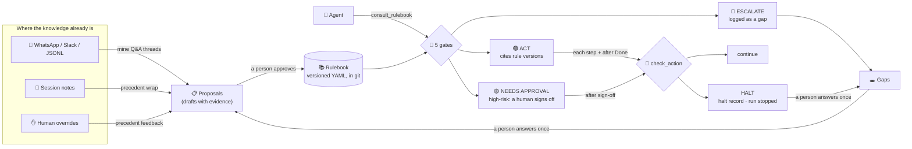

<p align="center">
  
</p>

<p align="center">
  <a href="https://github.com/burhan-mujahid/precedent/actions/workflows/ci.yml"></a>
  <a href="https://pypi.org/project/precedent-ai/"></a>
  <a href="https://doi.org/10.5281/zenodo.24087058"></a>
  
  
  
  <a href="https://modelcontextprotocol.io"></a>
  <a href="SECURITY.md"></a>
  <a href="LICENSE"></a>
</p>

<p align="center">
  <a href="https://burhan-mujahid.github.io/precedent/"><b>Website</b></a> ·
  <a href="#-quick-start">Quick start</a> ·
  <a href="#-how-it-works">How it works</a> ·
  <a href="#-plug-it-into-your-agent">Integrations</a> ·
  <a href="#-results-with-real-models">Live results</a> ·
  <a href="#-safety-by-design">Safety</a> ·
  <a href="docs/DESIGN.md">Design</a> ·
  <a href="docs/DEMO.md">Demo guide</a>
</p>

---

> **Your AI agent doesn't know how *your* business makes decisions.**
> When to refund. Who approves a discount. What to say about allergies. What *never* to do.
> Precedent learns those rules from the conversations your team is already having, has a person
> approve every one, and puts a deterministic gate in front of every action your agents take.

<p align="center">
  
</p>

<p align="center"><sub>Real output from <code>bash examples/demo.sh</code> (offline, no API key). Long lines shortened to fit.</sub></p>

> [!NOTE]
> **New in 0.3: the gate sits inside the tools.** Until now, an agent that never asked the rulebook was never stopped. Now `@kb.guarded()` Python tools and `precedent proxy` (in front of any MCP server) refuse to run a call without a current decision, and the check is built from the real tool name and arguments. Also new: only a rule's owner can approve changes to it, an HTTP API for n8n / Make / Zapier, and scope checks that catch "five thousand" and "wire it". [How it works](#-enforce-it-at-the-tool-boundary).

## 🧭 The problem

Every agent deployment hits the same wall: the agent is capable, but it doesn't know the house rules.

| The usual fix | Why it breaks |
|---|---|
| 📝 **"Write a knowledge base"** | It describes how the founder *thinks* the business runs. It takes weeks, and it's stale weeks later. |
| 🔌 **"Let the agent learn from the tools"** | CRMs and inboxes show *what* happened, never *why*, and can't tell a precedent from a mistake. |
| 🤖 **"Let the agent figure it out"** | Models are poorly calibrated about when *not* to act. That is the one decision you can't hand them. |

The real process lives in the moments when someone asks a colleague ***"how do we handle X?"*** and gets an answer. Precedent treats those moments as the source, a person as the authority, and the agent's uncertainty as the signal for what to learn next.

## ✨ What you get

<table>
<tr>
<td width="50%" valign="top">

### ⛏️ Rules mined, not written
Point it at a WhatsApp export, a Slack export or JSONL. It finds the Q&A threads and drafts one rule per answer, **each linked to the exact messages it came from**. Fixing a draft takes minutes; writing from a blank page takes weeks.

</td>
<td width="50%" valign="top">

### ✅ A person approves everything
There is exactly **one door** into the rulebook: an approved proposal. Models draft; people decide. Every change is versioned, attributed and replayable.

</td>
</tr>
<tr>
<td valign="top">

### 🚦 A gate before every action, and while it runs
Agents call `consult_rulebook` before acting. **Five deterministic gates outside the model** return one of three outcomes: act, ask a human to approve, or escalate. Then `check_action` re-checks **before each step and after Done**, and **halts** the run if the step goes beyond what was approved. Put the gate [inside the tools](#-enforce-it-at-the-tool-boundary) and an agent can't skip it.

</td>
<td valign="top">

### 🔁 Every escalation becomes a rule
Gaps are clustered into a weekly digest. A human answers once; the answer becomes a draft rule **and** a regression test, so the same question never escalates twice.

</td>
</tr>
<tr>
<td valign="top">

### 📉 Drift caught early
Rules that are overridden, unused, past their review date or duplicated get flagged, with a drafted fix, before they cause damage.

</td>
<td valign="top">

### 🗂️ Plain files, in git
YAML rules, JSONL logs. No database, no vector store, no server. Review rule changes in pull requests and gate merges with `precedent eval` in CI.

</td>
</tr>
</table>

## 🚀 Quick start

No API key needed. Python 3.10+.

```bash
pip install precedent-ai
```

The package on PyPI is `precedent-ai`; you import it and run it as `precedent`.

**See the whole loop in about 20 seconds** on a sample bakery WhatsApp group:

```bash
git clone https://github.com/burhan-mujahid/precedent && cd precedent
pip install -e .
bash examples/demo.sh            # offline
bash examples/demo.sh --live     # with GEMINI_API_KEY / MOONSHOT_API_KEY / ANTHROPIC_API_KEY / OPENAI_API_KEY set
bash examples/demo.sh --pause    # step by step, for presenting
```

**Or on your own team's chat:**

```bash
precedent init my-rulebook --pack support     # packs: general support ops sales finance hr oncall
cd my-rulebook
precedent ingest ~/Downloads/"WhatsApp Chat with Ops.txt"
precedent review                              # approve / edit / reject drafts, with the source messages shown
precedent ask "Customer says the birthday cake arrived damaged"
```

```text
[NEEDS APPROVAL] D-20261109T1154-1eadcb90d0  confidence 0.88  risk high
  answer : Ask for a photo first. If the damage is clear we remake it for free or refund in full, their choice. Don't argue about it, it's never worth the review.
  rules  : R-003 v1
  why    : reasoner: matched R-003 on: arrived, cake, customer, damaged
  why    : high-risk action: a human must approve
```

> [!TIP]
> WhatsApp: open the chat → ⋮ → More → **Export chat** → Without media. Android and iOS formats in all common locales work, including Urdu and other right-to-left chats.

## 🔍 How it works



### The five gates

Every `consult_rulebook` call goes through these, in order. The first failure wins, and **every failure opens a gap** for a human to answer.

| # | Gate | Escalates when | Why it's outside the model |
|:-:|---|---|---|
| 1 | **Coverage** | no approved rule mentions enough of the situation (IDF-weighted) | the model never sees an off-topic rulebook it could stretch to fit |
| 2 | **Judgement** | the model says the rules don't settle it, or two rules conflict | an honest "I'm not sure" is a feature, not a failure |
| 3 | **Grounding** | the model cites a rule it wasn't given, or its answer uses a number found in neither the rule nor the situation | invented rules and prompt-injected amounts never reach the agent |
| 4 | **Confidence** | confidence is below the threshold for the rule's risk tier | thresholds are yours to set, and `precedent calibrate` sets them from evidence |
| 5 | **Risk** | the rule is high-risk (money, legal, health, personal data, irreversible) | → **NEEDS APPROVAL**: the agent prepares, a person signs off |

### 🛑 The execution gate: halting a run that's already going

The five gates decide whether an action may **start**. They can't stop one that's already running, and they never see what actually happened. So there is a second gate. While acting, the agent calls `check_action` (or `kb.check`, or `precedent check`) with its decision id before each step that changes something, and once more after Done. Every call returns **continue** or **halt**. None of the checks calls a model.

| # | Check | Halts when | Reason |
|:-:|---|---|---|
| 1 | **Known** | the agent cites a decision the rulebook never issued | `unknown_decision` |
| 2 | **Sticky** | this decision, or any decision in the same run, was halted before | `halted` |
| 3 | **Single use** | the decision already passed its after-Done check | `already_done` |
| 4 | **Authorised** | the decision was ESCALATE, or NEEDS APPROVAL with no sign-off recorded | `not_authorized`, `no_sign_off` |
| 5 | **Fresh** | the decision, or its sign-off, is older than `runtime.decision_ttl_minutes` (60) | `expired` |
| 6 | **Rules unchanged** | a cited rule was retired, re-versioned or edited since the decision | `rule_changed` |
| 7 | **In scope** | the step uses an amount, or a high-risk word (bank, refund, delete…), that's in neither the decision nor its rules | `out_of_scope` |

Every halt is a **halt record** in `logs/events.jsonl`: the decision, the run, the cited rule versions, the stage (`during` or `after`), the reason, and **who created it**. That's `precedent:check` for the checks above, or the person or probe that called `precedent halt`. Halts are final. Once a run is halted, every later check in it halts too, so an agent can't retry its way past one. Out-of-scope and external halts also open a gap, so a person's answer becomes a rule fix and a regression test.

```text
> check: Refunding 5000 to the customer's card
[HALT] H-20261109T1428-e1f2fb8921  D-20261109T1428-2ed8117143  during  run run-cake
  why    : out_of_scope: the step uses 5000, which the decision did not authorise
  gap    : G-20261109T1428-80363d1ecc

> check: Refunded the cake in full
[HALT] H-20261109T1428-e1f2fb8921  D-20261109T1428-2ed8117143  after  run run-cake
  why    : halted: H-20261109T1428-e1f2fb8921 (out_of_scope) already stopped this decision; a person starts a new run
```

**Bring your own monitor.** If something outside Precedent halts a run, such as an execution monitor or a person watching, it calls `report_outcome` with `verdict: "halt"` (or `precedent halt D-… "why" --fix "what should happen"`). Precedent records the halt, stops the rest of the run, opens a gap and drafts the rule fix. Approving the fix adds a regression case. Only the cited rule's owner can approve that fix. The full contract for outside verifiers, including shadow mode: [docs/VERIFIERS.md](docs/VERIFIERS.md).

### 🔒 Enforce it at the tool boundary

The two gates above are tools the agent calls. **An agent that never calls them is never stopped.** To take that choice away from the agent, put the gate inside the tools themselves, so a tool that changes something won't run without a current decision.

**Python tools:** decorate them.

```python
@kb.guarded()
def issue_refund(order: str, amount: int) -> str: ...

issue_refund("1182", 1200, decision_id=d.id)   # checks "issue refund: order=1182, amount=1200", then runs
issue_refund("1182", 1200)                     # raises Blocked: never runs, and a halt record is written
```

The step is built from the **real tool name and arguments**, not from the agent's description of them, so the scope check sees the actual amount and action. Mark the tool that finishes an action with `final=True`, and the after-Done check runs once it returns. For function-calling loops, `kb.guard_handlers({...})` wraps a dispatch table (a blocked call returns the halt as the tool result) and `require_decision(spec)` adds `decision_id` to a tool's schema.

**MCP servers:** put the proxy in front.

```json
{ "mcpServers": { "payments": { "command": "precedent", "args": [
    "proxy", "--root", "/path/to/my-rulebook", "--pass", "list_orders", "--final", "issue_refund",
    "--", "npx", "-y", "@acme/payments-mcp"] } } }
```

The client sees the upstream server's tools, each with a required `decision_id`, plus `consult_rulebook`, `check_action` and `report_outcome`. A call that fails the execution gate **never reaches the upstream server**. `--pass` marks read-only tools that need no decision. `--final` tools run the after-Done check, and a second call on the same decision is refused while the first is still in flight.

What this covers: every call that goes through a guarded tool or the proxy. What it doesn't cover: a path you leave unguarded, such as a tool the agent can reach another way or credentials it holds directly. The boundary is only as complete as the set of paths you route through it.

## 🔌 Plug it into your agent

Precedent isn't an agent framework or a memory store. It's the **decision layer underneath** whatever you already use.

<details open>
<summary><b>🐍 Python: any framework</b></summary>

```python
from precedent import Precedent

kb = Precedent.open("./my-rulebook")
d = kb.resolve("Customer wants a refund, order arrived 3 days late", context={"order_value": 4500},
               run_id="run-42")

if d.outcome == "answer":            # act; d.cited == [{"id": "R-004", "version": 2, "sha": "f1733b9bf477"}]
    ...
elif d.outcome == "needs_approval":  # covered, but high risk: a human signs off (kb.sign_off(d.id, "owner"))
    ...
else:                                # "escalate": a gap was logged and will come back as a rule
    ...

# While acting: before each step, and once after Done
if kb.check(d.id, "Refunding 4500 to the original card").halted:
    stop_the_run()
kb.check(d.id, "Refunded 4500", stage="after")
```

For function-calling APIs, `kb.tool_spec()` gives a JSON Schema tool definition and `kb.handle_tool_call(args)` runs it. The tool call **never raises**: any error comes back as `escalate` with "Do NOT act". `kb.check_tool_spec()` and `kb.handle_check_call(args)` do the same for the execution gate, and any error there comes back as `halt`. Ready-made snippets: [Anthropic tool use](examples/integrations/anthropic_tool_use.py) · [LangGraph](examples/integrations/langgraph_tool.py).

</details>

<details>
<summary><b>🧩 MCP: Claude Desktop / Code, Cursor, Hermes, any MCP client</b></summary>

```json
{ "mcpServers": { "precedent": { "command": "precedent", "args": ["mcp", "--root", "/path/to/my-rulebook"] } } }
```

| Tool | What it does |
|---|---|
| `consult_rulebook` | the runtime gate: answer / needs_approval / escalate, with cited rule versions and the approved wording |
| `check_action` | the execution gate, before each step and after Done: continue / halt |
| `report_outcome` | confirm (becomes a regression test), override (drafts a rule fix for human review), or halt (an outside monitor stopped the run: halt record + gap + draft fix) |
| `search_rules` | read-only lookup of approved rules |
| `open_gaps` | what agents couldn't handle, waiting for a human |

Agents can't sign off their own NEEDS APPROVAL decisions: there is no sign-off tool over MCP. To gate another MCP server's tools, use `precedent proxy` ([above](#-enforce-it-at-the-tool-boundary)).

</details>

<details>
<summary><b>⚙️ Shell, n8n, Make, Zapier, cron: a command or an HTTP call</b></summary>

```bash
precedent ask "Supplier emailed saying their bank account has changed" --json
```

Prints the full decision as JSON. The exit code is `0` only when the agent may act on its own and `3` otherwise, so a script can't proceed by accident.

No command step? Run the HTTP API and branch on `outcome`:

```bash
precedent serve --root ./my-rulebook        # http://127.0.0.1:8787
curl -s localhost:8787/consult -d '{"situation": "Supplier says their bank account changed", "run_id": "n8n-42"}'
curl -s localhost:8787/check   -d '{"decision_id": "D-...", "step": "Replying to the supplier"}'
```

`POST /consult`, `/check` and `/outcome` return the same JSON as the MCP tools and fail closed the same way. It binds to localhost. To listen on any other address, set `PRECEDENT_HTTP_TOKEN`, and every request then needs `Authorization: Bearer <token>`.

</details>

<details>
<summary><b>📦 Static exports: Agent Skills, AGENTS.md, Parlant</b></summary>

```bash
precedent export skill      # an Agent Skills folder (agentskills.io): Claude, Codex, Cursor, Gemini CLI, Hermes...
precedent export agents     # an AGENTS.md / CLAUDE.md block
precedent export parlant    # a script that loads every approved rule as a Parlant guideline
precedent export json | markdown
```

Static files can't run the gates, so every export tells the agent to escalate when no rule clearly fits and never to act alone on high-risk rules. For the full gates, use MCP or the Python API.

</details>

<details>
<summary><b>🛡️ CI for your rulebook repo</b></summary>

Every pull request that changes a rule must keep all regression cases passing and introduce no critical drift. Copy [`examples/integrations/rulebook-ci.yml`](examples/integrations/rulebook-ci.yml):

```yaml
- run: precedent eval --min-pass 1.0
- run: precedent health --strict
```

</details>

## 🧪 Results with real models

The same sample chat and five situations, run through Gemini, Kimi and the offline baseline. Nothing below is edited; full transcripts and token counts are in [docs/LIVE-RESULTS.md](docs/LIVE-RESULTS.md).

| Situation | Gemini `gemini-3.8-flash` | Kimi `kimi-k3` | Offline baseline |
|---|:-:|:-:|:-:|
| Brownies safe for a nut allergy? | 🟡 approval | 🟡 approval | 🟡 approval |
| Delivery 1.5 hours late | 🟢 act | 🟡 approval¹ | 🟢 act |
| Cancel an order for the day after tomorrow | 🟡 approval | 🟡 approval | 🔴 escalate² |
| Birthday cake arrived damaged | 🟡 approval | 🟡 approval | 🟡 approval |
| Supplier says their bank details changed | 🔴 escalate | 🔴 escalate | 🔴 escalate |

<sub>¹ Kimi rated "message the customer and add a free cookie box" as high risk when drafting; a reviewer settles that once, at approval. ² The keyword baseline matched only "cancel" and "order" (confidence 0.52, under the 0.55 approval floor), so a person decides. The models worked out that "the day after tomorrow" is more than 24 hours away.</sub>

Ingest of the 9 Q&A threads: **Gemini 9.4 s**, **Kimi 57 s**, offline 0.3 s. Each decision is one model call (none when the coverage gate escalates first).

## 🗓️ The weekly loop: about 30 minutes for a founder

```bash
precedent cycle
```

One digest, in order of leverage:

1. **Answer these.** Escalations clustered by similarity (*"7 cases about supplier bank details"*). One answer per cluster becomes a draft rule.
2. **Review these drafts.** From chat mining, overrides, session wraps and drift checks.
3. **Rulebook health.** Stale, overridden, unused and duplicate rules, and the escalation rate.
4. **Failing regression cases**, if a change broke something that used to work.

<details>
<summary><b>All commands</b></summary>

| Command | What it does |
|---|---|
| `precedent init DIR --pack support` | create a rulebook (`precedent packs` lists packs) |
| `precedent ingest FILE` | mine WhatsApp / Slack / JSONL into rule drafts |
| `precedent review` | the only way into the rulebook: walk the drafts and approve / edit / reject each (`list`, `show`, `approve`, `reject` for scripts) |
| `precedent ask "…" [--run ID] [--json]` | the runtime gate |
| `precedent signoff D-…` | a person approves a NEEDS APPROVAL decision so it may run |
| `precedent check D-… "step" [--after] [--json]` | the execution gate: continue (exit 0) or halt (exit 3) |
| `precedent halt D-… "why" [--fix "…"]` | a person or monitor halts a running action; `--fix` drafts a rule fix |
| `precedent halts [--run ID]` | every halt: decision, run, rule versions, stage, reason, who created it |
| `precedent gaps answer G-… "what we do"` | turn an escalation (and similar open ones) into a draft rule |
| `precedent feedback D-… --confirm` | a correct decision becomes a regression case |
| `precedent feedback D-… --override "…"` | a wrong decision opens a gap and drafts a fix to the rule it cited |
| `precedent wrap notes.md` | end-of-session wrap: decisions in your notes become proposals |
| `precedent cycle` | the weekly digest |
| `precedent health --propose --strict` | drift report; drafts deprecate / reconfirm proposals; non-zero exit in CI |
| `precedent eval --min-pass 1.0` | replay every regression case against the current rulebook |
| `precedent calibrate --target 0.95` | recommend confidence thresholds from evidence |
| `precedent replay --as-of 2026-10-01 "…"` | what would the rulebook have said on that date? |
| `precedent rules [list \| show \| history \| reconfirm]` | browse rules and their version history |
| `precedent export skill \| agents \| parlant \| json \| markdown` | compile for other tools |
| `precedent doctor` | check the model setup end to end |
| `precedent mcp` | run the MCP server on stdio |

Every command takes `--root DIR` (or `PRECEDENT_ROOT`). Set `PRECEDENT_USER` so approvals are attributed.

</details>

## 🤖 Using a model

The offline reasoner is a deterministic keyword baseline for tests and demos. For real use, pick a provider in `precedent.yaml`, export its key, and run `precedent doctor`. It lists the models your key can use, makes a test call, and runs one real decision.

| Provider | `provider.kind` | Key env var | Notes |
|---|---|---|---|
| Google Gemini | `gemini` | `GEMINI_API_KEY` | Gemini 3 models reason first, so the preset uses `max_tokens: 8000`, `reasoning_effort: low` |
| Kimi (Moonshot) | `kimi` | `MOONSHOT_API_KEY` | key from platform.moonshot.ai (a Kimi Coding key won't work) |
| Anthropic | `anthropic` | `ANTHROPIC_API_KEY` | native Messages API |
| OpenAI | `openai` | `OPENAI_API_KEY` | |
| OpenRouter / Groq | `openrouter` / `groq` | `OPENROUTER_API_KEY` / `GROQ_API_KEY` | |
| Ollama (local) | `ollama` | none | nothing leaves your machine |
| Anything OpenAI-compatible | `openai` + `base_url` | `api_key_env` | vLLM, LM Studio, Azure, Together… |

```yaml
provider:
  kind: gemini
  model: <a current Flash model: see `precedent doctor --filter flash`>
```

Model names change often, so Precedent never hard-codes one. If a model rejects `temperature` or `reasoning_effort`, the client drops it and retries. Mining runs `ingest.workers` (default 4) model calls in parallel and prints the calls and tokens it used.

> [!NOTE]
> On python.org builds of Python for macOS, HTTPS fails until you run *Install Certificates.command*. Or install the extra: `pip install "precedent-ai[certs]"`.

<details>
<summary><b>Full configuration (<code>precedent.yaml</code>) with defaults</b></summary>

```yaml
policy:
  min_confidence: { low: 0.55, medium: 0.70, high: 1.01 }   # > 1.0 = never act alone
  approval_floor: 0.55        # high-risk matches below this escalate instead of going to sign-off
  stale_penalty: 0.8          # confidence multiplier for rules past their review date
runtime:
  redact: true                # strip personal data and secrets before the model and the log
  max_situation_chars: 4000
  decision_ttl_minutes: 60    # how long a decision (or its sign-off) authorises action
retrieval: { top_k: 5, min_coverage: 0.30 }
rules:     { review_days: 90 }
drift:     { unused_days: 60, override_limit: 2, duplicate_similarity: 0.6 }
ingest:    { redact: true, episode_window_hours: 12, episode_max_replies: 8, workers: 4 }
risk:      { high_terms: [], medium_terms: [] }               # domain packs fill these in
```

Safety settings are range-checked on load, so a typo like `0,7` stops with an error instead of silently opening a gate.

</details>

## 🔐 Safety by design

Precedent's job is deciding when an agent may act alone, so it's built to **fail closed**: when anything is in doubt, a person decides.

- 🧱 **The model is untrusted.** It can only cite rules it was shown. An answer with a number found in neither the rule nor the situation (a prompt-injected *"refund 5000"*) escalates. Model errors escalate. Agents also receive the approved rule text word for word.
- 🙈 **Privacy floor.** API keys, tokens, passwords, private keys, emails, phone numbers, card and IBAN numbers, IPs and URL query strings are redacted **before anything is stored or sent to a model**, both at ingest and at runtime. Use `ollama` and nothing leaves your machine.
- 🛑 **Halts are deterministic and final.** The execution gate halts a step that goes beyond its decision, a decision reused after Done or past its lifetime, and any run whose rules changed underneath it. A halted run stays halted.
- 🧾 **Audit trail.** Every decision records the id, version and content hash of each rule it relied on. Logs are append-only, and any past decision can be replayed against the rulebook as it stood that day.
- 🔒 **Hardened storage.** Ids are validated before they become file names, approvals take a cross-process lock, API keys only travel over HTTPS, and inputs and responses are size-capped.
- 🧬 **Supply chain.** One runtime dependency. CI runs `pip-audit`, Actions are pinned to commit SHAs, releases ship with signed build provenance.

The full threat model, what is **not** defended, and how to report a vulnerability: **[SECURITY.md](SECURITY.md)**.

## 🗺️ How it compares

The pieces exist separately; the combination doesn't.

| | Where rules come from | Who decides what's true | Gate before acting | Escalation → rule → test | Drift detection |
|---|---|---|:-:|:-:|---|
| Behaviour engines (e.g. Parlant) | written by developers | developers | guideline matching | – | conflict checks |
| Memory layers (Mem0, Zep/Graphiti, Letta) | conversations with users | the system | – | – | temporal invalidation |
| Self-improving agents (ACE, Hermes) | the agent's own attempts | the agent | – | – | playbook curation |
| LLM Wiki pattern | your documents | the LLM writes, people read | – | – | lint |
| Support SaaS (e.g. Sierra) | ticket resolutions | reviewers | inside a closed product | support only | – |
| **Precedent** | **your team's own Q&A + escalations** | **a person approves every change** | **✅ 5 deterministic gates, plus halt during and after** | **✅ automatic** | **stale · overridden · unused · duplicate · coverage** |

Precedent can export to Parlant, so it complements rather than competes. Details and related research: [docs/DESIGN.md §9](docs/DESIGN.md#9-related-work-and-how-precedent-differs).

## 🏗️ Project layout

```text
precedent/
  ingest/        WhatsApp, Slack and JSONL parsers, redaction, Q&A episode detection
  retrieve.py    dependency-free BM25 + coverage scoring
  reasoner.py    extract / decide / wrap: model-backed and deterministic offline versions
  runtime.py     the five gates
  guard.py       the execution gate: check during and after an action, halt records, sign-off
  scope.py       what a step commits to: amounts (1k, one thousand) and high-risk actions (wire = transfer)
  boundary.py    guarded tools: @kb.guarded, guard_handlers, require_decision
  proxy.py       precedent proxy: the execution gate in front of another MCP server
  httpapi.py     precedent serve: the same tools over HTTP
  loop.py        mining, review, gaps, feedback, session wrap
  drift.py       health checks           evals.py     regression replay
  calibrate.py   evidence-based thresholds  export.py  Skill / AGENTS.md / Parlant / JSON
  mcp.py         stdio MCP server        packs.py     domain packs        cli.py
skill/precedent/   use Precedent from Claude or any Agent Skills client
examples/          sample WhatsApp export, end-to-end demo, integration snippets
docs/              DESIGN.md · LIVE-RESULTS.md · DEMO.md
```

## 📍 Status and limits

**v0.3.0, alpha.** 162 tests, run by CI on Linux (Python 3.10 to 3.13), macOS and Windows; ruff and strict mypy clean. Known limits:

- **The offline reasoner is lexical.** It's a deterministic baseline for tests and demos; real deployments should use a model for `extract` and `decide`.
- **Retrieval is BM25.** It suits rulebooks of tens to low thousands of rules written in the team's own words. Stemming is English-only; Urdu and Roman Urdu chats parse fine, but rules match on exact words. An embedding retriever can drop in behind the same one-method interface.
- **Calibration needs evidence.** Thresholds are only recommended once a risk tier has enough regression cases.
- **No built-in authentication.** Whoever can write the rulebook folder can approve rules. Changes to an owned rule need its owner's name, but names aren't verified. Keep the rulebook in a git repo with reviewed pull requests ([SECURITY.md](SECURITY.md)).

**Roadmap:** [ROADMAP.md](ROADMAP.md).

## 🤝 Contributing

Contributions are welcome. See [CONTRIBUTING.md](CONTRIBUTING.md). Good first issues: more chat formats (Teams, Discord, Telegram, email), domain packs, an embedding retriever, a review UI.

```bash
pip install -e ".[dev]" && pytest -q && ruff check . && mypy
```

Live provider tests (skipped without keys): `GEMINI_API_KEY=… MOONSHOT_API_KEY=… pytest -m live`.

## 📚 Citing

If Precedent helps your research or product, please cite it. GitHub's **"Cite this repository"** button (from [CITATION.cff](CITATION.cff)) gives APA and BibTeX:

```bibtex
@software{mujahid_precedent_2026,
  author  = {Mujahid, Muhammad Burhan},
  title   = {Precedent: human-approved operating rules and deterministic action gates for AI agents},
  year    = {2026},
  version = {0.3.0},
  doi     = {10.5281/zenodo.24087058},
  url     = {https://github.com/burhan-mujahid/precedent}
}
```

## 📬 Contact

**Muhammad Burhan Mujahid**: [burhanmujahid552@gmail.com](mailto:burhanmujahid552@gmail.com) · [@burhan-mujahid](https://github.com/burhan-mujahid)

Questions and ideas: [Discussions](https://github.com/burhan-mujahid/precedent/discussions). Bugs: [Issues](https://github.com/burhan-mujahid/precedent/issues). Security reports: [privately](SECURITY.md), please.

## 📄 License

[MIT](LICENSE) © Muhammad Burhan Mujahid
