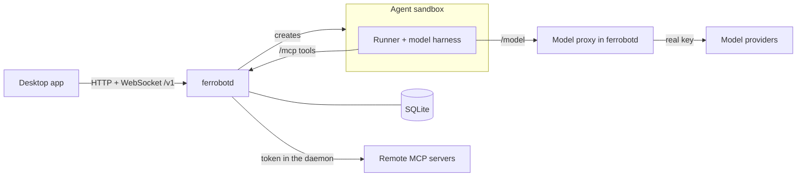

<div align="center">


# ferrobot

**A self-hosted team of AI agents. Each one gets its own computer.**

[](https://github.com/byQuexo/ferrobot/actions/workflows/ci.yml)
[](#contributing-security-license)
[](https://github.com/byQuexo/ferrobot/releases/tag/v0.1.12)
[](#download)
[](#download)

![ferrobot demo: you ask your main agent nova for a launch countdown page; it asks which style you want on a question card, then asks to create a teammate and you approve; the new agent builder appears in the sidebar with its avatar and profile, works through its steps on its own computer and shares countdown.html, previewed live in the chat; builder's Docker computer; builder's report to nova and nova's reply; the note nova saved in its memory; Usage with the Claude plan limits and the estimated cost of the Claude Code calls](docs/assets/demo.gif)

</div>


https://github.com/user-attachments/assets/183205f8-f6f2-4629-8183-7283265edea4


## Why ferrobot

ferrobot is a small Rust daemon on your machine and a thin desktop app on top.
Every agent gets its own sandboxed computer, a mailbox to you and the other
agents, a memory and a schedule, and works with the model you pick. Model keys
never enter a sandbox: agents reach their model through the daemon's proxy,
which adds the real key.

## Features

### Agents and chat

- **Agents.** Profiles with animated avatars and up to five tags; pin and
  reorder them. On first run Ferro walks you through Docker and a model
  provider, then becomes your main agent and builds a team when a job needs one.
- **Chat.** Streamed replies with tables, Mermaid diagrams and live HTML
  previews; attach files with the paperclip, drag and drop or paste; agents
  react to your messages with an emoji and you to theirs; a New line where
  unread turns start; drafts kept per chat; ⌘↵ sends ahead of a running turn.
- **Question cards.** Agents ask you single choice, multiple choice or free
  text questions right in the chat.
- **Model and context.** A model switch in the chat header and a ring showing
  how full the context is, with New chat (and Compact now for Claude Code).
- **Group chats.** Write once and every member answers in turn, or
  `@`-mention one agent and only it answers; a line shows who is writing, and
  names take each agent's colour. Call the group to talk it over by voice.
- **Traces.** A reply's steps open its turn on a timeline of model and tool
  calls, with timings and failures; export them over OTLP to Phoenix, Langfuse
  or any OpenTelemetry backend ([Traces](docs/wiki/Traces.md)).

### Teamwork

- **Mail and tasks between agents.** Agents message each other with
  `@name` mentions, delegate tasks and get the answers back automatically,
  even while they sleep; mail wakes a sleeping agent.
- **Agents create agents.** A new teammate waits for your Approve/Decline
  card unless Auto mode is on; it never gets more tools than its creator, and
  an agent limit applies.
- **Subagents.** Agents split work into parallel subtasks with the same model
  and tools.

### A computer per agent

- **Sandboxes.** A Docker container per agent with a persistent home, warm and
  cold sleep, snapshots, and encrypted archives for idle agents.
- **CLIs.** Keyless Debian packages such as `jq`, `pandoc` or `ffmpeg`, built
  into one shared sandbox image.
- **Files and share links.** Files from an agent's computer open in the chat;
  shared HTML and PDF files preview under their card, behind signed links.

### Keys and permissions

- **Keys stay in the daemon.** A model proxy swaps in the real key; keys live
  in the OS keychain and are managed in one Vault in Settings. No card ever
  asks for a key.
- **Tool profiles.** Per-agent tool groups and connectors, enforced by the
  daemon. Risky steps (deleting a folder, `git push`, connector calls that
  send things) wait for your card unless Auto mode is on; dangerous ones are
  always refused ([Tools and permissions](docs/wiki/Tools-and-Permissions.md)).

### Models

- **Providers and drivers.** Claude (Agent SDK), any OpenAI-compatible API
  including local Ollama, OpenAI Codex, Gemini, Gemini CLI, OpenRouter, Amazon
  Bedrock and Google Vertex AI, each with a model picker; OpenRouter with
  prompt caching for Claude models and sticky routing per agent.
- **Claude Code (your own login).** Opt-in: runs your own, unmodified `claude`
  CLI with your own subscription; it uses your seat's limits and ferrobot
  never touches the login. Its calls show in Usage with an estimate at API
  prices. Hooks, plugins and Claude Code's own subagents are set in
  Settings → Claude Code
  ([Providers](docs/wiki/Providers.md#claude-code-your-own-login)).

### Tools, routines and memory

- **MCP connectors.** Remote MCP servers with token or OAuth sign-in, a
  grouped catalog and a connection check, plus local servers (an `npx`
  server, say) that ferrobot starts on this computer with a cleared
  environment. Agents propose a connector on a card that shows its URL or
  exact command.
- **Routines.** Prompts on a cron schedule; agents can set up their own after
  you approve a card ([clip](docs/assets/clips/routine.mp4)).
- **Memory.** Per-agent memory with full-text search, plus a global memory
  every agent can read; or keep it all as Markdown notes in your Obsidian
  vault (Settings → Global memory) ([clip](docs/assets/clips/memory.mp4)).

### Voice, usage and the app

- **Voice.** Dictation, and calls with an agent read aloud as it streams;
  up to four agents share a call room and talk to each other; speed,
  push-to-talk and volume in the call bar ([video](docs/assets/voice-room.mp4)).
- **Usage and costs.** Tokens and estimated costs per agent, model and
  provider, a daily chart and CSV export ([clip](docs/assets/clips/usage-csv.mp4));
  OpenRouter calls at the cost it reports; Claude Code and Codex plan limits.
- **Desktop app.** macOS and Windows, starts its own daemon; ⌘K and keyboard
  shortcuts, Appearance (theme, accent colour, text size), Diagnostics, and
  the guides in Settings, which agents can read to walk you through a setting;
  a note when a new release is out. Any other client can use the daemon's
  versioned `/v1` API.

## Architecture



The desktop app holds no business logic; it is one client of the daemon's
versioned API. More in the [wiki](docs/wiki/Architecture.md).

## Download

Version 0.1.12 on the [release page](https://github.com/byQuexo/ferrobot/releases/tag/v0.1.12):
`ferrobot_0.1.12_universal.dmg` (macOS, Apple silicon and Intel) and
`ferrobot_0.1.12_x64-setup.exe` (Windows); `SHA256SUMS` lists the checksums.
The app needs [Docker Desktop](https://www.docker.com/products/docker-desktop/)
and starts its own daemon.

The installers are not signed, so the system warns once:

- **macOS:** right-click (or Control-click) the app in Applications, choose
  **Open**, then **Open** again.
- **Windows:** when SmartScreen says "Windows protected your PC", click
  **More info**, then **Run anyway**.

## Quickstart (Docker + Ollama, no API key)

Under five minutes, plus two downloads of about 2 GB each.

1. Install and start [Docker Desktop](https://www.docker.com/products/docker-desktop/).
2. Install [Ollama](https://ollama.com/download) and run `ollama pull qwen2.5:3b`.
3. Install ferrobot from the [download](#download) and open it.
4. In **Settings → Model providers**, add an **Ollama** provider (no key needed).
5. Create an agent with that provider and the model `qwen2.5:3b`, and ask it:
   "Write today's date into a file and tell me what you wrote."

A 3B model proves the plumbing; for real work pick a larger model or a cloud
provider.

### Build from source

You need Rust (stable), Node.js 24 and Docker.

```sh
docker build -f runner/Dockerfile -t ferrobot-runner:dev .
cargo build -p ferrobot-daemon
./target/debug/ferrobotd --backend docker --driver mock --agent-listen 0.0.0.0:7879   # no key needed
cd apps/desktop && npm ci && npm run tauri dev                                        # the app
```

Details, tests and the release build: [Getting Started](docs/wiki/Getting-Started.md)
and [CLAUDE.md](CLAUDE.md).

## Status

ferrobot is early. The desktop app, agents in Docker and voice rooms have been
used live on macOS. Claude (Anthropic API), OpenRouter and local Ollama have
run against the real services; OpenAI, Gemini, Bedrock and Vertex have only
been tested against fakes so far. Firecracker sandboxes are experimental and
have never booted a microVM. The Windows installer is new and has had little
testing. Details:
[Roadmap](docs/wiki/Roadmap.md) and [Ideas](docs/wiki/Ideas.md).

## Contributing, security, license

- **Contributing:** see [CONTRIBUTING.md](CONTRIBUTING.md) and the
  [Code of Conduct](CODE_OF_CONDUCT.md).
- **Security:** report vulnerabilities as described in [SECURITY.md](SECURITY.md).
- **License:** MIT OR Apache-2.0, at your option ([MIT](LICENSE-MIT),
  [Apache-2.0](LICENSE-APACHE)); contributions are dual licensed the same way.

ferrobot is written from scratch; it contains no third-party code, prompts or
brand assets beyond its listed dependencies and lucide icons.
