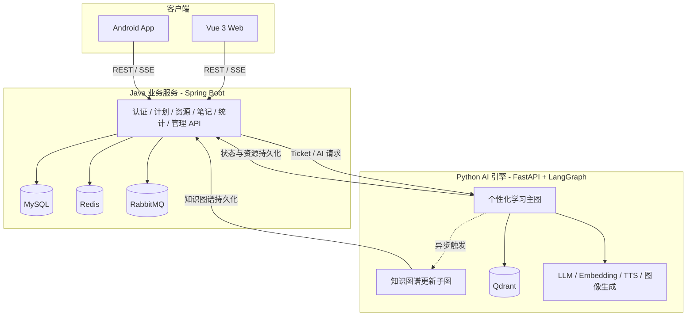
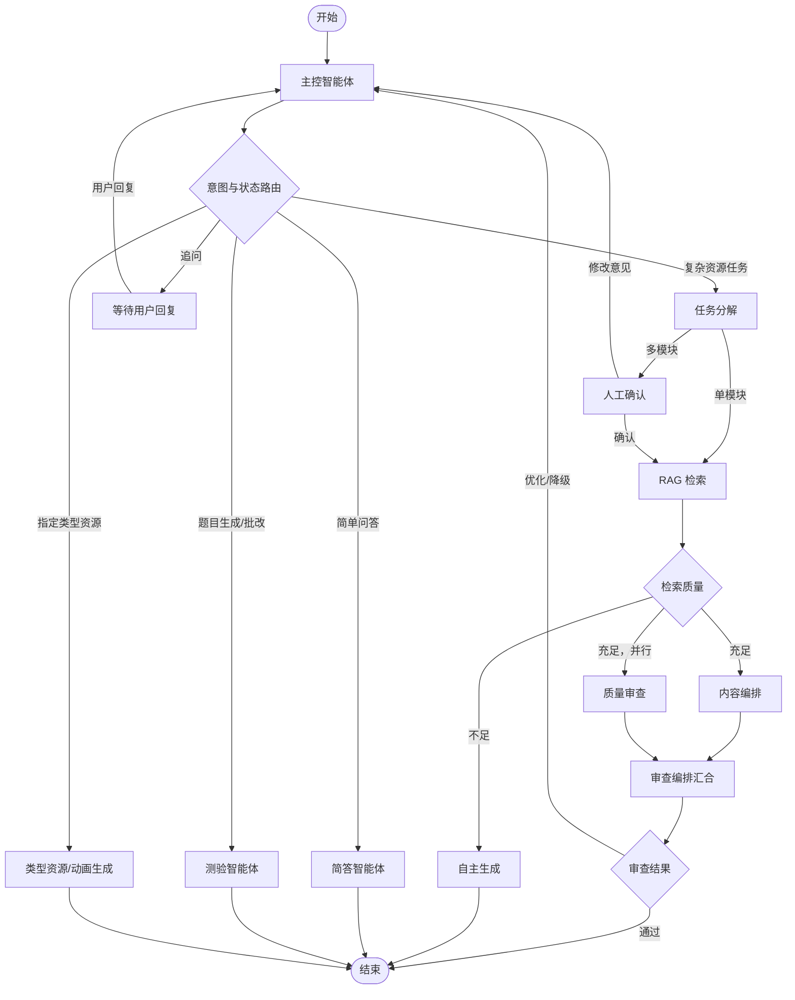
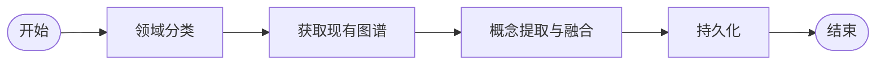

<div align="center">

# AURA-MAS 个性化多智能体学习系统

## Adaptive User-centric Resource Architecture — Multi-Agent System

基于 **LangGraph 多智能体协作**，面向学习计划、资源生成、知识管理与学习分析的一体化平台。

[](LICENSE)
[](Java-backend)
[](Java-backend)
[](Python-backend)
[](Vue-frontend)
[](Android-app)

[功能概览](#功能概览) · [界面预览](#界面预览) · [动态演示](#动态演示) · [系统架构](#系统架构) · [快速开始](#快速开始) · [部署说明](#部署说明)

[项目仓库](https://github.com/cdz-hy/aura-mas) · [问题反馈](https://github.com/cdz-hy/aura-mas/issues)

</div>

---

AURA-MAS 覆盖 Web、Android、业务服务与 AI 智能体引擎，通过 RAG、多模态生成、质量审查和用户画像持续生成适配学习目标的内容。

## 功能概览

| 能力 | 说明 |
| --- | --- |
| 多智能体协作 | 主控调度、任务分解、RAG 检索、内容编排、质量审查及异常回退协同执行 |
| 多模态学习资源 | 支持图文、题目、教学动画、视频、思维导图、播客等资源 |
| 个性化学习计划 | 结合学习目标与用户画像生成计划，跟踪模块进度和学习行为 |
| 对话式学习 | 通过 SSE 流式呈现回答、生成状态与智能体处理过程 |
| 知识管理 | 提供知识树、知识图谱、笔记、闪卡及错题辅导能力 |
| 学习分析 | 汇总学习时长、活跃度、掌握情况和效率趋势 |
| 多端访问 | 提供 Vue 3 Web 应用和 Jetpack Compose Android 应用 |
| 管理能力 | 支持用户、知识库、AI 补充资源、Token 用量和系统日志管理 |

---

## 界面预览

> 图片来自项目实际 Web 界面。点击图片可查看原图。

### 用户端

<p align="center">
  <a href="Vue-frontend/public/pictures/用户首页.png">
    
  </a>
  <br />
  <sub>用户首页</sub>
</p>

<table>
  <tr>
    <td width="50%" align="center">
      <a href="Vue-frontend/public/pictures/用户计划界面.png"></a><br />
      <sub>学习计划</sub>
    </td>
    <td width="50%" align="center">
      <a href="Vue-frontend/public/pictures/用户计划详情界面-图文资源.png"></a><br />
      <sub>图文学习资源</sub>
    </td>
  </tr>
  <tr>
    <td width="50%" align="center">
      <a href="Vue-frontend/public/pictures/用户计划详情界面-题目资源.png"></a><br />
      <sub>题目资源</sub>
    </td>
    <td width="50%" align="center">
      <a href="Vue-frontend/public/pictures/用户计划详情界面-动画资源.png"></a><br />
      <sub>教学动画资源</sub>
    </td>
  </tr>
  <tr>
    <td width="50%" align="center">
      <a href="Vue-frontend/public/pictures/用户计划详情界面-视频资源.png"></a><br />
      <sub>网络教学视频</sub>
    </td>
    <td width="50%" align="center">
      <a href="Vue-frontend/public/pictures/用户计划详情界面-导图资源.png"></a><br />
      <sub>思维导图资源</sub>
    </td>
  </tr>
  <tr>
    <td width="50%" align="center">
      <a href="Vue-frontend/public/pictures/用户计划详情界面-播客资源.png"></a><br />
      <sub>播客资源</sub>
    </td>
    <td width="50%" align="center">
      <a href="Vue-frontend/public/pictures/用户笔记界面与闪卡.png"></a><br />
      <sub>笔记与闪卡</sub>
    </td>
  </tr>
  <tr>
    <td width="50%" align="center">
      <a href="Vue-frontend/public/pictures/用户学习分析界面.png"></a><br />
      <sub>学习分析</sub>
    </td>
    <td width="50%" align="center">
      <a href="Vue-frontend/public/pictures/用户学习画像界面.png"></a><br />
      <sub>学习画像</sub>
    </td>
  </tr>
  <tr>
    <td width="50%" align="center">
      <a href="Vue-frontend/public/pictures/用户知识图谱界面.png"></a><br />
      <sub>知识图谱</sub>
    </td>
    <td width="50%" align="center">
      <a href="Vue-frontend/public/pictures/用户设置界面.png"></a><br />
      <sub>用户设置</sub>
    </td>
  </tr>
</table>

### 管理端

<p align="center">
  <a href="Vue-frontend/public/pictures/管理员首页.png">
    
  </a>
  <br />
  <sub>管理后台首页</sub>
</p>

<table>
  <tr>
    <td width="50%" align="center">
      <a href="Vue-frontend/public/pictures/管理员pdf知识库管理界面.png"></a><br />
      <sub>PDF 知识库管理</sub>
    </td>
    <td width="50%" align="center">
      <a href="Vue-frontend/public/pictures/管理员AI生成补充资源管理界面.png"></a><br />
      <sub>AI 补充资源管理</sub>
    </td>
  </tr>
  <tr>
    <td width="50%" align="center">
      <a href="Vue-frontend/public/pictures/管理员token调用界面.png"></a><br />
      <sub>Token 调用统计</sub>
    </td>
    <td width="50%" align="center">
      <a href="Vue-frontend/public/pictures/管理员日志界面.png"></a><br />
      <sub>系统日志</sub>
    </td>
  </tr>
</table>

---

## 动态演示

> 动图文件较大，按需展开查看。

<details>
<summary><strong>图文学习资源</strong></summary>
<br />

</details>

<details>
<summary><strong>对话式资源生成</strong></summary>
<br />

</details>

<details>
<summary><strong>播客类型资源</strong></summary>
<br />

</details>

<details>
<summary><strong>教学动画资源</strong></summary>
<br />

</details>

<details>
<summary><strong>测验作答与个性化错题辅导</strong></summary>
<br />

</details>

<details>
<summary><strong>网络教学视频</strong></summary>
<br />

</details>

<details>
<summary><strong>随学更新知识图谱</strong></summary>
<br />

</details>

---

## 系统架构



### LangGraph 主工作流

主图由主控智能体动态识别意图，并在任务分解、RAG 检索、内容生成、并行审查、人工确认与异常回退之间路由。



### 知识图谱更新子图

图文资源生成完成后，辅助工作流在后台完成领域识别、旧图加载、概念融合和持久化，不阻塞主对话响应。



---

## 技术栈

| 层级 | 主要技术 |
| --- | --- |
| Web 前端 | Vue 3.5、TypeScript 5.7、Vite 6、Pinia、Tailwind CSS、ECharts、Mermaid |
| Android | Kotlin 2.1、Jetpack Compose、Hilt、Room、Retrofit、OkHttp |
| Java 后端 | Java 21、Spring Boot 3.2.5、Spring Security、MyBatis-Plus、JWT |
| Python 后端 | FastAPI、LangGraph、LangChain、Qdrant Client、FastEmbed |
| 数据与消息 | MySQL、Redis、RabbitMQ、Qdrant |
| AI 与多媒体 | DashScope、MiMo、Volcengine Ark、MinerU、七牛云、Playwright、FFmpeg |
| 测试 | JUnit、Vitest、Playwright、Pytest、Android Instrumentation |

## 项目结构

```text
AURA-MAS/
├── Android-app/       # Kotlin + Jetpack Compose 移动端
├── Java-backend/      # Spring Boot 业务服务与数据持久化
├── Python-backend/    # FastAPI、LangGraph、RAG 与多模态生成
├── Vue-frontend/      # Vue 3 Web 用户端与管理端
├── deploy/            # 通用及 Ubuntu 部署文档
├── docs/              # 补充项目文档
├── docker-compose.yml # Redis、RabbitMQ、Qdrant
└── README.md
```

---

## 快速开始

### 环境要求

| 依赖 | 建议版本 | 用途 |
| --- | --- | --- |
| JDK | 21+ | Java 后端 |
| Maven | 3.9+ | Java 构建 |
| Python | 3.11+ | AI 引擎 |
| Node.js | 18+ | Web 前端 |
| MySQL | 8.0+ | 核心业务数据 |
| Docker / Compose | 推荐 | 快速启动 Redis、RabbitMQ、Qdrant |
| Android Studio | 最新稳定版 | Android 构建与调试 |

> FFmpeg 与 Playwright Chromium 仅在导出 H.264/AAC 教学动画视频时需要。

### 1. 获取项目

```bash
git clone https://github.com/cdz-hy/aura-mas.git
cd aura-mas
```

### 2. 准备 MySQL

创建数据库，Java 后端启动时会通过 `schema.sql` 与 `data.sql` 初始化结构和基础数据。

```sql
CREATE DATABASE learning_system
  CHARACTER SET utf8mb4
  COLLATE utf8mb4_unicode_ci;
```

Java 本地配置可参考：

```text
Java-backend/src/main/resources/application-example.yml
```

请至少配置数据库密码、JWT 密钥和内部服务密钥；Java 的 `INTERNAL_SECRET` 必须与 Python 的 `JAVA_SERVICE_SECRET` 保持一致。

### 3. 启动基础服务

```bash
docker compose up -d
```

该命令启动 Redis、RabbitMQ 与 Qdrant。MySQL 不包含在当前 Compose 文件中，需单独准备。

### 4. 启动 Java 后端

```bash
cd Java-backend
mvn spring-boot:run
```

默认地址：`http://localhost:8080`

### 5. 启动 Python AI 引擎

```bash
cd Python-backend
python -m venv .venv
# Windows: .venv\Scripts\activate
# macOS/Linux: source .venv/bin/activate
pip install -r requirements.txt
cp .env.template .env
# 编辑 .env，将 PORT 设为 8002
python main.py
```

> Vue 前端与 Java 后端均默认连接 `localhost:8002`，Python `.env` 中 `PORT` 必须设为 `8002`。

FastAPI 文档：`http://localhost:8002/docs`

如需动画视频导出，再安装以下运行时：

```bash
python -m playwright install chromium
```

同时确保系统已安装 `ffmpeg` 与 `ffprobe`。

### 6. 启动 Web 前端

```bash
cd Vue-frontend
npm ci
npm run dev
```

默认地址：`http://localhost:5173`

### 7. 构建 Android 应用

```bash
cd Android-app
./gradlew assembleDebug
```

Windows 也可执行：

```powershell
gradlew.bat assembleDebug
```

Android 应用支持在设置界面调整 Java 与 Python 服务地址。

---

## 常用命令

| 模块 | 开发 / 运行 | 测试 / 构建 |
| --- | --- | --- |
| Vue | `npm run dev` | `npm run test` / `npm run test:e2e` / `npm run build` |
| Java | `mvn spring-boot:run` | `mvn test` / `mvn package` |
| Python | `python main.py` | `pytest` |
| Android | Android Studio | `./gradlew test` / `./gradlew assembleDebug` |

## API 与服务

| 服务 | 默认地址 | 说明 |
| --- | --- | --- |
| Vue Web | `http://localhost:5173` | 用户端与管理端 |
| Java API | `http://localhost:8080` | 核心业务 API；Swagger 路径受安全配置约束 |
| Python AI | `http://localhost:8002` | 推荐本地联调端口 |
| FastAPI Docs | `http://localhost:8002/docs` | Python API 文档 |
| RabbitMQ 管理台 | `http://localhost:15672` | 仅绑定本机 |
| Qdrant | `http://localhost:6333` | 向量数据库 |

Python 路由主要分为：

- `/api/ai/*`：对话、计划、资源、知识树、知识图谱、闪卡和动画等 AI 能力
- `/api/v1/kb/*`：知识库管理
- `/api/analytics/*`：学习分析

---

## 配置说明

- 不要提交 `.env`、生产密钥、邮箱授权码或云存储凭证。
- Python 配置模板位于 `Python-backend/.env.template`。
- Java 配置模板位于 `Java-backend/src/main/resources/application-example.yml`。
- Redis 不可用时，部分验证码、限流及缓存能力可降级；RabbitMQ 不可用会影响异步任务；Qdrant 不可用会影响 RAG 与知识库能力。
- 七牛云用于头像、文档及多媒体资源上传；相关功能需配置有效的 Bucket 与访问域名。

## 部署说明

- [通用部署指南](deploy/DEPLOY_GUIDE.md)
- [Ubuntu 部署指南](deploy/DEPLOY_UBUNTU.md)

## 许可证

本项目基于 [MIT License](LICENSE) 开源。

## 反馈与贡献

欢迎通过 [Issues](https://github.com/cdz-hy/aura-mas/issues) 提交问题或建议，也欢迎发起 Pull Request。
