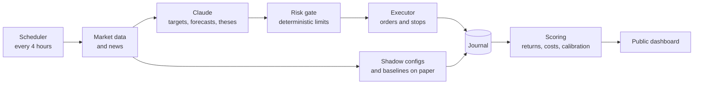

# AI Hedge Fund

An open-source Python experiment that runs a trading fund in public across 11 perpetual futures markets. Claude proposes, code disposes. Every decision is journalled, scored and published.

[](https://github.com/chase-manning/ai-hedge-fund/actions/workflows/ci.yml)
[Dashboard](https://chase-manning.github.io/ai-hedge-fund/)


## What it does

Cycles are 4-hour slots, currently started by hand. In one run, `fund`:

- Takes a snapshot of 11 perpetual futures markets on Hyperliquid: 2 US stock indices, 4 US stocks, gold, WTI crude oil, USD/JPY, bitcoin and ether.
- Asks Claude for a target weight, the probability the price is higher in 24 hours, a stop and a short thesis for each market.
- Passes that proposal through a deterministic risk gate. The model never sends an order.
- Executes the gated book on Hyperliquid only when a live mode is on, and always keeps paper books for all model configurations and 4 rule-based baselines.
- Journals the inputs, decisions, reasoning summaries, gate decisions, orders and costs, then publishes them.

## How it is built

1. **A workflow, not an agent loop.** Each cycle runs a fixed sequence of steps in order and calls Claude only for the optional news digest and trade proposals. It is easier to inspect when something looks wrong.
2. **Claude proposes, code disposes.** Claude outputs target weights, probabilities, stops and a short thesis. Deterministic code enforces the risk limits and sends orders.
3. **Small blast radius.** A dedicated wallet, an agent key that cannot withdraw, a $1,000 live equity ceiling, stops placed on the exchange and a 20% drawdown halt keep a bad cycle from growing.
4. **Glass box.** Every input, output, reasoning summary, gate decision, order and cost is journalled and published to a git branch.
5. **Forward only evaluation.** Language models have memorised prices up to their training cutoff, so a backtest over that period is contaminated. Hiding tickers or dates does not fix it. Results are scored forward from the first published cycle, with fees, funding and model costs included.
6. **Fail closed.** A failure in data, a decision or execution adds no new risk for that cycle.
7. **Pure core, thin shell.** Features, the risk gate, sizing, accounting and scoring are pure functions. Network calls live in a few modules, so the core can be tested without keys.

## Architecture



| Module | Role |
| --- | --- |
| `cycle.py` | Runs one cycle in a fixed order. |
| `data/` | Public market data, features and the snapshot. |
| `brain/` | Prompts, Claude calls, the news digest and the offline fake model. |
| `risk/` | The deterministic gate. |
| `execution/` | Turns gated weights into orders and stops. |
| `venues/` | Paper accounting and the execution venue. |
| `journal/` | Cycle records, forecasts, equity and transcripts. |
| `scoring/` | Returns, costs, Brier score and calibration. |
| `dashboard/` | The static research site. |
| `cli.py` | `fund run`, `status`, `score`, `dashboard`, `halt`, `resume`, `doctor`, `replay`. |

## Safety

Real orders, when enabled, pass through every layer below.

- The trading wallet is dedicated to this project. Its private key is never stored here.
- The agent key can trade and cannot withdraw.
- Live orders are refused when live equity is above `max_live_equity_usd` ($1,000) in `fund.toml`.
- The risk gate caps weight per market, gross exposure, net exposure and new risk per cycle. In closed markets (US market hours for stocks, indices, commodities and FX), it blocks new positions, flips and increases, but reductions and holds still pass. Positions cannot flip again within 12 hours.
- Stops are placed on the exchange after fills.
- A 20% drawdown from the high water mark halts and flattens the book.
- `fund halt` stops the next cycle. `fund halt --flatten` also closes the live book.
- Autonomy defaults to approve, which prints the gated plan and waits for a person.
- Mainnet trading stays off unless `FUND_ALLOW_MAINNET` is `yes`.

## Results

The public dashboard is the record: [chase-manning.github.io/ai-hedge-fund](https://chase-manning.github.io/ai-hedge-fund/).

Figures start at the first published cycle. There is no backtest, because language models have memorised price history up to their training cutoff. Fees, funding and model costs are included. Until there are hundreds of cycles, treat any result as an anecdote about this experiment, not evidence of an edge.

## Quickstart

Install [uv](https://docs.astral.sh/uv/) and Python 3.13, then:

```bash
uv sync
uv run fund run --mode paper --fake-llm
uv run fund status
uv run fund score
uv run fund dashboard --out site
```

That path needs no API keys. The `--fake-llm` flag uses an offline model whose weights follow the gap to the 20 day average.

With `ANTHROPIC_API_KEY` in `.env`:

```bash
uv run fund doctor
uv run fund run --mode paper
uv run fund dashboard --out site
open site/index.html
```

Copy `.env.example` to `.env` and fill in only the keys you are using.

## Configuration

`fund.toml` holds the fund name, cycle length, paper starting equity, daily model budget, journal directory and autonomy mode. It sets the champion, shadows, model IDs, token prices, news digest switch and search limit. The risk section is the gate: per market weight, gross and net exposure, new risk, minimum trade weight, daily loss, drawdown, flip cooldown, pre-weekend cap, stop range and class caps. The execution section is leverage, minimum order size, mainnet and testnet slippage, price gap limit and live equity ceiling. The paper section holds fill slippage and fees. The universe lists the 11 markets.

## Running with real orders

Start on testnet with a new, dedicated wallet. Fund it with a small mainnet deposit so you can claim the testnet faucet, then run `scripts/setup_agent.py` to create an agent key that can trade but cannot withdraw. Put the address and testnet agent key in `.env`. Never put the wallet private key in `.env`.

The `autonomy` setting in `fund.toml` applies only to the real venue:

- `paper` never sends a real order.
- `approve` (the default) prints the gated plan and waits for a person to confirm it.
- `auto` sends the gated plan directly. Use this for unattended runs only after you have watched `approve` mode.

`fund run --mode testnet` uses test funds. `fund run --mode live` is refused unless `FUND_ALLOW_MAINNET=yes` is set. `fund halt --flatten --mode testnet` stops the next cycle and closes the book. `fund resume` clears the halt after you confirm.

Hyperliquid's testnet faucet pays 1,000 mock USDC only to an address that has already made a mainnet deposit. The minimum mainnet deposit is 5 USDC. There is no way around that step.

## Automation

`.github/workflows/cycle.yml` runs one cycle, scores it, builds the static dashboard and publishes the journal branch and GitHub Pages. Start it by hand from the GitHub Actions tab, or run `gh workflow run cycle.yml -f mode=paper`.

The 4 hour schedule in the workflow is commented out, so cycles do not run automatically. Pushing code does not spend the model budget on its own. To turn unattended runs on, uncomment the schedule, add `ANTHROPIC_API_KEY` as an Actions secret and set the repository variable `FUND_MODE` to `paper`. GitHub disables scheduled workflows on a public repository after 60 days without activity.

## Development

```bash
make check
```

That runs ruff, pyright and pytest with coverage. Live network tests are marked `live` and stay off unless you pass `-m live`.

Offline tests use recorded market responses in `tests/fixtures/` and `FakeClaude`. Golden prompt files live in `tests/golden/`. Update them with `uv run pytest tests/test_render.py --update-golden` only when a prompt change is intentional.

To add a model configuration, create a catalogue entry and list its `model/style` ID under `shadows` in `fund.toml`. `style` is `single` or `team`. Only the champion can trade the real account.

`fund replay tests/fixtures/snapshot_real.json --times 3` reruns the champion on a saved snapshot and sends no orders. It needs `ANTHROPIC_API_KEY`.

## History

The first version was built in a day on 26 January 2025. It was a TypeScript chain of `gpt-4-turbo` agents arranged as an org chart, with employee agents reporting to a CEO agent. Each employee agent wrapped one financial data endpoint. That setup was slow and made sequential recursive calls. It had no portfolio state, risk limits or evaluation, and its fake exchange only printed. This version keeps the idea of a model proposing trades and replaces everything else. The original is preserved at the `v0-legacy` tag.

## Disclaimer

This is an experiment, not investment advice. Trading leveraged derivatives can lose money. There is no warranty.

## License

MIT. See [LICENSE](LICENSE).
