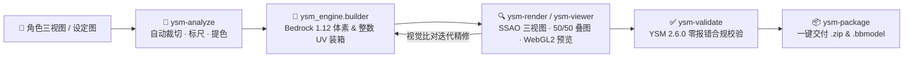

<div align="center">


<br />

# YSM AI Engine

**专为 AI Agent 打造的《我的世界》YSM 模型程序化建模、SSAO 软渲染、WebGL2 预览与合规校验引擎**

[](https://github.com/chenx5452321/ysm-ai-engine/actions/workflows/ci.yml)
[](https://github.com/chenx5452321/ysm-ai-engine/stargazers)
[](https://github.com/chenx5452321/ysm-ai-engine/network/members)
[](LICENSE)
[](https://www.python.org/)
[](#-使用指南python-api--命令行全流程)

[效果展示](#-效果展示) · [工作原理](#-端到端流水线) · [核心特性](#-核心特性) · [快速安装](#-安装与快速上手) · [3D 预览器](#第-5-步启动零依赖-webgl2-实时-3d-预览台) · [AI 协作指南](#-配合-ai-agent-使用与模型推荐) · [贡献者](#-贡献者-contributors)

</div>

---

**YSM AI Engine** 是一套面向 AI 编程助手（Antigravity、Claude Code、Cursor、Codex 等）及程序化建模工作流的开源 **Minecraft Yes Steve Model (YSM)** 研发框架。  
它让 AI 无需打开 Blockbench 图形界面，即可通过纯 Python 代码完成 **「三视图精确量尺 → 程序化体素建模与 UV 自动装箱 → 离线 SSAO / 50-50 叠图自检 & WebGL2 实时预览 → YSM 2.6.0 零报错校验 → 一键打包 `.zip` 与 `.bbmodel`」** 全链路生产。

> [!TIP]
> **AI 模型选型推荐**：强烈推荐使用 **Gemini 4 Neon 及以上** 或 **GPT 6.2 Sol 及以上**；Claude 系列暂无实测参考；**不推荐使用 DeepSeek v4.1 Flash**（详见 [推荐模型选型](#推荐模型选型)）。

---

## ✨ 效果展示

以下效果图完全由本引擎从零程序化生成（内置完整示例 [`examples/skull_hoodie_girl`](examples/skull_hoodie_girl)），并使用内置 **切平面修正 SSAO 软渲染器** 离线出图对比验证：

### 1. 正 / 左正侧 / 背正交三视图 & 3/4 视角对比
<p align="center">
  
</p>

### 2. 50/50 叠图精准对齐校验（`ysm-render overlay`）
<p align="center">
  
</p>

### 3. 纯白模 SSAO 体块厚度自检 & 动画姿态检验
| 纯白模 SSAO（体块与层次检查） | 基础动作绑定实拍（`idle / walk / run / sneaking / jump / sit`） |
| :---: | :---: |
|  |  |

---

## 🔄 端到端流水线



---

## 🚀 核心特性

| 模块 | 核心能力 |
| :--- | :--- |
| **🧱 程序化建模与自动 UV**<br>`ysm_engine.builder` | 内置 Bedrock `1.12.0` 骨骼树构建、X=0 自动对称镜像（`add_mirrored_cube`，自动翻转旋转符号与左右贴图）、纯色/渐变/像素绘制回调（`face_painter`）；`ShelfPacker` 自动装箱生成**零重叠非零整数 per-face UV**，并为每个面保留私有 **1px bleed gutter**（边缘像素外扩，避免线性采样串色）；一键提取第一人称手臂 `models/arm.json`。 |
| **🎥 零 GPU SSAO 软渲染器**<br>`ysm_engine.renderer` | 纯 NumPy + PIL 实现，无需启动游戏或显卡上下文即可高速出图：支持**三点棚拍柔光 + 切平面修正 SSAO**、自动包围盒定焦、**`50/50` 叠图精准对齐**、Molang 动画姿态批量渲染与骨骼枢轴可视化。 |
| **🌐 原生 WebGL2 3D 预览台**<br>`ysm_engine.viewer` | 零前端构建依赖、零第三方 JS 库，启动 `ysm-viewer` 即可在浏览器实时查看模型；支持 `.zip` / `.bbmodel` / 文件夹拖拽、逐骨骼调姿、动画播放、环境光与 360° 天空盒/HDR 光照检视。 |
| **📏 参考图定量分析器**<br>`ysm_engine.analyze_ref` | 自动切分 1/2/3 视图设定图、统一脚底到头顶像素标尺、提取主色调色板，导出 Bedrock 单位网格标尺图（`ref_ruler.png`）与轮廓宽高测量 JSON。 |
| **✅ 严格校验 & 双格式交付**<br>`validate` / `export_bbmodel` / `package` | 自动校验 UTF-8 无 BOM、`ysm.json` `spec=2`、文件路径大小写、整数非零 UV、18 项核心骨骼与 Locator 嵌套、`arm.json` 及 29 个基础动作；0 错误后一键输出游戏可用的 `.zip` 与可编辑的 `.bbmodel`。 |
| **🤖 AI Agent 协作规范**<br>`prompts/` | 内置 [`prompts/AGENT_GUIDE.md`](prompts/AGENT_GUIDE.md) 与 [`prompts/SKILL.md`](prompts/SKILL.md)，让 AI 直接掌握 Bedrock 旋转正负号、独立眼部图层、分层片状发丝与 4 阶段视觉自检闭环。 |

---

## 📦 安装与快速上手

环境要求：**Python 3.9+**（仅需轻量依赖 `numpy` 与 `pillow`）。

### 方式 A：可编辑安装（推荐，全局使用 CLI 与 Python 包）

```bash
git clone https://github.com/chenx5452321/ysm-ai-engine.git
cd ysm-ai-engine
pip install -e .
```

安装后即可在任意项目目录下直接使用全部 **6 个 CLI 命令**：

| 命令 | 用途说明 |
| :--- | :--- |
| `ysm-analyze` | 分析参考三视图并生成 Bedrock 单位标尺与色板数据 |
| `ysm-render` | 渲染白模 SSAO、正交三视图对比、特写、50/50 叠图、动作与骨骼枢轴 |
| `ysm-viewer` | 启动本地零依赖 WebGL2 3D 交互预览与逐骨骼调姿台 |
| `ysm-validate` | 执行 YSM 2.5 / 2.6.0 全项合规校验（必须 `0 errors`） |
| `ysm-package` | 校验并一键打包游戏安装包 `.zip` 与 Blockbench 工程 `.bbmodel` |
| `ysm-export-bbmodel` | 单独将 `main.json` + 贴图 + 动画导出为 `.bbmodel` |

### 方式 B：零安装即拷即用（Portable 模式）

1. 安装依赖：`pip install -r requirements.txt`
2. 将整个 `ysm_engine/` 目录直接复制到你的新模型项目根目录；
3. 在脚本中 `from ysm_engine import YSMModel, ...`，或通过 `python -m ysm_engine.validate ...` 直接调用。

### 一键运行内置示例与回归测试

```bash
# 1. 一键复现 skull_hoodie_girl 全部渲染、校验与 .zip / .bbmodel 产物
python examples/skull_hoodie_girl/run_all.py

# 2. 启动 3D 预览器实时查看刚刚生成的模型
ysm-viewer examples/skull_hoodie_girl/out/skull_hoodie_girl

# 3. 运行全链路单元测试
python -m unittest discover -s tests -v
```

<details>
<summary>📂 <b>点击展开完整仓库目录结构</b></summary>

```text
ysm-ai-engine/
├── README.md                          # 本文档
├── CONTRIBUTING.md                    # 贡献指南
├── LICENSE                            # Beerware 啤酒开源协议
├── pyproject.toml                     # 包配置与 6 个 CLI 入口
├── requirements.txt                   # 轻量依赖 (numpy, pillow)
│
├── .github/                           # CI 自动化测试与 Issue 模板
│   ├── workflows/ci.yml
│   └── ISSUE_TEMPLATE/
│
├── assets/                            # 仓库视觉资源（Banner 与贡献者头像）
│   ├── banner.png
│   └── contributors/gemini.png
│
├── ysm_engine/                        # 核心引擎包（支持 pip 安装或直接拷贝复用）
│   ├── __init__.py
│   ├── builder.py                     # YSMModel, ShelfPacker, 像素绘图工具, arm.json 提取
│   ├── renderer.py                    # BedrockScene, 切平面 SSAO, 三视图/白模/50-50 叠图/动作/骨骼渲染
│   ├── analyze_ref.py                 # 参考三视图自动裁切、像素标尺与色板测量
│   ├── validate.py                    # YSM 2.5 / 2.6.0 合规校验器
│   ├── export_bbmodel.py              # Blockbench .bbmodel 导出器
│   ├── package.py                     # 校验 + .zip / .bbmodel 打包器
│   ├── viewer.py                      # 零依赖本地 WebGL2 3D 模型预览器服务 (ysm-viewer)
│   └── viewer_static/                 # 纯原生 WebGL2 展示与骨骼调姿前端资源
│
├── prompts/                           # AI Agent 上下文规范与 Skill 模板
│   ├── AGENT_GUIDE.md                 # AI 建模 SOP、Bedrock 坐标系与 YSM 2.6.0 硬性规范
│   └── SKILL.md                       # 可直接导入 Antigravity / Claude Code / Cursor 的 Skill 文件
│
├── examples/                          # 完整可复现示例工程
│   └── skull_hoodie_girl/
│       ├── reference/reference_3view.jpg
│       ├── build_model.py             # 28 根骨骼、169 个体素、独立 3×2 眼部图层与片状长发建模源码
│       ├── build_animations.py        # 29 个基础动作、arm 动画与 ysm.json 清单生成
│       └── run_all.py                 # 一键复现示例全部渲染、校验与打包产物
│
├── docs/showcase/                     # README 展示效果图
└── tests/                             # 自动化全链路与预览器回归测试
    ├── test_pipeline.py
    └── test_viewer.py
```

</details>

---

## 🛠 使用指南（Python API & 命令行全流程）

### 第 1 步：分析参考三视图

```bash
ysm-analyze path/to/character_3view.jpg -o reference --height 34.0
```
自动输出 `reference/crops/ref_front.png`、`ref_side.png`、`ref_back.png`、`reference/ref_ruler.png`（带 Bedrock 单位刻度线）及 `reference/ref_analysis.json`。

### 第 2 步：编写 Python 建模脚本

```python
from ysm_engine import YSMModel

m = YSMModel(identifier="geometry.model", texture_width=512, texture_height=512, texels_per_unit=3.0)

# 1. 建立 YSM 2.6.0 标准骨骼层级
m.add_bone("All", pivot=(0, 0, 0))
m.add_bone("Waist", parent="All", pivot=(0, 12, 0))
m.add_bone("Body", parent="Waist", pivot=(0, 12, 0))
m.add_bone("AllHead", parent="Body", pivot=(0, 24, 0))
m.add_bone("Head", parent="AllHead", pivot=(0, 24, 0))
m.add_bone("ViewLocator", parent="Head", pivot=(0, 28, 0))
# ... 补全 RightArm/LeftArm/Hand/Locator 与 RightLeg/LeftLeg 等 18 项必选骨骼

# 2. 构建体素与自动对称镜像，并自动装箱整数 UV
m.add_cube("Head", origin=(-3.5, 24.0, -3.5), size=(7.0, 7.0, 7.0), solid_color="#FCF1F2")
m.add_mirrored_cube(
    "RightArm", "LeftArm",
    origin=(-6.0, 13.0, -1.8), size=(3.2, 11.0, 3.6),
    vgradient=("#F5F3FA", "#DCD8EA"),
)

# 3. 导出主几何、第一人称手臂与打包贴图
m.export_main_json("dist/my_girl/models/main.json")
m.export_arm_json("dist/my_girl/models/arm.json")
m.export_texture("dist/my_girl/textures/default.png")
```

> 更多高阶技巧（独立眼部图层 `EyeRight/EyeLeft`、定制 `face_painter` 像素画、片状多层头发与立体像素饰品）可参考 [`examples/skull_hoodie_girl/build_model.py`](examples/skull_hoodie_girl/build_model.py)。

### 第 3 步：离线 SSAO 渲染与视觉自检

```bash
# 纯白模 SSAO 体块检查
ysm-render clay dist/my_girl/models/main.json dist/my_girl/textures/default.png -o renders/clay.png

# 正交三视图 + 3/4 透视对比
ysm-render turnaround dist/my_girl/models/main.json dist/my_girl/textures/default.png --crops reference/crops -o renders/turnaround.png

# 50/50 叠图精准对齐（分别检验正面、正侧、背面）
ysm-render overlay dist/my_girl/models/main.json dist/my_girl/textures/default.png reference/crops/ref_front.png -o renders/ov_front.png --yaw 0 --ymin 22 --ymax 34.6
ysm-render overlay dist/my_girl/models/main.json dist/my_girl/textures/default.png reference/crops/ref_side.png  -o renders/ov_side.png  --yaw 90 --ymin 10.5 --ymax 34.5
ysm-render overlay dist/my_girl/models/main.json dist/my_girl/textures/default.png reference/crops/ref_back.png  -o renders/ov_back.png  --yaw 180 --ymin 10.5 --ymax 34.5

# 5 视角细节特写 & 动作姿态 & 骨骼枢轴检查
ysm-render closeups dist/my_girl/models/main.json dist/my_girl/textures/default.png --crops reference/crops -o renders/closeups.png
ysm-render poses    dist/my_girl/models/main.json dist/my_girl/textures/default.png dist/my_girl/animations/main.animation.json -o renders/poses.png
ysm-render skeleton dist/my_girl/models/main.json dist/my_girl/textures/default.png -o renders/skeleton.png
```

### 第 4 步：YSM 2.6.0 合规校验与打包

```bash
# 严格校验（必须 0 errors）
ysm-validate dist/my_girl

# 打包为可导入游戏的 .zip 与可编辑的 .bbmodel
ysm-package dist/my_girl
```

### 第 5 步：启动零依赖 WebGL2 实时 3D 预览台

```bash
# 直接启动并预加载指定模型目录（也可直接运行 ysm-viewer 后拖拽 .zip / .bbmodel / 文件夹）
ysm-viewer dist/my_girl
```

---

## 🤖 配合 AI Agent 使用与模型推荐

1. 将本仓库设为工作区，或在你的 AI Agent（Antigravity / Claude Code / Cursor / Codex 等）提示词中要求它 **先阅读 [`prompts/AGENT_GUIDE.md`](prompts/AGENT_GUIDE.md)**。
2. 也可以直接将 [`prompts/SKILL.md`](prompts/SKILL.md) 复制到你的 `.agent/skills/ysm-procedural-modeling/SKILL.md` 或 `.claude/skills/` 目录。
3. 发送角色设定图或三视图给 AI，要求它**每完成一大阶段渲染效果图向你汇报**，即可按 **4 阶段闭环流程**（量尺 → 白模 → 50/50 叠图精雕 → 动画校验打包）高还原度完成角色。

### 推荐模型选型

由于本引擎高度依赖 AI 的**多模态三视图空间理解、50/50 叠图视觉自检与长上下文迭代能力**，模型实测表现参考如下：

| 模型系列 | 推荐等级 | 说明 |
| :--- | :---: | :--- |
| **Gemini 4 Neon 及以上** | ✅ 强烈推荐 | 多模态看图对齐、三维空间还原与多轮细节精修表现稳定 |
| **GPT 6.2 Sol 及以上** | ✅ 强烈推荐 | 代码生成、坐标计算与复杂结构迭代能力扎实 |
| **Claude 系列** | ➖ 暂无参考 | 暂未针对本工作流完成系统实测 |
| **DeepSeek v4.1 Flash** | ❌ 不推荐 | 空间比例把握与复杂叠图视觉自检容易出现偏差，不建议用于精细角色还原 |

---

## 🎮 在 Minecraft 中安装生成的模型

1. 确保客户端已安装 **Yes Steve Model (YSM 2.5 / 2.6.x)** 模组；
2. 将打包好的 `*.zip`（或解压后的模型文件夹）放入 `.minecraft/config/yes_steve_model/custom/`；
3. 进入游戏执行 `/ysm model reload`，按 `Alt + Y` 即可切换使用；
4. 如需手动二次微调，直接用 **Blockbench 4.x / 5.x** 打开同目录下生成的 `*.bbmodel`。

---

## 💖 贡献者 (Contributors)

欢迎阅读 [CONTRIBUTING.md](CONTRIBUTING.md) 提交 PR 或分享你的 YSM 角色示例！

<table>
  <tr>
    <td align="center" width="180">
      <a href="https://github.com/chenx5452321">
        <br />
        <b>chenx5452321</b>
      </a><br />
      <sub>项目发起 · 策划与审核</sub>
    </td>
    <td align="center" width="180">
      <a href="https://github.com/XIE-FMount">
        <br />
        <b>XIE-FMount</b>
      </a><br />
      <sub>WebGL2 3D 预览器 (<code>ysm-viewer</code>)</sub>
    </td>
    <td align="center" width="180">
      <a href="https://github.com/1-dcjiang">
        <br />
        <b>1-dcjiang</b>
      </a><br />
      <sub>引擎精度优化 · 校验器加固与 CI</sub>
    </td>
    <td align="center" width="180">
      <a href="https://deepmind.google/technologies/gemini/">
        <br />
        <b>Gemini</b>
      </a><br />
      <sub>AI 建模引擎 · SSAO 渲染与示例</sub>
    </td>
  </tr>
</table>

---

## 📄 License

本项目基于 [THE BEER-WARE LICENSE (Revision 42)](LICENSE) 开源（历史贡献提交沿用其原有 MIT 授权）。如果这个项目帮到了你，欢迎点一个 ⭐ **Star** 支持！
