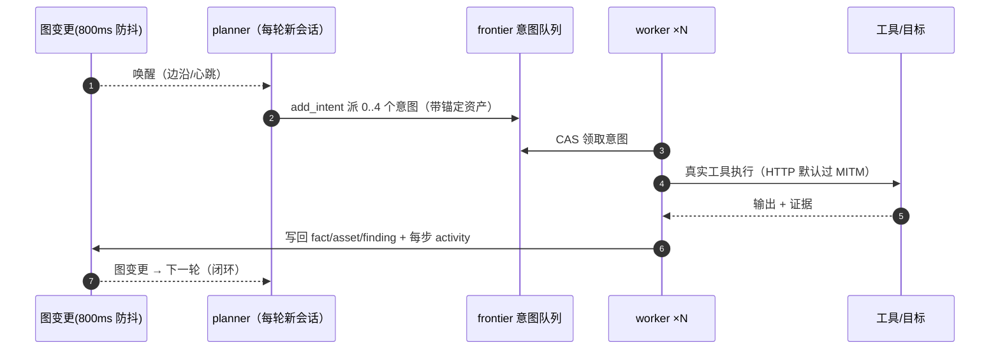
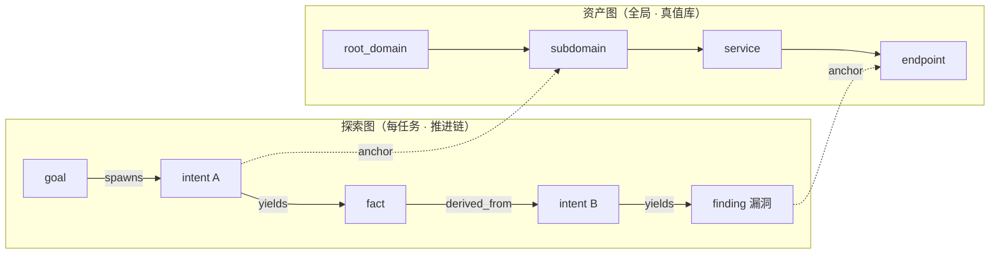
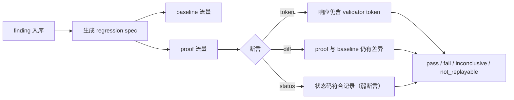
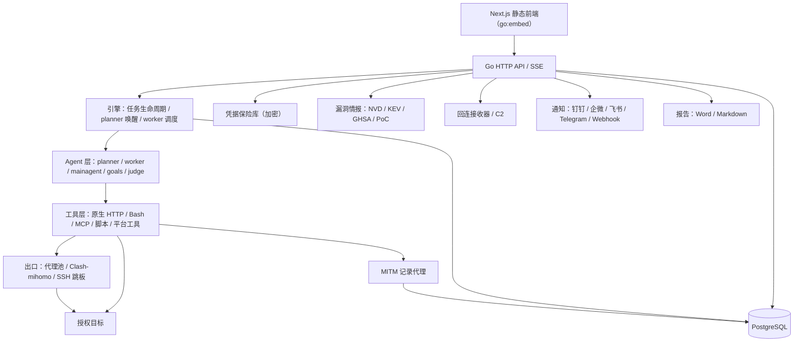
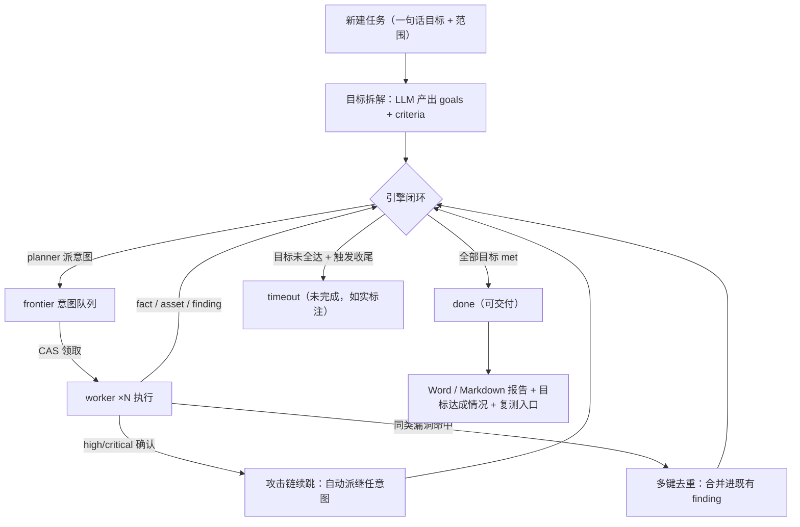

<div align="center">


# 破军 Pojun

**AI 自主渗透测试平台 · 从一句话目标到可交付漏洞报告**

> 破军，北斗第七星，主杀伐、主变局。<br/>
> 找到防线的破口，并把破口证明给你看。

[](https://github.com/chu0119/Pojun/releases)
[](https://github.com/chu0119/Pojun/actions/workflows/ci.yml)
[](LICENSE)


**Go 单体后端** · **Next.js 内嵌前端** · **PostgreSQL** · **多 Agent 自主推进** · **全程证据留痕**

📦 [一条命令安装](#快速开始) · 🧠 [单技能版 pojun-skill](https://github.com/chu0119/pojun-skill) —— 本平台方法论的单 skill 版，任意 AI Agent 即装即用

</div>

---

## 快速开始

> 依赖 **PostgreSQL**（安装脚本/Compose 自动处理）；探索需在 UI 里配置 **LLM**
> （Anthropic / OpenAI / 任意兼容网关，多通道轮询）。详细安装方式、系统选择、
> 公网部署与升级 → [安装详解](#安装详解)。

**Linux（Debian / Ubuntu / RHEL / Kali 等，root 执行，全自动交互安装）：**

```bash
curl -fsSL https://github.com/chu0119/Pojun/releases/latest/download/install.sh | sudo bash
```

**macOS 13+（Apple Silicon / Intel，一条命令，不需要 sudo）：**

```bash
curl -fsSL https://github.com/chu0119/Pojun/releases/latest/download/install.sh | bash
```

自动完成：Homebrew 检测（没有就装）→ PostgreSQL 16 安装与服务化 → 下载并
校验 darwin 包 → 生成 config.json → 注册 launchd 用户级服务（开机自启 +
崩溃自动拉起）→ 健康检查。渗透工具与 LibreOffice 等 `brew install` 按需装
（缺失工具在「宿主环境」页如实显示），详见[安装详解](#安装详解)。

**Windows / 已有 Docker（工具链全在镜像里，宿主机零安装）：**

```bash
git clone --depth 1 https://github.com/chu0119/Pojun.git pojun && cd pojun
cp .env.example .env    # Windows 用 copy；至少改 POSTGRES_PASSWORD
# Windows（Docker Desktop，WSL2 后端）：
docker compose -f docker-compose.yml -f docker-compose.windows.yml up -d
# macOS（Docker Desktop / OrbStack）：
docker compose -f docker-compose.yml -f docker-compose.macos.yml up -d
# Linux / 其他：
docker compose up -d
# → http://127.0.0.1:8787
```

> **远程主机（VPS / 云服务器）**：控制台默认只绑 `127.0.0.1`，装完在远端直接打开
> 会「拒绝连接」。先建隧道 `ssh -L 8787:127.0.0.1:8787 <user>@<host>`，再访问
> `http://127.0.0.1:8787`；或在安装时显式 `--listen=0.0.0.0:8787`（会告警，需自配
> 防火墙；公网优先走 HTTPS 反向代理，见「监听地址与暴露面」）。

**装好之后（3 分钟上手）：**

1. 浏览器打开 `http://127.0.0.1:8787` → 初始化管理员密码（≥8 位）
   （默认仅本机；跨机访问需显式放开或反向代理，见「监听地址与暴露面」）
2. 「LLM 配置」页配模型通道（≥2 个通道 + 开启轮询 = 实战推荐）；Anthropic/OpenAI/
   DeepSeek 等 OpenAI 兼容端点直接填 base_url + key + model（如 DeepSeek：
   `https://api.deepseek.com` + `deepseek-chat`/`deepseek-reasoner`）
3. 「宿主环境」页按需装工具（Docker 镜像已内置常用工具链，实际可用项以页面体检为准）
4. 新建任务，给一句话目标

---

## 目录

| | |
|---|---|
| **🚀 部署** | [快速开始](#快速开始) · [安装详解](#安装详解) · [配置速查](#配置速查) |
| **🧭 先读** | [为什么是破军](#为什么是破军) · [60 秒看懂](#60-秒看懂) · [界面速览](#界面速览) |
| **🧠 能力** | [核心能力总览](#核心能力总览) · [特色能力深潜](#特色能力深潜) · [能力深潜](#能力深潜) · [系统架构](#系统架构) |
| **📱 专项** | [微信小程序](#13-微信小程序渗透包是入口后端才是主战场) · [APK/移动端](#14-移动端与二进制apk-只是入口之一) · [源码/JS/契约](#15-源码--前端--api-契约把看不见的接口挖出来) · [出口基础设施](#17-出口基础设施代理池clashssh-跳板c2) |
| **⚖️ 差异** | [关键设计取舍](#关键设计取舍与不变量) · [与同类项目的差异](#与同类项目的差异) · [适用与不适用](#适用与不适用) |
| **🧰 资产** | [内置资产清单](#内置资产清单技能--mcp--工具) · [实战纪律](#实战纪律与安全边界) |
| **👥 参与** | [开发与贡献](#开发与贡献) · [文档索引](#文档索引) · [来源声明](#来源声明) · [许可与免责声明](#许可与免责声明) |

---

## 为什么是破军

自主渗透 Agent 最容易被误解成「让大模型连续调用扫描器」。真正跑过授权项目的人
都知道，难点不在发起扫描，而在下面四个问题：

1. **它知道自己做完了吗？** 大多数 Agent 把「模型说完成」当成完成，报告里全是
   「疑似」「可能存在」，客户无法验收。
2. **它拿得出证据吗？** 扫描器命中、版本匹配、模型推断都可以生成一条 finding，
   但拿不出可机械复现的请求/响应、命令输出与影响证明。
3. **它能在长任务里保持纪律吗？** 上下文一长就丢失目标、重复踩坑、忘记范围；
   上下文一短又接不上攻击链。
4. **它的边界可信吗？** 说「只测授权范围」，但 Bash、MCP、浏览器、代理各走各的，
   平台根本不知道真实出口和真实请求。

破军的设计目标不是「让 AI 多打几个工具」，而是把一名守纪律的渗透测试工程师的
工作方式拆成可执行的机制：**目标要可验收、发现要可证明、攻击链要能续跳、
范围要能落到代码、长任务要能收得住、成本要能算得清。**

### 它和「AI + 扫描器」的根本区别

| | 常见做法 | 破军 |
|---|---|---|
| 任务完成 | 模型自评 / 轮数用完即停 | 目标 + 验收标准 + `goal_met` 闸门；未达成强制记「未完成」 |
| 漏洞确认 | 扫描器输出直接入库 | 证据分级 + 机械验证 + 对抗式自检；critical/high 必须可复现 |
| 报告 | 把 finding 列表拼成 Markdown | Word 公文级交付：目标达成情况、流量证据、复测记录、修复路线图 |
| 长任务 | 上下文超限就遗忘 | Index / Summary / Raw 三层上下文 + 压缩 + 价值看门狗 |
| 范围控制 | 提示词里写「不要越界」 | 任务范围 + 写回守卫 + Program Profile 原生 HTTP 硬约束 |
| 出口 | 不知道流量最终从哪出去 | 每个任务构建时落只读出口回执：角色、捕获、代理池、UA |
| 质量回归 | 靠人工重跑 | 20 个内置评测场景 + 确定性 finding 回归库 |
| 攻击面 | Web 扫描为主 | 小程序 / APK / 源码 / JS / LLM / 云 / AD / 中间件 / 无线 / 合约 |
| 成本 | 单通道烧到限流 | 多通道轮询 + 熔断 + 角色路由 + 预算闸门 + 工具路由学习 |

> 破军不追求「一键打穿所有目标」。它追求的是：**在授权范围内，把能证明的漏洞
> 打深、把不能证明的结论降级、把没做完的任务如实标成没做完。**

单机实测基线（真实授权项目数据，Kali 部署）：12 个任务、56,000+ 次工具调用、
**295 个确认漏洞**（严重 28 / 高危 140）、2,752 个资产节点，全程无人值守。

### 六个别人很难一次复制的点

1. **微信小程序全链路**：不是「送一个解包脚本」，而是 wxapkg 安全解包 + 质量门禁 +
   `miniapp_audit` + A/B 越权 + 云开发/支付/开放能力 + 证据/报告。
2. **移动端/源码/JS/契约**：APK 逆向、sourcemap 还原、OpenAPI 契约枚举，最后都能回到
   平台原生 HTTP 与证据链。
3. **多攻击面**：AI/LLM、云/K8s、Windows AD、MQTT/AMQP/Kafka 等 15 个协议库、无线/硬件、
   智能合约，不是只有 Web 扫描。
4. **出口基础设施**：代理池 + Clash/mihomo + SSH 跳板 + C2 三形态 + 每任务出口回执。
5. **可组装平台**：24 Skill / 10 MCP / 92 工具 / 5 Playbook / 自定义工具与 Agent，
   全部 UI 配置，下一次装配生效。
6. **质量闭环**：目标闸门 + 证据分级 + 确定性回归 + 20 个评测场景 + OTel/命令/日志审计。

---

## 60 秒看懂

| 阶段 | 破军做了什么 |
|---|---|
| **输入** | 一句话目标 + 授权范围（域名/IP/企业主体）；可选 SRC Program Profile（平台、scope、excluded、RPS、时间窗、并发、dry-run） |
| **专项面** | 小程序（wxapkg）/ APK / 源码 / JS / AI-LLM / 云-K8s / AD / 中间件协议 / 无线 / 合约，分别加载对应 Skill 与工具链，不强行套 Web 流程 |
| **拆解** | goals Agent 产出「最终可验收目标 + criteria」，禁止把「侦察/扫描/验证漏洞」这类过程写成最终目标 |
| **编排** | planner 读取双图态势，向 frontier 派 0–4 条带锚定资产的意图；worker 用 CAS 领取，一次只做一条 |
| **执行** | 原生 `http_request` / `session_login` / 后台 job / 任务级脚本 / Bash / MCP；HTTP(S) 默认经 MITM 逐请求留痕 |
| **写回** | fact / asset / finding / hint 写回探索图与资产图；证据绑定 baseline / proof / verification / supporting 四类流量 |
| **续跳** | high/critical 确认后按漏洞类别自动派继任意图：注入→外带→登录→横向；上传→落地→能力边界；未授权→越权对照→影响评估 |
| **收尾** | 全部目标 `met` 才落 `done`；否则 timeout（未完成），列表/详情/报告三处一致标注 |
| **交付** | Word / Markdown / 一漏洞一 docx；报告附目标达成情况、证据、复测入口与修复建议 |
| **复盘** | activity 全链路可回放；评测 harness 打分；finding 回归库可手动重放 proof 流量 |

---

## 界面速览

> 以下截图全部来自 `NEXT_PUBLIC_MOCK=1` 的**纯合成演示数据**：域名统一使用 RFC
> 保留域（`*.acme.example` / `*.acme-lab.test`），IP 使用 TEST-NET / 私网网段，企业、人员、账号、口令、漏洞、
> 流量均为虚构。截图仅用于展示界面与信息结构，不代表任何真实目标或真实项目数据。

**全局态势**

| 总览：任务 / 发现 / 资产 / 流量 / Token 全局态势 | 任务列表：状态、目标进度、漏洞分布一屏可见 |
| :---: | :---: |
|  |  |

**任务执行与人在环路**

| 任务详情：多 Agent 会话，planner 态势研判实时可见 | 对话工作台：跨 Agent 对话、引用漏洞/资产、工具触发回放 |
| :---: | :---: |
|  |  |

**任务治理：目标、约束、范围、出口**

| 任务总览：描述、出口回执、Program Profile、目标与覆盖率 | 目标与操作约束：逐条验收标准 + allow/deny 边界 |
| :---: | :---: |
|  |  |

| SRC / 众测 Program Profile：scope、excluded、RPS、时间窗、并发、dry-run | 漏洞详情：摘要、复现命令、证据 PoC、状态卡 |
| :---: | :---: |
|  |  |

**发现、证据与回归**

| 跨任务发现：严重度统计、任务归属、复测/深入入口 | 确定性回归：从 finding 的 proof 流量生成可重放断言 |
| :---: | :---: |
|  |  |

| 资产覆盖图：六类资产节点 + 已测/未测 + 覆盖缺口 | 全局流量：所有 HTTP(S) 往来逐请求留存 |
| :---: | :---: |
|  |  |

**平台配置与质量运营**

| 漏洞情报：NVD / KEV / GHSA / PoC 时间流与同步水位 | 技能库：24 个方法论技能（含小程序 / APK / 云 / AD / 中间件） |
| :---: | :---: |
|  |  |

| MCP：预设、按 Agent 授权、启动健康检查与延迟 | Agent：按角色配模型、Skill、MCP 与工具可见性 |
| :---: | :---: |
|  |  |

| LLM：多通道轮询、熔断、故障转移 | 宿主环境：92 项工具/协议库体检 + 按需安装 |
| :---: | :---: |
|  |  |

---

## 核心能力总览

| # | 能力 | 一句话 |
|---|---|---|
| 1 | 多 Agent 自主推进 | planner 派意图、worker 执行、mainagent 接管对话；图变更驱动闭环 |
| 2 | 目标闸门 | 每条目标带可核验 criteria；未全达成不允许收官 |
| 3 | 双图架构 | 全局资产图 × 每任务探索图，用锚点缝合，血缘可回溯 |
| 4 | 证据分级与确定性回归 | L1–L4 证据、四类流量绑定、可重放的 finding 回归 spec |
| 5 | 原生执行面 | 原生 HTTP、会话复用、后台作业、任务级脚本、PoC 骨架 |
| 6 | 上下文经济 | Index ≤3KB / Summary ≤12KB / Raw 按需；纪律字段永不折叠 |
| 7 | 成本与模型治理 | 多通道轮询、熔断、角色路由、预算闸门、工具路由学习、可选工具裁剪 |
| 8 | 范围与出口 | Program Profile 原生 HTTP 硬约束 + 任务级出口回执 + 不可信输出隔离 |
| 9 | 漏洞情报运营 | NVD/KEV/GHSA/PoC 时间流、30 分钟高危快通道、资产指纹反查 |
| 10 | 红队与后渗透 | 回连接收器、C2 三形态、六阶段方法论、92 项工具/协议库 |
| 11 | 质量工程 | 20 个评测场景、A/B 对比、MCP 健康、OpenTelemetry、activity 回放 |
| 12 | 交付 | Word / Markdown / 一漏洞一 docx；目标达成情况与证据链完整呈现 |
| 13 | 微信小程序 | wxapkg 安全解包、质量门禁、接口/密钥/云环境审计、A/B 越权、云开发与开放能力 |
| 14 | 多攻击面 | APK/移动端、源码/JS/API 契约、AI/LLM 应用、云/K8s、AD、中间件协议、无线/硬件、智能合约 |
| 15 | 出口基础设施 | 代理池、Clash/mihomo 订阅、SSH 跳板、C2 三形态、出口回执与范围硬约束 |

---

## 能力深潜

### 1. 多 Agent 自主推进：事件驱动，而不是「一条大 prompt 跑到底」



- **planner 是唯一意图生成者**。它持有一份跨唤醒共享的 todolist，串行利用链
  （注入点 → 凭据 → 横向）只记录一次、按依赖逐步派发，不重复、不错序。
- **worker 做完一条意图即停**。结果写回双图后自动唤醒 planner；worker 不持有
  跨意图记忆，避免长上下文污染，也让失败可以被独立复盘。
- **mainagent 接管对话、报告补写、工具触发的即时任务**。人可以随时在对话里纠偏、
  引用漏洞/资产、注入 hint 或高优意图。
- **人在环路**：意图暂停/取消、人工审批、`steer_work` 实时纠偏、`kill_work`
  终止失控链路；每一步 activity 在 UI 内联可见。
- **自我收束**：空转 nudge 3 轮 + prevent 5 轮 + 取消原因落库；规划轮超时、
  拆解墙钟、瞬时故障自动重跑；免费限流通道也能稳定跑完任务。
- **一键自主推进（autopilot）**：可在任务页开关；恢复运行时可选择从当前图继续，
  不重置已完成目标。

### 2. 目标闸门：完成判定不可被绕过

自主 Agent 最常见的问题是「跑着跑着就宣布完成」。破军把完成判定从模型手里拿走：

- `set_goals` 支持每条目标带 `criteria`（可核验验收标准）。目标拆解提示词强制
  产出 criteria，例如：
  - 「未授权接口匿名返回 200 且响应包含业务字段」
  - 「越权对照能稳定读到非授权对象，且包含 3 个以上敏感字段」
  - 「上传文件后能通过 HTTP 取回内容，证明落地而非仅返回成功」
- **`goal_met` 闸门**：还有目标未 `met` 时，整体收官直接拒绝，并附未达成目标 id。
- **诚实终态**：只有全部目标达成才落 `done`；有未达成目标时，无论超时、自动空转、
  覆盖度收尾还是预算耗尽，终态一律 `timeout`（未完成），列表/详情/报告三处如实
  标注 `x/y 目标`。
- **目标管理**：UI 可新增/修改/删除目标；新增与修改会通知 planner 并复活任务，
  删除只通知 planner；报告新增「目标达成情况」小节，逐条列已达成/未达成及 criteria。

> 这条闸门的意义不是「更严格」，而是让自动化结果可以被验收：客户能清楚看到
> 哪些目标被证明了，哪些没有。

### 3. 双图架构：资产真值库 × 探索血缘

渗透测试的全部状态拆成两张独立、由锚点缝合的图：

- **资产图**（全局共享）：`root_domain / subdomain / ip / service / app / endpoint`
  六类节点的真值库，跨任务复用；公司归属 + 授权边界（task_scope）挂在这里。
- **探索图**（每任务一份）：`goal → intent → fact / finding` 的推进链，五种边
  （spawns / derived_from / yields / proves / covers）构成血缘——「这个发现是从
  哪条线索推出来的」全程可回溯。



**为什么必须分开？** 资产是跨任务复用的客观事实，探索是当前任务的推理路径。
把两者混在一张图里，会出现「别的任务的旧结论污染当前推理」和「同一资产被重复
登记成多个节点」两类问题。分开后，资产只增不改、探索按任务隔离，锚点负责缝合。

### 4. 证据链：从「漏洞存在」到「影响可验证」

破军把 finding 的可信度拆成可检查的层级，而不是一个模型自报的 severity：

| 层级 | 含义 | 典型证据 |
|---|---|---|
| **L1** | 线索/指纹 | 版本号、报错信息、目录存在、配置暴露 |
| **L2** | 行为异常 | 响应差异、状态码变化、反射/回显、越权对照 |
| **L3** | 可利用性 | 注入回显、命令执行输出、文件读取、登录成功 |
| **L4** | 业务影响 | 读取非授权数据、获取凭据、横向、资金/订单影响 |

- critical/high 必须达到 L3+，否则只能作为线索/低置信度，不进交付报告。
- **四类流量证据**：baseline（正常对照）/ proof（证明请求）/ verification（二次确认）
  / supporting（辅助），finding 与流量快照绑定，快照 sha256 版本化。
- **对抗式自检**：换身份、换参数顺序、换客户端复现；「确认了才报」。
- **证据附件**：截图 + Word/Excel/PPT/PDF 取样自动转图归档；任务内隔离、可归属漏洞。
- **确定性回归**：finding 入库时为可重放的 proof 流量生成回归 spec，断言优先级为
  `token > diff > status`；回归检查只回放已绑定流量，状态变更方法必须显式
  `allow_write=true`，不会自动调度、不会自动重试。



> 回归库的价值在于：漏洞修复后不需要重新跑整个任务，也不依赖模型「再看一眼」。
> 回放同一个请求，用可机械判定的断言告诉你「还成不成立」。

### 5. 执行面：能发请求，也能把请求留住

| 能力 | 说明 |
|---|---|
| `http_request` | 原生 HTTP 执行器：方法/头/体/重定向/超时可控，自动过 MITM 留痕 |
| `session_login` | 五形态登录（表单/JSON/Basic/Bearer/自定义），任务级 cookie jar 与 curl 互通 |
| 会话复用 | `http_request(session=同名)` 自动带登录态；双身份对照做越权零成本 |
| `poc_scaffold` | 按类别（sqli/ssti/lfi/ssrf/idor/jwt/upload/cmdi/race）生成可运行验证骨架 |
| `job_start/status/output/stop` | 后台作业：长扫描/爆破放后台跑，run 结束进程继续，结果随时取回 |
| `save_script` / `run_script` | 任务级共享脚本目录：一次编写，全任务复用 |
| `http_probe` | 批量探活，一次往返替代逐条 curl |
| `diff_responses` | 两个 HTTP 响应的结构化差异（越权/可枚举/状态机三类） |
| `search_vulns` / `get_poc` / `scan_with_nuclei` | 版本区间判定、PoC 检索、模板化扫描，与资产指纹联动 |

**后台作业**是长任务的关键：传统 Agent 的单轮超时会把长扫描直接杀掉；破军把
作业进程与 run 生命周期解耦，worker 可以先继续做别的意图，稍后回来取结果。

### 6. 上下文经济：Index / Summary / Raw 三层

长任务失败往往不是模型不聪明，而是上下文被低价值历史塞满。破军把上下文切成三层：

| 层 | 预算 | 内容 | 注入对象 |
|---|---|---|---|
| **Index** | ≤ 3,000 字节 | 目标、未完成意图、关键资产、最近结论的索引 | planner / worker |
| **Summary** | ≤ 12,000 字节 | 按优先级展开的态势摘要、关键 fact/finding | planner |
| **Raw** | 按需 | 完整节点、完整流量、完整工具输出 | 通过 `graph_overview(view=full)` / 专用工具读取 |

关键设计：

- **纪律字段永不折叠**：hints、lessons、failure directions、操作约束即使超预算也
  保留，避免「压缩把边界和教训压没了」。
- **长意图摘要降级**：超长意图按固定顺序降级（标题 → 摘要 → 240 字符截断），
  保证 Index 不爆，同时保留可识别的锚点。
- **worker 瘦身**：规划专用字段不进 worker 对话；未测资产按簇排序静态沉底，
  避免每个 worker 都背一遍全局资产。
- **`graph_overview` 三视图**：`index` / `summary` / `full`，默认 summary，
  需要细节时按需拉取，而不是每轮全量注入。
- **压缩与冷图**：支持上下文压缩、旧节点折叠；压缩目标、证据、约束不被静默丢弃，
  压缩失败有降级路径。

> 上下文可以压缩，纪律不能压缩。这是破军与「简单截断历史」最大的区别。

### 7. 成本与模型治理：把「能跑完」做成工程问题

**多通道 LLM 池**：

- 通道级熔断、故障转移、用量归因；免费限流通道也能跑完任务。
- 按角色配模型：planner 强推理 / worker 中推理 / judge 便宜档；支持链路优先级、
  冷却时间、绑定回退。
- 实测单项目 2,725M token、缓存命中率 93%——缓存不是「省一点」，而是长任务可
  持续的前提。

**预算闸门**：

- 任务级：token / USD / 分钟三选多，达到 80%（可配 50–95%）注入收敛提醒，
  100% 强制收尾并落终态。
- 意图级：worker 单意图 token / 分钟预算，耗尽前要求写回已有结论，避免一条
  意图烧穿整个任务。
- 预算耗尽收尾不再跑终局 planner，避免「为了收尾再烧一轮」。

**工具路由学习**：

- 从 activity + intent_reflections 统计「维度 × 工具」的使用次数与错误率；
- 同一维度至少 2 个工具、累计 8 次使用才注入；
- 低错误率工具与高错误率工具分块提示，明确写「不是禁用，只是提示换参数/换入口」；
- 写回/控制类工具排除在统计外，避免模型误以为 `report_finding` 失败要换掉。

**工具可见性（可选，默认关闭）**：

- 当 Agent 工具 schema 过多时，可按上限注入核心工具，其余通过 BM25 检索 +
  deferred tools 按需加载；
- BM25 分词支持中文单字/二元组与 ASCII 单词，`search_tools` 返回匹配工具；
- **默认 `POJUN_TOOL_VISIBILITY_LIMIT=0`（关闭）**：这是刻意的保守选择——schema
  裁剪会改变模型行为，必须先证明不降低产出再默认开。

### 8. 范围与出口：把「授权边界」落到代码

#### 8.1 SRC / 众测 Program Profile（任务级）

每个任务可配置一份 Program Profile：

| 字段 | 作用 | 强制程度 |
|---|---|---|
| platform / handle | 平台与 program 标识；原生 HTTP 自动补 `X-Bug-Bounty` | 声明 + 请求头 |
| scope / excluded | 公开 scope 与永不可测资产 | 上下文提示（planner 纪律，非 HTTP 代码过滤） |
| allowed_hosts / denied_hosts | 原生 HTTP allowlist / denylist（deny 优先） | **硬约束** |
| rps | 目标级请求速率（token bucket） | **硬约束** |
| window_start / window_end / timezone | 测试时间窗，支持跨夜（22:00–06:00） | **硬约束** |
| max_concurrent | 每任务并发请求上限 | **硬约束** |
| scanners_allowed | 允许的扫描器 | 上下文 |
| dry_run | 原生 HTTP 拒绝写方法 | **硬约束** |
| allow_race | 是否允许竞态/条件竞争 | 上下文 |

这些约束在 `http_request` / `session_login` 发请求前检查，重定向也会复查；
回归回放同样走同一套策略检查。

**诚实的边界说明**：以上硬约束只覆盖原生 HTTP 执行器。Bash / MCP / 浏览器没有
统一请求入口，平台无法在不伪造边界的前提下保证每一个子进程的实际出口——因此
破军不会声称「Bash 也被硬限制」，而是把它标成「按提示词与宿主策略自律」。
这是刻意的工程诚实。

#### 8.2 任务出口回执（issue #39）

每个任务首次构建 Agent 时，把实际注入的出口配置落成只读快照：

- 出口类型：记录代理 / 代理池 / 全局代理 / 直连 / 严格出口阻断；
- 各角色（worker / planner / mainagent）的出口是否一致；
- 流量捕获是否开启、记录代理是否在监听、CA 是否存在；
- 代理池策略与可用数量；
- 平台固定 UA、运行时默认 UA、工具自带 UA 分面声明；
- 旁路执行面（Bash / MCP）的出口解析方式；
- **明确标注「实际公网出口 IP：构建期不可观测」**，不拿声明冒充实际。

回执是只读快照，系统设置变更后，任务下次构建 Agent 才会刷新；UI 与
`GET /api/tasks/{id}/egress` 都可查看。

#### 8.3 不可信工具输出隔离

目标响应、网页内容、扫描器输出都可能包含提示注入。破军在工具出口加一层：

- 用 `<UNTRUSTED_TOOL_OUTPUT tool="...">` 包裹外部内容，转义分隔符；
- 命中「ignore previous instructions / 你现在是 / 忽略以上」等模式时追加警示；
- 结构化只读工具（如 `get_finding_traffic`、`traffic_search`、`get_task_node_detail`）
  豁免包裹，避免破坏 JSON 解析；
- 写回/控制类工具不走不可信包裹，保持工具语义清晰。

#### 8.4 任务级多角色凭据池（#24）

- 同一任务可配置 `admin / user_a / user_b` 等任意命名角色，支持 **form / JSON / Basic /
  Bearer / Cookie** 五种认证方式与 TOTP；旧版单账号 `tasks.auth_config` 保持兼容。
- 密码、Token、TOTP 只进数据库；planner / worker 的提示词只出现 **credential_id、角色名、
  登录地址、健康状态**，不出现秘密。
- worker 用 `session_login(credential_id=N, session=角色名)` 登录；URL/凭据由平台解析，
  模型无法把预置凭据带到任意 URL。
- 预置凭据连续 2 次 401/403 自动熔断 30 分钟；熔断期内本地直接拒绝、不发请求；凭据更新后
  哈希变化自动复位。
- 任务总览支持逐条添加/编辑/删除/自检；多角色池存在时旧单账号配置不再注入 worker。

#### 8.5 三层审批闸门

| 层 | 语义 | 内置规则 |
|---|---|---|
| 明令禁止 `deny` | 任何语境都不可逆且无合法渗透用途——不调模型直接拒 | 10 条 |
| 交 Agent 研判 `judge` | 作用对象取决于上下文（删测试表 vs 删生产表）——命中后走模型裁决 | 12 条 |
| 人工确认 `ask` | 平台能力边界变更（如开监听端口）——转人工审批 | 1 条 |

- 规则级 timeout 真生效（研判类 90s/allow，硬禁类 30s/deny）；
- 模型裁决**严格 JSON 解析**（解析失败走失败策略，绝不猜）；
- 反注入边界：裁判输入刻意收窄（仅工具名+参数+工作目录），历史不进裁判视野；
- **写回范围守卫**在数据层再兜一道：`record_fact` / `report_finding` 锚定非本任务
  自有范围的资产时直接拒绝（own / source / foreign 三分类，来源任务范围只读共享）。

### 9. 漏洞情报运营：按时间流，而不是静态知识库

多数同类产品的情报是「按组件查」；破军做的是「**最近 7 天爆了什么 → 匹配我的
资产 → 排进任务**」：

- NVD 全量/增量（实测库 42 万+）+ **CISA KEV 在野利用** + GitHub Advisory
  + GitHub PoC 聚合（实测库 1,400+）；
- **近期高危快通道**：按发布时间每 30 分钟拉 CVSS≥9.0 或 KEV，几十分钟进库；
- **资产指纹 → CVE 反向匹配**：同步的 CVE 自动匹配资产 technologies 指纹，
  命中即向任务挂 hint；
- **版本区间精确判定**：`search_vulns` 返回 `version_in_range` 三态；
  NVD 不填区间时 GHSA 补（保守判定：解析不出 → 「可能受影响」）；
- **nuclei 模板联动**：模板库随情报同步更新，扫描时按标签选择；
- 同步水位、失败原因、连通性自检、专用代理都在「漏洞情报」页可见。

### 10. 红队与后渗透：从边界到内网

- **回连接收器**：接住反弹 shell / OOB 回连，逐会话记录来源、时间、捕获内容；
  REST + agent 工具双入口；启停走人工审批。
- **C2 出口三形态**：
  - `direct`：本机可达；
  - `ssh`：本机无公网 + 公网中转机，平台自动建 SSH 反向隧道（断线重连，随监听器启停）；
  - `manual`：已有手工转发，只展示中转地址。
  `listener_start` 返回解析后的回连地址，agent 直接填 payload，无需自行判断网络形态。
- **后渗透方法论**：redteam-ops skill 六阶段（落地稳定化 → 提权 → 权限保持 →
  凭据获取 → 横向移动 → 数据获取回传 → 收尾）+ 证据纪律。
- **后渗透工具**：impacket / netexec / evil-winrm / chisel / ligolo-ng / proxychains /
  socat / linpeas / pspy / responder / sqlmap / hydra / hashcat / nuclei / ffuf …
  92 项工具/协议库在「宿主环境」页统一体检与安装（可一键的自动装，仅手工的显示安装提示；特权助手 pojun-hostd 串行排队）。
- **移动端与中间件**：APK 逆向（jadx/apktool/aapt/adb/frida/objection）、微信小程序
  解包、MQTT/AMQP/数据库/SOAP 等协议客户端库，覆盖 Web 之外的攻击面。

### 11. 质量工程：把「这次变好了」变成可测量

#### 11.1 评测 harness（`eval/`）

- 20 个内置场景（`go:embed` 随二进制发布，不依赖外部文件）；
- 评分维度：通过项、证据、成本、阶段推进；
- CLI：

```bash
# 校验全部内置场景
pojun-maint bench validate

# 对某个真实任务按指定场景打分（只读 DB，不重跑 agent、不发网络请求）
pojun-maint bench score --config /opt/pojun/config.json \
  --scenario dvwa-sqli-xss --task 18 --out run-a.json

# A/B 对比两次运行；出现回归时退出码非 0，可直接接 CI
pojun-maint bench compare --a run-a.json --b run-b.json --markdown diff.md
```

- `score` 使用只读数据库连接，不会修改任务数据；这是「评测不污染生产」的硬约束。

#### 11.2 MCP 启动健康检查

- 服务启动时对所有启用的 MCP server 建连 + `tools/list`；
- 单次超时 45s，结果落库：`last_ok` / `last_error`（脱敏）/ `last_latency_ms` /
  `tool_count`；
- 失败进入 10 分钟冷却，避免 agent 运行中反复重拨一个刚失败的 server；
- UI 卡片显示「健康 · 延迟 / 异常 / 未检查」，异常可展开脱敏错误。

#### 11.3 OpenTelemetry

- 默认 no-op，不引入额外开销；设置 `OTEL_TRACES_EXPORTER=otlp` 或
  `OTEL_EXPORTER_OTLP_ENDPOINT` 后启用 OTLP/HTTP 导出；
- span：`pojun.plan` / `pojun.worker` / `pojun.main_agent` / `execute_tool.<name>`；
- 工具 span 带工具名、参数摘要、错误状态；可与现有 activity 日志对照排障。

#### 11.4 价值看门狗

- 空转判定不再是固定墙钟：基线 300s，按最近工具行为的价值分动态延长；
- 价值分来自写回（fact/finding/asset）、深度验证、高价值资产命中、工具成功率，
  带时间衰减；
- 价值高时给更多时间，连续低价值才进入 nudge/prevent；
- stop reason 里带价值分与触发原因，便于复盘「为什么停」。

### 12. 交付：报告是产品，不是附件

- **专业级 Word**：封面、目录、页眉页脚、严重度着色、复测记录、流量证据、
  修复路线图；手写 OOXML，零外部依赖；
- **Markdown**：适合作 Issue / SRC 提交 / 内部知识库；
- **一漏洞一 docx**：批量导出 zip，适合客户按漏洞分发；
- **目标达成情况**：逐条列出已达成/未达成及验收标准，不把未完成包装成完成；
- **证据附件**：截图、数据样本、日志、流量快照可归属到 finding；
- **报告版本**：finding 流量快照有版本号，报告引用可验证。

---

## 特色能力深潜

这一节专门讲「破军有什么是单点工具/普通 Agent 套壳没有的」。不是把功能名堆成清单，
而是按攻击面讲清楚：**输入是什么、平台做了什么、最后闭环到哪里**。

### 能力地图：同一套平台，不是同一个扫描器

| 能力域 | 平台里具体有什么 | 闭环到哪里 |
|---|---|---|
| Web / API | 原生 HTTP、会话复用、A/B 双身份、`diff_responses`、`api_contract`、`js_audit` | 接口资产 → 越权/注入 finding → 流量证据 → 回归 |
| 微信小程序 | `mini-program` skill、`miniapp_unpack.sh`、`miniapp_audit`、专用 Playbook | AppID/接口/密钥/云环境 → 资产事实 → 双身份验证 → 报告 |
| APK / 移动端 | `apk-reverse` skill、jadx/apktool/aapt/adb/frida/objection、脚本化重打包 | 包哈希证据 → 接口/签名/密钥 → 后端 API 渗透 |
| 源码 / 前端 | `source-code-hunting` skill、`js_audit` sourcemap 还原、semgrep/gitleaks | 源码行 → 可达性验证 → 实际请求证据 |
| AI / LLM 应用 | `ai-llm-app-attack` skill、提示注入/RAG/工具滥用方法论 | 对话/工具调用/OOB 证据 → finding |
| 云 / K8s | `cloud-attack-methods` skill、云元数据/STS/IAM/对象存储/K8s/CI-CD 路径 | 凭据事实 → 只读影响验证 → 证据 |
| Windows AD | `active-directory-attack` skill、impacket/netexec/certipy/BloodHound/kerbrute | 域内路径 → 最小权限证明 → 攻击链报告 |
| 中间件协议 | MQTT/AMQP/Kafka/MongoDB/MySQL/PostgreSQL/Redis/SOAP/GitLab/Splunk/网络设备客户端 | 协议级枚举 → 配置/数据面证据 |
| 无线 / 硬件 / 合约 | `wireless-hardware-attack`、`smart-contract-audit`、固件/硬件方法论 | 专项 finding 与证据附件 |
| 资产测绘 | 资产图、企业 scope、FOFA MCP、ScopeSentry 同步、覆盖矩阵 | 资产真值库 → 规划 → 覆盖缺口 → 报告 |
| 出口基础设施 | 代理池、Clash/mihomo 订阅、SSH 跳板、C2 三形态、出口回执 | 真实出口声明 → 录制/证据 → 交付 |
| 可扩展性 | 24 Skill、10 MCP 预设、92 工具、5 Playbook、自定义 command/script/http/shell 工具 | 按任务装配 → 下一次运行生效 |
| 质量与运营 | 目标闸门、证据分级、确定性回归、评测 harness、OTel、命令/日志审计 | 可验收、可复测、可排障 |

> 大多数同类项目只覆盖其中 1–2 行，且停在「工具输出」；破军把每一行都接到
> 资产图、证据链、finding 与报告上。

### 13. 微信小程序渗透：包是入口，后端才是主战场

这是 v0.4.99 加入的完整能力，不是「多了一个解包脚本」。它覆盖：
**取包 → 解密 → 安全解包 → 质量门禁 → 静态审计 → 资产/事实落库 → 动态越权 →
云开发/支付/开放能力 → 证据 → 报告**。

#### 13.1 输入与安全解包

支持单个 `.wxapkg`、多个包（主包/分包/插件包）、含包的 `.zip` 或已解压目录。
`miniapp_unpack.sh` 的处理链：

1. 识别明文 / `V1MMWX` / macOS 旧加密；
2. 从路径或包内提取 AppID（严格 `wx` + 16 位十六进制，拒绝把 `wxid_...` 微信账号当 AppID）；
3. 对 zip 先做安全解压：拒绝 `../`、绝对路径、UNC、NUL、超长文件名，限制条目数与总大小，防路径穿越/zip bomb；
4. 自研 `wxapkg_safe.py` 做索引变体兼容与安全提取（`indexLen` 含/不含 fileCount、offset 绝对/相对、数据区重叠都能处理）；
5. 依次尝试 wedecode（4.x/分包质量最好）→ unveilr（WXML 交叉验证）→ KillWxapkg（MIT 兜底），每个产物过 `quality_gate.py`；
6. 选质量分最高的产物作为 `source`，把 AppID、包哈希、工具、质量分、警告写进 `manifest.json`。

`V1MMWX` 解密也做在平台内：`PBKDF2-HMAC-SHA1(appid, "saltiest", 1000, 32)` 派生密钥，
AES-256-CBC 解头部，尾部按 AppID 末位字符 XOR。**不执行包内任何代码**，只做解析与提取。

> 很多工具「解包 exit 0」但实际上 WXML 绑定全丢、页面结构是占位符。破军不信退出码，
> 只信质量门禁和 `manifest.json` 的质量分。

#### 13.2 `miniapp_audit`：一次调用出接口/密钥/云环境

`miniapp_audit` 复用 `js_audit` 的 Python 扫描内核，对解包产物做纯本地审计（OSV 依赖查询除外）：

- **接口/域名**：`wx.request`、`uploadFile/downloadFile`、`connectSocket`、`wx.cloud.callFunction`、
  `collection`、`web-view src`、第三方 SDK；
- **硬编码密钥**：AppSecret、支付密钥、云 AK/SK、地图 key、JWT、AES key/iv、私钥、上传 token；
- **云开发**：`env`、云函数名、集合名、存储路径；
- **签名/加密**：`sign/hmac/md5/sha/aes/encrypt/decrypt` 的定义与调用点；
- **路由**：`app.json` / `app-config.json` 的 pages / subPackages / plugins，标记登录/支付/订单/地址/会员/上传等高价值页面；
- **sourcemap**：`*.js.map`、`//# sourceMappingURL`，命中即可还原原始工程；
- **依赖**：`package.json` → OSV 查询。

输出 `report.json` / `endpoints.txt` / `secrets.txt`，每条接口和密钥都带 `file:line`；
密钥在清单里只留脱敏值，完整值只进受控 fact 供后续验证。

#### 13.3 平台闭环：不是「解包完就结束」

| 小程序发现 | 平台动作 |
|---|---|
| AppID / 小程序本体 | `insert_assets(type=app, bundle_id=<AppID>)` |
| 接口清单 | 批量 `insert_assets(type=endpoint)`，带来源文件/行号 |
| 硬编码密钥 | `record_fact` 全文 + `save_evidence` 脱敏行号 |
| 云环境/函数/集合 | `record_fact`，按云开发参考做只读探测 |
| 抓到的请求/响应 | `traffic_search` / `traffic_get`，绑定 finding |
| 越权候选 | `session_login` 建 A/B 两个身份 → `http_request` 对照 → `diff_responses` |
| 漏洞 | `report_finding`：AppID + 页面路径 + 接口 + 请求响应 + 影响 + 修复 |
| 解包产物 | `save_evidence` 登记 `miniapp/<appid>/source`，包哈希进证据链 |

内置 **Playbook：微信小程序渗透（包→接口→越权→云开发）** 会在用户上传 `.wxapkg` /
提到小程序/AppID/小程序码时自动路由，按固定阶段推进，不需要操作者手写拆解。

#### 13.4 动态验证：小程序不是「只能静态看」

- **抓包**：PC 微信 3.4.5+ 的小程序跑在 `WeChatAppEx.exe` / WMPF 运行时里，**不读系统代理**；
  平台文档给出 Proxifier 按进程转发规则，或 Android 5/6 模拟器、Magisk 系统证书、iOS 描述文件；
- **登录态**：`session_login` 支持表单/JSON/Header/Cookie；小程序 token 常在
  `Authorization`、`X-Token`、`token` 或 query；
- **越权矩阵**：A/B 双账号 × 无 token/空 token/A→B/普通→管理/过期/伪造 token，
  默认按最小样本验证，不批量拉数据；
- **云开发**：云函数鉴权、数据库/存储规则、环境共享、未登录模式；
- **支付/开放能力**：服务端算价、回调验签、退款累计、幂等；小程序码/URL Link/订阅消息/
  跨小程序跳转（只做测试商户/沙箱/最小金额）；
- **漏洞目录**：`references/06-vuln-catalog.md` 覆盖 43 类小程序漏洞，含触发条件、
  验证步骤、证据形态与误报边界。

#### 13.5 为什么这是特色

单看解包，市面上有 KillWxapkg/wedecode；单看抓包，有 Proxifier/mitmproxy。破军的差异是
**把「包 → 接口 → 资产 → 双身份验证 → 流量证据 → 回归 → 报告」做成同一条流水线**：

- 解包产物自动进入任务目录与证据链，不靠人工搬文件；
- 接口自动登记资产，后续 planner 能在资产图上继续派意图；
- 小程序专用 Playbook + Skill 双路由，不要求操作者记住 13 篇 references；
- 43 类漏洞目录 + 云开发/支付/开放能力，而不是只查硬编码密钥。

### 14. 移动端与二进制：APK 只是入口之一

`apk-reverse` skill 覆盖完整的 Android 静态 + 动态链路；IPA / 桌面客户端 / 原生二进制
走 `binary-mobile-reversing`（静态分析、签名/密钥、协议与二进制入口）：

- **工具链**：`java` / `apktool` / `aapt` / `adb` / `jadx` / `frida` / `objection`；
- **自带脚本**：`decode.sh` 一次跑 jadx + apktool 并输出 package/java/smali/so 摘要；
  `frida-run.sh` 处理 spawn/attach/设备选择；`rebuild-sign-install.sh` 完成
  apktool build → zipalign → apksigner → 可选 adb install；
- **静态**：Manifest/导出组件/debuggable/allowBackup、Java 层登录/签名/加密/风控、
  smali 与资源、`.so` 分流（strings/readelf/radare2/IDA/Ghidra）；
- **动态**：有设备才做 Frida/objection Hook；无设备就明确写「静态为主 + 流量模拟」，
  不假装做了动态验证；
- **从逆向回到服务端**：接口清单、签名算法、硬编码凭据 → `http_probe` / `auth_request` /
  `diff_responses` / 平台流量捕获。逆向只是拿钥匙，后端 API 才是主战场；
- **证据**：原始 APK 先 SHA-256 → `save_evidence`；patch/Hook 的位置、目的、可复现步骤
  全部落库。

内置 **Playbook：APP 逆向 + API 渗透** 把「静态提取 → 动态补全 → API 越权/注入 →
客户端漏洞 → 报告」串起来。移动端不是独立脚本，而是平台攻击面的一部分。

### 15. 源码 / 前端 / API 契约：把「看不见的接口」挖出来

#### 15.1 `js_audit`：sourcemap 泄露不是靠模型「想起来」

SPA 站点最常见的高价值入口不是目录爆破，而是**前端 sourcemap 泄露**：

- 入口 HTML → 提取 `<script src>` / modulepreload；
- 每个 JS 读尾部 `sourceMappingURL`（外链或 data:base64），无提示也探测 `<js>.map`；
- 从 bundle 继续挖 hash 命名 chunk；
- `.map` 含 `sourcesContent` 时还原 `.vue` / `.env` / config 目录；
- 扫描 AK/SK、私钥、JWT、内网段、URL/API path/router path；
- 输出 JSON 事件与 summary，worker 直接 `record_fact` / `report_finding`。

它**只落脚本、不自己发请求**：命令交给 Bash，流量录制、审批、审计全部自动生效。

#### 15.2 `api_contract`：从 OpenAPI/Swagger/Postman 读「后端支持什么」

爬虫靠猜路径会漏接口，前端 JS 分析只能看到「前端调了哪些」。`api_contract` 直接读
`/openapi.json`、`/swagger.json`、`/v3/api-docs`、`/api-docs` 等契约文件，解析出：

- path / method / 参数（含必填）；
- 是否需要鉴权（security 字段）；
- 单独列出「带鉴权标记的接口」——越权挖掘最该看的那批。

同样只组命令不执行，下载走记录代理与审批链。

#### 15.3 `source-code-hunting`：从源码到可利用性

- 先做仓库全貌、gitleaks/semgrep 秘密扫描、git 历史（删过又提交的密钥仍在历史里）；
- sink 驱动审计：SQLi/命令注入/反序列化/SSRF/文件/模板注入/越权；
- 国内框架模式：RuoYi、Spring Boot、ThinkPHP、JeecgBoot、Laravel、Django；
- 从代码到请求：确认入口可达、参数可控，再构造与线上一致的请求；
- 代码级证据 + 实际回显 = 高可信；只有代码推断最多 medium 并注明「未验证」。

### 16. 多攻击面：AI/LLM、云、AD、中间件、无线、合约

破军不是「Web 扫描器 + 几个 shell 命令」，而是按攻击面加载对应方法论与工具：

| 攻击面 | 平台能力 |
|---|---|
| **AI/LLM 应用** | 系统提示泄露、直接/间接提示注入、工具滥用、RAG 投毒、输出侧 XSS/SSRF、会话隔离、模型 API 计费滥用；出网用平台回连器留证 |
| **云 / K8s** | AWS/阿里云/腾讯云/GCP/Azure 元数据、STS/IAM 提权路径、对象存储、K8s token/逃逸面、CI-CD 凭据链；云控制面只读 |
| **Windows AD** | 域枚举、Kerberoast/AS-REP、委派、ADCS ESC1/ESC8、DCSync、BloodHound、Exchange/OWA 指纹；域控不做写操作 |
| **中间件协议** | MQTT（gmqtt/paho）、AMQP（pika/amqpstorm）、Kafka、MongoDB、MySQL、PostgreSQL、Redis、SOAP（zeep）、GitLab、Splunk、网络设备（netmiko/napalm） |
| **无线 / 硬件** | WiFi/BLE、固件提取、硬件接口、无线侦察与 WPA 路径 |
| **智能合约** | Solidity 重入/预言机/权限/签名、审计工具（slither/mythril，按需安装）、链上验证 |

**中间件协议**是特别容易被通用扫描器漏掉的一块：近 30 天 NVD 的 CVSS≥9.0 漏洞里，
Apache CXF、RabbitMQ、MQTT broker、MariaDB、GitLab、Splunk、F5、Fortinet 等协议型
中间件占很大比例，而 nmap/nuclei 往往只给通用指纹。破军直接给 Agent 15 个协议客户端，
让它能「跟中间件说话」：枚举队列、读集合、调管理 API、取设备配置，再由漏洞情报决定怎么打。

### 17. 出口基础设施：代理池、Clash、SSH 跳板、C2

多数 Agent 只有一个「HTTP_PROXY」输入框。破军把出口做成可运营的基础设施：

- **代理池**：HTTP/HTTPS/SOCKS5 条目，权重、启用/停用、批量导入、导入即验活；
  轮询 / 按目标粘性 / 首次随机 / random 四种策略；后台健康检查 + 连败熔断 + 自动恢复；
- **Clash/mihomo 订阅**：导入订阅 YAML，一键起本机 mihomo 内核，把 mixed-port 作为
  代理池入口；支持订阅分组 / 指定节点 / 轮询 / 自动测速 / 故障转移五种出口模式；
- **SSH 跳板**：登记跳板机（密码/私钥进加密凭据保险库）→ 本地 SOCKS5 → 自动加入代理池；
  适合「本机无公网、只有一台授权跳板」的场景；
- **C2 出口三形态**：`direct` 本机可达 / `ssh` 平台托管 SSH 反向隧道（断线重连）/
  `manual` 已有手工转发；`listener_start` 直接返回解析后的回连地址；
- **出口回执**：每个任务构建时记录角色、捕获、代理池、UA、旁路执行面，明确标注
  「实际公网出口 IP 不可观测」；
- **范围硬约束**：Program Profile 的 host allow/deny、RPS、时间窗、并发、dry-run
  只对原生 HTTP 硬生效，Bash/MCP 不伪造边界。

这套东西解决的是实战里最烦的三个问题：**出口 IP 不稳定、目标只允许特定来源、回连地址
永远填不对**。

### 18. 可扩展性：Skill / MCP / 工具 / Playbook 都是平台一等公民

- **Skill**：24 个内置方法论，agentskills.io 规范；`SKILL.md` 只做索引，`references/`
  按需读取，不把整库塞进上下文；支持自定义/上传/zip 安装；
- **MCP**：10 个预设（FOFA、Playwright、Burp、Chrome DevTools、HexStrike 等），
  按 Agent 授权可见性；启动健康检查 + 失败冷却；支持 HTTP/stdio；
- **工具**：92 项宿主工具/协议库统一体检与安装；系统工具 + 自定义工具；
  自定义工具支持 `command` / `script`（Python）/ `http` / `shell`，JSON Schema 参数、
  按 Agent 绑定、可 deferred；
- **Playbook**：5 个内置任务模板（Web 全流程、内网域渗透、APP 逆向 + API、纯侦察资产盘点、
  微信小程序），建任务一键套用，目标结构自带边界纪律；
- **Agent**：内置 goals/planner/worker/mainagent/reporter/retester/pentest，自定义 Agent
  可配模型、提示词版本、Skill/MCP/工具白名单、最大轮数、本地执行开关；
- **热装配**：Skill/MCP/工具/模型/Program Profile 修改后，下一次 Agent 装配生效，
  不打断正在运行的 run。

> 这不是「一个会调工具的 Agent」，而是一套**可组装的攻击面平台**：加一个 Skill 是加方法论，
> 加一个 MCP 是加外部能力，加一个自定义工具是加执行面，加一个 Playbook 是加任务结构。

### 19. 资产测绘：资产图不是「扫出来的列表」，而是可运营的真值库

- **六类资产节点**：`root_domain / subdomain / ip / service / app / endpoint`，全局共享、跨任务复用；
  公司归属与授权 scope 挂在资产上；
- **企业 + 任务范围**：企业 scope 支持域名、IP、CIDR、ICP 备案、企业关键词；任务范围从企业
  继承，也可单独追加；写回守卫在入库前拒绝越界资产；
- **资产 DSL**：`domain=example AND status_code>=400` 这类查询直接下推到 DB，不是前端过滤；
  支持域名/IP/URL/根域/页面标题/状态码/技术栈等字段；
- **ScopeSentry 同步**：从外部资产平台按项目/任务拉取子域/服务/App，批量入库；
- **FOFA MCP**：域名/证书/端口/指纹测绘，内置 one-fox 通道与多账号轮换；
- **覆盖矩阵**：`资产类型 × 测试维度` 五态（untested/open/running/done/zero_yield/finding），
  planner 的 `graph_overview`、coverage nudge、autopilot 续杯、Word/Markdown 报告四处同源；
- **资产拦截规则**：按域名/IP/URL/CIDR 配置 allow/deny，先拦后许，任务级白名单。

> 大多数扫描器的「资产列表」是结果页；破军的资产图是**规划输入 + 覆盖度量 + 报告章节**，
> 三者用同一份数据。

### 20. 运营与协同：把「跑完」之后的活也接住

- **命令审计**：`tool_use` + `tool_result` 成对记录，可按任务/关键词/工具筛选，支持单条执行详情；
- **实时日志**：SSE 滚动日志，断线可回放 ring buffer，支持历史游标；
- **流量保留**：`traffic_retention_days`（默认 0=关闭）自动清理超期未引用流量；支持 dry-run
  预览，保护集从 evidence snapshot / regression / finding timeline / 探索图读取，查询失败
  fail-closed；清理复用 FTS/blob/增量 vacuum 链路；
- **通知推送**：钉钉、企业微信、飞书、Telegram、通用 Webhook；支持单条/汇总、失败重试、
  渠道限流、漏洞详情回链；
- **诊断包**：一键导出 zip（版本、配置、引擎、代理、任务、finding 等），用于排障；
- **工作空间**：任务级文件管理器，上传/下载/在线编辑/新建目录，和任务工作目录/证据附件在同一隔离根下；
- **归档/恢复**：任务归档包含 finding、证据、回归 spec；恢复后可继续运行；
- **LLM 记录**：每次请求的模型、通道、token、耗时、错误可查，支持原始请求/响应查看与审计；
- **复测工作台**：漏洞详情手动发起独立复测会话，保留复测结论与证据，不自动打扰目标。

这些功能单看都不「性感」，但决定了平台能不能从「一次演示」变成「每天干活」。

---

## 系统架构

### 组件关系



### 技术栈

| 层 | 选择 | 为什么 |
|---|---|---|
| 前端 | Next.js 静态导出 + React 19 + Tailwind/shadcn，构建后 `go:embed` | 单二进制交付，不需要 Node 运行时/独立静态服务器 |
| API / 实时 | Go `net/http` + SSE | 任务事件、日志、对话流同源；少一层网关与消息队列 |
| Agent 引擎 | 自研 planner/worker/frontier + norma SDK fork | SDK 可控、可修补；编排状态全部落 PG |
| 存储 | PostgreSQL + pgx + JSONB | 图查询、CTE、JSONB 混合模型；一个依赖覆盖任务/图/证据/配置 |
| 流量 | go-mitmproxy + 流量记录代理 | HTTP(S) 逐请求留痕，finding 绑定原始流量 |
| 出口 | 代理池 + mihomo + SSH 跳板 | 覆盖 HTTP/SOCKS5、Clash 订阅、无公网跳板三类实战环境 |
| 报告 | 手写 OOXML | 不依赖 LibreOffice/Word 才能生成 docx |
| 可观测 | OTel + activity / commands / logs / egress | 追踪、审计、回放三个视角互补 |
| 部署 | systemd / launchd / Docker Compose | 单机、容器、macOS 开发都有官方路径 |

### 数据模型（核心表）

| 表/模块 | 作用 |
|---|---|
| `tasks` | 任务、状态、目标计数、Program Profile、出口快照、预算 |
| `nodes` / `edges` | 探索图：goal / intent / fact / finding / hint + 血缘边 |
| `assets` | 资产图：root_domain / subdomain / ip / service / app / endpoint |
| `task_scope` / `companies` | 授权范围与企业归属 |
| `findings` / `finding_updates` | 漏洞、去重键、合并时间线 |
| `finding_regressions` | 确定性回归 spec（proof/baseline 流量、断言、最近判定） |
| `evidence` / `traffic` | 证据快照与逐请求流量 |
| `activities` | 每一步工具调用、写回、错误、停止原因 |
| `intent_reflections` | 意图级复盘，用于工具路由统计与经验沉淀 |
| `task_templates` | Playbook 任务模板（Web / 域渗透 / APP / 侦察 / 小程序） |
| `vault_credentials` | 凭据保险库：SSH 跳板密码/私钥、任务登录凭据加密存储 |
| `mcp_servers` | MCP 配置、健康、工具数、冷却状态 |
| `settings` | 全局运行时开关、预算、模型池、代理池、范围策略 |

### 一次任务的完整生命周期



### 架构优势：为什么是「单机 Go 单体」，而不是「Python 脚本 + LangChain + 一堆中间件」

破军的架构选择不是为了「技术上更酷」，而是为了让自主渗透在真实环境里跑得住：

| 维度 | 常见做法 | 破军的选择 |
|---|---|---|
| 运行时 | Python 脚本 + 框架 + Node 前端 + Redis/Celery | **Go 单体后端** + Next.js 静态导出后 `go:embed` 内嵌；主服务一个二进制 |
| 状态 | 进程内存 / 对话历史 | **PostgreSQL 唯一事实源**：任务、双图、意图、finding、证据、活动全部落库 |
| 外部依赖 | Redis / 消息队列 / 向量库 / K8s | **只需要 PostgreSQL**；不引入消息队列、向量数据库、K8s 才能启动 |
| 编排 | 一条大 prompt / 固定 pipeline | **事件驱动图闭环**：图变更防抖唤醒 planner，frontier CAS 领取，worker 一次一条 |
| 边界 | 提示词里写「不要越界」 | **代码级 guard**：写回守卫、Program Profile、原生 HTTP 出口检查、审批闸门 |
| 证据 | 日志/截图散落 | **证据面独立**：MITM 流量、四类绑定、sha256 快照、artifact、回归 spec |
| 扩展 | 改代码加功能 | **Skill / MCP / 工具 / Playbook / Agent 五个扩展面**，UI 配置，下一次装配生效 |
| 运维 | SSH 上翻日志 | SSE 实时日志、命令审计、诊断包、一键更新、幂等 schema 迁移 |
| 出口 | 一个全局代理 | 代理池 / Clash-mihomo / SSH 跳板 / C2 三形态 / 每任务出口回执 |
| 成本 | 单模型烧到限流 | 多通道池、熔断、角色路由、预算闸门、上下文分层、工具路由学习 |

几个具体的架构收益：

1. **重启可恢复**：任务状态、探索图、frontier、证据都在 PG，进程重启后不需要「重新
   和模型解释一遍之前发生了什么」。
2. **LLM 不拥有控制权**：模型只能通过工具写回图、发起意图、提交 finding；能不能收官、
   能不能越界、能不能重放由确定性代码判断。
3. **数据面与控制面分离**：MITM、代理池、mihomo、SSH 跳板、C2、凭据保险库是独立数据面；
   Agent 通过受控工具使用它们，而不是拿到原始网络配置。
4. **证据面可审计**：activity / commands / traffic / artifacts / egress / OTel 六套视图
   对同一件事从不同角度留痕，出问题能定位到「哪次工具调用、哪个请求、哪个出口」。
5. **单机可交付**：没有 K8s 也能跑；Docker 镜像把工具链、Playwright、LibreOffice、
   字体全部装好，宿主机零安装。
6. **失败可降级**：LLM 通道熔断、MCP 失败冷却、代理熔断、上下文压缩、预算耗尽收尾——
   每个外部依赖都有失败路径，不会一个组件挂掉就整任务丢状态。

> 一句话：**把不确定性留给模型，把确定性留给平台。** 模型可以猜、可以试错，但任务状态、
> 范围、证据、完成判定和出口不能靠猜。

---

## 关键设计取舍与不变量

这些是破军代码里真正「不允许被优化掉」的东西：

1. **宁可 timeout，也不假 done。** 未达成目标的任务不能落 `done`；报告必须如实
   呈现 `x/y 目标`。
2. **扫描器命中不等于漏洞。** critical/high 必须有 L3+ 机械证据；纯版本匹配只能
   作为线索。
3. **证据必须能回验。** finding 绑定流量快照；回归 spec 回放同一请求；引用不能
   凭空生成。
4. **上下文可以压缩，纪律不能压缩。** hints / lessons / failure directions /
   操作约束永不折叠。
5. **Prompt 不是边界，代码才是。** 范围、速率、时间窗、并发、dry-run 在原生 HTTP
   请求发出前检查；不把「提示词里写了」当成硬边界。
6. **不假装看不见的边界。** Bash/MCP 没有统一请求入口，就不声称能硬限制；出口
   回执只声明可观测事实。
7. **激进优化默认关闭。** 工具 schema 裁剪、压缩策略等先可回退、先评测，再谈默认。
8. **单机可跑，不做平台依赖。** Go 单体 + PostgreSQL + 内嵌前端；不需要 K8s、
   消息队列、向量数据库才能启动。
9. **复测与回归手动触发。** 平台不自动向目标发复测请求；回归检查只回放已绑定的
   proof 流量，状态变更方法必须显式确认。
10. **写回范围守卫在数据层。** 不是靠模型自觉，而是入库前拒绝越界资产。

---

## 安装详解

> 快速上手用上面的[快速开始](#快速开始)就够了；本节是系统选择、四种安装方式、
> 公网部署与升级的完整参考。依赖 **PostgreSQL**；探索需配置 **LLM**（UI 里配，
> 支持 Anthropic / OpenAI / 任意 OpenAI 兼容网关，多通道轮询 + 故障转移）。

### 系统选择与配置要求

| 系统 | 结论 |
|---|---|
| **Debian 12 (bookworm)** | ✅ **首选**：稳定、systemd、PostgreSQL 15 源内、LibreOffice/poppler/uv 齐全 |
| **Ubuntu 22.04 / 24.04 LTS** | ✅ **首选**：与 Debian 同源，长期支持 |
| **Windows 10/11（Docker Desktop）** | ✅ **支持**：WSL2 后端跑 Linux 容器，工具链全在镜像里，见[方式二](#方式二docker-compose-直跑ghcr-已发布镜像)的 Windows 说明 |
| **macOS 13+（Apple Silicon / Intel）** | ✅ **支持**：一条命令安装（install.sh 自动走 brew + launchd，不需要 sudo），见[快速开始](#快速开始)；工具链不全时「宿主环境」页如实显示缺失 |
| Kali | ⚠️ 可用（开箱全套工具），但滚动更新有升级风险，生产环境不建议 |
| RHEL / Rocky / CentOS Stream | ⚠️ 支持（dnf 路径），但 ffuf/sqlmap 新版等工具覆盖少，按需自装 |
| Windows 原生（exe 直跑） | ❌ 不支持：特权助手/工具链/守护脚本均为 Linux 体系，请用 Docker Desktop 或 WSL2 |

**硬件**：最低 2 核 4G / 20G 磁盘（不含工具）；**推荐 4 核 8G / 60G**（含 SecLists
约 2.5G、nuclei 模板、Playwright chromium、LibreOffice）。
**网络**：安装期需访问 GitHub 与 LLM 网关；受限环境用 `--install-proxy`。
**Python**：内置 FOFA MCP 需要 Python ≥ 3.10（不影响主服务）；`uv` 由安装脚本自动准备。

### 方式一：一条命令，全自动交互安装（推荐 · 仅 Linux）

在**全新 Linux 服务器**（Debian/Ubuntu/CentOS/RHEL/Kali 等）上以 root 执行：

```bash
curl -fsSL https://github.com/chu0119/Pojun/releases/latest/download/install.sh | sudo bash
```

脚本会交互式问你（直接回车用默认值）：

1. **部署形态**：二进制（推荐，systemd + 系统 PostgreSQL）或 Docker；
2. **出网代理**（可选）：apt / GitHub 下载受限时填 `http://host:port`；
3. 然后自动完成：装依赖（PostgreSQL / LibreOffice / poppler / ImageMagick / 字体等）
   → 建运行用户与目录 → 初始化数据库 → 装 systemd 服务
   → 首次启动 → 打印访问地址与初始账号。

常用非交互姿势：

```bash
# 全默认（二进制、直连）
curl -fsSL https://github.com/chu0119/Pojun/releases/latest/download/install.sh | sudo bash -s -- -y
# 带代理 + 顺装常用渗透工具
curl -fsSL .../install.sh | sudo bash -s -- --install-proxy=http://10.0.0.14:7897 --with-tools
# Docker 形态
curl -fsSL .../install.sh | sudo bash -s -- --mode=docker
```

幂等：重复执行 = 原地升级；`config.json` / `jwt.key` / 数据 / 数据库不动。
卸载：`systemctl disable --now pojun pojun-hostd && rm -rf /opt/pojun`。

### 方式二：Docker Compose 直跑（ghcr 已发布镜像）

已经会用 Docker 的话，不需要 install.sh：

```bash
git clone --depth 1 https://github.com/chu0119/Pojun.git pojun && cd pojun
cp .env.example .env      # 至少改 POSTGRES_PASSWORD；POJUN_TAG 可钉到具体版本（如 v0.4.122）
docker compose up -d      # → http://127.0.0.1:8787
```

**Windows（Docker Desktop，WSL2 后端）**：

```powershell
git clone --depth 1 https://github.com/chu0119/Pojun.git pojun; cd pojun
copy .env.example .env    # 至少改 POSTGRES_PASSWORD
docker compose -f docker-compose.yml -f docker-compose.windows.yml up -d
# → http://127.0.0.1:8787
```

- Windows 加 `-f docker-compose.windows.yml` 的原因：data 卷改为 named volume
  （NTFS bind mount 的小文件 I/O 实测慢约两个数量级，流量/证据写入会明显变卡），
  并预映射回连端口 4444-4450；
- **回连接收器**：容器内 direct 模式解析出的 LHOST 是容器网段 IP，外部目标连不到——
  在「监听器 / C2」页把出口形态设为 **manual**、地址填 Windows 宿主机的局域网 IP
  （`ipconfig` 查看），监听端口与映射端口 1:1 对应；Windows 防火墙放行对应端口；
- 数据备份：`docker run --rm -v <项目名>_pojun-data:/data -v "%cd%:/backup" alpine tar czf /backup/pojun-data.tgz -C /data .`；
- 其余与 Linux 相同：镜像内置常用渗透工具链 / LibreOffice / Playwright，无需在
  Windows 宿主机安装任何工具链。建议 Docker Desktop 分配 ≥8G 内存。

- 镜像 `ghcr.io/chu0119/pojun`，amd64/arm64 双架构，`POJUN_TAG` 默认 `latest`；
  渗透工具随镜像内置（与二进制 `--with-tools` 同一套）：nmap / masscan /
  sqlmap / hydra / whatweb / nikto / ffuf / john / impacket / socat /
  proxychains / nuclei / httpx / subfinder / naabu / dnsx / katana / tlsx /
  notify / interactsh / gitleaks / chisel / amass / dalfox / feroxbuster /
  gobuster / wafw00f / semgrep / pwntools / SecLists 字典 /
  Playwright + chromium / LibreOffice / poppler / ImageMagick / 公文字体；
- 数据落 `./data`（宿主机可直接查看/备份），数据库在 `pgdata` 卷；
- 升级：`docker compose pull && docker compose up -d`；卸载：`docker compose down -v`；
- 回连端口映射示例见 `docker-compose.yml` 注释（reverse shell 需放开对应端口）。

### 方式三：下载预编译包（Linux / macOS，amd64 与 arm64）

到 [Releases](https://github.com/chu0119/Pojun/releases) 下载对应平台包
`pojun-<版本>-<平台>-<架构>.zip`（附 SHA256SUMS），解压后：

```bash
cp config.example.json config.json   # 填好 database 连接
./start.sh                           # → http://127.0.0.1:8787（默认仅本机）
```

> 用 `start.sh` 启动而非直接跑二进制——它是守护脚本，「一键更新」靠它完成换装
> （macOS 上的页面一键更新同样可用，按平台自动匹配发布包）。

**macOS 补充说明：**

macOS 也可以用 install.sh 一条命令安装（见[快速开始](#快速开始)）——脚本自动走
Homebrew + launchd，与 Linux 同款体验；下面的手动方式适合不想装 Homebrew 或
想精细控制各依赖的场景。

- 依赖自装：`brew install postgresql@16 libheif poppler libreoffice` 并启动 PostgreSQL；
  Node ≥ 20（Playwright MCP）与 `uv`（FOFA MCP）按需安装；
- 渗透工具链（nmap/sqlmap/nuclei 等）用 `brew install` 按需装，没有的工具
  「宿主环境」页会如实显示缺失——agent 会绕开缺失工具改用可用的；
- 特权助手 `pojun-hostd` 与批量装工具是 Linux 体系，macOS 上不可用（影响：
  「一键装齐」按钮不可用，其余功能完整）；
- `masscan`/`nmap -sS` 等特权扫描需要 root/sudo，与 Linux 同理。

### 方式四：从源码编译

```bash
cd web && npm ci && npm run build:static && cd ..
cp -r web/out server/webui/dist
CGO_ENABLED=0 go build -tags embedui -o pojun ./cmd/pojun
CGO_ENABLED=0 go build -o pojun-hostd ./cmd/pojun-hostd   # 可选：特权安装助手（Linux）
./start.sh
# 交叉编译其他平台示例（macOS Apple Silicon）：
# CGO_ENABLED=0 GOOS=darwin GOARCH=arm64 go build -tags embedui -o pojun-darwin-arm64 ./cmd/pojun
```

### 公网部署

内置公网部署安全基线（登录防爆破、探活去指纹、改密吊销会话、认证面无产品名）。
必须：HTTPS 反代 + 覆写 `X-Forwarded-For`。完整基线见
[docs/公网部署安全加固-2026-10-29.md](docs/公网部署安全加固-2026-10-29.md)。

### 升级

**页面一键更新**（系统配置 → 版本与更新）：下载 → SHA256 校验 → 冒烟测试 →
原子换装 → 失败自动回滚到上一版。升级只换程序不动数据，schema 幂等迁移。

---

## 配置速查

**数据库**（`config.json` 或 `POJUN_PG_DSN`）：

```json
{ "database": { "host": "127.0.0.1", "port": 5432, "user": "pojun",
                "password": "…", "dbname": "pojun", "sslmode": "disable" } }
```

**LLM**：环境变量 `ANTHROPIC_API_KEY` / `OPENAI_API_KEY` 可兜底，UI「LLM 配置」页
配多通道 + 开启「LLM 轮询」。默认直接 `./start.sh`（127.0.0.1:8787，仅本机）；
需要局域网/公网直连时显式 `./start.sh -addr 0.0.0.0:8787`（推荐改用反向代理）。

**任务预算 / 意图预算**（系统配置 → 执行与并发）：

- `task_budget_tokens` / `task_budget_usd` / `task_budget_minutes`：0 = 不限；
- `task_budget_warn_pct`：默认 80%，达到后注入收敛提醒；
- `intent_budget_tokens`：默认 3,000,000，worker 单意图预算；
- 预算耗尽会直接收尾，不再跑终局 planner。

**流量保留（可选）**：

```text
系统设置 / 流量页「保留策略」→ traffic_retention_days
0 = 关闭；>0 = 只清理超过 N 天且未被证据/回归/探索图引用的流量
```

**工具可见性（可选）**：

```bash
# 默认 0 = 关闭；设置为 30 表示最多注入 30 个工具 schema，其余按需检索
POJUN_TOOL_VISIBILITY_LIMIT=30 ./start.sh
```

**OpenTelemetry（可选）**：

```bash
OTEL_TRACES_EXPORTER=otlp \
OTEL_EXPORTER_OTLP_ENDPOINT=http://127.0.0.1:4318 \
./start.sh
```

默认 no-op，不配置不产生导出开销。

**C2 出口**（可选）：`PUT /api/c2/config` 配 `mode=direct|ssh|manual` +
中转机地址/SSH 凭据——`listener_start` 自动返回解析后的回连地址。

**反向代理（HTTPS）**：前端和 API/SSE 同源，反代必须关缓冲。Nginx 示例：

```nginx
server {
    listen 443 ssl;
    server_name your.domain.com;
    location / {
        proxy_pass http://127.0.0.1:8787;
        proxy_set_header Host $host;
        proxy_set_header X-Forwarded-Proto $scheme;
        proxy_set_header X-Forwarded-For $proxy_add_x_forwarded_for;  # 限流依赖
        proxy_buffering off; proxy_read_timeout 3600s;               # SSE 必需
        proxy_http_version 1.1; proxy_set_header Connection "";
    }
}
```

**监听地址与暴露面**：控制台能在宿主机执行命令，所以默认只绑回环 `127.0.0.1:8787`，
其他主机不可达。

- **二进制**：`./start.sh`（默认）或 `./start.sh -addr 127.0.0.1:9000`。
- **安装器**：`install.sh` 默认 `127.0.0.1:8787`；`--listen=0.0.0.0:8787` 放开所有
  接口，`--listen=<局域网IP>:8787` 只绑该网卡，`--listen=:8787` 等价所有接口（会告警）。
- **Docker**：仓库根的 `docker-compose.yml` 宿主侧默认 `127.0.0.1:8787:8787`；
  局域网直连用 `POJUN_BIND_IP=0.0.0.0 docker compose up -d`（不推荐）。容器内始终
  监听 `0.0.0.0:8787`，宿主限制只由 compose 的绑定地址负责。
- **安装器生成的 compose**（`install.sh --mode=docker`）：宿主地址在生成时已展开成
  字面量（如 `127.0.0.1:8787:8787`），因此 `POJUN_BIND_IP` **对它不生效**。放开需
  重跑 `install.sh --mode=docker --listen=0.0.0.0:<端口>`，或直接修改
  `/opt/pojun/docker-compose.yml` 的 ports 后 `docker compose up -d`。
- **推荐**：公网只暴露 HTTPS 反向代理（上面的 nginx），后端继续绑回环。
- **升级须知**：重跑 `install.sh` 会重写 systemd unit / launchd plist / 生成的
  compose 并重启服务，监听地址会回到 `127.0.0.1:8787`。保留旧的局域网直连必须
  显式传 `--listen=0.0.0.0:<端口>`（仓库 compose 部署可用 `POJUN_BIND_IP=0.0.0.0`；
  安装器生成的 compose 只认 `--listen`，见上一条）。
- `docker-compose.bench.yml` 是测评镜像的有意例外：`network_mode: host` + 镜像
  CMD 的 `-addr :8787`，不受上述宿主发布限制。

---

## 内置资产清单：技能 / MCP / 工具

### 24 个内置技能（按意图场景自动路由）

| 领域 | 技能 |
|---|---|
| 综合方法论 | `vuln-hunting`（未知面挖掘）/ `attack-surface-recon`（侦察）/ `pentest-output-standards`（报告规范）/ `pentest-verification`（证据与危害验证）/ `src-acceptance`（SRC 验收） |
| Web 与 API | `web-attack-methods` / `api-security-testing` / `api-recon` |
| 代码与组件 | `source-code-hunting` / `component-vuln-intel` / `smart-contract-audit` |
| 云与身份 | `cloud-attack-methods` / `active-directory-attack` / `ai-llm-app-attack` |
| 移动与硬件 | `apk-reverse` / `binary-mobile-reversing` / `mini-program` / `wireless-hardware-attack` |
| 红队与后渗透 | `redteam-ops`（六阶段方法论）/ `redteam-opsec` |
| SRC 知识库 | `src-hunting`（48 篇测试知识 + 11 篇流程规则，按需加载） |
| 工具桥接 | `playwright-cli` / `scopesentry` / `zero-day-research` |

> 技能遵循 agentskills.io 规范；加载时按目录索引读 `references/` / `rules/`，
> 不把整库塞进上下文。技能只写方法论，授权与安全约束由平台侧强制执行。

### 5 个内置 Playbook（建任务套用，不是空白目标）

| Playbook | 适用场景 | 内置的推进结构 |
|---|---|---|
| **Web 全流程渗透** | 医院/政企站点、单域名或少量域名 | 资产发现 → 未授权面 → 业务链路 → 验证留证 → 报告 |
| **内网域渗透** | 已有 VPN/办公网/外网立足点 | 立足点稳定化 → 提权 → 凭据 → 横向 → 域专项 → 数据证明 |
| **APP 逆向 + API 渗透** | APK 及其后端 API（IPA/桌面端走 `binary-mobile-reversing`） | 静态提取 → 动态补全 → API 越权/注入 → 客户端漏洞 → 报告 |
| **纯侦察·资产盘点** | 只做资产清点/暴露面盘点 | 归属核实 → 资产发现 → 暴露面标注 → 入库（不利用） |
| **微信小程序渗透** | `.wxapkg` / AppID / 小程序码 | 安全解包 → 接口/密钥/云环境 → A/B 越权 → 云开发/支付/开放能力 → 报告 |

Playbook 不只是「提示词模板」：每个目标结构里都写死了授权边界、最小验证纪律、
证据要求和收尾条件；种子按批次 flag 写入，用户改过/删过不会被升级复活。

### 10 个 MCP 预设（一键填充配置）

FOFA 资产测绘（含 one-fox 通道）/ Playwright 浏览器 / Chrome DevTools / Burp Suite /
Fetch 网页抓取 / Sequential Thinking / Memory 知识库 / Filesystem /
HexStrike 工具桥（150+ 安全工具桥接）/ Context7 文档检索。

### 92 项宿主工具 / 协议库（体检 + 按需安装）

- **网络与主机**：nmap / masscan / naabu / tlsx / openssl / nc / ssh / tcpdump；
- **子域与 DNS**：subfinder / dig / dnsx / amass / gau / waybackurls；
- **Web 与 API**：httpx / katana / ffuf / feroxbuster / gobuster / nikto / whatweb /
  dalfox / arjun / wafw00f / nuclei / sqlmap；
- **凭据与利用**：hydra / john / hashcat / impacket / netexec / certipy / bloodhound-python /
  kerbrute / responder / evil-winrm / ysoserial / pwntools / searchsploit；
- **隧道与横向**：chisel / ligolo-ng / socat / proxychains / sshuttle；
- **后渗透枚举**：linpeas / winpeas / pspy / gitleaks / trivy；
- **移动端**：jadx / apktool / aapt / adb / frida / objection / killwxapkg / wedecode；
- **中间件协议**：MQTT（gmqtt/paho-mqtt）、AMQP（pika/amqpstorm）、数据库客户端、
  SOAP/XML（zeep）等；
- **语料**：SecLists 字典 / nuclei 模板。

---

## 与同类项目的差异

### 逐项对照

| 维度 | 常见同类 | Pojun |
|---|---|---|
| 完成判定 | LLM 自评「任务完成」即可收官 | 目标 + 验收标准 + `goal_met` 闸门，未全达成强制记未完成 |
| 漏洞可信度 | 扫描器输出直接入库 | 机械验证凭据闸门 + L1-L4 证据分级 + 对抗式自检，critical/high 必须 L3+ |
| 漏洞重复 | 按标题/URL 简单去重 | 多键去重（cve/root/endpoint/param 强键）+ 合并时间线 + 跨任务去重 |
| 深度利用 | 确认漏洞即结束 | 攻击链自动续跳（维度→下一跳），L1→L4 影响层级推进纪律 |
| 长任务 | 单轮超时即丢 | 后台作业 + 任务级共享脚本 + 会话复用，run 结束作业继续跑 |
| 流量证据 | 无或截图 | MITM 逐请求留存 + 四类证据绑定 + sha256 版本化 + 报告引用 |
| 事后验证 | 人工重跑整个任务 | finding 级确定性回归：回放 proof 流量 + token/diff/status 断言 |
| 攻击面 | Web 扫描为主 | 小程序 / APK / 源码 / JS / LLM / 云 / AD / 中间件 / 无线 / 合约 |
| 小程序 | 解包脚本 + 手工测试 | 解包质量门禁 + miniapp_audit + A/B 越权 + 云开发 + 证据/报告 |
| 上下文 | 全量历史 / 简单截断 | Index 3KB / Summary 12KB / Raw 按需；纪律字段永不折叠 |
| 范围控制 | 提示词约束 | 任务范围 + 写回守卫 + Program Profile 原生 HTTP 硬约束 |
| 出口透明度 | 不声明或只给代理地址 | 代理池 / Clash-mihomo / SSH 跳板 / C2 三形态 + 任务级出口回执 |
| 工具治理 | 全量注入 / 固定白名单 | 维度×工具错误率提示 + 可选 BM25 工具检索（默认关闭） |
| 资产台账 | 扫描结果列表 | 资产图 + 资产 DSL + ScopeSentry 同步 + 覆盖矩阵 |
| 扩展方式 | 改代码 / 写 prompt | Skill / MCP / 工具 / Playbook / Agent 五个配置面 |
| 运维 | SSH 翻日志 | SSE 日志 + 命令审计 + 诊断包 + 一键更新 |
| 成本 | 单通道 | 多通道轮询 + 熔断 + 角色路由 + 预算闸门 + 缓存命中（实测 93%） |
| 质量回归 | 靠人工对比 | 20 个评测场景 + A/B 对比 + 只读评分 + CI 非零退出码 |
| 交付 | Markdown | 公文级 Word（封面/目录/复测/流量证据/修复路线图）+ 一漏洞一 docx |
| 部署 | 多服务 / K8s 依赖 | Go 单体 + PostgreSQL + 内嵌前端；单机可跑 |

### 截至 v0.4.122，只有破军把它们放进同一条闭环

这里说「只有」不是营销口号，而是指**组合能力**：单独看每一项都能找到相似实现，
但同时满足「目标闸门 + 证据分级 + 确定性回归 + 上下文分层 + 范围硬约束 + 出口回执
+ 预算闸门 + 评测 harness」的开源自主渗透平台，我们没有见到第二个。

1. **目标闸门 + 诚实终态**：未达成目标不允许 `done`，列表/详情/报告三处一致。
2. **finding 级确定性回归库**：从 proof 流量自动生成 spec，支持 token/diff/status
   断言、`allow_write` 保护、归档导出/恢复。
3. **任务级出口回执**：角色、捕获、代理池、UA、旁路执行面一次说清，且明确标注
   「实际公网出口 IP 不可观测」。
4. **Program Profile 原生 HTTP 硬约束**：host allow/deny、RPS、时间窗（含跨夜）、
   并发、dry-run、`X-Bug-Bounty`、重定向复查。
5. **价值看门狗**：用写回/验证/高价值资产/工具成功率算价值分，高价值方向延长，
   低价值方向才收束。
6. **上下文三层预算**：3KB Index / 12KB Summary / Raw 按需，hints/lessons/约束
   永不折叠。
7. **仓库内评测 harness**：20 个内置场景、只读评分、A/B 对比、CI 回归退出码。
8. **工具路由学习**：按意图维度统计工具错误率，注入「换参数/换入口/换工具」提示。
9. **MCP 启动健康检查**：45s 超时、错误脱敏、10 分钟冷却、UI 健康徽标。
10. **不可信输出隔离**：外部内容包裹 + 注入模式警示 + 结构化只读工具豁免。
11. **微信小程序全链路**：V1MMWX 解密 + 安全解析 + 质量门禁 + `miniapp_audit` +
    A/B 越权 + 云开发/支付/开放能力 + 证据/报告。
12. **中间件协议客户端**：MQTT/AMQP/Kafka/MongoDB/MySQL/PostgreSQL/Redis/SOAP/
    GitLab/Splunk/网络设备等 15 个协议库，补通用扫描器不认的协议型资产。
13. **出口基础设施**：代理池 + Clash/mihomo 订阅 + SSH 跳板 + C2 三形态 +
    每任务出口回执。
14. **资产覆盖矩阵**：资产类型 × 测试维度五态，规划/提醒/续杯/报告四处同源。
15. **边界诚实**：明确区分「原生 HTTP 硬约束」与「Bash/MCP 只能自律」，不伪造
    一个看起来完整、实际无效的边界。

---

## 适用与不适用

**适合：**

- 授权渗透测试 / SRC / 众测 / 企业内部红队；
- 需要「可验收、可复现、可交付」的安全评估；
- 有明确 scope 和测试窗口的项目；
- 想研究自主 Agent 编排、证据治理、上下文经济学的工程团队；
- 单机 / 小集群部署，不希望引入 K8s、消息队列、向量数据库。

**不适合：**

- 未授权的任何线上系统；
- 要求 7×24 多租户 SaaS 隔离的商业托管（当前是单实例控制台）；
- 只想要「输入域名 → 出一份扫描报告」的纯扫描器场景；
- 需要原生 Windows 服务端（请用 Docker Desktop / WSL2）。

---

## 实战纪律与安全边界

- **授权优先**：任务创建即声明范围（域名/IP/公司主体），资产图按范围登记，
  写回守卫在数据层拦截越界。
- **最小伤害验证**：SQL 注入探测默认 level 2 / risk 1（只读）；文件上传只验证
  能力不落地后门；登录面 ≤5 组默认口令失败即停；禁止大字典爆破生产系统。
- **审批门**：破坏性命令三层闸门（deny/judge/ask），平台能力边界变更转人工。
- **复测纯手动**：平台不自动触发任何复测动作；确定性回归也只回放已绑定的 proof
  流量，状态变更方法必须显式 `allow_write`。
- **凭据卫生**：LLM key / FOFA key / 代理凭据只进运行时配置，不入仓库、不入报告、
  不进截图；导出与日志做脱敏。
- **边界诚实**：Program Profile 的硬约束只覆盖原生 HTTP；Bash/MCP 的出口与范围
  依赖提示词、宿主策略与操作者自律，平台不会把它包装成「已被硬限制」。

---

## 开发与贡献

```bash
./dev.sh    # 后端(127.0.0.1:8787) + 流量代理(127.0.0.1:8788) + 前端 next dev(:5173)
go test ./...   # 连 PG 跑全量（CI 用 -p 1 串行防跨包死锁）
cd web && npx tsc --noEmit && NEXT_EXPORT=1 npx next build
```

- 后端：`go run ./cmd/pojun`（`-tags embedui` 内嵌前端）
- 前端：`cd web && npm run dev`（`/api` 反代热更新）
- Mock 预览：`cd web && NEXT_PUBLIC_MOCK=1 npm run dev`

评测：

```bash
go run ./cmd/pojun-maint bench validate
go run ./cmd/pojun-maint bench score --config config.json --scenario <id> --task <id>
go run ./cmd/pojun-maint bench compare --a a.json --b b.json
```

项目结构：

```
cmd/            程序入口（pojun 主服务 / pojun-hostd 特权助手 / pojun-maint 维护工具）
agent/          多 Agent 层：planner / worker / mainagent / 领域工具（tools_*.go）
db/             PostgreSQL 唯一存储：schema.sql（幂等迁移）+ 全部表 Store
server/         HTTP 服务：路由 / 引擎调度 / Manager / 会话 / 报告 / 更新
intercept/      拦截引擎：规则匹配 → LLM 研判 → allow/ask/deny
guard/          工具调用审批门（把裁决接进 agent 执行链）
listener/       回连接收器：接住反弹 shell / OOB 回连并留证
traffic/        MITM 流量记录代理 + 出口代理池
vulnintel/      漏洞情报：NVD/KEV/GHSA/PoC/快通道/资产联动/限速闸门
hosttools/      宿主工具目录（92 项，按攻击面分类）
hostd/          特权助手：root 常驻 unix socket，装工具/特权操作
llmpool/        LLM 多通道轮询池：熔断/故障转移
llmrec/         LLM 请求录制与 token 计量
report/         报告生成：Word 导出（手写 OOXML 零依赖）
notify/         通知推送：钉钉/飞书/企业微信等
evidence/       发现的证据留存与版本化
enrich/         资产自动补全：DNS / HTTP 探测
eval/           评测 harness：场景、评分、A/B 对比
telemetry/      OpenTelemetry：默认 no-op，OTLP/HTTP 按需
selfupdate/     一键自更新：查 Release → 校验 → 换装
skills/         内置 skill：vuln-hunting / redteam-ops / api-recon / …
web/            Next.js 前端（静态导出后 go:embed 内嵌）
docs/           设计文档 / 部署手册 / 能力对照
```

欢迎 Issue 与 PR：修 bug / 补文档直接提；新功能建议先开 Issue 讨论场景与边界。

---

## 文档索引

| 文档 | 内容 |
|---|---|
| [docs/AI-交接指南.md](docs/AI-交接指南.md) | 机制→代码位置地图、发版流程、测试纪律、已知问题与未决方向 |
| [docs/01-双图架构.md](docs/01-双图架构.md) | 资产图/探索图、锚点、schema 迁移设计、不变量清单 |
| [docs/02-引擎与调度闭环.md](docs/02-引擎与调度闭环.md) | planner/worker 编排与生命周期 |
| [docs/03-LLM接入层.md](docs/03-LLM接入层.md) | 通道选路、轮询池、熔断、录制计量 |
| [docs/04-审批与拦截.md](docs/04-审批与拦截.md) | 三层规则与裁决链路、反注入边界 |
| [docs/部署手册.md](docs/部署手册.md) | 部署 / 升级 / 排障（实测踩坑全记录） |
| [docs/公网部署安全加固-2026-10-29.md](docs/公网部署安全加固-2026-10-29.md) | 公网部署安全基线 |
| [docs/红队能力建设-2026-10-30.md](docs/红队能力建设-2026-10-30.md) | 杀伤链能力矩阵 / 竞品对照 / 路线图 |
| [docs/漏洞挖掘能力对比.md](docs/漏洞挖掘能力对比.md) | 与开源同类逐项对比 |
| [docs/深度优化方案-2026-10-31.md](docs/深度优化方案-2026-10-31.md) | 报告质感 × Agent 认知 × 攻击链 |
| [docs/模型路由策略.md](docs/模型路由策略.md) | 按角色配模型：planner 强推理/worker 中推理/judge 便宜档 |
| [docs/同行对比分析-2026-11.md](docs/同行对比分析-2026-11.md) | 12+ 同行项目代码级调研与借鉴落地清单 |
| [CHANGELOG.md](CHANGELOG.md) | 逐版本功能更新记录 |

---

## 来源声明

本项目最初 fork 自己删除的原作者项目
[Autumn-27/ARTEX](https://github.com/Autumn-27/ARTEX)（百度“Agent+”攻防挑战赛
冠军项目）的最终定版 v0.3.15，原作者代码保留在 git 历史里作为起点。

- **保留**：双图架构、planner/worker 编排、MITM 流量代理、审批门框架、基础
  工具集——原作者的架构设计是优秀的，git 历史向其致意；
- **重建**：全部设计文档、CI 门禁、依赖解耦（norma SDK fork）、Docker 源；
- **独立演进**：v0.3.16 以来 900+ 提交、约 5 万行新增由本仓库维护者完成，
  覆盖情报运营 / 目标闸门 / 攻击链 / 执行面 / 去重合并 / 证据链 / 技能体系 /
  上下文经济 / 评测与回归等整条能力线，与原项目已无代码级关联。

---

## 许可与免责声明

### 开源协议

**AGPL-3.0**——衍生作品（含网络服务）须同样开源。完整条款见 [LICENSE](LICENSE)。

### 使用限制

**本工具仅供个人学习、代码研究与本地技术验证使用，不得用于对任何线上系统或
网站发起实际测试。** 允许范围：阅读学习源码、本地隔离环境验证。严禁：对任何
线上系统发起扫描/探测/利用（无论是否授权）、实际渗透对抗、生产环境使用、
非法入侵与数据窃取。

使用者须自行遵守所在国家/地区全部法律法规（含《网络安全法》《数据安全法》
《个人信息保护法》等）。**因使用本工具产生的一切法律责任由使用者自行承担。**

本项目按“现状”提供，不附带任何担保。下载、安装或使用即表示已阅读并同意
上述全部条款。

---

## 参考

- [norma](https://github.com/Autumn-27/norma) — agent harness SDK（本平台多 Agent 引擎）
- [SecLists](https://github.com/danielmiessler/SecLists) / [nuclei-templates](https://github.com/projectdiscovery/nuclei-templates) — 语料与模板
- [FOFA](https://fofa.info) — 资产测绘（内置 MCP 预设）

<div align="center">

**破军 · Pojun** — 找到防线的破口，并把破口证明给你看。

</div>
