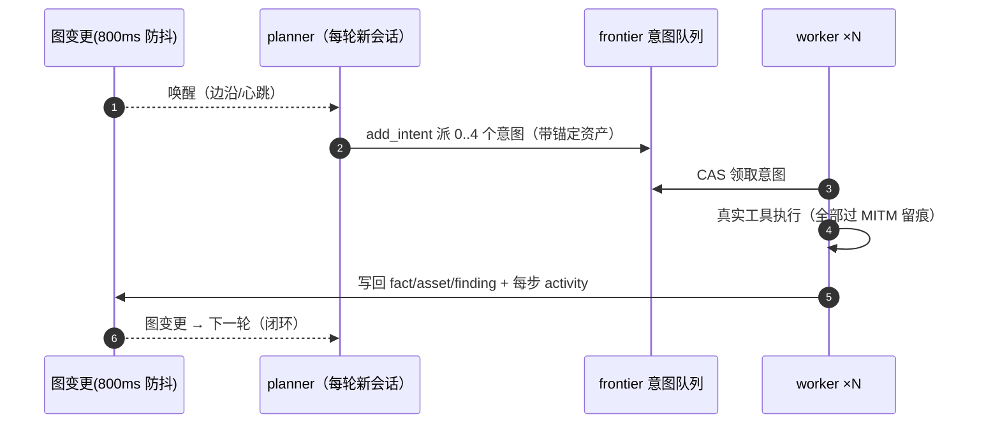
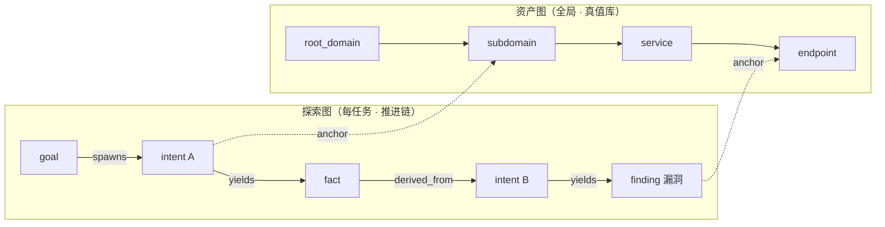
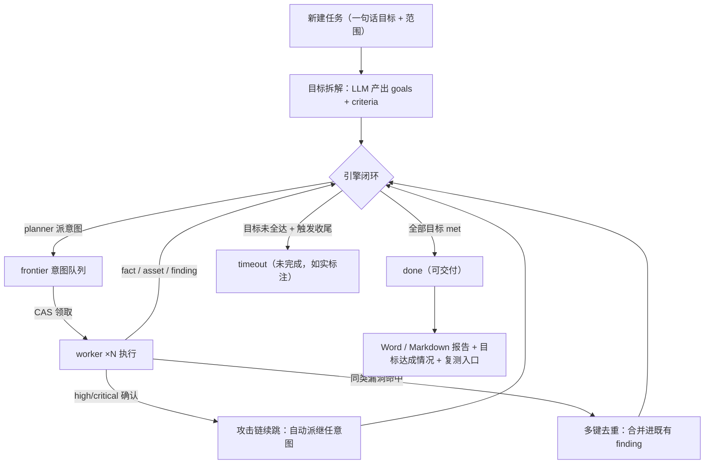

<div align="center">


# 破军 Pojun

**AI 自主渗透测试平台 · 从一句话目标到可交付漏洞报告**

> 破军，北斗第七星，主杀伐、主变局。<br/>
> 找到防线的破口，并把破口证明给你看。

[](https://github.com/chu0119/Pojun/releases)
[](https://github.com/chu0119/Pojun/actions/workflows/ci.yml)
[](LICENSE)


**Go 单体后端** · **Next.js 内嵌前端** · **PostgreSQL** · **多 Agent 自主推进** · **全程证据留痕**

📦 [一条命令安装](#快速开始) · 🧠 [单技能版 pojun-skill](https://github.com/chu0119/pojun-skill) —— 本平台方法论的单 skill 版，任意 AI Agent 即装即用

</div>

---

## 快速开始

> 依赖 **PostgreSQL**（安装脚本/Compose 自动处理）；探索需在 UI 里配置 **LLM**
> （Anthropic / OpenAI / 任意兼容网关，多通道轮询）。详细安装方式、系统选择、
> 公网部署与升级 → [安装详解](#安装详解)。

**Linux（Debian / Ubuntu / RHEL / Kali 等，root 执行，全自动交互安装）：**

```bash
curl -fsSL https://github.com/chu0119/Pojun/releases/latest/download/install.sh | sudo bash
```

**macOS 13+（Apple Silicon / Intel，一条命令，不需要 sudo）：**

```bash
curl -fsSL https://github.com/chu0119/Pojun/releases/latest/download/install.sh | bash
```

自动完成：Homebrew 检测（没有就装）→ PostgreSQL 16 安装与服务化 → 下载并
校验 darwin 包 → 生成 config.json → 注册 launchd 用户级服务（开机自启 +
崩溃自动拉起）→ 健康检查。渗透工具与 LibreOffice 等 `brew install` 按需装
（缺失工具在「宿主环境」页如实显示），详见[安装详解](#安装详解)。

**Windows / 已有 Docker（工具链全在镜像里，宿主机零安装）：**

```bash
git clone --depth 1 https://github.com/chu0119/Pojun.git pojun && cd pojun
cp .env.example .env    # Windows 用 copy；至少改 POSTGRES_PASSWORD
# Windows（Docker Desktop，WSL2 后端）：
docker compose -f docker-compose.yml -f docker-compose.windows.yml up -d
# Linux / 其他：
docker compose up -d
# → http://localhost:8787
```

**装好之后（3 分钟上手）：**

1. 浏览器打开 `http://<host>:8787` → 初始化管理员密码（≥8 位）
2. 「LLM 配置」页配模型通道（≥2 个通道 + 开启轮询 = 实战推荐）
3. 「宿主环境」页一键装齐工具（Docker 镜像已内置全部 66 件，可跳过）
4. 新建任务，给一句话目标

---

## 目录

| | |
|---|---|
| **🚀 部署** | [安装详解](#安装详解) · [配置速查](#配置速查) |
| **📸 产品** | [界面速览](#界面速览) · [核心能力](#核心能力) · [系统架构](#系统架构) · [与同类项目的差异](#与同类项目的差异) |
| **🧰 资产与纪律** | [内置资产清单：技能 / MCP / 工具](#内置资产清单技能--mcp--工具) · [实战纪律与安全边界](#实战纪律与安全边界) |
| **👥 参与** | [开发与贡献](#开发与贡献) · [文档索引](#文档索引) · [来源声明](#来源声明) · [许可与免责声明](#许可与免责声明) |

---

## 这是什么

Pojun 是一套 **LLM 多 Agent 自主渗透测试平台**：给一句话目标，它自动完成
「目标拆解 → 侦察 → 漏洞挖掘 → 利用 → 后渗透 → 报告」全流程，人随时可以插手纠偏。

它不是一个「包一层 API 的扫描器」。Pojun 的核心设计是**让 AI 像一个守纪律的渗透测试工程师一样干活**：

- **目标闸门**——每个目标必须带可核验的验收标准（如「未授权接口不带凭据返回 200 且
  含业务数据」「越权请求能读取到非本人对象的完整字段」），
  全部目标经证明达成才允许任务收官；未完成就标「未完成」，报告里如实呈现，绝不假装跑完了。
- **证据闸门**——critical/high 漏洞必须附可机械复现的证据（HTTP 状态码、命令命中输出、
  流量对比），纯版本匹配的「可能存在」进不了交付报告。
- **自主续跳**——确认漏洞 ≠ 完成意图。发现 high/critical 只到「漏洞存在」时，平台自动派发
  下一跳利用链意图（凭据→横向、注入→dump→登录、上传→webshell），推进到 L4 数据/资金影响层。
- **全程留痕**——所有 HTTP/S 流量过 MITM 代理逐请求留存，发现绑定流量证据，
  每一步 activity 可回放，「这个结论是怎么得出的」全程可回溯。

单机实测基线（真实授权项目数据，Kali 部署）：12 个任务、56,000+ 次工具调用、
**295 个确认漏洞**（严重 28 / 高危 140）、2,752 个资产节点，全程无人值守。

---

## 界面速览

> 以下截图来自真实运行实例，目标域名、企业名称、IP 与漏洞细节均已脱敏。

**全局态势**

| 控制台登录：首次启动初始化管理员，防爆破锁定 | 总览：任务 / 发现 / 资产 / Token 全局态势与趋势 |
| :---: | :---: |
|  |  |

**任务执行**

| 任务列表：目标进度与漏洞分布一屏可见 | 任务详情：多 Agent 会话，planner 态势研判实时可见 |
| :---: | :---: |
|  |  |

| 任务总览：目标逐条带验收标准，达成状态诚实呈现 |
| :---: |
|  |

| 目标管理与操作约束：目标逐条勾选达成，allow/deny 约束直接约束 planner 派单 |
| :---: |
|  |

**发现与证据**

| 发现：跨任务漏洞汇总，按严重度统计 | 漏洞详情：摘要 + 复测命令 + 证据 PoC + 状态卡 |
| :---: | :---: |
|  |  |

| 资产台账：企业 → 根域名/IP/子域/服务/接口 全量登记 | 资产覆盖图：力导向布局，已测节点高亮 |
| :---: | :---: |
|  |  |

| 全局流量代理：所有 HTTP/S 往来逐请求留存 |
| :---: |
|  |

**平台配置**

| 漏洞情报运营：42 万 CVE / KEV 在野利用 / PoC 仓库持续同步 | 技能库：22 个内置方法论技能，按需加载 |
| :---: | :---: |
|  |  |

| MCP 预设：FOFA 测绘 / Playwright / Burp 等一键接入 | Agent 角色：按角色配模型与可见性 |
| :---: | :---: |
|  |  |

| LLM 配置：多通道轮询 / 熔断 / 故障转移 | 宿主环境：66 件工具体检 + 一键装齐 |
| :---: | :---: |
|  |  |

| 监听器 / C2：反弹 shell 回连接收与出口管理 | 对话工作台：跨 Agent 对话与工具触发回放 |
| :---: | :---: |
|  |  |

| 系统设置：目标收尾 / 写回守卫 / 跨任务去重等开关 | 领域工具：agent 可调用的平台工具清单与开关 |
| :---: | :---: |
|  |  |

---

## 核心能力

### 1. 多 Agent 自主推进



- **planner** 是唯一意图生成者，持有一份跨唤醒共享的 todolist——串行利用链
  （注入点→凭据→横向）记录一次、按依赖逐步派发，不重复不错序。
- **worker** 做完一条意图即停；结果写回双图后自动唤醒 planner。
- **mainagent** 接管对话、报告补写、工具触发的即时任务（如复测提醒）。
- **人在环路**：对话纠偏 / 意图暂停取消 / 人工审批 / `steer_work` 实时纠偏，
  每步 activity 在 UI 内联可见。
- 多层韧性：空转收场（nudge 3 轮 + prevent 5 轮 + 取消原因落库）/ 拆解墙钟 /
  规划轮超时 / 瞬时故障自动重跑——免费限流通道也能稳定跑完任务。

### 2. 目标管理：完成判定不可被绕过

- `set_goals` 支持每条目标带 `criteria`（可核验验收标准），目标拆解提示词强制
  产出 criteria（如「未授权接口匿名返回 200 且含业务字段」「越权对照能稳定
  读到非授权对象」），禁止把「发现/验证漏洞」这类过程写成最终目标。
- **`goal_met` 闸门**：还有目标未 `met` 时，整体收官直接被拒绝（附未达成目标 id）。
- **诚实终态**：只有全部目标达成才落 `done`；有未达成目标时，无论超时 / 自动空转 /
  覆盖度收尾，终态一律 `timeout`（未完成），列表/详情/报告三处如实标注 `x/y 目标`。
- Word/Markdown 报告新增「目标达成情况」小节，逐条列出已达成/未达成及验收标准。

### 3. 执行面：原生执行器 + 会话复用 + 后台作业

| 能力 | 说明 |
|---|---|
| `http_request` | 原生 HTTP 执行器：方法/头/体/重定向/超时可控，自动过 MITM 留痕 |
| `session_login` | 五形态登录（表单/JSON/Basic/Bearer/自定义），任务级 cookie jar 与 curl 互通 |
| 会话复用 | `http_request(session=同名)` 自动带登录态；双身份对照做越权零成本 |
| `poc_scaffold` | 按类别（sqli/ssti/lfi/ssrf/idor/jwt/upload/cmdi/race）生成可运行 Python 验证骨架 |
| `job_start/status/output/stop` | 后台作业：长扫描/爆破放后台跑，run 结束进程继续，结果随时取回 |
| `save_script` / `run_script` | 任务级共享脚本目录：一次编写，全任务复用 |

### 4. 攻击链续跳：确认漏洞之后继续走

- `report_finding` 回执带 `chain_intent_id`——平台按漏洞类别自动派发继任意图：
  - SQL 注入 → 数据外带验证 → 登录态获取 → 后台横向
  - 文件上传 → 落地验证 → webshell 能力边界确认
  - 未授权接口 → 越权对照 → 数据面影响评估
- worker 纪律（代码注入提示，不受前端词表编辑影响）：确认漏洞 ≠ 完成意图；
  按影响层级 L1 信息 → L2 认证/越权 → L3 控制 → L4 数据/资金 推进；
  判「不可利用」前必须换过 ≥2 种本质不同手段并留下失败输出。

### 5. 漏洞去重与合并：一份漏洞一份真相

- **多键去重**：每条 finding 带 cve / root / endpoint / param 强键 +
  asset_class / name 弱键，新上报自动命中合并目标，`merge_count` 计数、
  来源 finding 收进 `finding_updates` 时间线，证据与资产锚点保留并集。
- **跨任务去重**：同资产同漏洞在别的任务已报过时，默认不重复打扰（可关）。

### 6. 写回守卫：范围越界的硬防线

- `record_fact` / `report_finding` 锚定非本任务自有范围的资产时直接拒绝
  （own / source / foreign 三分类，来源任务范围只读共享）。
- planner 侧配套「复核优先」硬尾巴：跨域名归属结论必须先双域取证复核，
  复核不过立即放弃该链——防止一次误报的关联导致整条链跑偏。

### 7. 漏洞情报运营（持续，不是静态知识库）

多数同类产品的情报是「按组件查」；Pojun 做的是「**按时间流**」——
**最近 7 天爆了什么 → 匹配我的资产 → 排进任务**：

- NVD 全量/增量（实测库 42 万+）+ **CISA KEV 在野利用** + GitHub Advisory
  + GitHub PoC 聚合（实测库 1,400+）
- **近期高危快通道**：按发布时间每 30 分钟拉 CVSS≥9.0 或 KEV，几十分钟进库
- **资产指纹→CVE 反向匹配**：同步的 CVE 自动匹配资产 technologies 指纹，
  命中即向任务挂 hint
- **版本区间精确判定**：`search_vulns` 返回 `version_in_range` 三态；
  NVD 不填区间时 GHSA 补（保守判定：解析不出→「可能受影响」）

### 8. 红队作战能力

- **回连接收器**：接住反弹 shell / OOB 回连，逐会话记录来源、时间、捕获内容；
  REST + agent 工具双入口；启停走人工审批。
- **C2 出口三形态**：direct（本机可达）/ SSH 中继托管（无公网+公网中转机，
  断线自动重连）/ manual（已有手工转发）。`listener_start` 返回解析后的
  回连地址，agent 直接填 payload，无需自行判断网络形态。
- **后渗透方法论**：redteam-ops skill 六阶段（落地稳定化→提权→权限保持→凭据
  获取→横向移动→数据获取回传→收尾）+ 证据纪律。
- **后渗透工具**：impacket / netexec / evil-winrm / chisel / ligolo-ng /
  proxychains / socat / linpeas / pspy / responder / sqlmap / hydra / hashcat /
  nuclei / ffuf … 66 件在「宿主环境」页一键装齐（特权助手 pojun-hostd 串行排队）。

### 9. 审批与拦截：三层闸门

| 层 | 语义 | 内置规则 |
|---|---|---|
| 明令禁止 `deny` | 任何语境都不可逆且无合法渗透用途——不调模型直接拒 | 10 条 |
| 交 Agent 研判 `judge` | 作用对象取决于上下文（删测试表 vs 删生产表）——命中后走模型裁决 | 12 条 |
| 人工确认 `ask` | 平台能力边界变更（如开监听端口）——转人工审批 | 1 条 |

- 规则级 timeout 真生效（研判类 90s/allow，硬禁类 30s/deny）；
- 模型裁决**严格 JSON 解析**（解析失败走失败策略，绝不猜）；
- 反注入边界：裁判输入刻意收窄（仅工具名+参数+工作目录），历史不进裁判视野；
- **写回范围守卫**（见 §6）在数据层再兜一道。

### 10. 全程证据链与交付

- **MITM 记录代理**：worker 的全部 HTTP/S 流量逐请求留存（CA 签发留痕）；
- **发现绑定流量**：finding 绑定 baseline / proof / verification / supporting
  四类流量证据，快照版本化（sha256），报告引用可验证；
- **证据附件**：截图 + Word/Excel/PPT/PDF 取样自动转图归档，任务内隔离、可归属漏洞；
- **报告导出**：专业级 Word（封面·目录·页眉页脚·严重度着色·复测记录·流量证据·
  修复路线图，手写 OOXML 零依赖）+ Markdown + 批量「一漏洞一 docx」zip；
- **对抗式自检**：换身份/换参数顺序/换客户端复现——「确认了才报」。

### 11. 成本与模型路由

- **LLM 三通道轮询**：熔断 + 故障转移 + 用量归因，免费限流通道也能跑完任务
  （实测 2,725M token，缓存命中率 93%）；按角色配模型：planner 强推理 /
  worker 中推理 / judge 便宜档。
- **worker 态势瘦身**：规划专用字段不进 worker 对话；**未测资产按簇排序**
  静态沉底；**http_probe 批量探活**一次往返替代逐条 curl。

---

## 系统架构

### 双图架构：资产图 × 探索图

渗透测试的全部状态拆成两张独立、由锚点缝合的图：

- **资产图**（全局共享）：`root_domain / subdomain / ip / service / app / endpoint`
  六类节点的真值库，跨任务复用；公司归属 + 授权边界（task_scope）挂在这里。
- **探索图**（每任务一份）：`goal → intent → fact / finding` 的推进链，五种边
  （spawns / derived_from / yields / proves / covers）构成**血缘**——「这个发现
  是从哪条线索推出来的」全程可回溯，这是**报告可信度的根基**。



### 一次任务的完整生命周期



---

## 安装详解

> 快速上手用上面的[快速开始](#快速开始)就够了；本节是系统选择、四种安装方式、
> 公网部署与升级的完整参考。依赖 **PostgreSQL**；探索需配置 **LLM**（UI 里配，
> 支持 Anthropic / OpenAI / 任意 OpenAI 兼容网关，多通道轮询 + 故障转移）。

### 系统选择与配置要求

| 系统 | 结论 |
|---|---|
| **Debian 12 (bookworm)** | ✅ **首选**：稳定、systemd、PostgreSQL 15 源内、LibreOffice/poppler/uv 齐全 |
| **Ubuntu 22.04 / 24.04 LTS** | ✅ **首选**：与 Debian 同源，长期支持 |
| **Windows 10/11（Docker Desktop）** | ✅ **支持**：WSL2 后端跑 Linux 容器，工具链全在镜像里，见[方式二](#方式二docker-compose-直跑ghcr-已发布镜像)的 Windows 说明 |
| **macOS 13+（Apple Silicon / Intel）** | ✅ **支持**：一条命令安装（install.sh 自动走 brew + launchd，不需要 sudo），见[快速开始](#快速开始)；工具链不全时「宿主环境」页如实显示缺失 |
| Kali | ⚠️ 可用（开箱全套工具），但滚动更新有升级风险，生产环境不建议 |
| RHEL / Rocky / CentOS Stream | ⚠️ 支持（dnf 路径），但 ffuf/sqlmap 新版等工具覆盖少，按需自装 |
| Windows 原生（exe 直跑） | ❌ 不支持：特权助手/工具链/守护脚本均为 Linux 体系，请用 Docker Desktop 或 WSL2 |

**硬件**：最低 2 核 4G / 20G 磁盘（不含工具）；**推荐 4 核 8G / 60G**（含 SecLists
约 2.5G、nuclei 模板、Playwright chromium、LibreOffice）。
**网络**：安装期需访问 GitHub 与 LLM 网关；受限环境用 `--install-proxy`。
**Python**：内置 FOFA MCP 需要 Python ≥ 3.10（不影响主服务）；`uv` 由安装脚本自动准备。

### 方式一：一条命令，全自动交互安装（推荐 · 仅 Linux）

在**全新 Linux 服务器**（Debian/Ubuntu/CentOS/RHEL/Kali 等）上以 root 执行：

```bash
curl -fsSL https://github.com/chu0119/Pojun/releases/latest/download/install.sh | sudo bash
```

脚本会交互式问你（直接回车用默认值）：

1. **部署形态**：二进制（推荐，systemd + 系统 PostgreSQL）或 Docker；
2. **出网代理**（可选）：apt / GitHub 下载受限时填 `http://host:port`；
3. 然后自动完成：装依赖（PostgreSQL / LibreOffice / poppler / ImageMagick / 字体等）
   → 建运行用户与目录 → 初始化数据库 → 装 systemd 服务
   → 首次启动 → 打印访问地址与初始账号。

常用非交互姿势：

```bash
# 全默认（二进制、直连）
curl -fsSL https://github.com/chu0119/Pojun/releases/latest/download/install.sh | sudo bash -s -- -y
# 带代理 + 顺装常用渗透工具
curl -fsSL .../install.sh | sudo bash -s -- --install-proxy=http://10.0.0.14:7897 --with-tools
# Docker 形态
curl -fsSL .../install.sh | sudo bash -s -- --mode=docker
```

幂等：重复执行 = 原地升级；`config.json` / `jwt.key` / 数据 / 数据库不动。
卸载：`systemctl disable --now pojun pojun-hostd && rm -rf /opt/pojun`。

### 方式二：Docker Compose 直跑（ghcr 已发布镜像）

已经会用 Docker 的话，不需要 install.sh：

```bash
git clone --depth 1 https://github.com/chu0119/Pojun.git pojun && cd pojun
cp .env.example .env      # 至少改 POSTGRES_PASSWORD；POJUN_TAG 可钉到具体版本（如 v0.4.64）
docker compose up -d      # → http://localhost:8787
```

**Windows（Docker Desktop，WSL2 后端）**：

```powershell
git clone --depth 1 https://github.com/chu0119/Pojun.git pojun; cd pojun
copy .env.example .env    # 至少改 POSTGRES_PASSWORD
docker compose -f docker-compose.yml -f docker-compose.windows.yml up -d
# → http://localhost:8787
```

- Windows 加 `-f docker-compose.windows.yml` 的原因：data 卷改为 named volume
  （NTFS bind mount 的小文件 I/O 实测慢约两个数量级，流量/证据写入会明显变卡），
  并预映射回连端口 4444-4450；
- **回连接收器**：容器内 direct 模式解析出的 LHOST 是容器网段 IP，外部目标连不到——
  在「监听器 / C2」页把出口形态设为 **manual**、地址填 Windows 宿主机的局域网 IP
  （`ipconfig` 查看），监听端口与映射端口 1:1 对应；Windows 防火墙放行对应端口；
- 数据备份：`docker run --rm -v <项目名>_pojun-data:/data -v "%cd%:/backup" alpine tar czf /backup/pojun-data.tgz -C /data .`；
- 其余与 Linux 相同：镜像内置全部渗透工具 / LibreOffice / Playwright，无需在
  Windows 宿主机安装任何工具链。建议 Docker Desktop 分配 ≥8G 内存。

- 镜像 `ghcr.io/chu0119/pojun`，amd64/arm64 双架构，`POJUN_TAG` 默认 `latest`；
  渗透工具随镜像内置（与二进制 `--with-tools` 同一套）：nmap / masscan /
  sqlmap / hydra / whatweb / nikto / ffuf / john / impacket / socat /
  proxychains / nuclei / httpx / subfinder / naabu / dnsx / katana / tlsx /
  notify / interactsh / gitleaks / chisel / amass / dalfox / feroxbuster /
  gobuster / wafw00f / semgrep / pwntools / SecLists 字典 /
  Playwright + chromium / LibreOffice / poppler / ImageMagick / 公文字体；
- 数据落 `./data`（宿主机可直接查看/备份），数据库在 `pgdata` 卷；
- 升级：`docker compose pull && docker compose up -d`；卸载：`docker compose down -v`；
- 回连端口映射示例见 `docker-compose.yml` 注释（reverse shell 需放开对应端口）。

### 方式三：下载预编译包（Linux / macOS，amd64 与 arm64）

到 [Releases](https://github.com/chu0119/Pojun/releases) 下载对应平台包
`pojun-<版本>-<平台>-<架构>.zip`（附 SHA256SUMS），解压后：

```bash
cp config.example.json config.json   # 填好 database 连接
./start.sh                           # → http://localhost:8787
```

> 用 `start.sh` 启动而非直接跑二进制——它是守护脚本，「一键更新」靠它完成换装
> （macOS 上的页面一键更新同样可用，按平台自动匹配发布包）。

**macOS 补充说明：**

macOS 也可以用 install.sh 一条命令安装（见[快速开始](#快速开始)）——脚本自动走
Homebrew + launchd，与 Linux 同款体验；下面的手动方式适合不想装 Homebrew 或
想精细控制各依赖的场景。

- 依赖自装：`brew install postgresql@16 libheif poppler libreoffice` 并启动 PostgreSQL；
  Node ≥ 20（Playwright MCP）与 `uv`（FOFA MCP）按需安装；
- 渗透工具链（nmap/sqlmap/nuclei 等）用 `brew install` 按需装，没有的工具
  「宿主环境」页会如实显示缺失——agent 会绕开缺失工具改用可用的；
- 特权助手 `pojun-hostd` 与批量装工具是 Linux 体系，macOS 上不可用（影响：
  「一键装齐」按钮不可用，其余功能完整）；
- `masscan`/`nmap -sS` 等特权扫描需要 root/sudo，与 Linux 同理。

### 方式四：从源码编译

```bash
cd web && npm ci && npm run build:static && cd ..
cp -r web/out server/webui/dist
CGO_ENABLED=0 go build -tags embedui -o pojun ./cmd/pojun
CGO_ENABLED=0 go build -o pojun-hostd ./cmd/pojun-hostd   # 可选：特权安装助手（Linux）
./start.sh
# 交叉编译其他平台示例（macOS Apple Silicon）：
# CGO_ENABLED=0 GOOS=darwin GOARCH=arm64 go build -tags embedui -o pojun-darwin-arm64 ./cmd/pojun
```

### 公网部署

内置公网部署安全基线（登录防爆破、探活去指纹、改密吊销会话、认证面无产品名）。
必须：HTTPS 反代 + 覆写 `X-Forwarded-For`。完整基线见
[docs/公网部署安全加固-2026-10-29.md](docs/公网部署安全加固-2026-10-29.md)。

### 升级

**页面一键更新**（系统配置 → 版本与更新）：下载 → SHA256 校验 → 冒烟测试 →
原子换装 → 失败自动回滚到上一版。升级只换程序不动数据，schema 幂等迁移。

---

## 配置速查

**数据库**（`config.json` 或 `POJUN_PG_DSN`）：

```json
{ "database": { "host": "127.0.0.1", "port": 5432, "user": "pojun",
                "password": "…", "dbname": "pojun", "sslmode": "disable" } }
```

**LLM**：环境变量 `ANTHROPIC_API_KEY` / `OPENAI_API_KEY` 可兜底，UI「LLM 配置」页
配多通道 + 开启「LLM 轮询」。常用参数：`./start.sh -addr :8787 -proxy :8788`。

**C2 出口**（可选）：`PUT /api/c2/config` 配 `mode=direct|ssh|manual` +
中转机地址/SSH 凭据——`listener_start` 自动返回解析后的回连地址。

**反向代理（HTTPS）**：前端和 API/SSE 同源，反代必须关缓冲。Nginx 示例：

```nginx
server {
    listen 443 ssl;
    server_name your.domain.com;
    location / {
        proxy_pass http://127.0.0.1:8787;
        proxy_set_header Host $host;
        proxy_set_header X-Forwarded-Proto $scheme;
        proxy_set_header X-Forwarded-For $proxy_add_x_forwarded_for;  # 限流依赖
        proxy_buffering off; proxy_read_timeout 3600s;               # SSE 必需
        proxy_http_version 1.1; proxy_set_header Connection "";
    }
}
```

---

## 内置资产清单：技能 / MCP / 工具

**22 个内置技能**（按意图场景自动路由，默认绑定到对应角色）：

| 领域 | 技能 |
|---|---|
| 综合方法论 | vuln-hunting（未知面挖掘）/ attack-surface-recon（侦察）/ pentest-output-standards（报告规范） |
| Web 与 API | web-attack-methods / api-security-testing / api-recon |
| 专项 | cloud-security / windows-ad / source-code-audit / llm-security / mobile-reverse / apk-reverse / contract-audit / wireless |
| 红队后渗透 | redteam-ops（六阶段方法论）/ opsec |
| SRC 知识库 | src-hunting（48 篇测试知识 + 11 篇流程规则，按需加载） |

**10 个 MCP 预设**（一键填充配置）：FOFA 资产测绘（含 one-fox 通道）/ Playwright
浏览器 / Chrome DevTools / Burp Suite / Fetch 网页抓取 / Sequential Thinking /
Memory 知识库 / Filesystem / HexStrike 工具桥（150+ 安全工具桥接）/ Context7 文档检索。

**66 件宿主工具**（体检 + 一键装齐）：网络与主机（nmap/masscan/naabu/tlsx…）、
子域与 DNS（subfinder/dig/amass…）、Web 与 API（httpx/katana/ffuf/dalfox…）、
注入与利用（sqlmap/hydra/hashcat/john…）、后渗透（impacket/netexec/evil-winrm/
chisel/ligolo-ng/socat/proxychains/linpeas/pspy/responder…）、
语料（SecLists 字典 / nuclei 模板）。

---

## 与同类项目的差异

| 维度 | 常见同类 | Pojun |
|---|---|---|
| 完成判定 | LLM 自评「任务完成」即可收官 | 目标 + 验收标准 + `goal_met` 闸门，未全达成强制记未完成 |
| 漏洞可信度 | 扫描器输出直接入库 | 机械验证凭据闸门 + L1-L4 证据分级 + 对抗式自检，critical/high 必须 L3+ |
| 漏洞重复 | 按标题/URL 简单去重 | 多键去重（cve/root/endpoint/param 强键）+ 合并时间线 + 跨任务去重 |
| 深度利用 | 确认漏洞即结束 | 攻击链自动续跳（维度→下一跳），L1→L4 影响层级推进纪律 |
| 长任务 | 单轮超时即丢 | 后台作业 + 任务级共享脚本 + 会话复用，run 结束作业继续跑 |
| 流量证据 | 无或截图 | MITM 逐请求留存 + 四类证据绑定 + sha256 版本化 + 报告引用 |
| 情报 | 静态知识库 | NVD/KEV/GHSA/PoC 时间流 + 资产指纹反向匹配 + 高危快通道 |
| 交付 | Markdown | 公文级 Word（封面/目录/复测/流量证据/修复路线图）+ 一漏洞一 docx |
| 成本 | 单通道 | 多通道轮询 + 熔断 + 角色路由 + 缓存命中（实测 93%） |

---

## 实战纪律与安全边界

- **授权优先**：任务创建即声明范围（域名/IP/公司主体），资产图按范围登记，
  写回守卫在数据层拦截越界。
- **最小伤害验证**：SQL 注入探测默认 level 2 / risk 1（只读）；文件上传只验证
  能力不落地后门；登录面 ≤5 组默认口令失败即停；禁止大字典爆破生产系统。
- **审批门**：破坏性命令三层闸门（deny/judge/ask），平台能力边界变更转人工。
- **复测纯手动**：平台不自动触发任何复测动作。
- **凭据卫生**：LLM key / FOFA key 只进运行时配置，不入仓库不入报告。

## 开发与贡献

```bash
./dev.sh    # 后端(:8787) + 流量代理(:8788) + 前端 next dev(:5173)
go test ./...   # 连 PG 跑全量（CI 用 -p 1 串行防跨包死锁）
cd web && npx tsc --noEmit && NEXT_EXPORT=1 npx next build
```

- 后端：`go run ./cmd/pojun`（`-tags embedui` 内嵌前端）
- 前端：`cd web && npm run dev`（`/api` 反代热更新）
- Mock 预览：`cd web && NEXT_PUBLIC_MOCK=1 npm run dev`

项目结构：

```
cmd/            程序入口（pojun 主服务 / pojun-hostd 特权助手）
agent/          多 Agent 层：planner / worker / mainagent / 领域工具（tools_*.go）
db/             PostgreSQL 唯一存储：schema.sql（幂等迁移）+ 全部表 Store
server/         HTTP 服务：路由 / 引擎调度 / Manager / 会话 / 报告 / 更新
intercept/      拦截引擎：规则匹配 → LLM 研判 → allow/ask/deny
guard/          工具调用审批门（把裁决接进 agent 执行链）
listener/       回连接收器：接住反弹 shell / OOB 回连并留证
traffic/        MITM 流量记录代理 + 出口代理池
vulnintel/      漏洞情报：NVD/KEV/GHSA/PoC/快通道/资产联动/限速闸门
hosttools/      宿主工具目录（66 件，按攻击面分类）
hostd/          特权助手：root 常驻 unix socket，装工具/特权操作
llmpool/        LLM 多通道轮询池：熔断/故障转移
llmrec/         LLM 请求录制与 token 计量
report/         报告生成：Word 导出（手写 OOXML 零依赖）
notify/         通知推送：钉钉/飞书/企业微信等
evidence/       发现的证据留存与版本化
enrich/         资产自动补全：DNS / HTTP 探测
selfupdate/     一键自更新：查 Release → 校验 → 换装
skills/         内置 skill：vuln-hunting / redteam-ops / api-recon / …
web/            Next.js 前端（静态导出后 go:embed 内嵌）
docs/           设计文档 / 部署手册 / 能力对照
```

欢迎 Issue 与 PR：修 bug / 补文档直接提；新功能建议先开 Issue 讨论场景与边界。

## 文档索引

| 文档 | 内容 |
|---|---|
| [docs/AI-交接指南.md](docs/AI-交接指南.md) | 机制→代码位置地图、发版流程、测试纪律、已知问题与未决方向 |
| [docs/01-双图架构.md](docs/01-双图架构.md) | 资产图/探索图、锚点、schema 迁移设计、不变量清单 |
| [docs/02-引擎与调度闭环.md](docs/02-引擎与调度闭环.md) | planner/worker 编排与生命周期 |
| [docs/03-LLM接入层.md](docs/03-LLM接入层.md) | 通道选路、轮询池、熔断、录制计量 |
| [docs/04-审批与拦截.md](docs/04-审批与拦截.md) | 三层规则与裁决链路、反注入边界 |
| [docs/部署手册.md](docs/部署手册.md) | 部署 / 升级 / 排障（实测踩坑全记录） |
| [docs/公网部署安全加固-2026-10-29.md](docs/公网部署安全加固-2026-10-29.md) | 公网部署安全基线 |
| [docs/红队能力建设-2026-10-30.md](docs/红队能力建设-2026-10-30.md) | 杀伤链能力矩阵 / 竞品对照 / 路线图 |
| [docs/漏洞挖掘能力对比.md](docs/漏洞挖掘能力对比.md) | 与开源同类逐项对比 |
| [docs/深度优化方案-2026-10-31.md](docs/深度优化方案-2026-10-31.md) | 报告质感 × Agent 认知 × 攻击链 |
| [docs/模型路由策略.md](docs/模型路由策略.md) | 按角色配模型：planner 强推理/worker 中推理/judge 便宜档 |
| [docs/同行对比分析-2026-11.md](docs/同行对比分析-2026-11.md) | 12+ 同行项目代码级调研与借鉴落地清单 |
| [CHANGELOG.md](CHANGELOG.md) | 逐版本功能更新记录 |

## 来源声明

本项目最初 fork 自己删除的原作者项目
[Autumn-27/ARTEX](https://github.com/Autumn-27/ARTEX)（百度“Agent+”攻防挑战赛
冠军项目）的最终定版 v0.3.15，原作者代码保留在 git 历史里作为起点。

- **保留**：双图架构、planner/worker 编排、MITM 流量代理、审批门框架、基础
  工具集——原作者的架构设计是优秀的，git 历史向其致意；
- **重建**：全部设计文档、CI 门禁、依赖解耦（norma SDK fork）、Docker 源；
- **独立演进**：v0.3.16 以来 700+ 提交、约 5 万行新增由本仓库维护者完成，
  覆盖情报运营 / 目标闸门 / 攻击链 / 执行面 / 去重合并 / 证据链 / 技能体系等
  整条能力线，与原项目已无代码级关联。

## 许可与免责声明

### 开源协议

**AGPL-3.0**——衍生作品（含网络服务）须同样开源。完整条款见 [LICENSE](LICENSE)。

### 使用限制

**本工具仅供个人学习、代码研究与本地技术验证使用，不得用于对任何线上系统或
网站发起实际测试。** 允许范围：阅读学习源码、本地隔离环境验证。严禁：对任何
线上系统发起扫描/探测/利用（无论是否授权）、实际渗透对抗、生产环境使用、
非法入侵与数据窃取。

使用者须自行遵守所在国家/地区全部法律法规（含《网络安全法》《数据安全法》
《个人信息保护法》等）。**因使用本工具产生的一切法律责任由使用者自行承担。**

本项目按“现状”提供，不附带任何担保。下载、安装或使用即表示已阅读并同意
上述全部条款。

---

## 参考

- [norma](https://github.com/Autumn-27/norma) — agent harness SDK（本平台多 Agent 引擎）
- [SecLists](https://github.com/danielmiessler/SecLists) / [nuclei-templates](https://github.com/projectdiscovery/nuclei-templates) — 语料与模板
- [FOFA](https://fofa.info) — 资产测绘（内置 MCP 预设）

<div align="center">

**破军 · Pojun** — 找到防线的破口，并把破口证明给你看。

</div>
