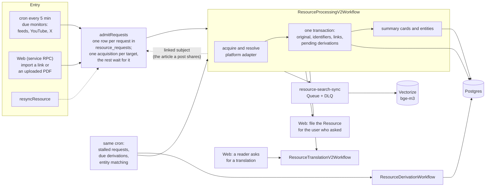

<div align="center">

# commonplot core

**The ingestion engine behind [commonplot.co](https://www.commonplot.co)**

[](LICENSE.md)
[](https://workers.cloudflare.com/)
[](https://www.commonplot.co)

[English](README.md) | [繁體中文](README.zh-TW.md)

</div>

A Cloudflare Worker that turns links, feeds and uploaded PDFs into readable
Resources: it fetches and parses the source, resolves its identity (a paper's
DOI, a video's channel, a post's author), writes it to Postgres, then derives
summaries, entities, translations and search vectors.

This repository also holds the [commonplot plugin](plugins/commonplot) for
Claude and ChatGPT.

## Sources

| Input | How it is acquired |
| --- | --- |
| Web page | Fetch, follow redirects, extract the article as Markdown; a PDF response goes to the PDF parser |
| PDF (link or upload) | Zotero document worker (a Cloudflare Container) for text, figures and bibliography; first-page identifiers resolved through OpenAlex or Crossref |
| Paper | DOI, arXiv or OpenAlex identity → OpenAlex metadata and open-access full text; references searched on Crossref |
| X / Twitter | twitterapi.io: post or article, media, and the link it shares |
| YouTube | Video metadata, transcript and chapters |
| Hacker News | Story and ranked comments; the linked article becomes its own Resource |
| LessWrong | GraphQL post as Markdown |
| RSS / Atom / JSON Feed | Each entry enters as a link |

## How it works



- **One intake.** Monitors, user imports, resyncs and linked subjects all go
  through `admitRequests`. Requests for the same target share one acquisition;
  a monitor's failed request is retried after a doubling wait (`retry_after`).
- **The original first.** The Workflow writes the original and the
  derivations it needs in one transaction, so a written Resource always has its
  pending work recorded. A derivation that fails records `retry_at`; the cron
  sweep restarts it in `ResourceDerivationWorkflow`.
- **Follow-ups run independently.** Search vectors go through a Queue,
  translations through their own Workflow, and paper references through
  Crossref. One failing does not undo the Resource or the others.
- Every run logs one `ingest_run` line with its outcome and each step's time.

## Layout

`src/` is layered; each directory imports only the ones above it.

```
src/
├── contracts/   schemas and pure rules: resource identity, kinds, languages, Markdown
├── services/    external systems: AI Gateway, Crossref, Images, Zotero, YouTube captions
├── adapters/    one file per platform, acquisition only, no database
├── store/       all SQL: requests, resources, derivations, references, monitors
├── monitors/    feed and X monitors and their runner
├── workflows/   processing, derivation, translation, references, request intake
├── search/      corpus vectors, the Queue consumer, retrieval, backfill
└── index.ts     service RPC, cron and Queue entrypoints
```

### Adding a platform

1. An adapter in `src/adapters/` that turns the provider's data into the shared
   acquired-resource contract.
2. Its identity (URL pattern, `kind` and `platform`) in
   `src/contracts/resource.ts`, with a matching database constraint.
3. Optionally a monitor in `src/monitors/` and its kind in
   `src/contracts/monitors.ts`, if new entries are not already in a feed.

The Workflow, persistence and follow-ups need no change.

## Self-hosting

Requirements: a Cloudflare account, PostgreSQL, and Docker (the Zotero
container is built on deploy). The database schema and migrations are part of
the commonplot app, which is not published.

1. **Hyperdrive** pointing at your database; put its id in `cloudflare.config.ts`.
   ```bash
   pnpm exec cf hyperdrive create --body '{"name":"commonplot-db","origin":{"scheme":"postgres","host":"…","port":5432,"database":"…","user":"…","password":"…"}}'
   ```
2. **Secrets**
   ```bash
   pnpm exec cf workers secrets update <NAME> --worker newsence-core --text <value>
   ```
3. **Deploy.** Workflows, the Queue and the container are created from
   `cloudflare.config.ts`.
   ```bash
   pnpm install
   pnpm exec cf deploy
   ```

Run locally with `pnpm dev`, then `curl "localhost:8787/__scheduled?cron=*/5+*+*+*+*"` to run the cron once.

| Secret | Used for |
| --- | --- |
| `KAITO_API_KEY` | X / Twitter (twitterapi.io) |
| `YOUTUBE_API_KEY` | YouTube metadata and channel monitors |
| `OPENALEX_API_KEY` | Paper metadata and open-access full text |
| `FASTINO_API_KEY` | Entity extraction |

| Binding | Purpose |
| --- | --- |
| `HYPERDRIVE` | Postgres |
| `R2` | Uploaded PDFs, parsed documents and figure crops |
| `AI` | AI Gateway (summaries, translations) and Workers AI embeddings |
| `IMAGES` | Hosted previews and avatars |
| `CORPUS_VECTORS` | Vectorize index for search and related Resources ([runbook](CORPUS_VECTORS_RUNBOOK.md)) |
| `RESOURCE_SEARCH_SYNC_QUEUE` | Vector sync after each write |
| `APP` | The commonplot app's `DomainRpc`, to file imported Resources |

Check changes with `pnpm lint` and `pnpm run typecheck`.

## Using commonplot from Claude or ChatGPT

commonplot's MCP server is at `https://www.commonplot.co/api/mcp` (sign in with
a commonplot account). The [plugin](plugins/commonplot) adds the skills that
tell the assistant when to use it. Guide:
[docs.commonplot.co](https://docs.commonplot.co/user/chatgpt-and-claude/).

## License

The engine is source-available under the
[PolyForm Noncommercial License 1.0.0](LICENSE.md): free for personal,
research, educational and nonprofit use; commercial use is not permitted.
The [plugin](plugins/commonplot) is [MIT](plugins/commonplot/LICENSE).
