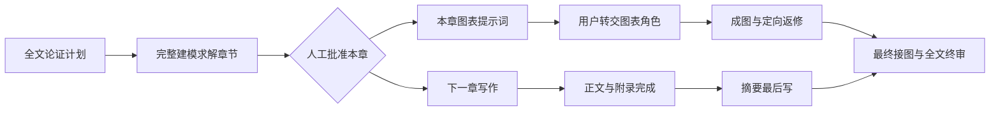

<div align="center">
  
  <h1>数模军械库</h1>
  <p><strong>数模 Skills ＋ 本地工作台</strong></p>
  <p>从读题、建模到论文交付，让 AI 协作的过程更清楚、更可追溯。</p>
</div>

<div align="center">

[](https://github.com/cjh-solver/MathModeling-Skills-Arsenal/actions/workflows/validate.yml)
[](LICENSE)

[开始使用](#开始使用) · [工作台演示](examples/workbench-demo/README.md) · [技能目录](docs/skill-catalog.md) · [验证与限制](docs/validation.md)

</div>

适合有题目、数据和人工判断，希望把建模任务、证据和成果组织起来的个人或团队。覆盖国赛、美赛、MathorCup 等竞赛；格式与 AI 使用要求以本届官方规则为准。

> **当前状态：** 主控为开发快照，完整发布检查尚未通过；节点批准和最终交付仍由人负责。详见[验证说明](docs/validation.md)。

## 先看看效果

本机读取已有 Harness 项目，集中查看比赛阶段、小问、角色会话和成果。页面定时从项目文件同步，不需要额外调用模型。比赛数据和审批记录保持只读，角色会话需自行登记并核实。


截图来自仓库内的合成演示项目，不代表真实比赛进度或批准结果。[打开演示项目](examples/workbench-demo/README.md) · [了解工作台](tools/harness-workbench/README.md)

## 选择你的起点

| 我想做什么 | 从哪里开始 | 先得到什么 |
| --- | --- | --- |
| 组织一场完整比赛 | [竞赛主控](skills/01-core/contest-orchestrator/SKILL.md) · [全流程提示词](docs/quickstart.md#mathorcup-全流程) | 题意划分、输入缺口、模型计划与节点安排 |
| 只处理一个问题 | [模型选择](skills/02-modeling/math-model-selector/SKILL.md) · [数据分析](skills/02-modeling/data-science-stack/SKILL.md) | 题型与模型选择、数据边界、可复现的分析方案 |
| 制作图表和示意图 | [科研绘图](skills/04-figures/modelviz/SKILL.md) · [图表决策](skills/04-figures/scipilot-figure-skill/SKILL.md) · [技术路线示例](skills/04-figures/tech-route-maker/examples/out/tech-route.svg) | 图表方案、可编辑图源、质量检查材料 |
| 写作或复核论文 | [学术写作](skills/03-writing/academic-writing/SKILL.md) · [论文排版](skills/03-writing/mathmodel-latex-skill/SKILL.md) | 章节审阅、LaTeX 论文工程与检查清单 |
| 查看已有 Harness 项目 | [工作台使用说明](tools/harness-workbench/README.md) | 阶段、角色、文件、论文和已有审查记录 |

更多单项任务和可复制提示词见[按任务启动](docs/quickstart.md)。

## 开始使用

```bash
git clone https://github.com/cjh-solver/MathModeling-Skills-Arsenal.git
cd MathModeling-Skills-Arsenal
```

仓库使用 `skills/<分类>/<技能>/SKILL.md` 结构，安装时将技能目录放到宿主实际读取的技能根目录。以 Codex 用户技能目录为例：

<details>
<summary>Codex 用户：展开 PowerShell 安装示例</summary>

以下命令安装数模分类，跳过创意写作；已有同名技能会跳过，不会覆盖。

```powershell
# PowerShell：只安装数模分类，跳过创意写作。
$skillRoot = Join-Path $env:USERPROFILE '.agents/skills'
New-Item -ItemType Directory -Force -Path $skillRoot | Out-Null
Get-ChildItem skills/0* -Directory | ForEach-Object {
    Get-ChildItem $_.FullName -Directory | ForEach-Object {
        if (-not (Test-Path -LiteralPath (Join-Path $_.FullName 'SKILL.md'))) { return }
        $destination = Join-Path $skillRoot $_.Name
        if (Test-Path -LiteralPath $destination) {
            Write-Warning "已存在，跳过：$($_.Name)"
        } else {
            Copy-Item -LiteralPath $_.FullName -Destination $destination -Recurse
        }
    }
}
```

此命令跳过已有同名技能；需要更新时先比较与备份，再合并。Claude Code、WorkBuddy 等宿主使用各自配置的技能目录；支持 `SKILL.md` 不代表工具、模型和多角色能力完全相同。

</details>

安装后打开新会话，给出题目、附件路径与规则来源：

```text
使用 contest-orchestrator。先读取我的题目和本届规则，列出缺失输入，
选择合适模式。先做题意与模型计划，不直接生成最终论文或编造实验结果。
```

MathorCup 全流程可指定 `full-contest-mathorcup`；只解一问、只画图或只审稿时使用对应单项技能。详见 [启动示例](docs/quickstart.md)。

## 工作流示例：章节批准后，图文并行

Harness 与 MathorCup 的新模板采用 `chapter_parallel`。先写建模求解，目录顺序与实际写作顺序分别维护。每次提交完整一章，由使用者批准后再写下一章；图表提示词也在该章批准后产生，由使用者转交图表角色。



图件返修更新提示词版本，后续章节继续写；未变正文的批准保持有效。最终交付仍检查最新图件、选定版本、证据来源与全文一致性。历史四批写作记录继续兼容。

## 验证与边界

- [流程测试与复现方法](docs/validation.md)说明检查内容、历史结果和尚未解决的发布问题。CI 通过不等于正式比赛交付通过。
- [合成章节示例](examples/chapter-parallel/README.md)展示正文与图表交接；构造数据上的结果不能证明真实比赛表现。
- [可编辑技术路线示例](skills/04-figures/tech-route-maker/examples/out/tech-route.svg)展示图源形式；实际图表需依据题目、数据和证据重新制作与核验。
- 科学计算、论文编译和不同宿主需要各自依赖；缺少工具时不能以源码检查代替实际运行。

## 参与和维护

[贡献指南](CONTRIBUTING.md) · [维护方向](docs/maintenance.md) · [更新记录](CHANGELOG.md) · [问题反馈](https://github.com/cjh-solver/MathModeling-Skills-Arsenal/issues)

仓库不发布比赛论文全文、赛事私有数据、个人记忆和凭据。整体协议为 [Apache-2.0](LICENSE)；第三方技能保留各自许可证，详见[技能目录与协议](docs/skill-catalog.md)。
