# Glasshouse

English | [简体中文](./README.zh-CN.md)

Run AI agents inside a hardware-virtualized Ubuntu 26.04 LTS virtual machine, so they cannot reach your host's files, credentials or internal network. QEMU/KVM on Linux, Virtualization.framework on macOS.

Full usage manual: [`USAGE.md`](./USAGE.md) (English) · [`USAGE.zh-CN.md`](./USAGE.zh-CN.md) (中文): starting, changing the configuration, adding CPU and memory, persistence, troubleshooting. Release notes: [`CHANGELOG.md`](./CHANGELOG.md) (English) · [`CHANGELOG.zh-CN.md`](./CHANGELOG.zh-CN.md) (中文).

## Glasshouse AI SandBox for Vibe-coding

Vibe coding means handing the keyboard to an AI agent and letting it run commands, install packages and edit files for hours. That is productive, and it is also exactly when you least want the agent standing on your real machine. Glasshouse gives that workflow a disposable room with glass walls: the agent works freely inside, and you can see everything it does.

- **Let it run without babysitting.** Claude Code is preinstalled (newest release at build time) in an Ubuntu VM. A bad `rm -rf`, a hostile `postinstall` script or a prompt-injected tool call can only damage the VM, not your home directory, SSH keys or browser profile.
- **Your code goes in, reviewed changes come out.** `glasshouse run --shell ./proj` copies the project into `/workspace` (secrets such as `.env*` and `*.pem` are skipped). When you are happy, `glasshouse pull` shows a diff and writes only what you approve.
- **Sign in with your own subscription.** Run `claude` in the VM and log in with your Claude account; no API key has to be copied in. The default network policy allows only the login and API domains.
- **Watch what it does.** CC-Monitor hooks are baked into the image through Claude Code's system-wide managed settings, which the `agent` user cannot edit, and the host keeps a hash-chained audit log.
- **Pick the weight you need.** `--shell` is a light terminal-only VM that boots fast; `--gui` is a full GNOME desktop for agents that drive a browser or an app.
- **Clean slate every time.** A session lives in its own disk overlay, separate from the read-only base image. When the session stops (`glasshouse stop`, a timeout, or a shutdown inside the VM) the overlay is deleted, so the next `glasshouse run` starts clean; `glasshouse rm` then removes the leftover log and record. Nothing is restored on restart, so run `glasshouse pull` first. With `--keep` the disk stays after stop and `glasshouse start <session>` boots it again.

Typical loop: `glasshouse run --shell ./proj` → run `claude` and describe what you want → `glasshouse pull` to review and bring the result home.

## Demo


*`glasshouse ssh` gives a root shell in the Ubuntu 26.04.1 VM (left); the same VM's GNOME desktop runs in a QEMU window (right).*


*Claude Code 2.1.326 runs inside the VM on a Claude Pro subscription login (as the `agent` user, in `/home/agent`). The VM's browser shows the CC-Monitor web UI at `127.0.0.1:9999`: the Claude Code session is monitored and its events appear in the audit log. The mode is Permissive, which only logs.*


*`glasshouse monitor` opens the CC-Monitor UI of the VM in the host's browser, through an SSH tunnel and a token-protected local proxy (the token in the printed URL is hidden in this picture). It shows the Claude Pro plan and quota, and the audit events of the Claude Code session running in the VM desktop (right). The account name, email and IDs are masked by CC-Monitor's "sensitive info" switch.*

## Contents

- [Glasshouse AI SandBox for Vibe-coding](#glasshouse-ai-sandbox-for-vibe-coding)
- [Demo](#demo)
- [Features](#features)
- [Status (read first)](#status-read-first)
- [How isolation works](#how-isolation-works)
- [Installation](#installation)
- [Usage](#usage)
- [Entering the VM and detailed usage](#entering-the-vm-and-detailed-usage)
- [Network modes and Claude login](#network-modes-and-claude-login)
- [Policy configuration](#policy-configuration)
- [Command reference](#command-reference)
- [CC-Monitor integration](#cc-monitor-integration)
- [Project layout](#project-layout)
- [First real-machine checklist](#first-real-machine-checklist)
- [Troubleshooting](#troubleshooting)

## Features

- **VM-level isolation**: the agent runs in its own Ubuntu 26.04 VM. The boundary is the hypervisor, not a container or file permissions.
- **No shared host directories**: no 9p, virtiofs or shared folders. The host packs your project into `/workspace`, and changes come back only after review.
- **Controlled networking**: the guest has no real NIC. Outbound HTTP(S) goes through a host-side proxy with a domain allowlist; private, loopback, link-local and cloud-metadata addresses are blocked, with DNS-rebinding protection.
- **Two ways to use Claude**: either an API key that stays on the host (the guest holds only a session token that the LLM gateway swaps for the real key), or a **subscription account logged in inside the guest** (no API key needed).
- **Tamper-evident audit log**: `audit.jsonl` is hash-chained and verified with `glasshouse logs --verify`. If the log cannot be written, the operation is refused (fail closed).
- **Policies can only tighten**: a project-level `.glasshouse.yaml` can make the policy stricter, never looser.
- **Resource limits**: vCPU, memory, disk, session timeout and egress byte caps, plus cgroups on Linux.
- **Two launch modes**: `--gui` starts a GNOME desktop VM and opens the desktop window; `--shell` starts a lightweight VM without a desktop and drops you into an agent shell in `/workspace`.
- **Claude Code preinstalled, newest release**: the image is built with the latest Claude Code (installed system-wide so the agent user cannot alter it). Rebuild the image to pick up a newer one.
- **Optional in-guest auditing**: integrates CC-Monitor to watch Claude Code inside the guest.

## Status (read first)

| Part | Status |
| --- | --- |
| Policy parsing and tighten-only merge, audit hash chain, network gate (allowlist, DNS-rebinding protection, private/metadata address blocking, traffic cap), HTTP proxy, LLM gateway, safe file import/export | Implemented, unit-tested; `go test -race ./...` passes |
| Session supervisor (audit socket, gateway/proxy listeners, cleanup, refuses to start on a corrupted audit log) | Implemented, tested end to end with a fake hypervisor |
| QEMU backend, cloud-init, CLI | Implemented. **Booted for real on Linux/KVM (amd64)** with both `headless` and `desktop` (GNOME) images: SSH, file import, offline mode, `pull` review, audit chain and CC-Monitor were checked. Not yet checked: `glasshouse gui`, an LLM round trip, the tamper test on `audit.jsonl`, and anything on arm64 |
| `image/build.sh` | Runs end to end on Ubuntu (both profiles); see the notes under "Step 8: Build the images" |
| macOS backend (`vz-helper/`, Swift) | **Runs on Apple silicon** (macOS 27, Swift 6.4, arm64). `image/build-mac.sh` builds and verifies images: each one boots from a fresh EFI variable store and passes `dpkg --verify` before it is written. Real `glasshouse run --shell` sessions worked end to end: vsock SSH, file import, the allowlist proxy (guest without a NIC), `network.mode: host` (NAT NIC, the Mac's network), the model gateway bridge, CC-Monitor and the audit chain. A `glasshouse run --gui` session opened the GNOME desktop (GDM auto-login on virtio-gpu) in the helper's window |
| CC-Monitor integration | Hooks are baked into the image. Verified on a real machine: the service runs and its web UI shows the monitored Claude Code session with its audit events (see Demo). The upstream code has not been reviewed line by line |

On a real machine, go in this order: `glasshouse doctor` → build an image → `glasshouse run`. When something deviates, look at `glasshouse logs --console` first.

## How isolation works

- **Files**: no host directory is mounted. `glasshouse run ./proj` makes the host pack the project (skipping `.env*`, `*.pem`, `id_*`, `.git/config`, and dropping symlinks that point outside the project) into `/workspace`. `glasshouse pull` fetches `/workspace` back and the host parses the tar itself: it rejects absolute paths, `..`, hard links and device files, strips setuid bits, never writes through symlinks, and shows a diff before writing (`files.export: review`).
- **Network**: the guest has no real NIC. On Linux, QEMU user-mode networking with `restrict=on` leaves exactly three forwards: SSH in, proxy out, model gateway out. On macOS the VM has no NIC at all; everything goes over vsock (only `network.mode: host` adds a NAT NIC). Outbound HTTP(S) goes only through the host proxy and is allowlisted by domain. Any resolved IP that is private, loopback, link-local (including cloud metadata) or the host itself is refused, and the connection is pinned to the checked IP. The proxy authenticates with a random per-session token.
- **Credentials**: the real model API key stays on the host (sources: `env:`, `file:`, `keychain:`, `secret-service:`). `ANTHROPIC_API_KEY` in the guest is just a session token; the gateway validates it, swaps in the real key, and forwards only `/v1/` paths.
- **SSH and root**: each session generates a throwaway ed25519 key kept only in the host session directory (0600) and deleted when the session ends. sshd accepts public keys only. `glasshouse ssh` opens a root shell by default; root inside the guest is not a security boundary, the VM is.
- **Audit**: `audit.jsonl` lives on the host and every record carries the previous record's hash; `glasshouse logs --verify` checks it. If the log cannot be written, network connections and file exports are refused (fail closed).
- **Resources**: vCPU/memory/disk caps; on Linux also cgroups (`systemd-run --user --scope`); session timeout; egress byte cap.

## Installation

Follow the steps in order; each step ends with a **check** that tells you whether to go on. Steps 1 to 10 are for **Linux (QEMU/KVM)**, the platform that was verified on a real machine. Apple silicon Macs have their own steps in [Installation on macOS](#installation-on-macos-apple-silicon).

| Step | What you do | Roughly |
| --- | --- | --- |
| 1 | Check the machine (CPU, KVM, disk, memory, network) | 2 min |
| 2 | Install the packages | 5 min |
| 3 | Let your user open `/dev/kvm` | 1 min |
| 4 | Get the source and check the Go version | 2 min |
| 5 | Build and test the `glasshouse` binary | 2 to 5 min |
| 6 | Run `glasshouse doctor` | 1 min |
| 7 | Pick the CC-Monitor commit | 5 min (to review it) |
| 8 | Build the images (`headless`, and `desktop` if you want a GUI) | depends mostly on your network; not timed |
| 9 | Write the policy file (model key or subscription login) | 2 min |
| 10 | Start a first session and run the smoke test | 5 min |

### Step 1: Check the machine

| Item | What is needed | How to check |
| --- | --- | --- |
| OS and CPU | Linux on x86-64 (`amd64`) or arm64. The image architecture must **match the host** (no emulation); the x86-64 path is the one verified on a real machine | `uname -sm` prints `Linux x86_64` |
| KVM | Hardware virtualization on, `/dev/kvm` present. Without it you need `--allow-tcg` (software emulation), which is very slow | `ls -l /dev/kvm` |
| Disk | Images are about 2.2 GB (`headless`) and 3.6 GB (`desktop`), plus about 0.9 GB for the cached base image, plus working space while building. **Keep at least 15 GB free** (an estimate, not measured) | `df -h ~/.local/share` |
| Memory and CPUs | A session defaults to the values in `vm.cpus` and `vm.memory` of the policy, and builds need some memory for libguestfs. 8 GB of host RAM is a sensible minimum (an estimate) | `free -g`, `nproc` |
| Network | The build downloads about 800 MB of base image plus apt, npm and git data. In mainland China see the mirror options in step 8 | |

**Check:** `/dev/kvm` exists. If it does not, turn on VT-x/AMD-V in the BIOS (and in the hypervisor, if this machine is itself a VM: nested virtualization).

### Step 2: Install the packages

What each part is for:

| Package | Used for |
| --- | --- |
| `qemu-system-x86` (or `qemu-system-arm` on arm64), `qemu-utils` | running the VM, `qemu-img` |
| `genisoimage` (or `xorriso`) | building the cloud-init seed disk of every session |
| `openssh-client` | `glasshouse ssh`, file transfer, the monitor tunnel |
| `virt-viewer` | `remote-viewer`, to see the desktop (only needed for `--gui`) |
| `libguestfs-tools`, `isc-dhcp-client` | building images (`virt-customize`; its helper VM needs a DHCP client for networking) |
| `gpgv`, `ubuntu-cloudimage-keyring` | checking Canonical's signature on the base image |
| `git`, `curl` | fetching CC-Monitor and the base image |
| Go (see `go.mod`; currently 1.24.7 or newer) | compiling `glasshouse` |

On Debian/Ubuntu:

```bash
sudo apt update
sudo apt install qemu-system-x86 qemu-utils genisoimage openssh-client virt-viewer \
                 libguestfs-tools isc-dhcp-client gpgv git curl ubuntu-cloudimage-keyring
```

Go: take the version from <https://go.dev/dl/> if your distribution's package is older than `go.mod` asks for (`sudo apt install golang-go` is enough only when it is new enough).

Other distributions: install the equivalent packages. Only Ubuntu was tested.

**Check:**

```bash
qemu-system-x86_64 --version | head -1 && qemu-img --version | head -1 && virt-customize --version && gpgv --version | head -1
command -v dhclient ssh remote-viewer
command -v genisoimage || command -v xorriso      # either one is enough
go version
```

Output on the test machine (your versions will differ):

```text
QEMU emulator version 8.2.2 (Debian 1:8.2.2+ds-0ubuntu1.18)
qemu-img version 8.2.2 (Debian 1:8.2.2+ds-0ubuntu1.18)
virt-customize 1.52.0
gpgv (GnuPG) ...
/usr/sbin/dhclient
/usr/bin/ssh
/usr/bin/remote-viewer
/usr/bin/xorriso
go version go1.26.4 linux/amd64
```

Every command must print something. `dhclient` is the one people forget; without it every `apt` call in the image build fails with "Temporary failure resolving".

### Step 3: Let your user open `/dev/kvm`

```bash
sudo usermod -aG kvm "$USER"
```

Log out and in again (or reboot) so the group applies. If you work as root there is nothing to do.

**Check:**

```bash
id -nG | tr ' ' '\n' | grep -x kvm            # prints kvm (root is not in this group; skip this line as root)
test -r /dev/kvm -a -w /dev/kvm && echo ok     # prints ok
ls -l /dev/kvm                                  # crw-rw----+ 1 root kvm 10, 232 ... /dev/kvm
```

The second line printing `ok` is what counts.

### Step 4: Get the source

```bash
git clone https://github.com/cn0xroot/glasshouse.git glasshouse
cd glasshouse
go version        # must satisfy the `go` line in go.mod
```

**Check:** `ls` shows `Makefile`, `cmd/`, `image/`, `internal/`, `go.mod`.

### Step 5: Build and test

```bash
make test        # go vet + go test -race ./... (all packages must say ok)
make build       # produces bin/glasshouse
./bin/glasshouse --help
```

The end of `make test` should look like this (timings and `(cached)` vary); any `FAIL` line means it did not pass:

```text
go vet ./...
go test -race ./...
ok  	glasshouse/cmd/glasshouse	5.607s
ok  	glasshouse/internal/audit	(cached)
?   	glasshouse/internal/backend	[no test files]
ok  	glasshouse/internal/backend/qemu	1.361s
... (11 packages report ok)
```

`make build` prints only `go build -o bin/glasshouse ./cmd/glasshouse`; the binary is about 11 MB.

Optional: put the binary on your `PATH` (`sudo install -m 0755 bin/glasshouse /usr/local/bin/`); the rest of this document uses `./bin/glasshouse` or just `glasshouse`.

**Check:** `bin/glasshouse` exists and `--help` lists `run`, `ssh`, `gui`, `monitor`, `pull`, `ls`, `logs`, `start`, `stop`, `rm`, `policy`, `doctor`. If `make test` fails, stop here and do not build images: something in your toolchain differs.

### Step 6: Run `doctor`

```bash
./bin/glasshouse doctor
```

`doctor` checks `ssh`, `ssh-keygen`, the ISO tool, the socket path length, whether the policy file loads, the hypervisor, and the images. **On a first run the two image checks fail; that is expected** and looks like this:

```text
  ok    ssh
  ok    ssh-keygen
  ok    ISO tool (cloud-init seed)
  ok    socket path length
  ok    policy loads
  ok    hypervisor (qemu)
  FAIL  image ubuntu-26.04-amd64-headless.qcow2 missing checksum file ... (images must be built with image/build.sh)
  FAIL  image ubuntu-26.04-amd64-desktop.qcow2 missing checksum file ...
  note  credentials.llm_gateway.key_ref is not set: the model gateway will refuse requests
```

**Check:** every line except the `image ...` ones is `ok` or `note`. A `FAIL` on `hypervisor`, `ssh` or the ISO tool means step 2 or 3 is incomplete. The `note` is fine when you log in with a subscription account (step 9).

### Step 7: Pick the CC-Monitor commit

The image bakes in [CC-Monitor](https://github.com/cn0xroot/CC-Monitor), which watches Claude Code inside the guest. It is third-party code that runs in your VM, so the build refuses a branch name and wants an **exact 40-character commit hash**, which you should look at before you trust it:

```bash
git ls-remote https://github.com/cn0xroot/CC-Monitor.git HEAD     # prints the current commit
git clone https://github.com/cn0xroot/CC-Monitor.git /tmp/cc-monitor-review
git -C /tmp/cc-monitor-review log --oneline -5                     # and read what changed
export CC_MONITOR_REF=<the 40-hex commit you reviewed>
```

The commit used on the test machine was `1b3516f5b5152f882daad6e6d5c2506bf166a35a`. The upstream code has not been reviewed line by line by this project; reviewing it is your decision.

**Check:** `echo "$CC_MONITOR_REF" | grep -Eq '^[0-9a-f]{40}$' && echo ok` prints `ok`.

### Step 8: Build the images

`image/build.sh` starts from Canonical's official cloud image (GPG-verified and SHA256-checked), installs developer tools, Claude Code (newest release), ccstatusline and the pinned CC-Monitor, and writes the image plus its `.sha256`. Run it with `bash` (it is not marked executable):

```bash
# 8a. Lightweight image for --shell (build this one first; it is the smaller one)
bash ./image/build.sh --profile headless

# 8b. Desktop image for --gui (GNOME), only if you want the desktop
bash ./image/build.sh --profile desktop
```

`CC_MONITOR_REF` is read from the environment you exported in step 7. In mainland China add `--mirror tuna` (or `ustc`, or leave `auto`); see the mirror notes below. To pin Claude Code: `CLAUDE_CODE_VERSION=stable bash ./image/build.sh --profile headless` (or an exact `x.y.z`).

What you will see, in order: the mirror choice, the Canonical signature check, the base image download (about 800 MB, cached afterwards), the CC-Monitor clone and hash check, growing the root partition, the `virt-customize` phase (apt, Node, Claude Code, CC-Monitor), cleanup, and finally the compressed image being written. The build has **not been timed**; the download and the apt/npm steps dominate. It is safe to run again: the image is written to a temporary file first and renamed into place only when complete, so a failed build never leaves a broken image behind.

Options: `--arch amd64|arm64` (must match the host), `--profile headless|desktop`, `--format qcow2|raw`, `--mirror auto|official|tuna|ustc`, `--keep-mirror`. Images are written to `$GLASSHOUSE_HOME/images/` (default `~/.local/share/glasshouse/images/`).

**Check:**

```bash
ls -lh ~/.local/share/glasshouse/images/
(cd ~/.local/share/glasshouse/images && sha256sum -c ubuntu-26.04-amd64-headless.qcow2.sha256)
./bin/glasshouse doctor      # now the image lines say ok
```

On the test machine the files were `ubuntu-26.04-amd64-headless.qcow2` (2.2 GB) and `ubuntu-26.04-amd64-desktop.qcow2` (3.6 GB).

#### Notes on building

- Claude Code is installed from npm (`@anthropic-ai/claude-code`, Node 22 or newer is required and the image's nodejs satisfies it). The build installs the newest release (`latest`) and fails if `claude --version` does not run; the installed version is recorded in `/etc/glasshouse-claude-code-version` inside the image.
- CC-Monitor's npm dependencies live in the `webui/` subdirectory of its repo. The script handles that (`npm ci --omit=dev`) and fails the build if it breaks. Override with `CC_MONITOR_SETUP_CMD`.
- The build needs internet access. The base image is about 800 MB and is cached in `$GLASSHOUSE_HOME/cache/`.
- **Mirrors for mainland China.** `--mirror auto|official|tuna|ustc` (or `GLASSHOUSE_MIRROR`) picks where the cloud image and the build guest's APT packages come from:

  ```bash
  bash ./image/build.sh --profile headless                  # auto: probes the official servers, Tsinghua (tuna) and USTC
  bash ./image/build.sh --profile headless --mirror tuna    # force Tsinghua
  bash ./image/build.sh --profile headless --mirror ustc    # force USTC
  ```

  `auto` stays on Canonical's servers unless they are unreachable or a mirror is at least twice as fast, prints what it measured, and falls back to the next source if a download fails. The image is **always** verified against Canonical's GPG-signed `SHA256SUMS`, and apt verifies its own signatures, so a mirror does not have to be trusted. The guest's APT source is switched to the mirror only for the build and put back to the official one at the end, so `network.allow` (which lists `archive.ubuntu.com`) keeps working; `--keep-mirror` leaves the mirror in the image, in which case add its host to `network.allow` (or use `network.mode: host`). Notes: USTC refused the image download from some networks (HTTP 403), which is why `auto` falls back; the mirrors serve `resolute/current`, the same image as the official `releases/26.04/release` (identical checksum when this was checked).
  Other optional environment variables: `APT_MIRROR=https://host/ubuntu` (any APT mirror), `NPM_REGISTRY=https://registry.npmmirror.com` (npm registry for CC-Monitor's dependencies and Claude Code), `CC_MONITOR_REPO=<https git URL>` (a GitHub mirror; the pinned commit hash is still verified). In China GitHub and npm are often the slow steps, and the script prints a tip when a mirror was selected.

#### Build flow

```mermaid
flowchart TD
  A["image/build.sh<br/>--profile / --arch / --format / --mirror"] --> B["Check arguments and tools<br/>CC_MONITOR_REF is a 40-hex commit<br/>Linux host, same CPU architecture<br/>qemu-img, gpgv, git, curl, virt-customize ...<br/>Canonical keyring present"]
  B --> C{"--mirror"}
  C -- auto --> D["Probe official / tuna / ustc in parallel<br/>time the first 512 KiB of the image"]
  C -- "official / tuna / ustc" --> E["Chosen source, official as fallback"]
  D --> F["Candidate order: picked source first, then the rest"]
  E --> F
  F --> G["For one candidate:<br/>fetch SHA256SUMS and SHA256SUMS.gpg"]
  G --> H{"Canonical GPG signature valid?"}
  H -- no --> N{"Another candidate left?"}
  H -- yes --> I{"Cached image matches the signed hash?"}
  I -- yes --> K
  I -- no --> J["Download the image, check the hash"]
  J -- failed --> N
  J -- ok --> K["Verified cloud image<br/>APT source = same mirror, or APT_MIRROR"]
  N -- yes --> G
  N -- no --> X["Abort: no verified image"]
  K --> L["Clone CC-Monitor (CC_MONITOR_REPO)<br/>check out the pinned commit, verify the hash, drop .git"]
  L --> M["Copy the image to a work file<br/>write the systemd unit and cloud-init config"]
  M --> O["Grow the root partition in place<br/>headless 8 GB / desktop 20 GB<br/>keeps the BIOS boot record intact"]
  O --> P["Resolve Claude Code version (default latest)<br/>check dhclient for libguestfs networking"]
  P --> Q1

  subgraph VC ["virt-customize: runs inside the guest, in this order"]
    Q1["1. If a mirror is used: point APT at it"] --> Q2["2. apt update/upgrade, install base packages"]
    Q2 --> Q3{"desktop profile?"}
    Q3 -- yes --> Q4["3. Install GNOME<br/>ubuntu-desktop-minimal, gdm3"]
    Q3 -- no --> Q5
    Q4 --> Q5["4. Copy the cloud-init config"]
    Q5 --> Q6["5. Install Claude Code first<br/>Node >= 22 check, npm install -g,<br/>claude --version into the version file"]
    Q6 --> Q7["6. Install CC-Monitor<br/>copy files, npm ci, ownership and permissions"]
    Q7 --> Q8["7. While installing CC-Monitor, hook Claude Code<br/>install.py --target /etc/claude-code/managed-settings.json<br/>requires the Claude Code version file to exist"]
    Q8 --> Q9["8. Mask auto-updates, enable ssh, cloud-init clean"]
    Q9 --> Q10["9. Restore the official APT source<br/>unless --keep-mirror"]
    Q10 --> Q11{"desktop profile?"}
    Q11 -- yes --> Q12["graphical.target, remove gnome-initial-setup, enable gdm3"]
    Q11 -- no --> Q13["multi-user.target"]
  end

  Q12 --> R
  Q13 --> R["virt-sysprep cleanup<br/>qemu-img convert (qcow2 compressed, or raw)<br/>write the .sha256 file"]
  R --> S["images/ubuntu-26.04-arch-profile.qcow2<br/>and its .sha256"]
```



At session start the hooks are already in the image; a session with `monitor.cc_monitor: false` removes `/etc/claude-code/managed-settings.json`, and an image built without the hooks gets them installed as a fallback (see `internal/cloudinit`).

#### If the build fails

| Symptom | Cause and fix |
| --- | --- |
| `missing tool: virt-customize` or similar | step 2 is incomplete |
| every `apt` call says "Temporary failure resolving" | `isc-dhcp-client` is missing: libguestfs needs a DHCP client to give the build guest a network (the script checks `dhclient` up front) |
| `supermin: failed to read kernel` / cannot read `/boot/vmlinuz-*` | a known libguestfs issue on Ubuntu, where kernels are root-only: `sudo chmod +r /boot/vmlinuz-*` (not met on the test machine, which builds as root) |
| `CC_MONITOR_REF must be a full 40-character commit hash` | step 7: a branch name or a short hash was given |
| the base image download is slow, stalls or returns 403 | use `--mirror tuna` or `--mirror ustc`; the signature check stays on whatever the source |
| npm or GitHub steps are slow | `NPM_REGISTRY=https://registry.npmmirror.com`, `CC_MONITOR_REPO=<a GitHub mirror>` |
| the host uses a proxy and `apt` says `Unable to connect to 127.0.0.1:...` | libguestfs forwards proxy variables into the guest, where `127.0.0.1` is the guest itself. The script clears them around `virt-customize`; the base image download still uses your proxy |
| the new image hangs at "Booting from Hard Disk..." | `virt-resize` renumbers and moves partitions, which breaks GRUB's BIOS boot record. `build.sh` grows the root partition in place; do not switch to `virt-resize` |

### Step 9: Write the policy file

Without a policy file the built-in defaults apply (allowlist network, no model key). Pick **one** way for Claude Code to authenticate.

**A. Subscription login (no API key).** Do nothing, or write a policy without `key_ref`. The default allowlist already contains `claude.ai`, `platform.claude.com` and `api.anthropic.com`. You log in inside the guest the first time you run `claude` (see [Network modes and Claude login](#network-modes-and-claude-login)). `doctor` prints a `note` about `key_ref`; that is expected.

**B. API key through the model gateway** (the real key stays on the host):

```bash
mkdir -p ~/.config/glasshouse && cat > ~/.config/glasshouse/policy.yaml <<'YAML'
version: 1
credentials:
  llm_gateway:
    key_ref: keychain:glasshouse-anthropic     # or env:ANTHROPIC_API_KEY / secret-service:glasshouse / file:/path
YAML
./bin/glasshouse policy check
```

`key_ref` forms: `env:NAME` (an environment variable, easiest on Linux), `secret-service:NAME` (the desktop keyring), `keychain:NAME` (macOS), `file:/path` (a file only you can read).

**Check:** `./bin/glasshouse policy check` prints no error. More on every setting: [Policy configuration](#policy-configuration).

### Step 10: First session and smoke test

```bash
mkdir -p ~/glasshouse-demo && echo "hello from the host" > ~/glasshouse-demo/hello.txt
./bin/glasshouse run --shell ~/glasshouse-demo
```

The first boot takes a minute or two (`run` waits up to 6 minutes). You land in a shell as the `agent` user in `/workspace`. Inside the guest:

```bash
pwd                  # /workspace
whoami               # agent
cat hello.txt        # hello from the host   (the project was copied in)
claude --version     # the Claude Code in the image
echo "made in the guest" > result.txt
exit                 # leaving the shell does NOT stop the VM
```

Back on the host:

```bash
./bin/glasshouse ls                     # the session is `ready`
./bin/glasshouse pull                   # shows result.txt as `added`; answer y to write it into ~/glasshouse-demo
cat ~/glasshouse-demo/result.txt
./bin/glasshouse logs --verify          # the audit hash chain must verify
./bin/glasshouse stop                   # the session disk is deleted unless you started with --keep
```

Two quick isolation checks, if you want them: `./bin/glasshouse run --shell --offline` and `curl -sS -m 8 https://example.com` inside the guest must fail; in the default allowlist mode `curl -sS -m 8 http://169.254.169.254` must be refused (`glasshouse logs` shows `net.deny`).

Expected output (the session ID differs each time; `pull --yes` stands in for answering `y`):

```text
session s-9c9e2d starting (first boot can take a minute or two)...
imported 1 files (20B) into /workspace
session s-9c9e2d ready
/workspace
agent
hello from the host
2.1.326 (Claude Code)
...
1 change(s) from the guest (2 files received, 0 skipped):
  added     result.txt
applied
audit log OK: 5 records, chain intact
session s-9c9e2d stopped
```

With `network.mode: host` a `warning: network.mode=host ...` line is printed before the start; that is normal.

**Check:** `result.txt` arrived on the host only after you answered `y` to the `pull` review, and `logs --verify` passed. That is the whole loop: `run`, work, `pull`, `logs --verify`, `stop`.

Optional: the desktop. Needs the `desktop` image from step 8b and `remote-viewer`:

```bash
./bin/glasshouse run --gui ~/glasshouse-demo      # opens the desktop window when ready
./bin/glasshouse gui                              # reopen the window later
```

If the desktop asks for a password, see [Usage troubleshooting](#usage-troubleshooting). To keep the desktop's data across restarts use `start.sh` (see [`start.sh`](#startsh-the-desktop-vm-that-keeps-its-data)).

### Updating and removing

- **Update the program:** `git pull && make test && make build`.
- **Update the images** (for example to get a newer Claude Code): run step 8 again. Running sessions are not affected, but a session kept with `--keep` is layered on the old image and **refuses to start** after a rebuild; pull what you need, then `glasshouse rm` it.
- **Remove a session:** `glasshouse rm <session>`. **Remove everything:** stop all sessions, then delete `$GLASSHOUSE_HOME` (default `~/.local/share/glasshouse`; it holds images, the download cache, sessions and audit logs, so copy the audit logs first if you need them) and `~/.config/glasshouse`.

### Installation on macOS (Apple silicon)

Macs with Apple silicon (M1 to M5) run **arm64** guests only: Virtualization.framework does not emulate other CPUs, so the x86-64 images of the Linux steps cannot be used. The image is built from Canonical's Ubuntu 26.04 **arm64** cloud image (`ubuntu-26.04-server-cloudimg-arm64.img`), not the live-server ISO, because the cloud image is already an installed Ubuntu that cloud-init can configure. This path was verified by the project owner on an Apple silicon Mac; it cannot be re-checked on the repository's Linux machine.

**Mac step 1: Check the Mac.** macOS 13 or newer, Apple silicon (`uname -m` prints `arm64`). Open a **native** terminal, not one running under Rosetta (`sysctl -n sysctl.proc_translated` must print `0`). The data directory must be on APFS, and 15 GB free is a sensible minimum (an estimate).

**Mac step 2: Install the tools.**

```bash
xcode-select --install             # Swift and codesign (skip if already installed)
brew install go qemu gnupg         # Go; qemu-img (qcow2 -> raw); gpg/gpgv (Canonical's signature)
```

Check: `swift --version`, `go version`, `qemu-img --version`, `gpgv --version | head -1`, `command -v codesign` all print something, and `go version` says `darwin/arm64`.

**Mac step 3: Get the source and build.**

```bash
git clone https://github.com/cn0xroot/glasshouse.git glasshouse && cd glasshouse
make                               # on a Mac this builds bin/glasshouse and the signed bin/glasshouse-vz together, both native arm64
```

Do not build the two with separate commands: `make` keeps the pair matching, and it refuses to run under Rosetta. At the end it runs `bin/glasshouse-vz check`. Check: `bin/glasshouse` and `bin/glasshouse-vz` exist; `file bin/glasshouse` says `arm64`.

**Mac step 4: Pick the CC-Monitor commit.** Same as Linux [step 7](#step-7-pick-the-cc-monitor-commit): review a commit of CC-Monitor and `export CC_MONITOR_REF=<40-hex commit>`.

**Mac step 5: Build the image.**

```bash
./image/build-mac.sh --profile headless     # and/or --profile desktop
```

The script downloads the arm64 cloud image and checks it against Canonical's key, then boots it once in a build VM (the same helper plus a NAT network device that only image builds get). Inside the guest it installs the same software as `build.sh` (`image/provision-guest.sh`), cleans the guest and powers it off. Finally it boots the result once more **without network** and runs `dpkg --verify` and a check of the EFI boot files; an image that fails is not written. The build gives up after 5400 seconds (`BUILD_TIMEOUT`), and `--cpus` and `--memory` size the build VM. The mirror options and the optional variables are the same as on Linux.

The result is `~/.local/share/glasshouse/images/ubuntu-26.04-arm64-<profile>.raw` plus its `.sha256`. You can also build the raw image on an arm64 Linux machine with `./image/build.sh --format raw` and copy both files over.

**Mac step 6: Check with `doctor`.**

```bash
./bin/glasshouse doctor
```

On a Mac it also checks that the helper is native, starts, and is signed with the `com.apple.security.virtualization` entitlement; that glasshouse is not under Rosetta; that `vm.cpus` and `vm.memory` are within what this Mac allows; that the data directory is on APFS; and that the session's unix-socket paths fit macOS's 104-byte limit (a long `GLASSHOUSE_HOME` fails here).

**Mac step 7: Policy, then the first session.** Write the policy as in Linux [step 9](#step-9-write-the-policy-file) (on a Mac `keychain:NAME` is the natural `key_ref`), then run the smoke test of Linux [step 10](#step-10-first-session-and-smoke-test). On macOS `network.mode: host` uses a NAT network device instead of QEMU's user-mode network; the host is then reachable at the NAT gateway, usually `192.168.64.1`.

## Usage

### Launch modes

| Mode | Command | What you get |
| --- | --- | --- |
| GUI desktop | `glasshouse run --gui ./proj` | GNOME desktop VM (`desktop` image); the desktop window opens when the session is ready (needs `remote-viewer`, otherwise the VNC socket path is printed) |
| Lightweight SSH shell | `glasshouse run --shell ./proj` | VM without a desktop (`headless` image, smaller and faster to boot); you land in an `agent` shell in `/workspace` |
| Policy default | `glasshouse run ./proj` | whatever `vm.profile` in the policy says (`desktop` by default) |

`--headless` is an alias of `--shell`, and `--mode gui|shell` is the long form. Mode flags never loosen the policy: `--gui` is refused if the user policy or the project's `.glasshouse.yaml` already forces `headless`. Shell mode keeps the session running after you leave the shell; use `glasshouse ssh` to get back in and `glasshouse stop` to shut it down. Add `--offline` to either mode to cut all outbound network.

### Commands

```bash
./bin/glasshouse run --shell ./myproject       # lightweight shell mode
./bin/glasshouse run --gui ./myproject         # desktop mode
./bin/glasshouse run ./myproject -- claude     # copy the project into /workspace, run claude as the agent user
./bin/glasshouse ssh                           # root shell in the guest
./bin/glasshouse gui                           # open the desktop (desktop profile)
./bin/glasshouse monitor                       # open the CC-Monitor UI
./bin/glasshouse pull                          # review the diff and bring changes back
./bin/glasshouse logs --verify                 # verify the audit hash chain
./bin/glasshouse stop                          # stop the session
```

Typical flow: `run` → let the agent work in the guest → `pull` to review and fetch changes → `logs --verify` → `stop`.

To keep the agent fully offline (model gateway only): `glasshouse run --headless --offline ./proj -- claude`.

Session data lives in `$GLASSHOUSE_HOME` (default `~/.local/share/glasshouse`). Unix socket paths have a length limit; if the path is too long, set a shorter `GLASSHOUSE_HOME`.

## Entering the VM and detailed usage

### Entering the VM

| I want to… | Command |
| --- | --- |
| Start a VM and land in a shell | `glasshouse run --shell ./myproject` |
| Start a VM with a desktop | `glasshouse run --gui ./myproject` |
| Get back into a running VM (root shell) | `glasshouse ssh` |
| Get back in as the unprivileged user | `glasshouse ssh --user agent` |
| Run one command in the VM | `glasshouse ssh -- bash -c 'cd /workspace && ls -la'` |
| Run Claude Code straight away | `glasshouse run --shell ./myproject -- claude` |
| Reopen the desktop window | `glasshouse gui` |

**Picking the session.** Every command that takes `[session]` accepts a session ID (see `glasshouse ls`). If you leave it out it works only when **exactly one** session is running; with several running it refuses and lists their IDs, so name one: `glasshouse ssh s-1a2b3c`.

**Session states** (`glasshouse ls`): `starting` → `ready` (usable) → `stopping` → `stopped`; `failed` means boot or setup failed (see `glasshouse logs --console`); `dead` means the supervisor process died (clean up with `glasshouse rm <session>`).

### `glasshouse run`

`glasshouse run [flags] [dir] [-- command...]`

- `dir` (optional) is copied into `/workspace` in the guest, minus the files in `files.deny_patterns` and symlinks that point outside it. Without a `dir` the guest starts with an empty `/workspace`.
- `-- command...` runs that command as the `agent` user in `/workspace` after the VM is ready (for example `-- claude`, `-- bash -l`). With `--shell` and no command you get an interactive `agent` shell; with `--gui` the desktop window opens.
- The first boot of a session takes a minute or two. `glasshouse run` waits up to 6 minutes for the VM.
- Flags: `--shell`/`--headless`, `--gui`, `--mode gui|shell`, `--offline`, `--policy FILE`, `--keep`, `--allow-tcg`. See the table under "Launch modes".
- **Leaving the shell does not stop the VM.** The session keeps running until `glasshouse stop`.

### `glasshouse ssh`

`glasshouse ssh [--user root|agent] [session] [-- command...]`

- `--user root` (default) opens a root shell in the guest. It is refused if the policy sets `ssh.root: false`; use `--user agent` then. Root inside the guest is **not** a security boundary, the VM is.
- `--user agent` is the unprivileged user that owns `/workspace`. It starts in `/home/agent`; `cd /workspace` to get to the project.
- Everything after `--` is passed as separate arguments, so wrap a compound command in `bash -c '...'`.
- Each login is recorded in the audit log (`ssh.login`). Access uses a throwaway key kept in the session directory, so you cannot ssh into the VM from another tool.

### `glasshouse gui`

`glasshouse gui [session]` opens the desktop of a `--gui` (desktop profile) session. It needs `remote-viewer` and `socat` (`apt install virt-viewer socat`). The VM's display is a VNC unix socket that virt-viewer 11 cannot open directly, so `glasshouse` starts a one-shot `socat` bridge on 127.0.0.1 (a random port, one connection, closed after a minute if nobody connects) and points `remote-viewer` at it. The display has no password, so while that port is open any local user could connect. A `--shell` session has no desktop and `gui` refuses to open it. The desktop logs in automatically as `agent`.

### `glasshouse monitor`

`glasshouse monitor [session] [--no-open]` opens the CC-Monitor web UI of the guest through a token-protected loopback proxy on the host (`--no-open` only prints the address). It is available when `monitor.cc_monitor` is on, and it is a convenience view, not a root of trust: use `glasshouse logs` for the authoritative record.

### `glasshouse pull`: bring changes back

`glasshouse pull [--yes] [--delete] [session] [dir]`

- Fetches `/workspace` from the guest and shows what would change (`modified`, `added`, and so on) before writing anything. Answer `y` to apply, anything else to cancel.
- `dir` defaults to the project the session was started with. For a session started without a project you must give an existing directory.
- The host parses the archive itself and **skips unsafe entries** (absolute paths, `..`, hard links, device files, symlinks that point outside, setuid bits are dropped); the summary says how many were skipped.
- `--yes` applies without asking (only when `files.export` is `review`). `--delete` also deletes project files that no longer exist in the guest. `files.export: deny` refuses all exports; `auto` applies them without review.

### `glasshouse logs`

`glasshouse logs [--follow|--verify|--console] [session]`

- default: the audit log (session start/stop, `ssh.login`, `exec`, `files.import`/`files.export`, `net.deny`, …)
- `--follow` keeps printing new events; `--verify` checks the hash chain and exits non-zero if it was tampered with; `--console` prints the guest's serial console, the first thing to read when a VM does not come up.

### `glasshouse stop` and `glasshouse rm`

- `glasshouse stop [session]` shuts the VM down and **deletes its disk: everything that was only inside the guest is gone.** `pull` first. The audit log and the session record stay.
- `glasshouse run --keep` keeps the disk after stop; `glasshouse start <session>` boots it again.
- `glasshouse rm <session>` removes a stopped, failed or dead session's directory, including the audit log.

### Typical workflows

```bash
# Lightweight shell, work, bring the result back
glasshouse run --shell ./myproject          # you are now in an agent shell in /workspace
#   ...work inside the guest, exit with `exit`...
glasshouse pull                             # review the diff and apply
glasshouse logs --verify                    # check the audit chain
glasshouse stop

# Desktop session
glasshouse run --gui ./myproject            # desktop window opens
glasshouse ssh --user agent                 # a terminal next to it
glasshouse pull && glasshouse stop

# Several sessions at once
glasshouse ls
glasshouse ssh s-1a2b3c
glasshouse stop s-1a2b3c
```

### Sending files to the VM (host to guest)

Besides the project directory that `glasshouse run <dir>` packs into `/workspace`, you can hand over single files later (a dataset, an installer, a model) by serving them from the host with Python and downloading them inside the guest. The guest reaches the host at **`10.0.2.2`** (QEMU's address for the host; the Linux/QEMU backend).

```bash
# 1. On the host: serve a directory (only that directory is exposed)
cd ~/share && python3 -m http.server 8000 --bind 127.0.0.1

# 2. In the guest (glasshouse ssh, or the desktop terminal)
curl -fO http://10.0.2.2:8000/data.zip        # or: wget http://10.0.2.2:8000/data.zip
```

- **This only works with `network.mode: host`** (see [Network modes](#network-modes-and-claude-login)). `allowlist` and `offline` refuse the host on purpose (private addresses are blocked and QEMU runs with `restrict=on`), so the request fails: this was tried, the proxy answers `403` and a direct connection gets no answer.
- Binding to `127.0.0.1` is enough, because QEMU forwards `10.0.2.2` to the host's loopback. Do not bind to `0.0.0.0` unless you want other machines on your LAN to download the files as well.
- In `host` mode the guest can reach everything the host can, so serve only a dedicated directory, never `$HOME`, and stop the server (`Ctrl+C`) when the transfer is done.
- Checked on Linux x86 (host mode: `curl` and `wget` from a `--shell` session downloaded a file from the host server). **Not checked on macOS**: there the host is the NAT gateway, usually `192.168.64.1` (see the table above), so use `http://192.168.64.1:8000/...` and bind the server to `0.0.0.0` or that address.
- The other direction (guest to host) is `glasshouse pull`, which reviews changes before writing them.

### Usage troubleshooting

- **`no running session; start one with glasshouse run`**: nothing is running; `glasshouse ls` shows what exists.
- **`several sessions are running (...); name one`**: add the session ID.
- **`session ... is not running (state: ...)`**: it stopped, failed or died; see `glasshouse logs --console <session>`, then `glasshouse rm <session>`.
- **`policy ssh.root is false for this session`**: use `--user agent`.
- **`remote-viewer not found`**: install `virt-viewer` and `socat`, then run `glasshouse gui <session>`. If `remote-viewer` fails with `vnc_display_open_host: assertion 'host != NULL' failed`, you ran it on the `vnc+unix://` address by hand; use `glasshouse gui` instead.
- **The desktop window is black ("Display output is not active.") or asks for a password**: the screen was blanked and then **locked** after 5 idle minutes. The guest users have no password, so it cannot be unlocked by typing one. Get in from the host: `glasshouse ssh <session> -- loginctl unlock-sessions`, then move the mouse. New sessions no longer lock, blank or suspend (cloud-init sets the GNOME defaults). A session created earlier keeps its old settings, so turn them off once inside it: `glasshouse ssh --user agent <session> -- bash -c 'export XDG_RUNTIME_DIR=/run/user/$(id -u) DBUS_SESSION_BUS_ADDRESS=unix:path=/run/user/$(id -u)/bus; gsettings set org.gnome.desktop.screensaver lock-enabled false; gsettings set org.gnome.desktop.session idle-delay 0; gsettings set org.gnome.settings-daemon.plugins.power sleep-inactive-ac-type nothing'`. Or give `agent` a password with `sudo passwd agent` (as root: `passwd agent`).
- **`this session was started without a GUI`**: start it with `--gui`.
- **`ssh` says the command is not found**: you passed a compound command as one argument; use `-- bash -c '...'`.

## Network modes and Claude login

`network.mode` in your policy picks how the guest reaches the network:

| Mode | What the guest can reach | Trade-off |
| --- | --- | --- |
| `allowlist` (default) | Only the listed `host:port` entries, through the host proxy (private/loopback/metadata addresses refused, egress capped) | Strongest; HTTP(S) only |
| `offline` | Nothing except the model gateway | Strongest; no subscription login possible |
| `host` | **The host's network directly** (Linux: QEMU user-mode NAT; macOS: a virtio NIC on Virtualization.framework's NAT network, `192.168.64.0/24`. Either way the guest uses the host's routing, DNS, proxy/TUN and VPN) | The allowlist, private-address blocking and egress cap **do not apply**. The guest can reach anything the host can, including the host LAN and the host itself (`10.0.2.2` on Linux, the NAT gateway, usually `192.168.64.1`, on macOS). A project's `.glasshouse.yaml` can never select it, and `glasshouse` prints a warning and records it in the audit log. SSH and the model gateway still go over the private channel (vsock on macOS) |

```yaml
# ~/.config/glasshouse/policy.yaml
version: 1
network:
  mode: host
```

**Logging in to Claude Code with a subscription account** (inside the guest, no API key):

1. Do not set `credentials.llm_gateway.key_ref`. Without it, `glasshouse` does not inject `ANTHROPIC_BASE_URL` / `ANTHROPIC_API_KEY`, which would otherwise override the login.
2. Make the login domains reachable: `network.mode: host`, or keep `allowlist` (the defaults include `claude.ai`, `platform.claude.com` and `api.anthropic.com`).
3. `glasshouse run --shell ./proj`, then run `claude` in the guest shell and choose the subscription login. Open the printed URL in a browser on your own machine and paste the code back into the terminal.

The login token is stored in the guest (`~/.claude/.credentials.json`), so a compromised guest can use your subscription. In `allowlist` mode it can at most talk to the allowlisted domains; in `host` mode it can send it anywhere. Prefer `allowlist` unless you need the host network. With an API key (`key_ref` set) the real key stays on the host instead.

## Policy configuration

The policy file defaults to `~/.config/glasshouse/policy.yaml` (or `$GLASSHOUSE_POLICY`, or `--policy`). A `.glasshouse.yaml` in the project root can only tighten it. See [`docs/policy.example.yaml`](./docs/policy.example.yaml) for a full example. Main fields:

| Field | Values / meaning |
| --- | --- |
| `vm.profile` | `headless` / `desktop` |
| `vm.cpus` `vm.memory` `vm.disk` `vm.timeout` | resource and session-length limits; `timeout: 0` means unlimited |
| `ssh.root` | whether `glasshouse ssh` may open a root shell |
| `files.mode` | `copy` (pack and import) / `none` |
| `files.export` | `review` (show diff first) / `auto` / `deny` |
| `files.deny_patterns` `files.max_import` | patterns skipped on import, and the total size cap |
| `network.mode` | `allowlist` (default) / `offline` / `host` (the guest uses the host network directly, see below) |
| `network.allow` | allowed `host:port` entries |
| `network.max_egress` | outbound byte cap |
| `monitor.cc_monitor` | enable CC-Monitor inside the guest |
| `credentials.llm_gateway` | `provider` and `key_ref` (`env:`, `file:`, `keychain:`, `secret-service:`) |

`policy.yaml` uses a built-in YAML subset parser. Anything outside the subset is an error, not silently ignored.

## Command reference

Session arguments are session IDs such as `s-abc123`. When omitted, `ssh`, `gui`, `monitor`, `pull`, `logs` and `stop` pick the only running session and fail if several are running.

| Command | What it does |
| --- | --- |
| `glasshouse doctor` | check the host (hypervisor, tools, policy, images) |
| `glasshouse run [flags] [dir] [-- command...]` | create and start a session |
| `glasshouse start <session> [-- command...]` | boot a stopped session again (needs `run --keep`) |
| `glasshouse ssh [--user root\|agent] [session] [-- command...]` | open a shell in the VM (default user `root`) |
| `glasshouse gui [session]` | open the desktop window |
| `glasshouse monitor [session]` | open the CC-Monitor web UI |
| `glasshouse pull [--yes] [--delete] [session] [dir]` | bring guest changes back, with a diff first |
| `glasshouse ls` | list sessions |
| `glasshouse logs [--follow\|--verify\|--console] [session]` | audit log, hash-chain check, or guest console |
| `glasshouse stop [session]` | stop a session |
| `glasshouse rm <session>` | delete a stopped session's record |
| `glasshouse policy check [file]` | validate a policy file |

### `run`

| Flag | Meaning |
| --- | --- |
| `--shell` (alias `--headless`) | lightweight mode: `headless` image, no desktop, lands in an `agent` shell in `/workspace` |
| `--gui` | desktop mode: GNOME, opens the desktop window when ready (needs `remote-viewer`, otherwise the VNC socket path is printed) |
| `--mode gui\|shell` | same as the two flags above |
| `--offline` | no outbound network except the model gateway |
| `--keep` | keep the session disk after stop, so `glasshouse start` can boot it again |
| `--policy FILE` | user policy (default `~/.config/glasshouse/policy.yaml` or `$GLASSHOUSE_POLICY`) |
| `--allow-tcg` | allow very slow software emulation when `/dev/kvm` is missing |

Without a mode flag, `vm.profile` in the policy decides (`desktop` by default). A mode flag never loosens the policy: `--gui` is refused if the policy forces headless. The project directory is copied into `/workspace` (without `.env*`, `*.pem`, `id_*`, `.git/config` or symlinks pointing outside it). A command after `--` runs as `agent` in `/workspace`. In shell mode, leaving the shell does **not** stop the VM; `glasshouse stop` does.

```bash
glasshouse run --shell ./myproject            # lightweight shell; run claude inside
glasshouse run --gui ./myproject              # desktop
glasshouse run ./myproject -- claude          # run claude directly
glasshouse run --keep --shell ./myproject     # keep the disk after stop
glasshouse run --offline --shell ./myproject  # no network
```

### `start`

`glasshouse start <session> [-- command...]` boots a session that was created with `run --keep` and has stopped. What was installed or changed inside the VM is still there, and the project is not copied again. The session keeps the policy it was created with. It is refused when the base image has been rebuilt since, because the kept disk is layered on the old image. A fresh SSH key and token are installed on every start. A session whose supervisor vanished (host reboot, `kill -9`; shown as `dead` in `ls`) can be started too. Verified on a real machine: files in `/workspace` and the home directory survive stop → start and a killed supervisor.

### `start.sh`: the desktop VM that keeps its data

`./start.sh` in the repository root wraps the commands above for the GNOME desktop:

```bash
./start.sh [project-dir]   # first run: create a desktop session with --keep; later runs: boot it again
./start.sh stop            # shut the VM down; the disk is kept
./start.sh status          # show the saved session and its state
./start.sh reset           # delete the saved session and everything inside it (asks for the session id)
```

The session id is saved in `~/.local/share/glasshouse/desktop-session`. Installed software, files and the Claude login survive stop, restart and a reboot of the host. A rebuilt base image (`image/build.sh`) makes the saved disk unusable, so `glasshouse pull` your work before rebuilding; `start.sh` then refuses with an explanation and never deletes anything on its own.

### `ssh`, `pull`, and the rest

```bash
glasshouse ssh                            # root shell in the only running session
glasshouse ssh --user agent s-abc123      # as the agent user
glasshouse ssh --user agent -- ls /workspace

glasshouse pull                           # show a diff, write only after you confirm
glasshouse pull --yes                     # no prompt (only when files.export is review)
glasshouse pull --delete                  # also delete project files that no longer exist in the guest
glasshouse pull s-abc123 ./out            # a given session and target directory

glasshouse logs --verify                  # check the audit hash chain
glasshouse logs --console                 # guest serial console (look here first when boot fails)
glasshouse stop                           # stop; the disk is deleted unless the session was run with --keep
```

`glasshouse ls` states: `starting` → `ready` (usable) → `stopping` → `stopped`; `failed` means boot or setup failed; `dead` means the supervisor process died (clean up with `rm`).

## CC-Monitor integration

[CC-Monitor](https://www.cc-monitor.com) is an audit and guard tool for Claude Code (hooks that block or ask; a local web UI on 127.0.0.1:9999 with **no authentication**). How it is wired in:

- `image/build.sh` installs Claude Code first, then CC-Monitor at a pinned commit (`CC_MONITOR_REF=<40-hex commit>`, never a branch), and hooks Claude Code **while installing CC-Monitor**: `install.py --target /etc/claude-code/managed-settings.json` writes the hooks into Claude Code's system-wide managed settings. That file is root-owned (0644), so the `agent` user cannot edit it, and it works for any user, which matters because the `agent` user does not exist yet when the image is built. The script refuses to hook unless Claude Code is already installed.
- At session start cloud-init only starts the `glasshouse-cc-monitor` service; the hooks are already in the image. Set `monitor.cc_monitor: false` to turn the monitor off: such a session deletes `/etc/claude-code/managed-settings.json` again. A project's `.glasshouse.yaml` cannot turn it off. An image built before the hooks were baked in gets them installed as a guarded fallback, so a session never runs unmonitored without saying so.
- `glasshouse monitor` reaches the guest UI over an SSH unix-socket forward, then exposes it through a token-protected loopback proxy on the host (it checks the Host header against DNS rebinding and does not forward cookies to the guest app). The UI is never exposed on a TCP port directly.
- It is a **convenience layer, not a root of trust**: it runs inside the untrusted guest, its logs can be edited by guest root, and its rules are regexes that can be bypassed. The host's `audit.jsonl` is the record of truth.
- It reads `~/.claude/.credentials.json` to check quota. In API-key mode that file does not exist in the guest (and the gateway only passes `/v1/`), so the quota page does not work. With a subscription login inside the guest the file exists and the page can work.

## Project layout

```
cmd/glasshouse/      CLI entry point and session supervisor
internal/policy/     policy parsing and tighten-only merge
internal/miniyaml/   YAML subset parser
internal/audit/      hash-chained audit log
internal/netd/       network gate, HTTP proxy, LLM gateway
internal/secrets/    key sources (env/file/keychain/secret-service)
internal/fsbridge/   safe file import/export
internal/cloudinit/  cloud-init data generation
internal/session/    session directory and lifecycle
internal/backend/    hypervisor abstraction; qemu/ and vz/ backends
image/build.sh       image build script (Linux, libguestfs)
image/build-mac.sh   image build script for Apple silicon Macs (arm64 cloud image, built in a VZ VM; runs image/provision-guest.sh)
vz-helper/           Swift helper for macOS
docs/                policy example; PROGRESS.md (development progress) and CHANGELOG.md (code change log) are local notes listed in .gitignore
```

## First real-machine checklist

1. `glasshouse doctor` is all green; `glasshouse policy check` shows no unexpected warnings.
2. `glasshouse run --headless --offline`, then `glasshouse ssh` opens a root shell; `curl https://example.com` must fail inside the guest.
3. Without `--offline`: `apt update` works through the proxy; `curl http://192.168.x.x` and `curl http://169.254.169.254` must be refused; `glasshouse logs` shows `net.deny`.
4. `env | grep ANTHROPIC` in the guest shows only the session token, not the real key.
5. Put a symlink to `/etc` and a file with a `../` path in the guest's `/workspace`; `glasshouse pull` must reject or skip them.
6. `glasshouse logs --verify` passes; after hand-editing one line of `audit.jsonl` it must fail.
7. `desktop`: `glasshouse gui` shows the desktop; `glasshouse monitor` opens the UI, and `ss -ltn` on the host shows exactly one extra 127.0.0.1 port.
8. After `kill -9` on the supervisor, `glasshouse ls` shows `dead` and `glasshouse rm` cleans up.

## Troubleshooting

- **`doctor` says an image is missing its `.sha256`**: images must be built with `image/build.sh` (Linux) or `image/build-mac.sh` (Mac), which also write the checksum file.
- **The model gateway refuses requests**: you are in API-key mode without a key. Set `credentials.llm_gateway.key_ref`, or leave it unset and log in with a subscription inside the guest (see "Network modes and Claude login").
- **Image build is very slow or times out downloading**: use a mirror, `./image/build.sh --mirror tuna` (see "Step 8: Build the images"), and set `NPM_REGISTRY` / `CC_MONITOR_REPO` if the npm or GitHub steps are the slow ones.
- **apt fails with `Unable to connect to 127.0.0.1:...` during an image build**: the host proxy leaked into the guest; see the notes under "Step 8: Build the images".
- **Allowlisted domains are denied with `private-or-host-address`**: your DNS returns fake IPs (e.g. `198.18.0.x` from a Clash/TUN fake-ip setup), which the network gate treats as non-public and refuses. Add the allowlisted domains to the proxy's `fake-ip-filter` (or use a resolver that returns real addresses on the host), or set `network.mode: host` so the guest uses the host network, and its proxy/TUN, directly (no allowlist then).
- **macOS: an image built with an older version hangs at boot** (no console output, one vCPU at 100%), or `apt-get` dies with `Illegal instruction`: the helper attached the sparse raw disk with Virtualization.framework's `.automatic` caching mode, which under memory pressure can hand the guest stale zeros for blocks it just wrote, so files (kernel, shim, libraries) got whole pages of zeros. The helper now uses `.cached` (the same fix as UTM, Lima and apple/container). Rebuild the helper (`make vz-helper`) and the image; `build-mac.sh` also verifies every image with a second, network-less boot (`dpkg --verify` plus the EFI boot files) before writing it.
- **No `/dev/kvm`**: add your user to the `kvm` group; use `--allow-tcg` only if KVM truly is unavailable, and expect it to be very slow.
- **Unix socket path too long**: set a shorter `GLASSHOUSE_HOME`.
- **`git clone git@github.com:...` fails in the guest**: raw SSH egress is unsupported; use HTTPS.
