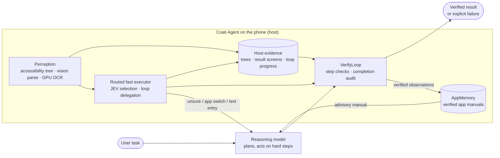

<div align="center">


# Coati Agent

**An AI agent that lives on your Android phone**

[](https://arxiv.org/abs/2611.02644)
[](#results)
[](#get-started)
[](LICENSE)

Describe the result you want. Coati Agent operates your apps to get there, uses its built-in Linux workspace
when the job needs code or a file, and reports success only when it can show it. No computer and no ADB.

**English** · [Español](README.es.md) · [中文](README.zh-CN.md) · [日本語](README.ja.md) · [한국어](README.ko.md)

[Why Coati Agent](#why-coati-agent) ·
[Get started](#get-started) ·
[What it can do](#what-it-can-do) ·
[Demo](#demo) ·
[How it works](#how-it-works) ·
[Research](#research)


<sub>The large model plans a repeated action once; the host taps item after item and counts what changed. Real time.</sub>

</div>

---

## Why Coati Agent

Your phone can do almost anything, but you still have to do it yourself: open one app, copy something,
switch to another, tap through the same screens again. Coati Agent does that part for you. Say what you
want in everyday language, and watch it work on your screen, the way a helpful friend would.

- **It lives on your phone.** Install one app. You do not need a computer, a cable or root access.
- **It works with the apps you already have.** There are no plugins to wait for: if you can tap through
  an app, Coati Agent can usually operate it too.
- **It can make things, not only tap.** A small Linux computer comes built in, so it can gather
  information, work on it, and hand you a finished PDF, chart or spreadsheet.
- **It checks its own work.** A task counts as done only when the screen shows it. If Coati Agent cannot
  confirm the result, it tells you.
- **You stay in charge.** You see every step and can pause or stop at any time. Your API key stays on your
  phone.

**Things you can ask it:**

- *"Set an alarm for 7:30 on weekdays and add Tokyo to my world clock."*
- *"Find two hotels in Tokyo rated 8.0 or higher for December 12 to 14, and save the prices in a note."*
- *"Read the first five listings in this app and make me a PDF comparing their prices."*

It is not magic: it can be slower than you on a simple task, and it can make mistakes, so keep an eye on
anything important. Coati Agent uses an AI model account of your own, and that provider may charge for
what you use.

## Get started

You need an Android 11 or newer device and an API key for an AI model. A [Google Gemini key](https://aistudio.google.com/apikey) is the easiest place to start.

1. **Install.** On your phone, download `coati-<version>-arm64.apk` from [Releases](../../releases/latest)
   (nearly all phones; use `x86_64` for an x86 device or emulator, or `universal` if unsure) and open it. Allow
   installation from this source if Android asks.
2. **Set up.** Open Coati Agent and follow the steps to turn on the overlay and **accessibility**
   permissions, then enter your API key under *AI Model Configuration*.
   On Android 13 and newer, if the accessibility switch is greyed out, open the app's info page in system
   Settings, tap the **⋮** menu, and choose *Allow restricted settings*.
3. **Ask.** Tap the floating Coati Agent button and type the result you want, for example *"Set an alarm
   for 7:30 AM in the Clock app."* A panel shows each step; pause or stop whenever you like.

Optional: add a JEV key (*Settings → JEV*) for faster simple steps, and choose a mode under *Settings →
Speed and accuracy*. Keys stay on the device and are sent only to the providers you configure.

<details>
<summary>Build from source</summary>

Requires JDK 17+ and the Android SDK.

```sh
./gradlew :app:assembleDebug
adb install -r app/build/outputs/apk/debug/app-debug.apk
```

</details>

## What it can do

- **Operate your apps.** Native, Flutter and canvas apps, through Android's accessibility service. It
  needs no root, no ADB and no computer.
- **Finish tasks across apps.** Read something in one app and act on it in another; a completion is
  checked against the result screen of every app the task used.
- **Run code and produce files.** A built-in Linux workspace comes inside the APK with nothing else to
  install: bash, Python (Pillow, pypdf, ReportLab, requests), Node.js, curl and a Chinese font, plus
  `apk add` and `pip install` for anything else. Coati Agent can collect information on the phone, process
  it, and deliver a PDF, chart or spreadsheet to your Download/Coati folder.
- **Get faster with use.** A small selection model takes simple steps, the host repeats loops of simple
  steps without a model call per item, and per-app manuals learned from verified observations shorten
  later visits.
- **Say when it could not finish.** Host evidence decides whether a step or a task succeeded, and a task
  that cannot be verified is reported as unverified rather than done.

## Demo

Screen recordings of the public build on a OnePlus phone (ColorOS, Android 16), Balanced mode, real
time: clips are trimmed at the ends only, never sped up. Each clip shows its own elapsed time; the top
bar and bottom panel are Coati Agent's on-screen progress and Pause/Stop controls. Each is one
representative run.

### Linux workspace — from phone apps to a finished file
*"In the Car Market app, read the names and prices of the first 5 listings. Then make a one-page PDF
report named car_report.pdf with a table of those listings and a bar chart of their prices, deliver it
to me, and open it on the phone so I can see it."* Coati Agent reads the listings, writes the report with
Python in its Linux workspace, and opens the delivered file. 17 steps, 5 min 13 s: the completion audit
twice rejected the report as read from the screen, and Coati Agent regenerated and reopened it before the audit
accepted. An unrecorded run of the same task finished in 9 steps and 1 min 44 s. File names in Downloads
and the app drawer are blurred.

<a href="https://www.coati-os.com/assets/demos/V5_linux.mp4"></a>

[Watch the recording](https://www.coati-os.com/assets/demos/V5_linux.mp4)

### Everyday task with the fast executor
*"In the Clock app, turn on the 7:00 weekday alarm, then add Tokyo to the world clock."*
73 s, 8 steps, 6 of them on the fast route; typing "Tokyo" goes to the Reasoning model.

https://github.com/user-attachments/assets/24384019-9561-482a-ae9f-30cc6ec87f0c

### Loops of simple steps — Reasoning every step vs. fast executor
*"In the Car Market app, add the first 10 listings to my favorites."* Same task, same phone, side by
side: 254 s with the Reasoning model deciding every step, 47 s when it plans the loop once and the host
repeats it (5.4×). Both runs favorited exactly the first 10 listings.

https://github.com/user-attachments/assets/fb831034-b329-4b8a-a25b-fdd2b382c192

### AppMemory — first visit vs. after learning
*"In the Coati 手册实验室 (Manual Lab) app, open the "实验档案" (Experiment Archive) page."* A deep,
rarely used page in an app the model has never seen. The first visit explores (18 steps, 231 s) and
the verified route is written to the app's manual; the next visit goes straight there (6 steps, 27 s).

https://github.com/user-attachments/assets/e3d520af-a866-4f61-b647-075994f30fa7

### Cross-app task — Booking.com → Google Keep
*"In the Booking.com app, find two hotels in Tokyo for two adults sharing one room, checking in on
December 12, 2026 and checking out on December 14. Both should have a guest review score of at least
8.0. Save their names, review scores, and total prices for the two-night stay, including the
currency, in a Google Keep note titled "Tokyo hotel shortlist". Do not book anything."*
A live app with dates, filters and prices, then a second app: 32 steps, 10 min 24 s, accepted by the
completion audit. Account details are blurred.

https://github.com/user-attachments/assets/e3babe08-9d76-4f92-b60b-f266a8fa7317

## How it works

Most mobile GUI agents run on a computer that drives a phone over a debugging bridge, out of reach
of ordinary users. **Coati Agent ships as an Android app** and operates other apps through Android's
accessibility service. Running on the phone gives it something a model alone lacks: **host-recorded
evidence** of what actually happened on screen — accessibility trees, result screens across apps,
the progress of a repeated action. Coati Agent grounds its execution in this evidence:

- **VerifyLoop** accepts a step or a completion only when host evidence confirms it.
- **AppMemory** learns per-app manuals solely from verified observations and reuses them later.
- A **routed fast executor** lets a small selection model take simple, confident steps, and lets the
  host repeat loops of simple steps that the large model plans once.



**VerifyLoop.** Every action is checked against the screen before and after it, by host evidence
(pixel changes at the target, tree texts, target state) or a compact model check. A completion
claim goes to an independent audit that sees the last result screen of every app the task used and,
for delegated loops, the host's record of which items were handled. If the audit cannot run, the
task ends as *done but unverified* instead of a plain "Task complete".

**AppMemory.** Per-app manuals (pages, routes, controls) are learned only from observations the
verification accepted, bound to the app's version, and offered to the Reasoning model as advisory
context on later visits. They help most on deep, rarely used routes in unfamiliar apps.

**Routed fast executor.** A small selection model (JEV) picks among actions the host builds from the
accessibility tree, and the host taps the element's own bounds. Unsure choices, app switches and text
entry go to the Reasoning model. For a repetitive sub-task, the large model plans the loop once
(per-item action, count, stop condition) and the host repeats it item by item without a model call
per item, recording progress as evidence. The speed–accuracy trade-off is a user setting:

| Mode | Fast path takes |
|---|---|
| Fast | every goal-directed step, text entry included |
| **Balanced** (default) | goal-directed steps; unfamiliar screens go to the Reasoning model |
| Accurate | only confident goal-directed steps |

Details: [`docs/jev-executor.md`](docs/jev-executor.md).

**Linux workspace.** An Alpine Linux userland runs under PRoot as an ordinary child process of the app,
unpacked on first use. Each task gets a fresh `/workspace`; the Reasoning model runs commands one at a
time and reads their output. The host copies files from `/workspace/output` to the phone's Download
folder and gives the completion audit its own record of commands and files.

## Research

Coati Agent's execution design is described in the paper
[*Coati: Host-Grounded Execution for Installable Mobile GUI Agents*](https://arxiv.org/abs/2611.02644).
The Linux workspace was added after the paper; the benchmark results below do not use it.

### Results

AndroidWorld, all 116 tasks, with **Gemini 3.8 Flash as the backbone of every agent**. Every agent
runs through the same harness, task instances, step budgets and official scorer.

| Agent | Controls the phone via | Trials | Success rate | False completions |
|---|---|---|---|---|
| **Coati Agent** | accessibility only | 3 | **86.5%** (89.7 / 87.1 / 82.8) | **5.4%** |
| Artemis | accessibility only | 3 | 77.6% | – |
| Artemis | ADB | 1 | 76.5% | – |
| FinalRun | ADB | 1 | 59.9% | 14.5% |
| Midscene.js | ADB | 1 | 59.1% | 7.5% |

Coati Agent solves 95 of the 116 tasks in all three trials. The ablation and per-app breakdown are in the
paper.

Beyond the benchmark — whose tasks are short first visits — in everyday-use experiments:

| What | Result |
|---|---|
| Fast executor on seven everyday phone tasks | **−39%** median time (64 → 39 s), **−25%** model tokens, comparable success |
| Fast executor on loops of simple steps (favorite, compare, hide in a 40-item list) | **2.8–5.4×** faster with **6–9×** fewer model tokens, equal or higher success |
| AppMemory on a deep route in an unfamiliar app (3 independent learning sessions) | **18.5 → 6–7** steps, median **190 → 77 s** |
| Fast executor on an Android 16 phone (9 tasks × 3 runs: native, canvas, Flutter, permission dialogs) | **27/27** runs vs 26/27, median **110.5 → 78.6 s**, Reasoning calls on the critical path **285 → 67** |
| AppMemory on the same phone | deep route: **22** steps (222 s) on the first visit, then **5** steps (about 22 s) |

### Reproducing the paper

| Experiment | Where | Notes |
|---|---|---|
| AndroidWorld (Coati Agent, ablations, opponents) | [`scripts/androidworld`](scripts/androidworld/README.md) | APK adapter around the official AW task runner; `--config C1/C2/C3/C4`, `--provider google`, `--routing`; opponents via `--agent midscene` / `--agent finalrun` |
| Everyday and device tasks, Car Market loops | [`scripts/device_bench`](scripts/device_bench/README.md) | `python run_app_bench.py <out> R1,R2,R3,R4 classic,jev 5`; `python marketplace.py repeat-summary <out>` |
| AppMemory learning | [`scripts/device_bench`](scripts/device_bench/README.md) | `python run_learning_bench.py <out> classic 2` |
| Fixture apps | [`test-apps/living-manual-lab`](test-apps/living-manual-lab/README.md), [`test-apps/marketplace`](test-apps/marketplace/README.md), `test-apps/interrupter` | Offline, deterministic; outcomes checked from the apps' saved state |

```sh
./gradlew :test-apps:living-manual-lab:installV1Debug
./gradlew :test-apps:marketplace:assembleDebug
adb install -r test-apps/marketplace/build/outputs/apk/debug/marketplace-debug.apk
```

The AndroidWorld harness records each episode's full identity (sources, parameters, budget, APK,
transport) and never replays or overwrites a scored episode; see its README for the pinned
environment and credential rules.

## Safety, privacy and platform

- **You stay in control.** Permission and installation dialogs are handed back to you (unless you
  choose full trust); every action happens visibly on screen; tasks can be paused or stopped at any
  time, and risky actions ask for confirmation.
- **Privacy.** Screenshots and screen descriptions are sent to the model providers you configure.
  AppMemory stores only admitted, sanitized page facts on the device.
- **Linux workspace.** Commands run with the app's own permissions and have internet access. The
  workspace separates file paths for convenience and is not a security boundary, so treat it as code
  running inside the Coati Agent app.
- **Distribution.** Coati Agent operates other apps through the accessibility service, which Google Play's
  AccessibilityService policy does not permit for autonomous agents, so it is distributed for direct
  installation. In July 2026 the European Commission adopted binding measures under the Digital
  Markets Act requiring Google to give third-party AI assistants equal access to Android features,
  including performing actions in apps (IP/26/1634).

## Repository layout

| Path | Contents |
|---|---|
| `app/` | The Coati Agent Android app: agent loop, VerifyLoop, AppMemory, JEV fast executor, perception, overlay UI |
| `scripts/androidworld/` | AndroidWorld harness for Coati Agent and opponent agents |
| `scripts/device_bench/` | Device benchmarks, Car Market tasks and checker, learning benchmark |
| `test-apps/` | Fixture apps: Manual Lab, Car Market, Interrupter |
| `third_party/` | Sources, build recipe and package list for the Linux workspace components |
| `docs/` | Design notes (fast executor, OCR inputs, local relay) and device validation reports |

## Citation

Yudou Ying and Pu Shi contributed equally; Yuhua Zheng is the corresponding author.

```bibtex
@misc{ying2026coati,
  title         = {Coati: Host-Grounded Execution for Installable Mobile GUI Agents},
  author        = {Yudou Ying and Pu Shi and Hanlei Shi and Yuhua Zheng},
  year          = {2026},
  eprint        = {2611.02644},
  archivePrefix = {arXiv},
  primaryClass  = {cs.MA},
  url           = {https://arxiv.org/abs/2611.02644}
}
```

## License

Coati Agent is free for **noncommercial use** under the
[PolyForm Noncommercial License 1.0.0](LICENSE): personal use, research, education, and use by
noncommercial organizations such as universities and public research institutions.

**Commercial use requires a separate license.** This includes use inside a company, in a commercial
product or service, or to provide services to others for a fee. Aspects of Coati Agent are the subject of
Chinese patent applications; for a commercial license, contact the applicant listed for the
relevant application in [PATENTS.md](PATENTS.md).

The Linux workspace bundles separate third-party programs (PRoot, talloc, Alpine Linux packages) under
their own licenses, including GPL and LGPL; see [THIRD_PARTY_NOTICES.md](THIRD_PARTY_NOTICES.md).

## Acknowledgments

Coati Agent is a joint research effort of Prof. Yuhua Zheng's team at the Hangzhou Institute for Advanced
Study, University of Chinese Academy of Sciences, and independent researcher Pu Shi.

Coati Agent builds on [AndroidWorld](https://github.com/google-research/android_world) for evaluation,
[ncnn](https://github.com/Tencent/ncnn) and [PaddleOCR](https://github.com/PaddlePaddle/PaddleOCR) for
on-device OCR, and [PRoot](https://github.com/termux/proot) and [Alpine Linux](https://alpinelinux.org)
for the Linux workspace.
