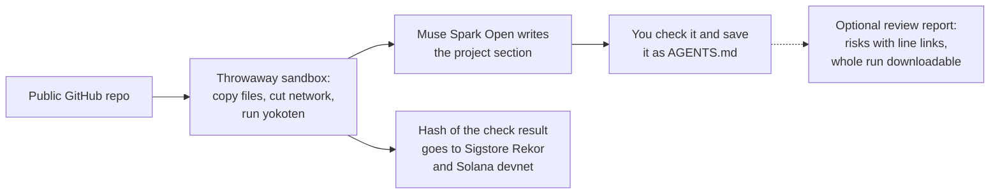

<p align="center">
  <a href="https://youtu.be/QIsv1PGTWX8"></a>
</p>

<h1 align="center">yokoten doctor</h1>

<p align="center"><b>See what an AI understands from your repo, before it touches your code.</b></p>

<p align="center">
  <a href="https://doctor.yokoten.app"><b>Try it now</b></a> ·
  <a href="https://youtu.be/QIsv1PGTWX8">Watch the 2-minute demo</a> ·
  <a href="docs/design.md">Read the design</a>
</p>

<p align="center">Free · No account · Public repos · Your repo's code never runs</p>

<p align="center">
  <a href="LICENSE"></a>
  
  
</p>

---

AI coding agents read your repo before they change it. If they get the build, the tests, or the off-limits files wrong, you pay for it later. yokoten doctor shows you what an agent will take away, so you can fix it first.

## Highlights

- **Paste a URL, see the AI's view.** Muse Spark Open reads the repo and writes how to build it, how to test it, and what not to touch.
- **You stay the judge.** If the text looks right, save it as `AGENTS.md`. The page then checks that it's there. A repo that already has one gets no new text.
- **A review report with line links.** Ask for the risks an agent should know before it changes your project. Each risk links to its line of code. It takes one to two minutes.
- **Receipts, not trust.** The server writes each check result's hash to Sigstore Rekor and a Solana devnet memo, and the page tells you if a write failed. You can download a whole review run and check it with one command.
- **Safe by design.** A throwaway Modal sandbox copies the public files, cuts the network, and runs [yokoten](https://github.com/yokoten-labs/yokoten). Nothing from your repo is installed, built, or run.

## Check the AI's work

When a review report's run file is ready, the report page offers it. Download the file, then run:

```bash
npx -y -p cool-workflow@0.4.1 cw report verify-bundle <file>
```

This proves nothing changed after the review. It doesn't prove the AI is right. That part is still on you.

## How it works



1. A throwaway sandbox clones the repo and runs yokoten on it.
2. Muse writes the project section of `AGENTS.md`. The page shows that text first, then the steps to save it as `AGENTS.md` and check that it saved. The saved file holds only that text, not yokoten's template, whose rules name checks a repo without yokoten doesn't have. Further down are yokoten's file checks, its other templates, and a patch.
3. The server writes a hash of the result to Sigstore Rekor and to a Solana devnet memo. The memo also names the repo, the commit and the yokoten version. You can download the result and compare.

See `docs/public-record.md`.

## Built with

| Part | What it does |
|------|--------------|
| [Muse Spark Open](https://ai.meta.com/) on [Baseten](https://www.baseten.co/) | Writes each repo's project section and the review report |
| [Modal](https://modal.com/) | Runs one throwaway sandbox for each check, and the server |
| [yokoten](https://github.com/yokoten-labs/yokoten) | Runs the file checks, with the same result every time |
| [cool-workflow](https://www.npmjs.com/package/cool-workflow) | Plans the review steps and seals the run file |
| [Sigstore Rekor](https://docs.sigstore.dev/logging/overview/) and Solana devnet | Keep a public record of each result's hash |
| [Astro](https://astro.build/) | Builds the static page |

Built for the Meta Global AI Developer Hackathon.

## Run your own copy

You need your own Modal account and your own Baseten key. Nothing here
shares the demo's keys.

1. Put your Baseten key in the server secret store as `BASETEN_API_KEY`.
   Keep it out of this repo and out of the browser.
2. Deploy the Python app in `server/` to Modal.
3. Serve the static files from `dist/` after `npm run build` on any static host. See `docs/hosting.md`.
4. Open the page and paste a public repo URL.
5. Put `REKOR_SIGNING_KEY` and `SOLANA_DEVNET_SEED` in the server secret store to turn on the public record. Without them the page works, and writes no record.

For the full check on your own machine, run `npx yokoten`.

## How this is built

Each tool does what it is good at. Claude plans and reviews. Muse Spark Open writes the code from task briefs, and writes each repo's project section at run time. yokoten makes the checks, which give the same result every time. Modal runs one throwaway sandbox for each check, and Baseten serves Muse Spark Open. See `REVIEW.md` and `docs/build-log.md`.

## Where to report

- A wrong check result goes to the yokoten repo. The checks are yokoten's;
  this page only shows them.
- A broken page goes here, in this repo's issues.

## Disclosure

One person built this entry during the hackathon, with AI tools:

- **Muse Spark Open** (`muse-spark-open-1026`, on Baseten) wrote most of the code, from task briefs. At run time it writes each repo's project section. Since PR #93, CI checks every code file against Muse's reply.
- **Claude** (Claude Code) wrote the design, the visitor copy and the task briefs. It reviewed the code, ran the tests and deploys, and made the commits. It also wrote some code by hand, mostly before PR #93.
- **A reviewer model** from another vendor (DeepSeek, through OpenCode Go) reviews each pull request from PR #22 on. PR #97 was too large for it, so a separate Claude session read it. PR #103 merged with no review, and a separate Claude session read it afterwards.
- **yokoten** started before the hackathon. This page uses `yokoten@0.2.0` from npm. No yokoten code is copied here, and yokoten is not part of this entry. Its logo existed before this project.

`Co-Authored-By` lines name Muse on the commits whose code it wrote.

<details>
<summary>Full details</summary>

This entry was built during the hackathon, with these tools:

- **Muse Spark Open** (`muse-spark-open-1026`, on Baseten) wrote most of the code in this repo, from task briefs. At run time it writes each repo's "This project" section.
- **Claude** (Claude Code) wrote `docs/design.md`, this site's design and visitor copy, and the task briefs in `docs/tasks/`. It reviewed the code, ran the tests and deploys, and made the commits. It chose what to build and how with the owner, so the briefs are detailed. It also wrote code by hand: the API address in `web/src/client/app.ts`, small edits to docs, small fixes, every change from PR #46 to PR #60, including the About page and the agent view, and PR #90's control states. Each pull request names who made it. From PR #93, Muse returns every code file, and CI checks each file against Muse's reply. For that PR, Muse also returned the code Claude had written. Muse changed some of those files and returned 12 unchanged, so those 12 are still Claude's work. The files it changed also keep many lines from Claude's code. On 2026-11-01, pull requests with Muse as the worker had added about 4,100 lines of code and tests, and those with Claude about 500. Some of the Muse pull requests also hold small hand edits. PR #97 rebuilt every page with Muse as the worker, from Claude's design and briefs. One exception: Claude chose the final text of `test/web/static-host.test.mjs`, and Muse only copied it, so those words are Claude's.
- **yokoten** (`yokoten@0.2.0`) started before the hackathon, and it kept changing during it, in its own repo. This page uses version 0.2.0, released on 2026-10-30. That version holds two things made during the hackathon that this page uses: `doctor --files`, and the `how` field in its JSON. None of yokoten's commits from that time name Muse. yokoten is an npm dependency, and no yokoten code is copied here. This repo holds none of that work, and we do not submit it as this entry. The checks on the page are yokoten's.
- **A reviewer model** that writes no code here reviews each pull request, through OpenCode Go, from PR #22 on. Each review names its model. PR #97 was over this reviewer's size limit, so no model from another vendor reviewed it. A separate Claude session that took no part in the work read it instead. Its blocking findings were fixed before the merge, and the smaller ones are in issue #98. PR #103 was over the limit too, and a gap in the check let it merge with no review at all. A separate Claude session read it after the merge, and a later pull request fixed its findings.

yokoten's logo existed before this project.

A `Co-Authored-By` line names Muse on commits whose code it wrote. Claude's part is stated here instead of in those lines, and some commit messages also name it. Commit messages were edited once, before the first push, to change those lines.

</details>

### A note for the organizers

One person made this entry and is its only participant. Muse and Claude are AI tools, not team members. The rules don't say whether an AI tool counts as a contributor, so we state our use of them here. If this use of Claude is not allowed, please tell us, and we will follow your decision.
