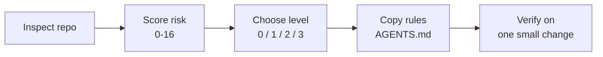

<div align="center">

# Agent Workflow Kit

Evaluation-first workflow rules for bringing AI coding agents into real software projects.

[](https://github.com/crisxuan/agent-workflow-kit/actions/workflows/docs-check.yml)
[](LICENSE.md)

[English Guide](docs/guide.md) · [中文文档](docs/guide.zh-CN.md) · [中文首页](README.zh-CN.md)

</div>

---

## What This Is

Agent Workflow Kit is a tool-neutral guide and agent workflow package for deciding whether a repository needs AI-assisted development rules, and how heavy those rules should be. It is not tied to Codex: any LLM, coding agent, or agent harness can use the guide, templates, and rules.

It helps maintainers answer five practical questions:

- Does this project need an AI workflow at all?
- Should the workflow be minimal, standard, or full?
- When should a spec layer be used?
- What should AI agents verify before claiming work is done?
- Which external actions require explicit maintainer approval?

The central rule is simple:

> Evaluate the project first. Then choose the smallest workflow that reduces real risk.

## At A Glance



## Why Use It

| Problem | What This Project Provides |
|---|---|
| AI agents jump into code too quickly | A repo inspection and risk scoring flow before changes |
| Requirements vanish into chat history | Guidance for adding a spec or change-memory layer only when needed |
| Work is claimed done without evidence | Copy-ready verification and completion rules for `AGENTS.md` |
| Tooling stacks overlap and conflict | Conflict rules for specs, plans, reviews, hooks, and external actions |
| Teams want consistent agent behavior | Agent-facing Skill packages and reusable templates for repeatable evaluations |

## How To Use The Kit

| Path | Best When |
|---|---|
| Read the [English guide](docs/guide.md) or [Chinese guide](docs/guide.zh-CN.md) | You want to evaluate a project manually |
| Copy [examples/AGENTS.level-2.md](examples/AGENTS.level-2.md) | You want a practical standard workflow starter |
| Use the `skills/agent-workflow-kit` package | You want an agent to inspect a repo and produce a workflow decision |
| Adapt the Markdown rules for Claude, Cursor, Codex, Gemini, or another harness | You want consistent behavior across tools |

## Quick Start

1. Open the [English guide](docs/guide.md) or [Chinese guide](docs/guide.zh-CN.md).
2. Score your project with the 0-16 risk table.
3. Choose the matching workflow level.
4. Copy the smallest useful `AGENTS.md` template block.
5. Fill in real install, test, lint, build, and browser/E2E commands.
6. Test the workflow on one small change before making it team policy.

## Workflow Levels

| Level | Use When | Typical Rules |
|---|---|---|
| Level 0 | AI does not edit code, or the project is disposable | No formal AI workflow |
| Level 1 | Small maintained projects | Basic agent rules and verification commands |
| Level 2 | Most AI-assisted software projects | Basic rules, spec guidance, agent discipline, external-action safety |
| Level 3 | Production, security-sensitive, complex UI, or multi-agent teams | Level 2 plus review gates and stronger verification |

## Documentation

| Document | Purpose |
|---|---|
| [English Guide](docs/guide.md) | Full public guide for maintainers |
| [Chinese Guide](docs/guide.zh-CN.md) | Full Chinese public guide |
| [AGENTS Templates](skills/agent-workflow-kit/references/agents-templates.md) | Copy-ready English `AGENTS.md` blocks |
| [中文 AGENTS 模板](skills/agent-workflow-kit-zh-cn/references/agents-templates.zh-CN.md) | Copy-ready Chinese Skill reference with English agent blocks |
| [Engineering References](skills/agent-workflow-kit/references/engineering-references.md) | Optional engineering guideline catalog |
| [中文工程规约参考](skills/agent-workflow-kit-zh-cn/references/engineering-references.zh-CN.md) | Chinese reference catalog |
| [Contributing](CONTRIBUTING.md) | Contribution and synchronization guide |
| [Changelog](CHANGELOG.md) | Project change history |
| [Level 2 AGENTS Example](examples/AGENTS.level-2.md) | Copy-ready standard workflow starter |

## Agent Skills And Templates

The `skills/` directory contains agent-facing versions of the guide. They are packaged as Codex-compatible Skills, but the instructions are plain Markdown and YAML, so other LLMs, coding agents, and agent harnesses can read and adapt them as project workflow rules.

These packages are optional. If you only want the human guide or `AGENTS.md` templates, use the documents above.

| Skill | Use It For |
|---|---|
| `skills/agent-workflow-kit` | English agent Skill package for evaluating a repository, scoring risk, recommending workflow level, and preparing project rules after approval |
| `skills/agent-workflow-kit-zh-cn` | Chinese agent Skill package with the same workflow and Chinese-facing instructions |

Each skill includes:

- `SKILL.md`: the agent workflow and safety rules
- `agents/openai.yaml`: display metadata and default prompt
- `references/agents-templates*.md`: reusable `AGENTS.md` template blocks
- `references/engineering-references*.md`: optional engineering reference catalog

Example prompts:

```text
Use $agent-workflow-kit to evaluate this repository and recommend the right AI workflow level.
```

```text
使用 $agent-workflow-kit-zh-cn 评估这个仓库，并推荐合适的 AI 工作流级别。
```

## Repository Layout

```text
README.md                         # Project homepage
README.zh-CN.md                   # Chinese project homepage
AGENTS.md                         # AI maintenance rules for this repo
CONTRIBUTING.md                   # Contribution guide
CHANGELOG.md                      # Project change history
.gitattributes                    # GitHub Linguist metadata
docs/guide.md                     # Full English guide
docs/guide.zh-CN.md               # Full Chinese guide
examples/AGENTS.level-2.md        # Copy-ready standard workflow starter
skills/
  agent-workflow-kit/        # English agent Skill package
  agent-workflow-kit-zh-cn/  # Chinese agent Skill package
scripts/check-docs.rb             # Markdown, YAML, skill, and link checks
.github/workflows/docs-check.yml  # GitHub Actions validation
```

## Validation

Run the local checks before publishing documentation changes:

```bash
ruby scripts/check-docs.rb
```

The check validates Markdown fences, YAML syntax, skill structure, and public links.

## License

- Guide prose and Skill instructions: [CC BY 4.0](https://creativecommons.org/licenses/by/4.0/)
- Reusable `AGENTS.md` templates and example code blocks: [CC0 1.0](https://creativecommons.org/publicdomain/zero/1.0/)
- Third-party tools and references keep their own licenses.
