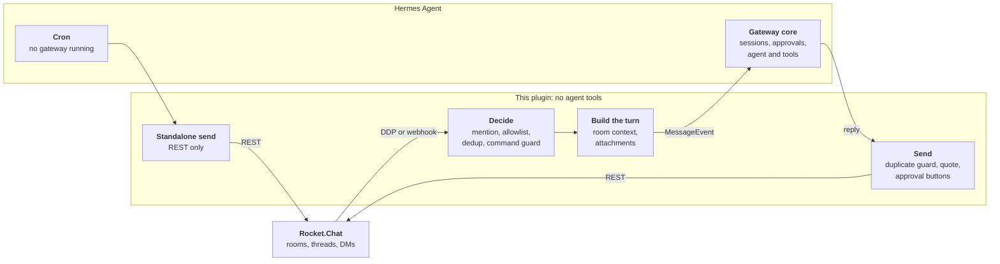

[](https://csabatatrai-ulx.github.io/hermes-rocketchat-team-gateway/)

# Rocket.Chat Team Gateway for Hermes Agent

[](https://github.com/csabatatrai-ulx/hermes-rocketchat-team-gateway/actions/workflows/ci.yml)
[](LICENSE)
[](https://hermes-agent.nousresearch.com/)
[](requirements.txt)

**Documentation:** https://csabatatrai-ulx.github.io/hermes-rocketchat-team-gateway/

**Bringing Hermes Agent into the enterprise team chat.** Rocket.Chat is the open source, self-hosted chat that organizations choose when their conversations must stay on their own servers. This [Hermes Agent](https://hermes-agent.nousresearch.com/) platform adapter makes Hermes a safe colleague there: one bot for a whole team, default-deny commands, and approval buttons so a person decides on dangerous actions. It only carries conversations, like Hermes's own Slack and Mattermost adapters; the agent keeps [every tool Hermes has](#tools-everything-hermes-has-none-of-its-own).

Supports **Rocket.Chat 8.7 – 9.x** from one code path. Requires **Hermes 0.22.3 or newer**.

- **Standalone, as [Hermes asks of third-party integrations](https://github.com/NousResearch/hermes-agent/pull/4637#issuecomment-4950466375).** Rocket.Chat support is a long-standing request ([#3725](https://github.com/NousResearch/hermes-agent/issues/3725), [#94576](https://github.com/NousResearch/hermes-agent/issues/94576)). This plugin changes nothing in Hermes core and keeps up with Rocket.Chat and Hermes releases itself; a contract test covers every Hermes interface it uses.
- **Built for shared rooms.** Each person gets their own session and room context, Hermes commands are blocked over chat unless allowed, and only the person who asked can approve their dangerous command.
- **Tested live.** 780 unit tests in CI against the oldest supported and the newest Hermes release, plus end-to-end runs with the official Hermes 0.23.0 image against Rocket.Chat 8.9.1, including a restart, a network outage and real clicks on the approval buttons.

Demo video (1:29): two people in a shared room, the approval buttons and the personal assistant. Also [on X](https://x.com/csabaatatrai/status/2120545513212616929).

https://github.com/user-attachments/assets/3a8107bc-dd71-4a02-9eed-7d476e32b55a

### ChatOps: a fix that waits for a human

Demo video (0:49):

https://github.com/user-attachments/assets/13bf2138-55c0-4fbd-9e7d-f0fc7ff10732

A simulated outage in a sandbox: the service, its logs and the alert are staged; what Hermes does, the commands it runs and the approvals are not.

## Try it in a few minutes

No Rocket.Chat server, no account, no API key? One Compose file starts Rocket.Chat, Hermes Agent and this plugin locally, with a bot, two people and a room ready, and a scripted demo model so nothing needs signing up:

```bash
git clone https://github.com/csabatatrai-ulx/hermes-rocketchat-team-gateway && cd hermes-rocketchat-team-gateway
docker compose -f try/compose.yaml up -d
python3 try/check.py    # 7 end-to-end checks: answers, two askers, the command guard, approval buttons, DMs
```

Open **http://localhost:3000**, sign in as `alice` / `hermes-demo`, and say `@hermes hi` in **#hermes-demo**. The demo model is not AI: it answers with fixed text, so what you see is the plugin itself. For a real model, sign in to Nous Portal (free tier) or use any OpenAI-compatible endpoint: [try/README.md](try/README.md).


## Why this adapter

**It keeps a shared room understandable.**

- Everyone gets their own session in a room. A thread is shared by its participants, or per person with Hermes's `thread_sessions_per_user`.
- Every mention carries what happened in the room since that person's previous mention, marked as context, with dates and UTC offsets. Nothing is stored; it is read from Rocket.Chat each time.
- Answers quote the question and mention the asker, so concurrent answers stay attributable. A thread mention is answered in the thread.
- A one-to-one DM needs no mention. A DM of three or more people follows room rules.


**It guards a room with many users.**

- Every `/word` is refused over chat unless allowed, without asking Hermes what is a command. A new command in a future Hermes is refused from day one, and no Hermes change can open the guard. Otherwise anyone in a room could run `/model`, `/yolo` or `/restart`.
- With `approvals.mode: manual`, a dangerous command waits for a click: accept and deny buttons appear on the prompt, and each click runs as the authenticated person who made it. Confirming `/new` works the same way. Which commands count as dangerous is Hermes's call, and its list has gaps (a relative-path `rm` is not flagged, [#151542](https://github.com/NousResearch/hermes-agent/issues/151542)); see [what approvals cover](docs/security.md#what-it-does-not-do).
- Skill commands have their own allowlist, and persistent approvals that would write to the shared config are refused.
- A bot answers only in rooms it is a member of, so nobody can pull it into a channel with a mention.
- Lines from senders outside the allowlist are marked `[unverified sender]` in the room context, and a multi-line message cannot forge a context marker.
- An optional signed asker token tells a history MCP server who is really asking, without trusting the model. See [security](docs/security.md#asker-token).

**It stays correct when things go wrong.**

- Duplicate suppression in both directions survives a restart. A reaction or edit makes Rocket.Chat redeliver a message with the same id; that never starts a second turn.
- After a reconnect, missed mentions are replayed. After a restart, the bot says which messages it did not process, or answers them with `replay` mode.
- A provider failure becomes a short notice naming the model provider, not a raw stack of retries.
- Removed Rocket.Chat APIs are detected at runtime and deprecation headers are logged, so a server upgrade shows up in the log before it breaks.

**It also works as a personal assistant.**

The same plugin can serve one person in their DMs, by configuration only: answer only the owner, only in DMs, and open the session, model and scheduling commands that a shared bot must not expose. The most dangerous commands (`/yolo`, `/restart`, `/update` and a few more) stay closed even then, unless enabled one by one.

> [!IMPORTANT]
> **A personal assistant needs its own Hermes instance and bot account per person.** One Hermes has one owner's sessions, memory, model and cron jobs. Never use the `personal` preset on a bot that several people can talk to.

```dotenv
ROCKETCHAT_TEAM_DM_ONLY=true
ROCKETCHAT_TEAM_ALLOWED_USERS=<owner user id>
ROCKETCHAT_TEAM_ALLOW_BUILTIN_PRESET=personal
```

Step by step, with the settings and a checklist: [personal assistant](docs/personal-assistant.md).

## Talking to the bot

| | In a room or thread | In a one-to-one DM |
|---|---|---|
| A question | `@hermes when is the release?` | `when is the release?` |
| A Hermes command | `@hermes /new` or `@hermes !new` | `!new` or `@hermes /new` |

Rocket.Chat clients treat a message that starts with `/` as one of their own commands and never send an unknown one, so a bare `/new` does not reach the bot. Mention it first, or use `!new` as on Hermes's Slack and Matrix adapters. Hermes's own prompts already show the form that works, such as `@hermes /approve`. Only allowed commands run; see [commands](docs/commands.md).

## Evidence

Every number below comes from a run, not from a claim. The live runs used Rocket.Chat 8.9.1, the official Hermes 0.23.0 image and Chrome driving the web client.

| What was checked | Result |
|---|---|
| Unit and contract tests in CI, on Hermes 0.22.3 (oldest supported) and 0.23.0 | 780 pass on both |
| `hermes plugins validate --install-deps` | Passes, no private core imports |
| End-to-end scenarios: mentions, threads, DMs, files both ways, concurrent askers, the command guard | 39 / 39 |
| Approval buttons clicked in a room and a thread, including another person's click doing nothing | 16 / 16 |
| `/new` confirmation buttons | 10 / 10 |
| Approval button in a one-to-one DM | 4 / 4 |
| Gateway restart and network outage, with catch-up | 14 / 14 |
| Cron delivery through the running gateway, and with the gateway stopped | 2 / 2 |
| Refused commands such as `/yolo`, `/tools`, `/cron` and unknown `/words` | 0 model calls |
| `@file:` and `@folder:` from a room member, directly and hidden in an earlier message of an unverified sender | 0 files attached (before the fix: `config.yaml` attached, `memories/` listed) |
| Real model (Nous Portal): room context, identity, threads, long answers, approval | Pass |
| Personal assistant, a second Hermes with the `personal` preset and a real model: DM questions, memory across sessions, preset commands, `/sethome` and a delivered reminder, `/yolo` refused, other people and rooms ignored | 19 / 19 |
| Fully local: the same real-model checks against a self-hosted open-weight model on vLLM, no cloud model service (team bot: room context, identity, threads, long answers, approval; personal assistant: all of the above) | 11 / 11 and 19 / 19 |

How each was measured, and what is not verified yet: [testing and evidence](docs/evidence.md). To repeat the core of it yourself, `python3 try/check.py` runs seven of these checks against the [try-it stack](try/README.md), no account or key needed.

Building it also turned up Hermes bugs, which the author reported upstream:

- [#148433](https://github.com/NousResearch/hermes-agent/issues/148433): a shutdown during a redirected turn overwrites an already streamed reply.
- [#149169](https://github.com/NousResearch/hermes-agent/issues/149169): `/loop` and `/heartbeat` stay silent after a gateway restart until the chat gets a plain message.
- [#151542](https://github.com/NousResearch/hermes-agent/issues/151542): a relative-path `rm` never asks for approval, while the same deletion with an absolute path does.
- [#148988](https://github.com/NousResearch/hermes-agent/issues/148988), with a fix proposed in [#149038](https://github.com/NousResearch/hermes-agent/pull/149038): session previews in `/resume` and `/sessions` showed an adapter's context line instead of the person's message; found because this adapter gives every turn room context.

## How it works

### System context


The C4 container and component views, and the Structurizr DSL they come from, are in [architecture](docs/architecture.md#c4-model).

### Message flow



The plugin only carries messages. Sessions, the agent and approvals stay in Hermes, and room access for the agent belongs in an MCP server. See [architecture](docs/architecture.md).

### Tools: everything Hermes has, none of its own

No tools of its own does not mean a bot without tools. In Rocket.Chat the agent uses every tool Hermes gives it: the terminal, files, web search, code execution and the tools of any MCP server you connect, with Hermes's approvals in front of the dangerous ones. You choose which, per platform, with `platform_toolsets.rocketchat_team`. The plugin only carries the conversation, on purpose. It is the same scope as Hermes's own Slack, Mattermost and Telegram adapters, a transport bug cannot become a tool that reads or posts where it should not, and a tool that lives in Hermes or an MCP server works from every channel.

Rocket.Chat itself works the same way: to let the agent search a room, read its history or post elsewhere, connect an MCP server. Rocket.Chat 8.8 and later ships a native one (Enterprise plans with the AI add-on; alpha), and community servers exist:

```bash
hermes mcp add rocketchat --url https://chat.example.com/api/v1/mcp   # authentication: see Rocket.Chat's MCP documentation
hermes config set platform_toolsets.rocketchat_team '[terminal, rocketchat]'   # the tools this bot may use
```

With the optional signed asker token, such a server knows who is really asking. See [security](docs/security.md#asker-token).

Step by step, as sequence diagrams: [a question and its answer, and a dangerous command with its buttons](docs/architecture.md#a-question-and-its-answer).

## Quick start

### 1. Prepare Rocket.Chat

1. **Administration → Users → New**: create a user such as `hermes` with the roles `user` and `bot`, without admin or room owner rights.
2. Log in as the bot, open **Profile → Personal Access Tokens**, and create a token with **Ignore Two Factor Authentication** ticked. Copy the token and the user ID; they are shown once.
3. Invite the bot to the rooms it should work in: `/invite @hermes`. DMs need no setup.

### 2. Install

```bash
hermes plugins install rocketchat-team-gateway --enable
```

Until the [catalog entry](https://github.com/NousResearch/hermes-agent/pulls?q=rocketchat-team-gateway) is merged, install it straight from this repository:

```bash
hermes plugins install csabatatrai-ulx/hermes-rocketchat-team-gateway --enable
```

### 3. Configure

Run `hermes gateway setup` and choose Rocket.Chat. The wizard checks the credentials against the server before saving them. Or put the settings in `~/.hermes/.env` (`chmod 600`):

```dotenv
ROCKETCHAT_TEAM_URL=https://chat.example.com
ROCKETCHAT_TEAM_BOT_USERNAME=hermes
ROCKETCHAT_TEAM_USER_ID=<bot user id>
ROCKETCHAT_TEAM_TOKEN=<bot personal access token>
ROCKETCHAT_TEAM_ALLOWED_USERS=<user id>,<user id>    # user IDs, not usernames
```

Decide who may talk to the bot: `ROCKETCHAT_TEAM_ALLOWED_USERS`, Hermes pairing, or on a closed server `ROCKETCHAT_TEAM_ALLOW_ALL_USERS=true`. Without one of them Hermes answers nobody.

**Before letting real users in, give the platform an explicit tool list.** A platform plugin cannot set this for you, and without it Hermes grants the platform its full core toolset, including the terminal and file writes.

```bash
hermes config set platform_toolsets.rocketchat_team '[my-mcp-server]'   # or [] for none
hermes config set approvals.mode manual   # a person answers every dangerous command
hermes config set memory.memory_enabled false        # one memory would be shared by everyone
hermes config set memory.user_profile_enabled false
```

Hermes's default `smart` mode lets a helper model approve flagged commands, so no one is asked.

`@file:`, `@url:` and the other Hermes `@` references in messages are kept inert by default, so a room member cannot attach files from the bot's workspace. For a bot only you use, `ROCKETCHAT_TEAM_ALLOW_CONTEXT_REFERENCES=true` turns this off ([why](docs/security.md#context-references)).

### 4. Start and check

```bash
hermes gateway restart
grep 'Rocket.Chat:' ~/.hermes/logs/agent.log
```

A healthy start logs:

```text
Rocket.Chat: authenticated as @hermes (<bot user id>) on https://chat.example.com
Rocket.Chat: DDP logged in (resume token)
Rocket.Chat: DDP subscribed to stream-room-messages
```

Then mention the bot in a room it belongs to, or send it a DM. `@hermes /whoami` answers instantly without a model call and shows who the bot thinks you are.

## Security model

| Question | Answer |
|---|---|
| Who can talk to the bot? | People in the rooms the bot is a member of, narrowed by `ROCKETCHAT_TEAM_ALLOWED_USERS`. A mention cannot pull it into another room. |
| Who can run a Hermes command over chat? | Nobody, unless that command is allowed. Every `/word` is refused by default. |
| Who can approve a dangerous command? | Only the person who asked. Each click runs as the authenticated person who made it. |
| What does the model see from other people? | The room since the asker's previous mention, marked as context. Senders outside the allowlist are marked `[unverified sender]`. |
| Can a message make the bot read a file or fetch a URL by itself? | No. Hermes expands `@file:`, `@folder:`, `@git:` and `@url:` in incoming messages before the model runs, with no tool call. The adapter keeps these inert in the message, the room context and attached documents. One person running their own bot can turn it off with `ROCKETCHAT_TEAM_ALLOW_CONTEXT_REFERENCES=true`. See [context references](docs/security.md#context-references). |
| What is up to your Hermes configuration? | Which tools the bot has, the approval mode, which commands count as dangerous, and memory. See [what the adapter does not do](docs/security.md#what-it-does-not-do). |

## What this plugin does on your system

| Behaviour | Details |
|---|---|
| Network | Connects only to `ROCKETCHAT_TEAM_URL`: a long-lived WebSocket (`/websocket`) and REST calls. No telemetry. Redirects are not followed, so the token cannot reach another host. |
| Listening port | None by default. `ROCKETCHAT_TEAM_TRANSPORT=webhook` opens an HTTP listener on `127.0.0.1:8645` and refuses to start without a shared secret. |
| Background work | One WebSocket connection with reconnect, a typing indicator loop during turns, debounced state writes. |
| Files on disk | `$HERMES_HOME/rocketchat-plugin-dedup/`: `inbound.json`, `outbound.json` (message ids and content hashes of sent replies), `ddp_cursor.json`, `ddp_status.json`. `ROCKETCHAT_TEAM_DEDUP_STATE_DIR=off` keeps them in memory. |
| Files read | When the model sends `MEDIA:/path`, Hermes validates the path and the plugin uploads that file to the room. `ROCKETCHAT_TEAM_OUTBOUND_FILES=false` turns this off. |
| Files received | Attachments on the mentioning message are downloaded with the bot's token into Hermes's media cache. |
| Credentials | Read through Hermes's profile-scoped secret reader. The plugin reads no credential files. |
| Logs | Message text from DMs is never logged, only ids and counts. |
| Shell commands, self-update | None. |

## How it differs from `rocketchat-platform`

The Hermes plugin catalog already has a Rocket.Chat plugin, [`rocketchat-platform`](https://github.com/HalfbitStudio/hermes-plugin-rocketchat). The two solve different problems: that one gives the agent Rocket.Chat tools; this one makes a room that many people share with one bot safe and understandable. Compared with `rocketchat-platform` 1.5.2:

| | `rocketchat-platform` | Rocket.Chat Team Gateway |
|---|---|---|
| Agent tools for Rocket.Chat (post, search, history, channels) | ✓ ten tools | – by design; pair it with an MCP server |
| Context a mention carries | earlier messages of the thread, for a mention in a thread | what happened in the room since the asker's previous mention |
| Who an answer is for | a plain reply, or a thread with `ROCKETCHAT_REPLY_MODE=thread` | each answer quotes its question and mentions its asker |
| Hermes commands over chat | passed to Hermes | refused unless an administrator allows each one |
| Dangerous commands | Hermes's text prompt | approval buttons that only the asker can use |
| After a restart or an outage | reconnects | answers or reports the mentions it missed; no duplicate turns, even across restarts |

The two do not clash: this plugin registers the Hermes platform id `rocketchat_team` and reads `ROCKETCHAT_TEAM_*` settings, `rocketchat-platform` registers `rocketchat` and reads `ROCKETCHAT_*`. If you run both, give each its own bot account. To switch from `rocketchat-platform`, copy `ROCKETCHAT_URL`, `ROCKETCHAT_TOKEN`, `ROCKETCHAT_USER_ID` and `ROCKETCHAT_ALLOWED_USERS` to their `ROCKETCHAT_TEAM_` names, add `ROCKETCHAT_TEAM_BOT_USERNAME`, use `platform_toolsets.rocketchat_team` and `deliver=rocketchat_team`, and restart the gateway.

## Upgrading from 1.x

2.0 has its own platform id, `rocketchat_team`, and reads `ROCKETCHAT_TEAM_*` instead of `ROCKETCHAT_*`. In the profile's `.env`:

```bash
sed -i 's/^ROCKETCHAT_/ROCKETCHAT_TEAM_/' ~/.hermes/.env
```

- `config.yaml`: rename the `rocketchat` keys under `platforms`, `platform_toolsets`, `platform_hints` and `display.platforms`, and a top-level `rocketchat:` section, to `rocketchat_team`
- cron jobs: `deliver=rocketchat` becomes `deliver=rocketchat_team`
- restart the gateway; sessions start fresh

If old keys are still set and the new ones are not, the gateway log says which to rename.

## Documentation

| Document | Contents |
|---|---|
| [Configuration](docs/configuration.md) | every setting with its default |
| [Sessions and context](docs/sessions-and-context.md) | sessions, room context, threads, DMs |
| [Commands](docs/commands.md) | chat commands and the command guard |
| [Attachments](docs/attachments.md) | inbound and outbound files |
| [Security](docs/security.md) | threat model, asker token, recommended Hermes settings |
| [Deployment](docs/deployment.md) | recommended Hermes config, state, reverse proxy, containers |
| [Compatibility](docs/compatibility.md) | versions and the Rocket.Chat APIs used |
| [Architecture](docs/architecture.md) | module layout, delivery paths, design decisions |
| [Troubleshooting](docs/troubleshooting.md) | symptoms and fixes |
| [Development](docs/development.md) | running the tests |

## Acknowledgements

[](https://ulx.hu/)

Developed by **Csaba A. Tátrai** ([LinkedIn](https://www.linkedin.com/in/csabatatrai-datascientist/)) at [Ulx Kft.](https://ulx.hu/), an enterprise open source IT company, and released as open source with its permission.

## License

[Apache License 2.0](LICENSE). See [NOTICE](NOTICE) for attribution.
