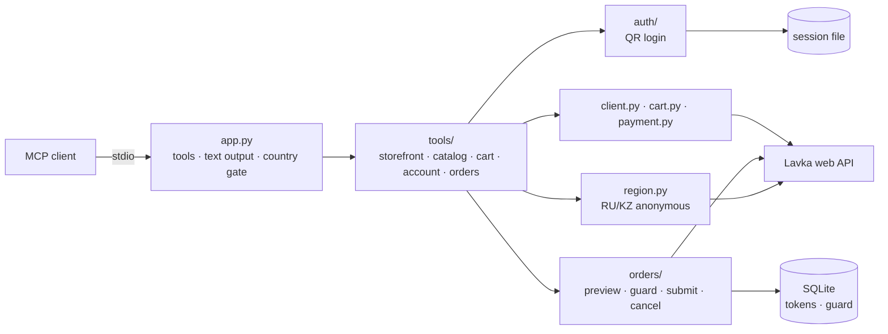

<!-- mcp-name: io.github.d3d0n/better-lavka-mcp -->
<p align="center">
  
</p>

<h1 align="center">Better Lavka MCP</h1>

<p align="center">
  <strong>Groceries from Yandex Lavka Uzbekistan, ordered by your AI assistant.</strong>
</p>

<p align="center">
  <a href="https://pypi.org/project/better-lavka-mcp/"></a>
  <a href="https://github.com/d3d0n/better-lavka-mcp/actions/workflows/ci.yml"></a>
  <a href="https://registry.modelcontextprotocol.io/v0/servers?search=better-lavka-mcp"></a>
  
  <a href="https://github.com/d3d0n/better-lavka-mcp/blob/main/LICENSE"></a>
  <a href="https://glama.ai/mcp/servers/d3d0n/better-lavka-mcp"></a>
</p>

<p align="center">
  <a href="https://github.com/d3d0n/better-lavka-mcp/blob/main/docs/auth.md">Sign in</a> ·
  <a href="https://github.com/d3d0n/better-lavka-mcp/blob/main/docs/checkout.md">Checkout</a> ·
  <a href="https://github.com/d3d0n/better-lavka-mcp/blob/main/docs/clients.md">Clients</a> ·
  <a href="https://github.com/d3d0n/better-lavka-mcp/blob/main/CHANGELOG.md">Changelog</a> ·
  <a href="https://github.com/d3d0n/better-lavka-mcp/blob/main/SECURITY.md">Security</a> ·
  <a href="https://github.com/d3d0n/better-lavka-mcp/blob/main/CONTRIBUTING.md">Contributing</a>
</p>

---

## What is it

An MCP server for Yandex Lavka in Uzbekistan. Connect it to Claude, Codex, OpenCode or any other MCP client, and your assistant can find groceries, fill the cart and place the order for you.

You sign in once by scanning a QR code in the Yandex app. Everything runs on your computer.

---

## Stuff you do with it

- **Say where once.** "Deliver home" — the assistant picks your saved address and remembers it next time.
- **Ask what's on the shelf.** "Is there milk at Chilonzor?" — milk and its price at your Lavka.
- **Shopping list in one message.** "Milk, bread, six eggs" — all of it lands in the cart in one go. It takes what you bought before; for anything new it shows the options and asks which one.
- **As usual.** "What do I usually get?" — your favorites and what you bought here, most recent first.
- **Browse the shelves.** "What's in the dairy section?" — categories and shelves with prices, like in the app.
- **Same as last time.** "Repeat my last order" — everything from your last order goes back into the cart at today's prices; anything sold out comes with Lavka's own replacements.
- **Pay less.** Discounts show next to prices; the preview lists your promo codes and coupons and can spend your Plus points.
- **Read the label.** "How many calories are in this bread?" — calories, protein, fat, carbs, ingredients and shelf life from the product card.
- **Say yes.** The assistant shows address, items, total and card; you agree, the order goes out, and if the bank wants 3-D Secure you get the link.
- **Where is it?** "Where's my order?" — Lavka's own status, minutes left and how far the courier is. "Cancel my order."
- **Peek at Russia and Kazakhstan.** Browse the RU and KZ storefronts and search their products.

---

## Three little stories

**Sunday restock.** You type *"repeat my last order, deliver home"*. Potatoes, chicken, cottage cheese and the rest go back in the cart; the flatbread is sold out today, and the assistant says so. It shows the total, you say "yes", and breakfast is on its way.

**Recipe to cart.** You paste a plov recipe and say *"get everything for four people"*. The assistant turns it into a list and puts rice, carrots, lamb, oil and cumin in the cart in one request. Where there are several kinds and you haven't bought one before, it asks which; anything out of stock comes back with a suggestion to swap.

**Label check.** *"How many calories are in this bread?"* The assistant opens the product card: 240 kcal per 100 g, 7.7 g protein, three days of shelf life.

---

## Works today · Not yet

| ✅ Works today | 🚧 Not yet |
|---|---|
| Sign in with a QR code from the Yandex app | Scheduled delivery slots |
| Your address and card are remembered | Adding to an order that's already placed, or changing its address |
| Search with discounts, stock and "bought before"; your usual products; catalog and product cards | Tips for the courier |
| Shopping lists, cart editing, Lavka's replacements for sold-out items | Support chat and order feedback ("the cilantro never came") |
| Promo codes, coupons and Plus points in the preview | Retrying a failed payment on the same order |
| Ordering with a saved card, 3-D Secure link, cancelling | Paying in cash |
| Live tracking: status, minutes left, courier distance | "Tell me when it's back in stock" |
| Order history, order details, repeat an order | |
| Browse the RU and KZ storefronts | Ordering in Russia and Kazakhstan |

---

## Getting started

You need [uv](https://docs.astral.sh/uv/getting-started/installation/). Add this to your MCP client:

```json
{
  "mcpServers": {
    "lavka": {
      "command": "uvx",
      "args": ["better-lavka-mcp"]
    }
  }
}
```

Or with Claude Code: `claude mcp add lavka -- uvx better-lavka-mcp`.

Ask the assistant to call `login`, scan the QR in the Yandex app, and you're in. Per-client examples (Claude Code, Claude Desktop, OpenCode, Oh My Pi) are in [docs/clients.md](https://github.com/d3d0n/better-lavka-mcp/blob/main/docs/clients.md).

**From source:**
```sh
git clone https://github.com/d3d0n/better-lavka-mcp.git && cd better-lavka-mcp
mise trust && mise install
mise run install   # Python 3.12 + deps from uv.lock
mise run test      # offline suite, no network, no money
```
Then point the client at `/absolute/path/to/better-lavka-mcp/.venv/bin/better-lavka-mcp`.

**Uninstall:** `uvx better-lavka-mcp uninstall` deletes the sign-in, remembered address and card, and everything else the server stored, then prints how to remove the client entry and the package.

Settings:

- `YANDEX_LAVKA_REGION` — country: `UZ` (default), `RU` or `KZ`. In RU and KZ only `get_storefront_status` and `search_products` work; both also take a `country` argument for one call.
- `YANDEX_SESSION_FILE` — where the session cookies live.
- `BETTER_LAVKA_MCP_OUTPUT=json` — tools return raw JSON instead of the default short text. The text says what happened, lists the data, and tells the assistant what to do next; JSON is handy for scripts and debugging.

Products, orders and categories show up as short ids like `amber fox wave` instead of 44-character hex — about 5 tokens instead of 23. The same product always gets the same words, and tools accept either form.

---

## Tools

Nineteen tools with plain verb + noun names, so the assistant picks the right one on the first try.

| Tool | What it does |
|---|---|
| `use_address` | Pick the delivery address by its saved name ("Home", "Work"); remembered next time |
| `search_products` | Find products with prices, discounts and stock; empty query = what you usually buy |
| `list_categories` | The catalog: groups and categories |
| `get_category_products` | Shelves and products in one category |
| `get_product` | Product card: price, pack, nutrition, ingredients, shelf life |
| `add_to_cart` | Add a whole shopping list in one go |
| `repeat_order` | Put a past order back into the cart |
| `get_cart` | What's in the cart, delivery and total |
| `set_cart_quantity` | Change or remove one item |
| `preview_order` | Address, card, items and total before ordering; promo codes and Plus points |
| `submit_order` | Place the order |
| `list_order_history` | Orders with their items and, while Lavka tracks them, live status: minutes left, courier distance |
| `get_order` | One order in full: fees, payment status (3-D Secure link), tracking |
| `cancel_order` | Cancel an order |
| `get_account` | Who is signed in, saved addresses (which is chosen) and cards (which is remembered) |
| `login` | Sign in with a QR code; call again until the scan is confirmed |
| `search_addresses` | Find an address by text |
| `get_storefront_status` | Start here: is Lavka open, delivery time, sign-in, chosen address, cart and latest order |
| `reconcile_order_attempt` | Unblock ordering after a dropped connection |

---

## Under the hood



Session and order state live under `~/.local/share/yandex-lavka-mcp/` (on Windows, `%LOCALAPPDATA%\better-lavka-mcp`).

<details>
<summary><strong>Code map</strong></summary>

`src/better_lavka_mcp/`

- `app.py` — the MCP server, text rendering hook, country and address state
- `tools/` — the tools, grouped by storefront, catalog, cart, account and orders
- `client.py` — Lavka web API client and the session file
- `render.py`, `aliases.py` — text output and short three-word ids
- `auth/` — QR sign-in
- `cart.py`, `payment.py`, `region.py` — cart writes, saved cards and payment status, RU/KZ storefronts
- `orders/` — preview, submit, cancel, guards, tracking
- `paths.py`, `preferences.py`, `uninstall.py` — data folder, remembered choices, `uninstall`

</details>

---

## What it is not

- Not official. Not affiliated with or endorsed by Yandex. The API is undocumented and may change.
- Not a payment processor. It never sees full card numbers.

---

<p align="center">
  <sub>Unofficial · runs on your machine · <a href="LICENSE">GPL-3.0-only</a></sub>
</p>
