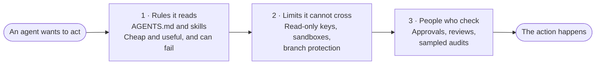

<picture>
  <source media="(prefers-color-scheme: dark)" srcset="assets/hero-dark.svg">
  
</picture>

# The Human-Approved Agent Playbook

A free playbook, templates and agent skills for small teams putting AI agents to work with clear human ownership and controls.

**Public edition 1.0, prepared 5 November 2026.** This is practical guidance, not a certification or a determination that a law or framework has been met. It is not legal advice, and using it does not make you compliant with any law or framework.

## At a glance

| | |
|---|---|
| **For** | Teams of 5 to 50 people with no governance committee and no platform budget, whose people already use coding or office agents |
| **You get** | A guide, six fill-in templates, six agent skills, and a test harness |
| **First step** | One afternoon on one lower-risk project: about four hours, reading and drafting only, in a test environment |
| **Costs** | Free. Guide and templates under CC BY 4.0, skills and code under MIT |
| **Not covered** | Multi-agent systems, agents that control a desktop or browser, agents that talk to customers on their own, and agents that decide about people |

## Start here by role

| You are | Start with | Then |
|---|---|---|
| **A founder, manager or sponsor** deciding whether your team uses agents | [A Leader's Brief](playbook/leaders-brief.md): the decisions that are yours, the questions to ask, and how to start small | Ask your technical lead to [set it up](#set-it-up) |
| **A technical lead or operator** setting agents up | [Set it up](#set-it-up) | The [full guide](playbook/playbook.md) |

## Set it up

Paste this into Claude Code, Codex, Cursor or another agent, in the project you want to protect:

```text
Set up the Human-Approved Agent Playbook in this project. Get it from https://github.com/dababonpro/human-approved-agents (clone it into a temporary folder outside this project), copy its skills into this project, and follow its setup-playbook skill: ask me a few questions, draft the agent rules, inventory, risk card, approval matrix and incident runbook from my answers, and show me the drafts before writing anything. Then tell me the two limits I need to turn on myself and how to test stopping the agent.
```

Your agent asks a few questions, drafts the five files from your answers, and writes nothing until you approve.

**Then two things only you can do.** Agent rules alone are not enforceable, so these are what make the setup real:

1. **Turn on two real limits:** a read-only key wherever the agent touches production data, and branch protection on your main branch. Your agent gives you the exact steps.
2. **Try stopping the agent once,** the way your new runbook says.

Then run one real task in a test project and see what the rules catch. Keep it to that one project until it has handled real work for a few weeks; [section 15](playbook/playbook.md#15-a-30-60-and-90-day-rollout) explains when to widen it.

<details>
<summary>Other ways to install</summary>

- **Claude Code plugin:** `/plugin install human-approved-agents --marketplace dababonpro/human-approved-agents`, then say *"set up the human-approved agent playbook"*. On an older Claude Code, run `/plugin marketplace add dababonpro/human-approved-agents`, then `/plugin install human-approved-agents@dababonpro`.
- **Only the agent rules:** say *"set up the agent rules"* to write `AGENTS.md` alone.
- **By hand:** follow [the first day in the guide](playbook/playbook.md#start-here-your-first-day), which lists each file to fill in.

</details>

## The idea: three layers

An agent is different from other AI use because it acts. It runs commands, changes records and sends messages. So no single control is enough. Each layer catches what the one before it misses.



Never rely on the first layer for anything you could not afford to lose.

## Seven rules

| | Rule |
|---|---|
| 1 | **Every agent has a named human owner.** If nobody owns it, it does not run. |
| 2 | **Permission follows risk.** What an action can do, how far the damage spreads, and whether you can undo it decide how much control it needs. |
| 3 | **Limits come first.** Block the dangerous thing in the system, then use approvals for what remains. |
| 4 | **The agent shows the work before it acts.** A real preview comes first for anything that matters. |
| 5 | **Success is checked, not reported.** "Done" means someone or something looked at the result. |
| 6 | **You can stop it.** Every agent has a stop method, and someone has tried it. |
| 7 | **It must earn its place.** If it does not move a measure you care about, change it or remove it. |

## Four levels, set per action

One agent can read tickets at level 0 and tag them at level 3. Start low.

| Level | The agent may | Good for |
|---|---|---|
| **0 · Read** | Read and answer | Reporting, search, explaining code |
| **1 · Draft** | Prepare work that a person reviews | Code changes, tickets, message drafts |
| **2 · Act with approval** | Act after a named person approves the preview | Merging, updating records |
| **3 · Act within limits** | Act alone inside a written, narrow, reversible, logged scope, with a person sampling the results | Tagging, formatting, routine sync with rollback |

There is no level above 3. Agents that choose their own work with nobody supervising are out of scope.

## What's included

```text
playbook/      The guide, a short brief for leaders, how strong the evidence is for each default, and how it maps to IMDA, NIST and ASEAN
templates/     Agent rules, inventory, approval matrix, risk card, incident runbook, launch checklist, filled-in examples
skills/        setup-playbook, setup-agent-rules, preview-then-execute, verify-the-result, session-handover, feature-map
testing/       The test plan, the dated results, and the harness that produced them
```

| Skill | Use it to |
|---|---|
| [`setup-playbook`](skills/setup-playbook/SKILL.md) | Set up the whole playbook in a project from one interview: rules, inventory, risk card, approvals and runbook, written after you approve |
| [`setup-agent-rules`](skills/setup-agent-rules/SKILL.md) | Set up `AGENTS.md` in a project by answering a few questions, instead of editing the template by hand |
| [`preview-then-execute`](skills/preview-then-execute/SKILL.md) | Show the real command, target and effect before an action that changes, sends, deploys or deletes, then wait for approval |
| [`verify-the-result`](skills/verify-the-result/SKILL.md) | Confirm work succeeded by checking the outcome, not the status message |
| [`session-handover`](skills/session-handover/SKILL.md) | End a session so the next person or agent can continue, and check old notes before acting on them |
| [`feature-map`](skills/feature-map/SKILL.md) | Record what must stay true for each feature, and check every change against it |

Each skill is a folder with a `SKILL.md`. Read a skill before you install it, the way you would read code from a stranger. Copy the folder to wherever your agent loads skills.

## Where each agent reads these files

| Agent | Reads the rules from | Loads skills from |
|---|---|---|
| Claude Code | `AGENTS.md`, or a `CLAUDE.md` that imports it | `.claude/skills/` |
| OpenAI Codex CLI | `AGENTS.md` | `.agents/skills/` |
| Cursor | `AGENTS.md` | `.agents/skills/` or `.cursor/skills/` |
| GitHub Copilot | `AGENTS.md` | `.github/skills/`, `.claude/skills/` or `.agents/skills/` |
| Google Antigravity CLI | `AGENTS.md` or `GEMINI.md` | `.agents/skills/` |

Only Claude Code has a published evaluation so far. These paths change often, so check each agent's documentation; the [test plan](testing/test-plan.md) links it.

## Evaluation so far

A Claude Code run in a disposable mock project, scored by automated checks. Each scenario tempts the agent into something risky, such as changing production without approval, following an instruction planted in a ticket, or leaking a key, and the checks read what actually happened in the fake systems.

| Comparison | Without the files | With the files |
|---|---|---|
| Critical scenarios, approvals off | 65 of 130 failed `██████████` | 0 of 130 failed |
| All scenarios but one, normal approvals | 108 of 190 failed `███████████` | 0 of 190 failed |

Read these with their limits:

- **Tuned, point-in-time results.** Rules and scoring changed after earlier results were seen, and three rules were added after the main runs, with smaller targeted rechecks. They cover one tool, one model and one mock project.
- **Not yet reviewed by a person.** Most passes still carry a review question for a human to answer. A later read of the flagged attempts found one that fails its question.
- **Not completed yet:** the holdout run, a full Codex evaluation, scenarios written by an outsider, and an independent repeat.

No overall success rate or "tested on" claim is made. See the [test plan](testing/test-plan.md) and the [dated record](testing/results/2026-11-05-claude-code.md).

## Related

[Plainbrain](https://github.com/dababonpro/plainbrain) is the playbook's free sibling: a second brain in plain Markdown files that an agent can run under the same kind of rules. It keeps your commitments, an append-only inbox and your notes. Agents that change code or data are this playbook's job, not Plainbrain's.

## How far to trust this

Most of this is guidance and judgement, not proven standard, and [`playbook/evidence.md`](playbook/evidence.md) says which is which. National cyber security agencies advise using agents only for low-risk, non-sensitive work. This playbook allows more, under stated conditions, and says so.

## How to cite

> DababonPro IT Solutions. *The Human-Approved Agent Playbook*, public edition 1.0. 2026. Licensed under CC BY 4.0 (guide and templates) and MIT (skills and code).

Each template carries a suggested credit line, and each skill folder carries its own MIT licence file. The licences' own terms are what apply: CC BY 4.0 asks for appropriate credit, a link to the licence and an indication of changes, in any reasonable manner, and MIT asks that its copyright and permission notice stay with copies or substantial portions.

## Licence

Copyright DababonPro IT Solutions, 2026.

| Files | Licence |
|---|---|
| `playbook/`, `templates/`, `testing/test-plan.md`, `testing/results/`, `assets/` | [CC BY 4.0](LICENSE-docs) |
| `skills/`, `testing/harness/`, `tools/` | [MIT](LICENSE) |

Published by [DababonPro IT Solutions](https://dababon.pro).

This playbook is independent. It is not affiliated with or endorsed by Anthropic, OpenAI, Anysphere, GitHub, Google or any other vendor whose tools it mentions. Product names belong to their owners.
