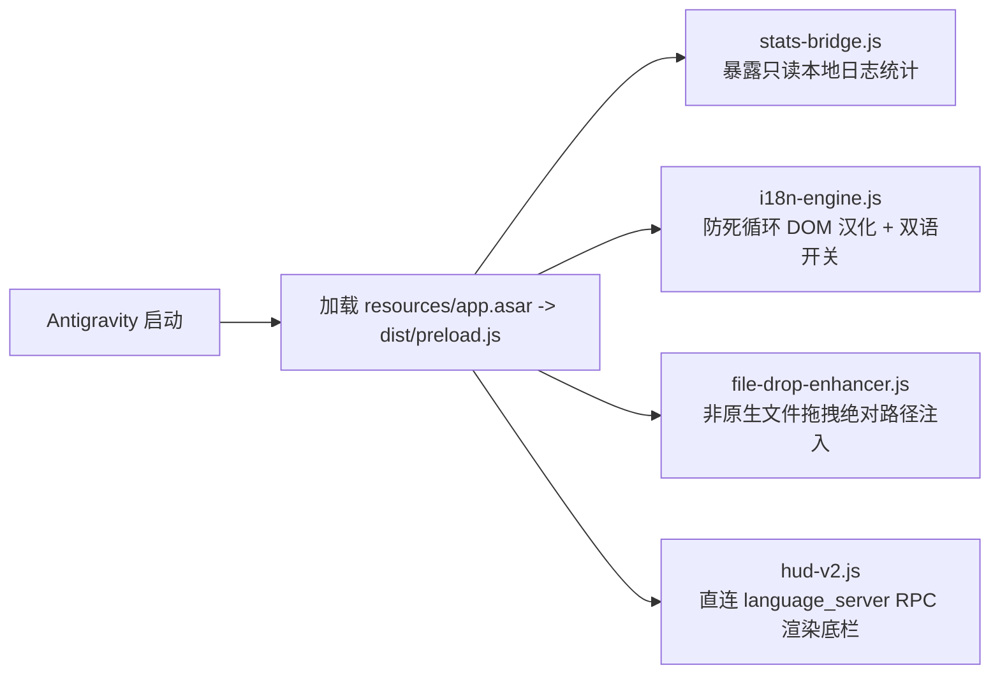

# Antigravity 中文汉化与算力/配额监控拓展包 (`antigravity-zh-hud-pack`)

> **Antigravity IDE / Desktop Client Chinese Localization (i18n), Real-Time Token/TPS HUD, Quota Monitor & File-Drop Enhancer.**  
> 为 **Antigravity** 桌面客户端打造的一站式增强拓展包：集成 **中英双语 / 简体中文界面汉化 (v2.3.0)**、**输入框底部实时算力 / Token / 模型配额监控状态栏 (HUD)** 与 **全局文件拖拽绝对路径注入**。  
> **全面适配 Antigravity `2.35.0+` · 开箱即用 · 零外部依赖 · 数据 100% 本地处理 · 支持一键无损卸载还原**

---

## 🤖 Instructions for AI Agents（AI 自动安装与部署协议）

> **致接入的 AI Agent（Antigravity / Claude Code / Codex）**：当用户将本仓库发给你并要求“安装/部署汉化与监控底栏”时，**严禁要求用户手动敲命令行**。请严格按以下安全流程执行：

### Step 1：克隆仓库并安装本地依赖
```bash
git clone https://github.com/dajin10/antigravity-zh-hud-pack.git
cd antigravity-zh-hud-pack
npm install --omit=dev
```

### Step 2：预校验补丁兼容性（Dry-Run）
在不动客户端文件的前提下，先执行只读预检：
```bash
node bin/install.js --dry-run
```

### Step 3：执行 `app.asar` 注入（防进程自杀规则）
- **情况 A（外部终端或未运行 Antigravity）**：直接执行注入并汇报完成：
  ```bash
  node bin/install.js
  ```
- **情况 B（当前正在 Antigravity 内部会话中执行）**：由于 Windows 下运行中的 `Antigravity.exe` 会锁定 `resources/app.asar`，**严禁直接强杀当前 Antigravity 进程**（否则会中断当前对话）。请向用户说明：**“依赖与预检已就绪，请先关闭 Antigravity 客户端，然后运行 `node bin/install.js`（或双击 `install.bat`），重新打开即可生效。”**

---

## 🆕 更新日志 (Changelog)

### v2.3.0 — Antigravity 2.35.0+ 新版深度适配与双语/流速全面升级
> **版本兼容性说明**：早期旧版拓展包仅适用于旧版 Antigravity（HTML 内联明文 `csrfToken` 架构），在 **Antigravity 2.35.0+** 新版客户端中会出现 HUD 全量失效、无法同步配额及部分新设置项未汉化的问题。**v2.3.0 已针对新版底层架构完成全面重构与优化：**

- **🔐 修复新版认证机制导致的 HUD 全失效问题**：
  - 适配新版 Electron `contextIsolation` 沙箱与 `/auth` 动态换票机制，改为从共享 `localStorage['agy_session_csrf_token']` 安全提取会话令牌。
  - 增加 `grpc-status: 16` 令牌失效自动清除重刷，以及启动冷加载阶段 2 秒高频自动重试，彻底解决「正在同步模型配额...」卡死与遥测全 0 问题。
- **📊 升级新版模型配额与选择器匹配规则**：
  - 优先读取新版模型按钮的 `data-model-label` 与 `data-context-window` 原生属性，精确识别 `Gemini 4 Hydrogen / Argon / Neon` 等新模型上下文上限。
  - 全面兼容 `RetrieveUserQuotaSummary` 的 `disabled` 过滤、`remaining.remainingFraction` 嵌套结构，以及 `5h` / `weekly` / `daily` / `\d+[smhd]` 多窗口 Bucket 动态渲染。
- **⚡ 流速（TPS）防突变滤波校准**：
  - 引入 Anti-Burst 滤波器，剔除 `< 0.25s` 或 `< 30 tok` 的网络单包缓冲突发样本，杜绝瞬时除法畸变虚高（如 2000+ tok/s）与平均速率拉偏。
  - 严格区分「实时生成中」与「工具/步骤执行中」，并在速率弹窗新增 **「端到端综合速率（含 TTFT）」** 口径。
- **🌐 升级中英文双语三态显示（默认「双语」）**：
  - 右上角悬浮按钮支持 **`双语` → `中` → `EN`** 三态循环切换（短词 `中文 (English)`，长说明 `中文 / English`），兼顾直觉阅读与英文原意对照。
  - 补全编排器设置（Orchestrator / Executor）、界面布局模式（Knowledge Work / Software Engineering）及定制预算说明等新版界面词条。
- **🛠️ 安装器沙箱自愈**：`bin/install.js` 自动在 `dist/utils.js` 注入 `sandbox: false`，确保新版 Electron 窗口下 `preload.js` 正常挂载与文件统计桥接。

---

## 📸 效果演示

### 1. 输入框底部双行监控状态栏（实机截图）
> 挂载于对话输入框卡片正下方：第 1 行为四段式实时遥测（均支持点击展开明细），第 2 行为当前选中模型的 5h / 每周剩余配额与重置倒计时。


### 2. 底栏各按钮点击展开详情（全部 5 个交互面板）

| ① 会话统计 (`N 轮 M 步`) [实机截图] | ② 生成速率 (`tok/s`) | ③ Token 用量与缓存命中 |
| :---: | :---: | :---: |
|  |  |  |
| 展示模型用时、工具调用用时、首字延迟 (TTFT) 与会话平均速率 (TPS) | 展示实时采样速率、会话平均 TPS、最近一轮输出与流式耗时 | 展示累计/最近一轮缓存命中率、未缓存输入、缓存读取与思考 Token |

| ④ 上下文窗口占比 (`%`) | ⑤ 全模型配额总览（点击第 2 行配额条） |
| :---: | :---: |
|  |  |
| 多段彩色堆叠条 + 树状分层消耗排行（支持点击展开/收起子项） | 按共享配额池智能归组，高亮当前使用模型，展示 5h 与每周限额进度 |

### 3. 全量简体中文界面（设置界面展示）
> 覆盖设置面板、模型管理、工作流、权限弹窗等全量界面文本，右上角提供可拖拽的 **「中文 / EN」** 悬浮切换开关，代码区与终端严格防误翻。


---

## ✨ 为什么需要这个拓展包？（原版 vs 安装后）

| 能力维度 | Antigravity 原版 | 安装本拓展包后 |
| :--- | :--- | :--- |
| **界面语言** | 纯英文 UI，设置与配额说明需自行理解 | **全量简体中文汉化 (v2.2.0)**，右上角悬浮开关一键中/英切换，严苛保护代码区/终端不误翻 |
| **算力与速率遥测** | 不可见 | 输入框下方第 1 行实时展示：**会话轮/步数 · 流式 `tok/s` · 累计 Token/缓存命中率 · 上下文环形占比** |
| **模型配额监控** | 需层层点开设置菜单查看 | 输入框下方第 2 行实时同步当前模型 **5h / 每周配额进度条与倒计时**，点击弹出全模型配额总览 |
| **文件拖拽** | 仅支持图片/Office/音视频等有限附件 | 突破限制，拖入 `.txt`、代码、日志等任意文件自动提取并填入 **磁盘绝对路径** |
| **安全性与可逆性** | — | 100% 本地运行无外传；首次安装自动备份原版 `app.asar.original`，支持 **一键无损卸载还原** |

---

## 🚀 核心功能与规则详解

### 1. 对话框底部双行监控底栏 (HUD V2.1)
挂载于输入框圆角卡片外部正下方，自动适配浅色 / 深色主题：

- **第 1 行：四段式实时遥测**
  - **会话统计**：实时显示当前会话 `N 轮 M 步`（点击可查看模型耗时、工具耗时、首字延迟 TTFT 等明细）。
  - **生成速率**：流式输出实时采样 `XX.X tok/s`（脉冲动画指示当前正在输出）。
  - **Token 累计与缓存命中**：展示累计消耗与 `缓存命中 XX%`，直观评估上下文复用效率。
  - **上下文窗口环形占比**：圆环进度条展示当前上下文百分比，点击展开**原生二级树状消耗排行**。
- **第 2 行：当前模型配额实时同步条**
  - 自动监听对话窗口的模型选择器，切换模型时 **0 延迟** 匹配对应的官方配额池。
  - 同行展示：`当前模型名` + `5h 彩色进度条 / 剩余百分比 / 倒计时` + `每周 彩色进度条 / 剩余百分比 / 倒计时` + `手动刷新按钮`。
  - 点击配额条可弹出 **「全模型配额总览」Popover 卡片**，按共享配额池智能归组并高亮当前选中模型。

### 2. 全量简体中文本地化引擎 (`i18n-engine` v2.2.0)
- **动态规则解析**：支持 5 小时限额、每周限额的动态时间倒计时（天/小时/分/秒智能换算）及权限弹窗动态语句翻译。
- **Loop-safe 性能保护**：基于节流与写入锁保护的 `MutationObserver`，杜绝 DOM 死循环与 GPU/内存泄漏。
- **自定义词典热加载**：自动创建 `%APPDATA%\Antigravity\i18n-custom.json`，随时增补自定义翻译词条。
- **双语一键切换**：界面右上角提供可拖拽悬浮开关，随时在「中文 / 英文」之间无缝切换（状态持久化至 `localStorage`）。

### 3. 全局文件拖拽绝对路径注入 (`file-drop-enhancer`)
- 拖入图片、PDF、Excel 等原生支持的附件时，放行原生多模态上传。
- 拖入代码文件、配置文件、Markdown、日志等任意其他文件时，通过 Electron `webUtils.getPathForFile` 提取真实磁盘绝对路径并自动插入当前光标位置。

### 4. 配套可选工具：历史对话标题批量汉化 (`tools/conversation-title-zh`)
- 提供独立 Python 脚本，在关闭 Antigravity 后对本地历史会话数据库（`conversation_summaries.db` 与 `agyhub_summaries_proto.pb`）中的英文标题进行批量汉化并自动备份。

---

## 🔧 底层架构：插件如何与 Antigravity 结合？

Antigravity 是基于 **Electron**（内嵌 Chromium 渲染进程 + 本地 `language_server` 后端服务）构建的桌面客户端。

> **为什么不打包成标准 VS Code `.vsix` 扩展？**  
> 标准 `.vsix` 扩展运行在受限的 Extension Host 沙箱中，**无法访问主对话窗口的 DOM**，因此无法在输入框正下方挂载双行遥测底栏，也无法对主 UI 进行全局实时的 DOM 文本本地化与全局拖拽增强。

本拓展包采用 **Electron `app.asar` -> `dist/preload.js` 模块化注入机制**：



- **幂等注入与隔离标记**：安装脚本在 `dist/preload.js` 末尾写入带有 `ANTIGRAVITY_ZH_HUD_PACK_START` / `END` 标记的独立 IIFE 块，不破坏原生代码结构，支持随时原地升级或剥离还原。

---

## 📦 快速安装与使用

### 环境要求
- **操作系统**：Windows 10/11（主要支持，已提供一键 `.bat`）；macOS / Linux 可使用 Node.js 命令行安装。
- **Node.js**：`>= 18.0.0`（[官网下载](https://nodejs.org/)）
- **Python 3.8+**（仅使用 `tools/conversation-title-zh` 历史标题汉化时需要）

### 方式一：Windows 一键安装（推荐）
1. 下载或克隆本仓库到本地：
   ```bash
   git clone https://github.com/dajin10/antigravity-zh-hud-pack.git
   ```
2. **完全退出 Antigravity 客户端**（注意检查系统托盘图标是否已退出）。
3. 双击运行根目录下的 **`install.bat`**。
   - 脚本会自动检测运行进程、首次自动安装 `@electron/asar` 依赖、备份原版 `app.asar` 到 `~/.gemini/antigravity/backups/app.asar.original` 并完成注入。
4. 重新启动 Antigravity，即可看到全中文界面与输入框底部的双行状态栏。

### 方式二：命令行安装（支持跨平台与自定义路径）
```bash
# 1. 安装依赖
npm install --omit=dev

# 2. 自动探测 app.asar 并注入
npm run install-patch

# 若 Antigravity 安装在非默认目录，可手动指定 app.asar 路径：
node bin/install.js --asar "D:\YourPath\Antigravity\resources\app.asar"

# 仅执行拼装与语法校验，不修改文件（调试用）：
node bin/install.js --dry-run
```

---

## 🛠️ 日常使用与进阶配置

### 1. 中英双语 / 纯中文 / 英文三态切换
- 安装后窗口右上角会出现悬浮控制标签，默认开启 **「双语」** 模式，点击可在 **`双语` → `中` → `EN`** 之间实时切换，支持鼠标拖拽调整位置。

### 2. 自定义汉化词典
安装器会自动在以下路径初始化自定义词典模板（若不存在）：
- Windows: `%APPDATA%\Antigravity\i18n-custom.json`

你可以直接按 JSON 键值对添加任何新增词汇，例如：
```json
{
  "_comment": "Antigravity 自定义汉化词典扩展",
  "Custom Workflow": "自定义工作流",
  "Token Budget": "Token 预算"
}
```
保存后重启 Antigravity 即可生效（自定义词典优先级高于内置词典）。

### 3. 历史对话标题批量汉化（可选）
1. 完全退出 Antigravity 客户端。
2. 进入 `tools/conversation-title-zh/` 目录，双击运行 `apply_after_close.bat`（或执行 `python update_titles.py --apply`）。
3. 工具会自动备份数据库并在 `translations.json` 映射基础上汉化历史对话标题。

---

## 🔄 版本更新与卸载还原

- **Antigravity 客户端自动更新后失效怎么办？**  
  客户端官方更新会覆盖 `resources/app.asar`，只需关闭客户端后重新双击一次 `install.bat`（约 5 秒），即可恢复全部汉化与底栏功能。
- **更新本拓展包到最新版**  
  拉取最新仓库代码后，直接运行 `install.bat` 或 `npm run install-patch`，安装器会自动剥离旧版注入块并原地升级，**不会重复注入**。
- **一键无损卸载还原**  
  完全退出 Antigravity 后，双击运行 **`uninstall.bat`**（或执行 `npm run uninstall-patch`），脚本将优先使用 `app.asar.original` 完整还原官方原版客户端。

---

## 📁 仓库目录结构

```text
antigravity-zh-hud-pack/
├── README.md                        # 使用说明与架构文档
├── LICENSE                          # MIT 开源协议
├── package.json                     # 依赖声明与 CLI 脚本
├── install.bat                      # Windows 一键安装 / 升级脚本
├── uninstall.bat                    # Windows 一键卸载还原脚本
├── bin/
│   ├── install.js                   # 跨平台幂等注入器（含自动备份与语法校验）
│   └── uninstall.js                 # 跨平台无损还原器
├── src/
│   ├── stats-bridge.js              # 原生对话日志统计桥接
│   ├── i18n-engine.js               # 简体中文汉化引擎 v2.2.0
│   ├── file-drop-enhancer.js        # 全局文件拖拽绝对路径增强
│   ├── hud-v2.js                    # 实时算力/Token/配额监控底栏 V2.1
│   └── entry.js                     # 模块统一引导入口
├── docs/
│   └── images/                      # README 实机截图与功能示意图
├── config/
│   └── i18n-custom.example.json     # 自定义词典模板
└── tools/
    └── conversation-title-zh/       # 可选：历史对话标题批量汉化工具
```

---

## ⚠️ 注意事项与风险提示（使用前必读）

1. **客户端自动更新覆盖风险**：Antigravity 官方客户端自动更新后会替换 `resources/app.asar`，导致汉化与 HUD 底栏暂时失效。此时只需完全退出客户端并重新双击运行 `install.bat`（约 5 秒）即可恢复，**不会丢失自定义词典数据**。
2. **文件拖拽注入兼容性风险**：若未来官方版本更改了编辑器 DOM 结构导致路径注入失败，系统会**自动降级为写入系统剪贴板并弹出 Toast 提示**，此时手动 `Ctrl+V` 粘贴即可。
3. **进程占用导致安装失败 (`EBUSY` / `EPERM`)**：Windows 下只要系统托盘中仍有 `Antigravity.exe` 驻留，系统就会锁定 `app.asar`。安装或卸载前请务必右键托盘图标彻底退出客户端。

---

## ❓ 常见问题 (FAQ)

- **Q：运行时提示 `EBUSY` / `EPERM` 目标文件被占用？**  
  A：Antigravity 仍在后台运行（可能在系统托盘中）。请右键托盘图标选择退出，或任务管理器结束 `Antigravity.exe` 后重试。
- **Q：为什么没有分发打包好的 `app.asar` 文件？**  
  A：直接分发官方 `app.asar` 体积过大（上百 MB）、涉及官方二进制版权，且无法跨版本通用。采用源码补丁注入器是最轻量化、最安全透明的开源分发方式。
- **Q：底栏配额数据不刷新或显示 `--`？**  
  A：配额数据通过本地 `language_server` RPC 实时拉取；请确认 Antigravity 已正常登录账号且本地语言服务进程运行正常，可点击底栏右侧刷新图标手动同步。

---

## 📄 开源协议

本项目基于 [MIT License](LICENSE) 开源，欢迎提交 Issue 与 Pull Request 共同完善词典与监控特性。
