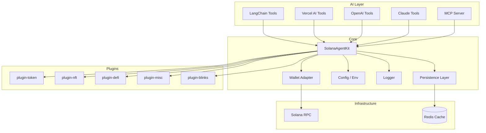
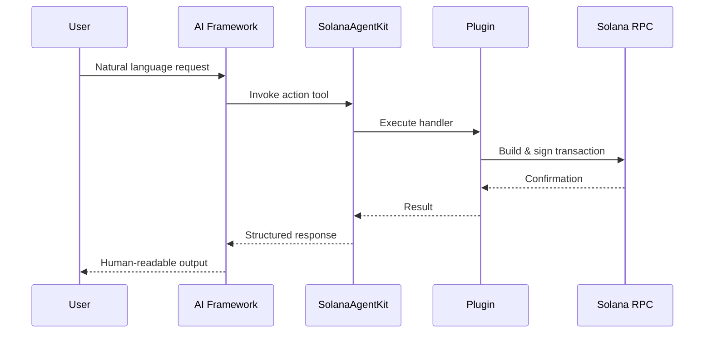

# Solana Agent Kit

Production-ready TypeScript toolkit for connecting AI agents to Solana blockchain protocols. Built as a modular monorepo with plugin architecture, optional Redis persistence, and first-class support for LangChain, Vercel AI SDK, OpenAI Agents, and Claude.

---

## Overview

Solana Agent Kit provides a unified interface for AI agents to perform on-chain operations — token transfers, DeFi interactions, NFT management, cross-chain bridging, and more — through a composable plugin system.

| Capability | Description |
|------------|-------------|
| **Plugin architecture** | Install only the protocol bundles you need |
| **Multi-AI support** | LangChain, Vercel AI, OpenAI, Claude, MCP adapters |
| **Wallet flexibility** | Keypair, Open Wallet Standard, embedded wallet providers |
| **Optional Redis cache** | Persistent caching with graceful in-memory fallback |
| **Strict TypeScript** | Full type safety across core and plugin APIs |

---

## Architecture



### Agent Workflow



---

## Feature Highlights

- **60+ protocol actions** across token, DeFi, NFT, and misc categories
- **Composable plugins** — chain `.use()` calls to build your agent
- **Dual API surface** — programmatic `methods` and AI-facing `actions`
- **Redis persistence** — optional caching layer with retry, graceful shutdown, and memory fallback
- **Structured logging** — configurable log levels via `LOG_LEVEL`
- **Cross-platform builds** — Windows-compatible clean scripts via rimraf
- **Automated validation** — typecheck, lint, test, and build in a single command

---

## Installation

### Prerequisites

- Node.js >= 22
- pnpm >= 8

### Setup

```bash
git clone https://github.com/sendaifun/solana-agent-kit.git
cd solana-agent-kit
pnpm install
pnpm build
```

### Package Installation (consumers)

```bash
pnpm add solana-agent-kit @solana-agent-kit/plugin-token
```

---

## Quick Start

```typescript
import { Keypair } from "@solana/web3.js";
import bs58 from "bs58";
import { SolanaAgentKit, KeypairWallet, createVercelAITools } from "solana-agent-kit";
import TokenPlugin from "@solana-agent-kit/plugin-token";

const keypair = Keypair.fromSecretKey(bs58.decode(process.env.SOLANA_PRIVATE_KEY!));

const agent = new SolanaAgentKit(
  new KeypairWallet(keypair, process.env.RPC_URL!),
  process.env.RPC_URL!,
  { OPENAI_API_KEY: process.env.OPENAI_API_KEY },
).use(TokenPlugin);

const tools = createVercelAITools(agent);
```

---

## Configuration

Copy the example environment file and fill in your values:

```bash
cp .env.example .env
```

### Required Variables

| Variable | Description |
|----------|-------------|
| `RPC_URL` | Solana RPC endpoint |
| `SOLANA_PRIVATE_KEY` | Base58-encoded secret key |
| `OPENAI_API_KEY` | OpenAI API key (for AI integrations) |

### Optional — Redis Persistence

| Variable | Default | Description |
|----------|---------|-------------|
| `REDIS_ENABLED` | `false` | Enable Redis caching |
| `REDIS_URL` | — | Full Redis connection URL (overrides host/port) |
| `REDIS_HOST` | `127.0.0.1` | Redis host |
| `REDIS_PORT` | `6379` | Redis port |
| `REDIS_PASSWORD` | — | Redis password |
| `REDIS_DB` | `0` | Redis database index |
| `REDIS_KEY_PREFIX` | `solana-agent-kit:` | Key namespace prefix |
| `REDIS_CACHE_TTL_SECONDS` | `60` | Fresh cache TTL |
| `REDIS_STALE_TTL_SECONDS` | `21600` | Stale-while-revalidate TTL |

### Logging

| Variable | Default | Description |
|----------|---------|-------------|
| `LOG_LEVEL` | `info` | One of `debug`, `info`, `warn`, `error` |

### Using Redis Persistence

```typescript
import { createPersistenceLayer } from "solana-agent-kit";

const persistence = await createPersistenceLayer();
await persistence.cache.set("wallet:balance", { sol: 1.5 });
const balance = await persistence.cache.get("wallet:balance");

// Graceful shutdown
await persistence.shutdown();
```

---

## Development

```bash
# Install dependencies
pnpm install

# Build all packages
pnpm build

# Type check
pnpm typecheck

# Lint
pnpm lint

# Run unit tests
pnpm test

# Full validation pipeline
pnpm validate

# Generate a new Solana keypair
pnpm generate

# Interactive integration tests (requires .env)
pnpm test:integration
```

### Per-Package Builds

```bash
pnpm build:core
pnpm build:plugin-token
pnpm build:plugin-defi
pnpm build:plugin-nft
pnpm build:plugin-misc
pnpm build:plugin-blinks
pnpm build:adapter-mcp
```

---

## Testing

Unit tests use Vitest and cover configuration parsing, cache store behavior, and Redis connection manager state.

```bash
# Run all tests
pnpm test

# Watch mode
pnpm test:watch

# Integration tests (manual, requires configured .env)
pnpm test:integration
```

---

## Project Structure

```
solana-agent-kit/
├── packages/
│   ├── core/                  # SolanaAgentKit, wallets, AI adapters, persistence
│   │   ├── src/
│   │   │   ├── agent/         # Core agent class
│   │   │   ├── config/        # Environment configuration
│   │   │   ├── errors/        # Typed error hierarchy
│   │   │   ├── persistence/   # Redis connection manager & cache store
│   │   │   ├── utils/         # Logger, wallet helpers, tx utilities
│   │   │   ├── langchain/     # LangChain tool adapter
│   │   │   ├── vercel-ai/     # Vercel AI SDK adapter
│   │   │   ├── openai/        # OpenAI Agents adapter
│   │   │   └── claude/        # Claude adapter
│   │   └── tests/             # Unit tests
│   ├── plugin-token/          # SPL, Jupiter, Pump.fun, Pyth, etc.
│   ├── plugin-nft/            # Metaplex, 3Land, Magic Eden, Tensor
│   ├── plugin-defi/           # Drift, Raydium, Orca, OKX, deBridge
│   ├── plugin-misc/           # CoinGecko, Helius, Allora, SNS
│   ├── plugin-blinks/         # Solana Blinks actions
│   └── adapter-mcp/           # MCP server wrapper
├── test/                      # Interactive integration test harness
├── examples/                  # Standalone demo applications
├── scripts/                   # Developer utilities
├── docs/                      # Generated API docs + internal notes
├── vitest.config.ts           # Test runner configuration
├── turbo.json                 # Monorepo build orchestration
└── biome.json                 # Linter and formatter
```

### Design Decisions

- **Plugins over monolith** — each protocol bundle is independently installable and versioned
- **Actions + Tools split** — `tools/` for low-level Solana calls, `actions/` for AI-facing wrappers with Zod schemas
- **Persistence in core** — Redis integration lives in `packages/core` so all plugins benefit from shared caching
- **Examples excluded from workspace** — demo apps manage their own dependencies to avoid version conflicts

---

## Troubleshooting

### Build fails on Windows

Ensure you are using the updated clean scripts (`rimraf` instead of `rm -rf`). Run `pnpm install` to pick up the latest scripts.

### Redis connection refused

Set `REDIS_ENABLED=false` to use in-memory caching only. The agent kit degrades gracefully when Redis is unavailable.

### Type errors after plugin install

Ensure peer dependency versions match. Run `pnpm typecheck` to identify mismatches.

### `pnpm test` vs `pnpm test:integration`

- `pnpm test` — automated Vitest unit tests (no network required)
- `pnpm test:integration` — interactive harness requiring `.env` with RPC URL and private key

### Action limit warning

AI adapters truncate at 128 actions when many plugins are loaded. Install only the plugins you need.

---

## FAQ

**Q: Do I need Redis?**
No. Redis is optional. When disabled or unreachable, the cache store operates entirely in memory.

**Q: Which AI framework should I use?**
All four adapters (LangChain, Vercel AI, OpenAI, Claude) expose the same underlying actions. Choose based on your existing stack.

**Q: Can I create custom plugins?**
Yes. Implement the `Plugin` interface with `name`, `methods`, `actions`, and `initialize`.

**Q: Is this safe for production?**
The toolkit handles private keys and transaction signing. Never commit secrets, use environment variables, and audit plugin actions before deploying.

**Q: How do I migrate from v1?**
See [MIGRATING.md](./MIGRATING.md) for the v1 → v2 plugin architecture migration guide.

---

## Contributing

See [CONTRIBUTING.md](./CONTRIBUTING.md) for development setup, code style, and pull request guidelines.

## License

Apache-2.0 — see [LICENSE](./LICENSE).
