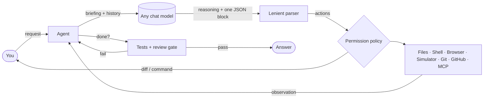

<div align="center">


# Anvil

**A native macOS coding agent that works with almost any model.**

Open a folder, describe a change, review every diff. Anvil reads, edits, runs and tests until the job is done.

[](#install)
[](#architecture)
[](LICENSE)
[](#evals)
[](ROADMAP.md)

[Features](#features) · [Install](#install) · [Quick start](#quick-start) · [Providers](#providers) · [How it works](#how-it-works) · [Evals](#evals) · [Contributing](#contributing)

</div>

---

Anvil is a desktop app in the spirit of Claude Code and Codex, built natively for the Mac with SwiftUI. Its agent speaks a plain-text protocol instead of relying on native tool calling, so it runs on any chat model, including cheap and free ones, and adds checks of its own to keep weaker models on track: tests run before "done", a reviewer reads the diff, and a different model takes over after repeated failures.

On the default model, a typical small coding task costs a fraction of a cent.

## Why Anvil

- **Bring your own model.** Any OpenAI-compatible API in one JSON file, community provider plugins installed from a GitHub link, plus your own ChatGPT and Gemini web accounts. No vendor lock-in and no native tool calling required.
- **Review everything.** Every edit is a diff before it's written, every request is a checkpoint you can undo, and four permission modes decide what asks first.
- **Built for the whole loop.** A real terminal, a live browser preview the agent can drive, an iOS Simulator it can tap through, git, GitHub and language servers, all in one window.
- **Parallel when it pays.** Split a feature into sub-sessions that each run in their own git worktree, then merge them back with conflict checks.

## Features

<table>
<tr>
<td width="50%" valign="top">

### The agent
- Reads, edits, runs commands and tests, with live, folded tool steps
- Plans for big jobs: approve, revise or cancel before anything runs
- Follow-ups typed mid-run reach the agent at its next step
- `explore` helpers investigate in their own context, in parallel
- Sub-sessions in their own worktrees for independent parts of a feature, nested under their parent in the sidebar and kept across restarts
- Worktree cleanup removes merged worktrees and their branches from the app
- Background queue: line tasks up and they run on their own branches

</td>
<td width="50%" valign="top">

### Review and safety
- Every edit computed and shown as a diff first
- Modes: *Ask*, *Auto-accept edits*, *Plan only*, *Bypass*
- Dangerous commands (`rm -r`, `sudo`, `git push`...) always ask
- Checkpoints per request; undo or rewind to any message
- Per-request cost and step limits
- Publishing to GitHub asks first, in every mode but Bypass

</td>
</tr>
<tr>
<td valign="top">

### Accuracy
- Syntax check on every edit, LSP type checks after each batch
- Runs the project's tests before accepting "done"
- A second call reviews the diff for real problems
- Switches model family after the same action fails twice
- Remembers test commands and lessons per project

</td>
<td valign="top">

### Speed
- Read-only actions in one reply run in parallel
- Repo map and a cached project brief in the briefing
- Line-range edits that halve output tokens
- Prefetches the code an error points to
- Adaptive reasoning effort and prompt-cache warming
- A context bar with cache hits, and token estimates calibrated to each model's own usage reports

</td>
</tr>
<tr>
<td valign="top">

### Built-in tools
- **Terminal** with tabs (SwiftTerm), background processes for dev servers
- **Browser**: live preview that reloads on edit; the agent clicks, types and reads console errors through the DOM
- **iOS Simulator**: build, launch, and tap through accessibility elements
- **MCP** servers (stdio), in Claude's `.mcp.json` format

</td>
<td valign="top">

### Integrations
- **GitHub** via `gh`: issues, PRs with inline review comments, CI logs, `/pr`
- Labeled GitHub issues picked up into the queue
- `AGENTS.md` / `CLAUDE.md` project memory, `/init` to write one
- Skills (`SKILL.md`) and custom slash commands, Claude Code compatible
- Provider plugins: one JSON file, or a GitHub link
- Headless CLI mode for scripts and evals

</td>
</tr>
</table>

## Install

There are no signed release builds yet ([roadmap](ROADMAP.md)), so build from source.

**Requirements:** macOS 15 or later, Xcode 26 or later, [XcodeGen](https://github.com/yonaskolb/XcodeGen) (`brew install xcodegen`).

```bash
git clone https://github.com/deeeeone/Anvil.git
cd Anvil
xcodegen generate
xcodebuild -project Anvil.xcodeproj -scheme Anvil -derivedDataPath build build \
  CODE_SIGN_IDENTITY=- DEVELOPMENT_TEAM=
open build/Build/Products/Debug/Anvil.app
```

The `CODE_SIGN_IDENTITY=-` override signs the app ad hoc, so you don't need the maintainer's signing team. To sign with your own, set `DEVELOPMENT_TEAM` and `CODE_SIGN_IDENTITY` in `project.yml` instead.

Optional extras:

| For | Install |
|---|---|
| Simulator element tools | `brew tap cameroncooke/axe && brew install axe` |
| GitHub tools | `brew install gh && gh auth login` |
| Type checks | the language server for your stack: TypeScript (bundled with TypeScript 7, or `typescript-language-server`), `pyright`, `gopls`, `rust-analyzer`, `sourcekit-lsp` (ships with Xcode) |

## Quick start

1. Launch Anvil and open a project folder (⌘O).
2. Open **Settings → Provider** (⌘,) and set up at least one provider (see [Providers](#providers)).
3. Type what you want in the composer, for example *"the date parser fails on ISO weeks, fix it and add a test"*, and press ⏎.
4. Review diffs as they come, or switch the mode with ⇧⌘M.

Useful from there:

| Action | How |
|---|---|
| Undo the last task | ⌥⌘Z or `/undo` |
| Stop the agent | ⌘. or Esc |
| Queue a background task | ⌥⏎ or `/queue <task>` |
| Work on a separate branch | **New worktree session** |
| Commit with a generated message | `/commit` |
| Open a pull request | `/pr` |
| Attach files or git state | `@file`, `@git-diff`, `@last-output` |

## Providers

Pick the model from the menu on the composer. Anvil talks to each provider directly; nothing goes through a server of ours.

| Provider | Models | Setup | Cost |
|---|---|---|---|
| **Experiential Labs** | `glm-5.3-flash-uncensored` (default), `glm-5.3-flash`, `deepseek-v4.1-flash` and variants | API key | priced per token |
| **Any OpenAI-compatible endpoint** ("Luna API") | whatever it lists at `/v1/models` | URL | depends on the endpoint |
| **ChatGPT (web)** | `chatgpt/auto`, `gpt-5.5`, `gpt-5.5-thinking`, `o3` and more | sign in with your account | your ChatGPT plan |
| **Gemini (web)** | `gemini-auto`, `gemini-pro`, `gemini-flash`, `gemini-flash-lite` | sign in with a Google account | free |

### More providers, and writing your own

**Settings → Provider → Add provider** offers ready-made presets for **Z.ai, OpenRouter, Groq, DeepSeek, Mistral, the OpenAI API, Ollama and LM Studio**, and installs community plugins straight from a GitHub URL. Every provider is described by one `anvil-provider.json` file:

```json
{
  "spec": 1, "id": "zai", "name": "Z.ai", "type": "openai",
  "baseURL": "https://api.z.ai/api/paas/v4",
  "auth": { "type": "apiKey" },
  "models": [{ "id": "glm-4.6", "context": 200000 }]
}
```

That's a complete provider for any OpenAI-compatible API. For services without one, such as a chat website, set `"type": "process"` and ship a small program in any language that speaks a JSON-lines protocol; Anvil can run the website sign-in for it and hand over the session. Before installing from GitHub, Anvil shows exactly which host a plugin talks to or which command it runs. The full spec, templates and a JSON Schema are in **[docs/PROVIDERS.md](docs/PROVIDERS.md)**.

Keys and session cookies live in the macOS Keychain. Several ChatGPT or Gemini accounts can be added; requests start on the active one and fall through to the others when one is signed out or rate-limited.

> [!WARNING]
> The ChatGPT and Gemini providers use the websites' own private endpoints, not official APIs. They can break whenever OpenAI or Google change their sites, and using them may go against those services' terms. Use them on accounts you're prepared to risk.

<details>
<summary><b>Signing in to ChatGPT and Gemini</b></summary>

<br>

**Sign in to ChatGPT…** / **Sign in to Gemini…** (in Settings, or from the model menu) opens the sign-in page and adds the account by itself as soon as you're in. Signing in again as the same person refreshes that account instead of duplicating it, and an account that stops working shows **Sign in again**.

Passkeys and Google's embedded-browser check don't work inside a web view, so the window has **Use Safari**: sign in there and Anvil reads the session from Safari's cookies, including one Safari already has. That needs Full Disk Access; the window asks for it when it's missing. **Paste cookies…** adds an account from another browser's Cookie header.

An expired session heals itself from Safari on the next request, but only when Safari is signed in as the same person.

</details>

## How it works



Every reply is a sentence or two of reasoning followed by one fenced JSON block:

```json
{"say": "Fixing the off-by-one in parseWeek.",
 "actions": [{"tool": "replace_lines", "args": {"path": "src/date.ts", "start": 41, "end": 41, "content": "  return week - 1"}},
             {"tool": "shell", "args": {"command": "npm test"}}]}
```

Actions run in order and the batch stops at the first failure. Edit tools *prepare* their changes; the app computes diffs, applies the permission policy and records a checkpoint before anything is written. Results come back as one `<observation>`.

<details>
<summary><b>Protocol hardening learned from live runs</b></summary>

<br>

- **First block wins.** Stop sequences end a reply when the model starts writing its own observation, and only the first JSON block runs.
- **String-aware repairs.** The parser fixes trailing commas, comments, Python literals, raw newlines, missing braces and cut-off replies, without touching the contents of JSON strings.
- **Useful parse errors.** When a reply still can't be parsed, the model is shown where its JSON broke.
- **No blind overwrites.** `write_file` refuses to overwrite a file the agent hasn't read in this session.
- **Servers go to the background.** Server commands sent to `shell` are redirected to `start_process`.
- **Re-anchoring.** A model that claims it "can't access your files" is reminded that the app runs its actions.
- **Tests stay honest.** The prompt forbids weakening tests to make them pass.

</details>

### Architecture

```
Anvil/
├── App/      entry point, app state, session controller, background queue, sub-sessions, headless runner
├── Brain/    agent loop, reply parser, prompt builder, model routing, provider clients
├── Providers/ provider spec, plugin registry and installer, plugin client, presets
├── Core/     permissions, diffs, checkpoints, git, LSP client, sessions, settings, keychain, web accounts
├── Tools/    file, shell, process, web, browser, simulator, GitHub and MCP tools
└── UI/       SwiftUI views: sidebar, conversation, composer, inspector, diffs, settings
AnvilTests/   parser, edit engine, permissions, git, LSP, and scripted agent runs against a fake model
evals/        realistic coding tasks with hidden checks, and the runner
examples/     provider plugin examples and templates
docs/         provider spec (PROVIDERS.md) and its JSON Schema
```

## Headless mode

The same agent runs without a window, for scripts and evals. Sessions are saved and show up in the app afterwards.

```bash
ANVIL_API_KEY=... build/Build/Products/Debug/Anvil.app/Contents/MacOS/Anvil --headless \
  --project ~/code/myapp --prompt "Fix the failing test" --mode edits --approve
```

| Flag | Meaning |
|---|---|
| `--mode ask\|edits\|plan\|bypass` | permission mode |
| `--approve` | answer permission prompts with yes, except dangerous commands |
| `--resume SESSION-ID` | continue a saved session |
| `--model ID`, `--max-steps N` | override the model and step limit |
| `--no-verify`, `--no-review`, `--no-escalate`, `--no-stream`, `--no-adaptive`, `--no-prefetch` | switch individual features off (for ablations) |
| `--parse FILE` | run the reply parser on a saved model reply |

Keys passed through the environment stay in memory and are never passed to the commands the agent runs.

## Evals

`evals/tasks/` holds 16 small, realistic tasks: bug fixes, features, refactors across files, implementing from a spec, a dev server, a performance fix, a flaky test, a shell script, and a question that must not change any files. Each has a `setup.sh`, a `prompt.txt`, and a hidden `check.sh` the agent never sees. Ten `tb-*` tasks are modelled on Terminal-Bench categories (recovering a secret from rewritten git history, a C/Python polyglot, fixing a broken C build, an XSS filter, an interactive installer, asyncio cancellation, SQL optimization, sysadmin config with TLS, a slow build, a 400k-row CSV transform) and ship a `solution.sh`; `evals/validate.sh` proves each check fails on the untouched project and passes with its solution. Every run happens in a fresh repo under `/tmp`, so evals never touch your sessions.

```bash
python3 evals/run.py --models glm-5.3-flash-uncensored,deepseek-v4.1-flash-uncensored --parallel 4
python3 evals/run.py --tasks py-,js-csv -- --no-review    # arguments after -- go to the agent
```

Latest results (Bypass mode, effort high, 21 November 2026):

| Model | Pass | Avg steps | Avg time | Cost for all 16 |
|---|---|---|---|---|
| glm-5.3-flash-uncensored | **16/16** | 4.2 | 13.9 s | $0.018 |
| deepseek-v4.1-flash-uncensored | **16/16** | 4.6 | 14.3 s | $0.022 |
| glm-5.3-flash | 16/16 | 3.4 | 48 s | $0.031 |
| deepseek-v4.1-flash | 16/16 | 4.6 | 38 s | $0.067 |
| gpt-6-luna | 13/16 | 3.4 | 105 s | free |

The first two rows include the speed features (adaptive effort, prefetch, line-range edits, terse replies); turning off adaptive effort and prefetch alone took glm from 13.9 s to 17.6 s. The older rows predate those features. All three gpt-6-luna misses were provider errors (rate limits and challenges) before the agent started.

## Configuration

| What | Where |
|---|---|
| Project memory | `AGENTS.md`, `CLAUDE.md`, `.claude/CLAUDE.md` or `ANVIL.md` in the project root |
| Custom commands | `.anvil/commands/`, `.claude/commands/`, `~/.claude/commands/` (markdown; `$ARGUMENTS` is replaced) |
| Skills | `.anvil/skills/`, `.claude/skills/`, `~/.claude/skills/` (`SKILL.md` folders) |
| MCP servers | the project's `.mcp.json`, or `~/Library/Application Support/Anvil/mcp.json` |
| Provider plugins | Settings → Provider → Add provider; files in `~/Library/Application Support/Anvil/providers/` |
| Everything else | Settings (⌘,): Provider, Agent, Tools |

## Roadmap

Next up: a bigger eval suite tracked over time, per-hunk review, shell checkpoints, persistent allow rules and hooks. See [ROADMAP.md](ROADMAP.md) for the full list and known limitations.

## Contributing

Issues and pull requests are welcome. See [CONTRIBUTING.md](CONTRIBUTING.md) for how to build, test and send a change. In short:

```bash
xcodegen generate
xcodebuild -project Anvil.xcodeproj -scheme Anvil -derivedDataPath build test \
  CODE_SIGN_IDENTITY=- DEVELOPMENT_TEAM=
```

Tests marked *Live* talk to real services and skip themselves when they aren't set up.

To report a security problem, please follow [SECURITY.md](SECURITY.md) instead of opening a public issue.

## Acknowledgements

Anvil grew out of Peep, an agentic desktop pet for macOS, whose text protocol and agent architecture it reuses. It also builds on:

- [SwiftTerm](https://github.com/migueldeicaza/SwiftTerm) for the terminal
- [XcodeGen](https://github.com/yonaskolb/XcodeGen) for the project file
- [HanaokaYuzu/Gemini-API](https://github.com/HanaokaYuzu/Gemini-API) and [zhaees/chatgpt-proxy](https://github.com/zhaees/chatgpt-proxy), whose protocol work the web providers follow
- [AXe](https://github.com/cameroncooke/AXe) for simulator accessibility
- [elder-plinius/L1B3RT4S](https://github.com/elder-plinius/L1B3RT4S) (AGPL-3.0), the source of the optional Jailbreak mode's prompts

## License

Anvil is licensed under the [GNU Affero General Public License v3.0](LICENSE). If you run a modified version for others over a network, you must offer them its source.
