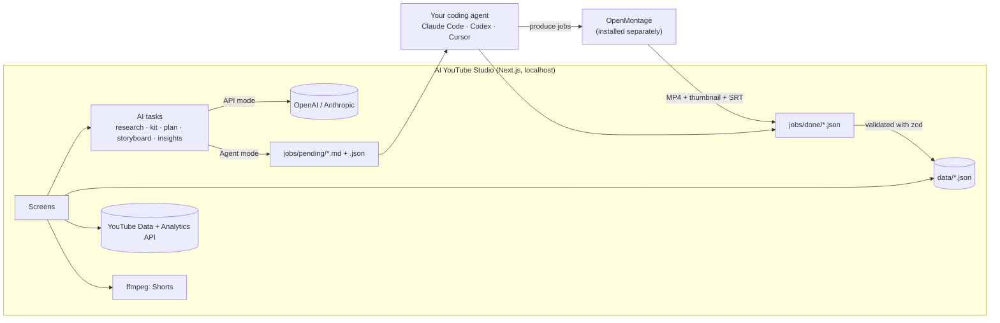

<div align="center">


# AI YouTube Studio

**Run a faceless YouTube channel end to end with your own AI.**
Pick a niche → research what already works → brand the channel → plan a month →
storyboard every video → approve at a weekly check-in → produce with
[OpenMontage](https://github.com/calesthio/openmontage) → publish → learn from the stats.

[Quick start](#quick-start) · [How it works](#how-it-works) · [Weekly workflow](#the-weekly-workflow) · [Setup guides](#setup-guides) · [FAQ](#faq)


</div>

---

## Why this exists

Making 5 good videos a week is mostly **planning work**: finding topics that already
perform, writing scripts, keeping a consistent channel identity, remembering what to post when,
and learning from the numbers. AI is good at that work. But a channel that posts unreviewed
AI content gets demonetized fast.

AI YouTube Studio puts the whole pipeline in one local app and keeps **one human gate**: a
weekly check-in where you approve the next five videos before anything is produced or
published.

- 🧠 **Bring your own brain.** Use a coding agent (Claude Code, Codex, Cursor, …) with no API key, or plug in an OpenAI or Anthropic key.
- 🎬 **Real production.** Approved storyboards become [OpenMontage](https://github.com/calesthio/openmontage) jobs: narration, stock and archive footage, motion graphics, captions, Remotion render.
- 📅 **A month at a time.** 5 videos a week × 4 weeks = 20 planned videos, each with a script, scene list, title options, thumbnail concepts and a Short.
- ✅ **One human gate.** Nothing is produced or published until it passes the weekly check-in. Edit an approved script and it drops back to unapproved.
- 📈 **A feedback loop.** Pull views and watch time, have the AI explain winners and losers, and feed that into next month's plan.
- 🔒 **Local and private.** Runs on `localhost`. Your keys and tokens live in a gitignored file on your machine.

## Live example: Built & Broken

This repo ships with a real channel built with the studio: **Built & Broken**, which tells
the stories of how famous companies were built and how they broke. It's a rebrand of an
existing unused channel. The whole first month lives in
[`data/channels/built-and-broken/`](data/channels/built-and-broken/): the research, the
channel kit, 20 planned videos for November 2026, and full storyboards for week 1.

| Week 1 | Pillar |
|---|---|
| How Nokia Lost Everything in Six Years | The Fall |
| The 17-Year-Old Who Built IKEA | The Build |
| Netflix Destroyed Its Own Business on Purpose | The Bet |
| LEGO Was Weeks From Bankruptcy | The Comeback |
| Kodak Invented the Digital Camera, Then Hid It | The Fall |

Clone the repo and run it, and you'll see the channel in the sidebar.

## What it does

| Step | Screen | What happens |
|---|---|---|
| 1. Niche | **Find your niche** | Pick a preset (business stories, history, tech explainers, anime what-ifs, true-story motivation) or describe your own. |
| 2. Research | **Research** | Pulls the top-performing long-form videos for your searches from the YouTube Data API (views, subscribers, views÷subs). The AI turns them into winning patterns, content pillars and a plain-English report. |
| 3. Brand | **Channel kit** | Name options, handle, description, keywords, pillars, logo and banner briefs (made in Canva or anything else), upload defaults. |
| 4. Plan | **Monthly plan** | 20 topics on a 4-week calendar, with pillars mixed every week and no repeated story structures. |
| 5. Storyboard | **Video page** | Full script split into timed scenes (narration, visual, source type), 3 titles, 3 thumbnail concepts, a 30–60s Short segment, sources, and an AI-disclosure flag. Everything is editable. |
| 6. Check-in | **Weekly check-in** | You review the week's 5 videos and tick 4 checks per video (original angle, clean visuals, disclosure, facts) to approve. |
| 7. Produce | **Video page** | Sends the approved storyboard to OpenMontage as a production job. The app then cuts a 1080×1920 Short with ffmpeg (blurred background, captions). |
| 8. Publish | **Video page** | Builds a **Studio upload kit** (files plus copy-paste metadata), or uploads through the API with scheduled `publishAt` once your Google project is audited. |
| 9. Learn | **Stats** | Subscribers, total views, and a **road-to-monetization** tracker (1,000 subs + 4,000 long-form watch hours, or 10M Shorts views), plus views, likes, comments and average view duration per video. One click has the AI write winners, losers and guidance, which feed the next monthly plan. |

<table>
<tr>
<td></td>
<td></td>
</tr>
<tr>
<td></td>
<td></td>
</tr>
</table>

## How it works



- **State is plain JSON** under `data/`. You (and your agent) can read every plan and storyboard,
  and the example channel lives in git.
- **Every AI step is a typed task** (`lib/tasks/*`). Each one has a prompt builder, a zod output
  schema and an `apply()` that writes the result. API mode and Agent mode share the same prompts
  and validation.
- **Agent mode** writes a markdown brief per job (with the exact JSON schema) to `jobs/pending/`.
  [`AGENTS.md`](AGENTS.md) tells any coding agent how to process them. Invalid results are rejected
  with the validation error and can be retried.
- **Production is always agent-driven**, because OpenMontage is an agentic toolkit. The job pins
  `approval_policy: pre-approved-by-weekly-checkin` and `storyboard_binding: script-and-scene-order-are-final`,
  so what renders is exactly what you approved.
- **Approval is bound to content.** It stores a hash of the storyboard, so any edit invalidates it.

## Quick start

Requirements: **Node 20+**, **ffmpeg** on your PATH, and **git**. To produce videos you also need
**Python 3.10+** for OpenMontage.

```bash
git clone https://github.com/dennis299/ai-youtube-studio.git
cd ai-youtube-studio
npm install
npm run dev
```

Open <http://localhost:3000>. You can explore the Built & Broken example right away. To run your own channel:

1. **Settings → AI brain.** Choose *Agent mode* (no key) or paste an OpenAI or Anthropic key.
2. **Settings → YouTube.** Add your Google OAuth client and click *Connect YouTube channel*. See [docs/setup-google.md](docs/setup-google.md).
3. **Settings → Production tools.** Point the studio at your OpenMontage folder. See [docs/openmontage.md](docs/openmontage.md).
4. **New channel.** Pick a niche and click *Create channel and start research*.

### Agent mode in 30 seconds

When a step says *Waiting for your AI agent*, run your agent in this folder:

```bash
claude -p "Process all pending jobs in jobs/pending following AGENTS.md"
```

Then click **Check for results**. Any agent that can read and write files works. See [docs/agent-mode.md](docs/agent-mode.md).

## The weekly workflow

| When | You | The studio / your agent |
|---|---|---|
| Once a month | Click **Plan month** | 20 topics from research and last month's stats |
| Every week (about 30 min) | **Weekly check-in**: read 5 scripts, edit, tick 4 checks, approve | Writes storyboards for the week |
| After check-in | Click **Produce approved videos**, then run your agent | OpenMontage renders each video and thumbnail |
| Per video | **Cut the Short**, then **Build upload kit** (or **Upload via API**) | ffmpeg makes the 9:16 Short; the kit has everything to paste into Studio |
| Weekly | **Refresh stats**, then **Learn from these stats** | Insights saved for the next plan |

## Costs

| Item | Typical cost |
|---|---|
| The studio itself | Free (MIT) |
| AI brain in Agent mode | Whatever your coding-agent plan already costs |
| AI brain in API mode | A few cents per storyboard with current models |
| OpenMontage with free sources (Pexels/Pixabay stock, archive footage, local Piper TTS) | **$0** per video |
| OpenMontage with paid voices and visuals (ElevenLabs, fal.ai, …) | Roughly $1–5 per video. The studio caps it per channel (default $5). |
| YouTube Data API | Free, with a 10,000 units/day quota |

## YouTube limits you should know

- **Uploads from an unaudited Google Cloud project are locked to private.** YouTube restricts
  `videos.insert` from projects that haven't passed its [API compliance audit](https://support.google.com/youtube/contact/yt_api_form).
  Until you pass it, the studio uses the **Studio upload kit**: the video, Short, thumbnail and
  `upload.txt` with the title, description, tags, category, AI-disclosure answer and schedule.
  You upload in YouTube Studio in about a minute, then paste the link back for stats. After the
  audit, tick *audited* in Settings and switch the channel to API upload.
- **Quota:** 10,000 units/day. A search costs 100, an upload about 1,600, and a stats refresh 1 per
  50 videos. Research results are cached for 7 days. Settings shows how much is left today.
- **Custom thumbnails** require a phone-verified channel.

## Monetization and copyright: read this

YouTube doesn't demonetize channels for using AI. It demonetizes **inauthentic content**: generic,
repetitive or mass-produced videos, and fake AI "experts" on finance, health or law
([Tubefilter, July 2026](https://www.tubefilter.com/2026/07/13/youtube-inauthentic-content-monetization-policy-update/)).
The studio is built around that:

- Every topic needs a specific **angle**, and plans avoid repeating structures.
- The **check-in checklist** makes a human confirm originality, clean visuals, disclosure and facts.
- **Visuals are stock, public-domain archive, AI-generated or motion graphics.** Never film, TV or
  anime frames. Screenshots are still copyrighted, even as stills. The anime preset uses AI-generated
  illustrations only.
- Storyboards carry an **AI-disclosure** flag, which maps to YouTube's "altered or synthetic content" setting.

This is general guidance, not legal advice.

## Niche presets

Rough 2026 RPM ranges (earnings per 1,000 views) from public creator data. They vary a lot by audience and country.

| Preset | RPM | Notes |
|---|---|---|
| Business stories | $6–15 | The example channel. Brand-safe, evergreen. |
| History documentaries | ~$10 (education median) | Archive footage friendly |
| Tech & AI explainers | $6–15 | Motion graphics heavy |
| True-story motivation | $4–8 | |
| Anime what-if stories | $2–4 | High views, low RPM, copyright-sensitive |

Sources: [AIR Media-Tech](https://air.io/en/air-data-findings/which-youtube-niche-makes-the-most-money-in-2026-ranked-by-real-rpm-and-cpm),
[vidIQ](https://www.vidiq.com/blog/post/most-profitable-youtube-niches),
[OutlierKit](https://outlierkit.com/resources/youtube-rpm-benchmarks/).

## Setup guides

- [Google Cloud and YouTube API setup](docs/setup-google.md)
- [Agent mode](docs/agent-mode.md)
- [OpenMontage install](docs/openmontage.md)

## Project layout

```
app/                 Next.js routes (screens + server actions in app/actions.ts)
components/          UI (shadcn/ui on Base UI)
lib/
  tasks/             research · channel kit · monthly plan · storyboard · produce · insights
  ai/                API mode (OpenAI, Anthropic)
  jobs.ts            agent job queue (jobs/pending → jobs/done → jobs/archive)
  youtube/           OAuth, research, quota, upload, stats, channel overview
  checkin.ts         approval rules (content-hash bound)
  media/short.ts     ffmpeg 9:16 Short
  publish/kit.ts     Studio upload kit
data/                local state (only the example channel is committed)
examples/            the Built & Broken channel kit and logo
scripts/             complete-job.mjs, the helper for agents
tests/               vitest
```

```bash
npm test         # 60 tests: store, jobs, tasks, quota, schedule, check-in, Shorts, upload kit, channel overview, review fixes
npm run build
```

## FAQ

**Does it post to YouTube automatically?**
With an audited Google project, yes: it uploads as private with a `publishAt` time and YouTube
releases it on schedule. Before the audit it gives you an upload kit, because API uploads would be locked private.

**Do I need an OpenAI or Anthropic key?**
No. Agent mode uses the coding agent you already have. Keys are optional and only cover the
text steps. Video production always runs through an agent driving OpenMontage.

**Can I use it for TikTok or Instagram?**
The Short is a standard 1080×1920 MP4, so you can upload it anywhere by hand. Native posting is on the roadmap.

**Why isn't OpenMontage bundled?**
It's AGPL-3.0, and this repo is MIT. You install it separately and point Settings at it.

## Roadmap

- [ ] One-click "Run agent" button that launches the agent CLI
- [ ] Thumbnail A/B variants and title testing
- [ ] TikTok / Instagram Reels publishing
- [ ] Multi-language dubbing via OpenMontage's localization pipeline

## License

MIT © 2026 Dennis Ezeora. [OpenMontage](https://github.com/calesthio/openmontage) is a separate
project under AGPL-3.0 and is not included in this repository.

*Part of a weekly build series: a new project every week.*
