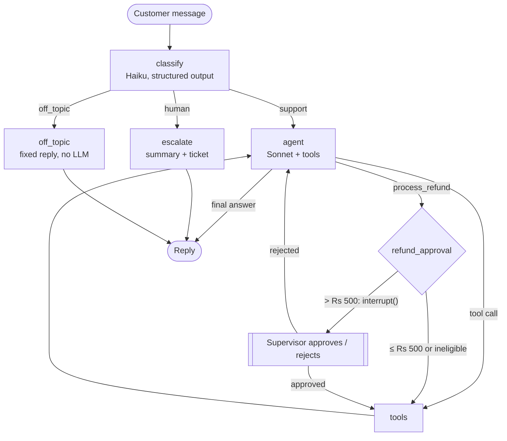

# 🛍️ ShopEasy Support Agent

**An agentic AI customer support assistant built with LangGraph, LangChain and Claude**

It answers from real order data and company policies, processes refunds under business rules,
and pauses risky actions for human approval.

*Built by **Deven Kalathiya***

The agent checks the order and the policy, confirms with the customer, then <b>pauses the whole graph</b>
because Rs 1,499 is over the auto-approve limit. The live flow (right) shows exactly where it stopped.

---

## 📌 The problem

Support teams spend most of their time on the same questions: *"Where is my order?"*, *"What's the return
policy?"*, *"I want a refund."* A plain chatbot can't safely handle these:

| A plain chatbot… | This agent… |
|---|---|
| ❌ Makes up policies | ✅ Searches the real policy documents (RAG) and answers from them |
| ❌ Can't see order data | ✅ Calls tools to look up live orders, tracking and dates |
| ❌ Can be talked into anything | ✅ Enforces refund rules in Python code, not in a prompt |
| ❌ Shouldn't move money alone | ✅ Pauses refunds over Rs 500 until a human supervisor approves |

---

## 🧠 Agentic AI, LangChain and LangGraph: what each one does here

| | What it is | Why it's used | Where in the code |
|---|---|---|---|
| 🤖 **Agentic AI** | An AI that decides its own next step: which tool to call, what to do with the result, and when it has enough to answer | Support questions vary. A fixed script can't handle "refund the earbuds" and "where's my order" equally well, but an agent that looks things up first can | The `agent ⇄ tools` loop in `app/graph.py` |
| 🔗 **LangChain** | The building blocks for LLM apps | Talks to Claude (`ChatAnthropic`), turns plain Python functions into tools with `@tool`, and runs the policy search (split markdown → embed → retrieve) | `app/tools.py`, `app/rag.py`, model setup in `app/graph.py` |
| 🕸️ **LangGraph** | A framework for building agents as a graph of steps | Gives explicit control: a router decides the path, refunds over Rs 500 pause with `interrupt()` until a supervisor decides, and every conversation is saved so it can resume later | `app/graph.py` (`build_graph`), memory in `app/service.py` |
| ✨ **Claude** | The language models | Haiku is fast and cheap for routing and summaries, Sonnet is stronger for reasoning and tool use | `AGENT_MODEL` / `ROUTER_MODEL` in `app/config.py` |

### One message, start to finish

A customer types *"My earbuds stopped working, I want a refund"*:

1. **LangGraph** runs the `classify` step. Claude Haiku labels the message as `support` (structured output, not free text).
2. The **agent** (Claude Sonnet via **LangChain**) decides *on its own* to list the customer's orders and search the
   defective-items policy. It explains the options and asks for a "yes". **This is the agentic part.**
3. On "yes", it calls `process_refund`. **LangGraph** checks the amount, sees Rs 1,499 > Rs 500, and **pauses the graph**.
   The state is saved to SQLite, so it can wait minutes or days.
4. A supervisor clicks **Approve**. The graph resumes exactly where it stopped, the refund runs, and the agent replies.

---

## 🖥️ See it in action

<table>
<tr>
<td width="50%">

**📄 RAG: answers from real policy docs** 
The agent searched the policy documents twice with different queries before answering.

</td>
<td width="50%">

**✅ Human approved, graph resumed** 
After the supervisor approves, the refund runs and the order updates live to "Refund started".

</td>
</tr>
<tr>
<td width="50%">

**🛡️ Business rules + human handoff** 
The smartwatch is outside the 10-day window, so the refund is refused. "Manager" goes straight to a human, no reasoning model used.

</td>
<td width="50%">

**🌙 Order tracking + off-topic guard (dark mode)** 
Live tracking from the order database. An off-topic request gets a fixed reply that costs nothing.

</td>
</tr>
</table>

<b>More screenshots: start screen and mobile</b>

 

**What the web app shows:**
- **Agent trace on every reply:** the route the router picked and each tool the agent called, with its input
- **Live LangGraph flow:** the nodes light up for the path each message took. Amber means paused, waiting for a human
- **Supervisor desk:** approve or reject large refunds, with an optional note the agent passes on to the customer
- **Live orders and tickets:** the sidebar updates as refunds and escalations happen

---

## 🏗️ Architecture

| Piece | Where | Why |
|---|---|---|
| Router | `app/graph.py: classify` | Cheap Haiku call with a Pydantic schema decides the path |
| Agent loop | `agent` ↔ `tools` | Sonnet decides which tool to call until it can answer |
| RAG | `app/rag.py` | Policy markdown → header-based chunks → local embeddings (BM25 fallback) |
| Tools | `app/tools.py` | Orders, refunds, policy search, escalation |
| Human-in-the-loop | `refund_approval` | `interrupt()` pauses the graph; resumes with `Command(resume=...)` |
| Memory | `SqliteSaver` | Per-`thread_id` checkpoints; conversations and pending approvals survive restarts |
| Business rules | `app/db.py` | Return window, ownership, no double refunds, approval threshold |
| Web UI | `app/static/index.html` | Chat, agent trace, live graph flow, supervisor desk |

---

## 🎯 AI engineering concepts in this project

| Concept | How it's applied |
|---|---|
| **Tool calling** | Five typed tools built with LangChain `@tool`; the model chooses which to call and when to stop |
| **Retrieval-augmented generation** | Policy docs chunked by markdown headers, embedded locally with FastEmbed (`bge-small`), with a BM25 keyword fallback if embeddings are unavailable |
| **Structured output** | The router returns a Pydantic `Route` object, so routing is a typed decision, not text parsing |
| **Human-in-the-loop** | LangGraph `interrupt()` pauses mid-run; `Command(resume=...)` continues with the supervisor's decision |
| **Persistent memory** | `SqliteSaver` checkpoints every step per conversation thread, so chats and pending approvals survive restarts |
| **Model routing for cost** | Small model (Haiku) for classification and summaries, large model (Sonnet) only where reasoning is needed, and no model at all for off-topic replies |
| **Prompt-injection defence** | `customer_id` comes from the session config, never from the model, so no prompt can reach another customer's orders |
| **Guardrails in code** | Return window, ownership, double-refund and approval limits are checked in Python before any write |
| **Deterministic testing** | Graph tests swap the LLMs for scripted fakes, so routing, interrupts and database effects are tested with no API key |
| **Observability** | Every reply returns its tool trace to the UI; optional LangSmith tracing for every node and token |

---

## 💬 Example conversations

| You type | What happens |
|---|---|
| "What's your return policy for electronics?" | RAG answer from the policy docs |
| "Where is my running shoes order?" | Looks up ORD1003, gives tracking and ETA |
| "My earbuds stopped working, I want a refund" | Agent confirms, then pauses for **supervisor approval** (Rs 1,499) |
| "Refund my phone case too, it's cracked" | Rs 399, **auto-approved** |
| "Refund the smartwatch" | Refused: outside the 10-day window, explained using policy |
| "Show me order ORD1006" | Not found (it belongs to another customer) |
| "Let me talk to a manager" | Routed straight to escalation, ticket created |
| "Write me a poem" | Off-topic, polite fixed reply, zero LLM cost |

---

## 🔒 Source code

This repository is a showcase of the project. The source code is kept private.
If you'd like a live demo or a walkthrough of the code, feel free to reach out.

---

## 🧩 Design decisions

- **LangGraph instead of a single agent:** explicit control flow. Routing, approval gates and escalation are
  graph edges that can be tested and reasoned about, not hopes inside a prompt.
- **Safety by design:** `customer_id` comes from the session config, never the LLM, so prompt injection can't
  access another customer's orders. Refund rules are enforced in Python, so the model can't be talked out of them.
- **Human-in-the-loop:** `interrupt()` + a checkpointer means the graph can wait hours for a supervisor and resume
  exactly where it stopped, even after a server restart.
- **Cost control:** Haiku for routing and summaries, Sonnet only for reasoning, a hard-coded off-topic reply,
  and `parallel_tool_calls=False` for a simple, auditable approval flow.
- **Testability:** graph tests use scripted fake LLMs, so routing, interrupts and DB effects are verified for free.

## 🔭 Roadmap

Stream tokens over SSE, trim long histories with `trim_messages`, add an order-cancellation tool, swap SQLite for
Postgres (`langgraph-checkpoint-postgres`, pgvector), add LangSmith evals on a set of sample conversations, and
deploy with Docker.

---

Built by <b>Deven Kalathiya</b>

