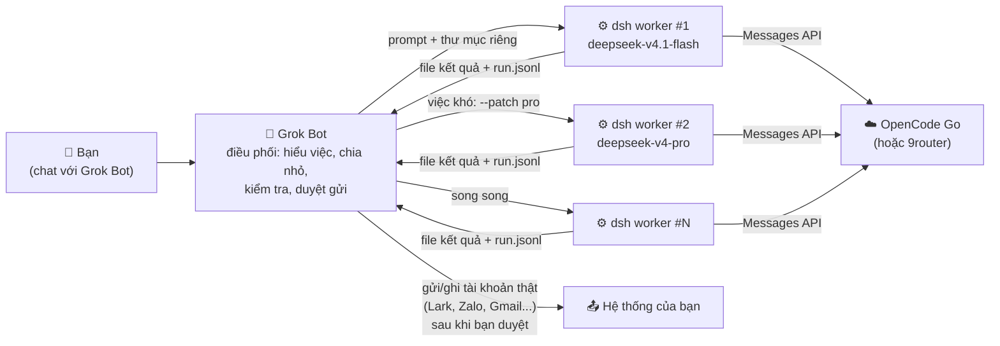

# Grok Bot × DeepSeek Harness — Orchestrator VN

**Biến Grok Bot thành lớp điều phối, DeepSeek Harness làm worker giá rẻ — tiết kiệm quota, chạy liên tục.**

Dành cho chủ doanh nghiệp nhỏ, team vận hành và dev đang dùng AI agent cho việc thật — những người từng gặp cảnh:

- Chạy một task kho (warehouse) trên model đắt + browser, **quota cả tuần cháy sạch trong một buổi**.
- Việc chỉ là đọc CSV, viết script, nháp báo cáo… nhưng vẫn tốn token của model xịn nhất.
- Muốn agent chạy liên tục mà không phải canh hạn mức.

> 💡 **Ý tưởng:** model đắt chỉ làm việc khó — hiểu yêu cầu, chia việc, kiểm tra, quyết định. Phần "chân tay" giao cho `dsh` (DeepSeek Harness) chạy ngay trên box của Grok Bot với model rẻ `deepseek-v4.1-flash` qua **OpenCode Go** (hoặc một router như **9router**). Mỗi việc chỉ tốn khoảng **0,004–0,02 USD**.

---

## Kiến trúc



- **Grok Bot** giữ mọi thứ nhạy cảm: browser, đăng nhập, gửi tin, ghi dữ liệu, quyết định.
- **dsh** chỉ làm trong một thư mục tạm (sandbox `workspace-write`), trả về file + log JSON để Grok Bot kiểm tra lại.

## Benchmark thật

Chạy trên box của Grok Bot, model `deepseek-v4.1-flash` qua OpenCode Go, ngày 21/10/2026. Chi phí tính theo giá off-peak từ token thực tế.

| Việc | Thời gian | Kết quả | Chi phí |
|---|---|---|---|
| Làm sạch CSV 208 dòng đơn hàng (trùng, ngày lộn xộn, giá "185k"/"185.000đ") → doanh thu theo khách/tháng + tóm tắt tiếng Việt | 111 s | ✅ khớp 100% số liệu kiểm tra tay | ~$0.017 |
| Viết parser sao kê ngân hàng VN + 10 unit test, tự chạy test | 76 s | ✅ 10/10 test pass | ~$0.012 |
| Chạy lệnh CLI chỉ-đọc (lark-cli, wrangler, df…) → báo cáo môi trường | 45 s | ✅ chỉ chạy đúng lệnh được phép | ~$0.005 |
| Đọc trang web qua `curl` → tóm tắt 10 ý | 31 s | ✅ chính xác | ~$0.004 |
| Viết báo cáo tuần tiếng Việt kiểu tin nhắn Lark | 32 s | ✅ văn tự nhiên, cần người duyệt | ~$0.004 |
| Đổi sang `deepseek-v4-pro` + nối tiếp phiên (`--session-id`) | ~9 s | ✅ nhớ ngữ cảnh | — |

> Số liệu từ một lần chạy, các test chạy song song. Kết quả thực tế phụ thuộc prompt, dữ liệu và tải của nhà cung cấp.

## Nên giao gì cho dsh, giữ gì cho Grok Bot

| ✅ Giao cho dsh (rẻ) | 🛑 Giữ ở Grok Bot |
|---|---|
| Xử lý CSV/Excel/log, đối soát, làm báo cáo | Mọi thao tác **gửi/ghi/xoá** trên Lark, Zalo, Gmail, Drive, Cloudflare |
| Viết script, test, tool nhỏ | Việc cần **browser**, đăng nhập, captcha |
| Nháp tiếng Việt: báo cáo tuần, proposal, JD, recap | Web search thật (dsh trên box chưa có search) |
| Tóm tắt tài liệu, chat đã export ra file | Quyết định liên quan tiền, khách hàng, nhân sự |
| Batch nhiều phần chạy song song | Duyệt cuối, nói chuyện với bạn |

## Bắt đầu nhanh

Nói với Grok Bot (hoặc làm tay trên box):

```bash
# 1. Node >= 22.19 rồi cài dsh
npm i -g @deepseek-ai/dsh

# 2. Config OpenCode Go (không chứa key)
mkdir -p ~/.dsh && cp config/cordis.patch.yml.example ~/.dsh/cordis.patch.yml

# 3. Key: nhờ Grok Bot xin secret tên OPENCODE_API_KEY

# 4. Chạy thử
mkdir -p /tmp/dsh-test && cd /tmp/dsh-test
DSH_TELEMETRY_DISABLED=1 dsh --profile headless "say hi"
```

Hướng dẫn chi tiết từng bước + xử lý lỗi: **[docs/cai-dat.md](docs/cai-dat.md)**.

Chạy ví dụ đơn hàng có sẵn:

```bash
mkdir -p /tmp/work/don-hang && cp examples/don-hang/don_hang_tho.csv /tmp/work/don-hang/
scripts/run-dsh.sh /tmp/work/don-hang examples/don-hang/prompt.txt
# việc khó hơn: scripts/run-dsh.sh --pro <thư-mục> <prompt>
```

## Nội dung repo

| File | Nội dung |
|---|---|
| `skills/dsh-worker/SKILL.md` | Skill cho Grok Bot: khi nào giao việc, cách viết prompt, chạy, kiểm tra |
| `config/cordis.patch.yml.example` | Config dsh dùng DeepSeek qua OpenCode Go (không có key) |
| `config/patches/` | `flash.patch.yml`, `pro.patch.yml` — đổi model theo từng lệnh |
| `scripts/run-dsh.sh` | Helper: vào thư mục làm việc, chạy headless `--json`, tách câu trả lời cuối |
| `examples/don-hang/` | CSV đơn hàng giả + prompt mẫu |
| `docs/cai-dat.md` | Cài đặt từng bước + xử lý sự cố |
| `docs/use-cases.md` | 9 tình huống cho SME Việt Nam, kèm prompt mẫu |
| `docs/9router.md` | Tuỳ chọn: chạy qua 9router (chưa kiểm thử) |

## Use case cho SME Việt Nam

Đối soát công nợ, báo cáo tuần Lark, tóm tắt chat Zalo đã export, xử lý đơn hàng CSV/Excel, viết script KiotViet/Pancake/n8n, nháp proposal/JD, batch tóm tắt tài liệu… Xem prompt mẫu ở **[docs/use-cases.md](docs/use-cases.md)**.

## Cộng đồng & dịch vụ

- **Tự động hóa cho bớt việc** — nhóm Facebook cho chủ doanh nghiệp/vận hành: https://www.facebook.com/groups/tudonghoachobotviec/
- **OpenCode VN** — nhóm Facebook cho người build agent/skill: https://www.facebook.com/groups/opencode.io.vn/
- **YouTube**: https://www.youtube.com/@nguyenngothuong
- **Triển khai AI agent / automation / Lark cho doanh nghiệp** — làm trên quy trình thật, bàn giao workflow chạy được. Chi tiết: [PROMO.md](PROMO.md).

Bài về vận hành/doanh nghiệp đăng chủ yếu ở nhóm Tự động hóa; nhóm OpenCode dành cho build agent/skill.

### ⭐ Thấy hữu ích?

Bấm **Star** cho repo và **Follow** [diginno-net](https://github.com/diginno-net) để nhận skill mới cho doanh nghiệp Việt.

## Lưu ý

- `dsh` đang ở giai đoạn **developer preview**, cú pháp có thể đổi. Nếu lệnh lỗi, xem `dsh --help`.
- OpenCode Go hiện xếp DeepSeek Harness vào nhóm client "còn vấn đề" về session header; thực tế vẫn chạy, nhưng có thể thay đổi.
- Không có cam kết chi phí hay hiệu năng. Kiểm tra lại kết quả trước khi dùng cho việc thật.
- Không lưu key trong repo, config hay prompt. Key chỉ nằm trong biến môi trường `OPENCODE_API_KEY`.

## Giấy phép

- Nội dung: **CC BY 4.0** — dùng, sửa, chia sẻ, kể cả thương mại, với điều kiện ghi công.
- Script và config: **MIT**.

Ghi công đề xuất:

> Dựa trên `grokbot-dsh-orchestrator-vn` của Diginno (CC BY 4.0).

## Đóng góp

1. Mở issue mô tả việc bạn đã giao cho dsh, prompt dùng, kết quả.
2. Thêm use case vào `docs/use-cases.md` hoặc ví dụ mới trong `examples/`.
3. Chạy `bash scripts/audit_public.sh` trước khi mở pull request.

## Phiên bản

- **0.1.0** — 21/10/2026 — bản đầu tiên: skill, config, helper, benchmark, use case.
