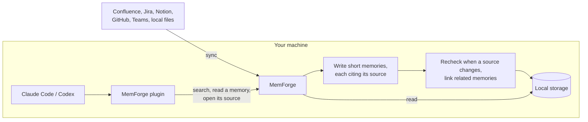

<h1> MemForge</h1>

**Give every agent your team's brain on day one.**

The memory layer for AI agents. Everything your team knows. Cited, and always
up to date. Built from your docs, tickets and chat.

<p>
  <a href="https://github.com/dodo-labs-ai/mem-forge/actions/workflows/ci.yml"></a>
  
  
</p>

<p align="center">
  <picture>
    <source media="(prefers-color-scheme: dark)" srcset="https://raw.githubusercontent.com/dodo-labs-ai/mem-forge/main/.github/assets/demo-dark.gif">
    
  </picture>
</p>

<p align="center">
  The open-source edition runs on your machine. The <b>Team Cloud Edition</b> is on the way:
  we host it and provide the models, your team just subscribes.
  <a href="https://github.com/dodo-labs-ai/mem-forge/discussions/13">Join the waitlist</a>.
</p>

## Why MemForge

**On day one, your agent knows what your team knows.** A new hire picks up a
ticket, and their agent reads the code and guesses. The answer the team
settled months ago sits in a Notion page nobody linked. With MemForge, the
agent checks team memory before it acts and finds the convention, decision or
known issue that applies, from Confluence, Jira, Notion, GitHub and Teams in
one `search` call.

**When a doc changes, memory follows.** The team changed a rule last week, and
agents still repeat the old one. With MemForge, the next sync rechecks every
memory built on the changed page: each is kept, replaced or retired, and the
earlier version stays as history. Memories that repeat, update or contradict
each other are linked, so the agent sees which one replaced another and where
two disagree.

**Every answer shows where it came from.** A confident answer you cannot check
is a liability. With MemForge, each memory comes with its supporting text and
a link to the page, ticket or file. Where the source allows it, the citation
is pinned to the revision and passage that was read, and the agent can open
the original. The supporting text can be the model's focused wording, not
always a verbatim quote.

**It runs on your machine.** Apache-2.0, with local storage (SQLite, FTS5 and
Chroma). You bring your own model keys, and those providers receive only what
is sent for inference. The plugins send no session transcripts.

See [how MemForge compares](https://github.com/dodo-labs-ai/mem-forge/blob/main/docs/comparison.md) with Mem0, Zep, claude-mem and
Unblocked.

## Quick start

> **Beta.** APIs, storage formats and plugin packaging may change. An upgrade
> that migrates your data saves a recovery point first
> ([Upgrading](https://github.com/dodo-labs-ai/mem-forge/blob/main/docs/quickstart.md#upgrading)).

You need Docker with Compose v2 and an API key for OpenRouter, OpenAI or
Anthropic.

**Let your agent set it up.** Paste this into Claude Code or Codex:

```text
Set up MemForge for me. Fetch this guide with curl and follow it exactly:
https://raw.githubusercontent.com/dodo-labs-ai/mem-forge/main/docs/agent-setup.md
```

The agent starts MemForge and installs its plugin, then hands you the admin UI
to enter your model key and connect a source, so your keys never pass through
the agent.

**Or set it up yourself:**

1. **Start MemForge.**

   ```bash
   git clone https://github.com/dodo-labs-ai/mem-forge.git && cd mem-forge
   cp .env.example .env
   docker compose up --build
   ```

   The admin UI is at http://localhost:5174.

2. **Choose models.** In **Settings**, choose a generation model, which writes
   the memories, and optionally an embedding model for semantic search. After
   **Save and validate**, each one shows **Ready**.

3. **Connect a source.** In **Sources**, add Notion pages, a Confluence
   space, a Jira project or a GitHub repository, and run a sync. Turn on
   **Sync automatically** to keep it current. The source shows the memories it
   made as the sync runs.

4. **Install the agent plugin.**

   ```text
   # Claude Code (inside a session)
   /plugin marketplace add dodo-labs-ai/mem-forge
   /plugin install memory@memforge
   ```

   ```bash
   # Codex
   codex plugin marketplace add dodo-labs-ai/mem-forge
   codex plugin add memory@memforge
   ```

5. **Ask.** Start a new agent session in your project and ask:

   ```text
   Before you change this, check MemForge for decisions and conventions that
   apply, and show the source for each one you rely on.
   ```

   The agent answers with the memories that apply and names the source of each.

The [quickstart](https://github.com/dodo-labs-ai/mem-forge/blob/main/docs/quickstart.md) covers every model provider,
local folders, the host CLI and network details.

## How it works



1. **Sync.** Connectors read your docs, tickets and chat, on a schedule or
   when you ask.
2. **Extract.** A model turns each source into short memories, each citing the
   passage it came from.
3. **Recheck.** When a source changes, the memories built on it are kept,
   replaced or retired, and related memories are linked.
4. **Recall.** Agents search memory and open its sources over MCP.

More detail: [architecture overview](https://github.com/dodo-labs-ai/mem-forge/blob/main/docs/architecture.md).

## Integrations

MemForge sits between the systems where your team writes things down and the
agents that do the work.

**Agent integrations**

<p>
  &nbsp;Claude&nbsp;Code&nbsp;&nbsp;&nbsp;
  <picture><source media="(prefers-color-scheme: dark)" srcset="https://raw.githubusercontent.com/dodo-labs-ai/mem-forge/main/.github/assets/icons/openai-dark.svg"></picture>&nbsp;Codex
</p>

**Memory sources**

<table>
  <tr>
    <td>Docs and wikis</td>
    <td nowrap>
      &nbsp;Confluence&nbsp;&nbsp;&nbsp;
      <picture><source media="(prefers-color-scheme: dark)" srcset="https://raw.githubusercontent.com/dodo-labs-ai/mem-forge/main/.github/assets/icons/notion-dark.svg"></picture>&nbsp;Notion&nbsp;&nbsp;&nbsp;
      <picture><source media="(prefers-color-scheme: dark)" srcset="https://raw.githubusercontent.com/dodo-labs-ai/mem-forge/main/.github/assets/icons/github-dark.svg"></picture>&nbsp;GitHub&nbsp;Pages&nbsp;&nbsp;&nbsp;
      <picture><source media="(prefers-color-scheme: dark)" srcset="https://raw.githubusercontent.com/dodo-labs-ai/mem-forge/main/.github/assets/icons/github-dark.svg"></picture>&nbsp;GitHub&nbsp;repo&nbsp;docs&nbsp;&nbsp;&nbsp;
      &nbsp;Local&nbsp;folders
    </td>
  </tr>
  <tr>
    <td>Tickets</td>
    <td nowrap>&nbsp;Jira</td>
  </tr>
  <tr>
    <td>Chat</td>
    <td nowrap>&nbsp;Teams</td>
  </tr>
  <tr>
    <td>Planned</td>
    <td nowrap>
      &nbsp;Obsidian
    </td>
  </tr>
</table>

[Add a source](https://github.com/dodo-labs-ai/mem-forge/blob/main/docs/quickstart.md#4-add-a-source) lists what each one syncs and
how to scope it. Need one that is missing?
[Vote for the next source](https://github.com/dodo-labs-ai/mem-forge/discussions/12).

## Limits

- The open-source edition runs for one person on one machine. It has no
  accounts or authentication and listens on `127.0.0.1` only, so do not expose
  it on a network. For memory your whole team shares, join the
  [Team Cloud Edition waitlist](https://github.com/dodo-labs-ai/mem-forge/discussions/13).
- Model extraction and semantic judgments can miss useful knowledge or make
  mistakes. Check the cited Evidence before relying on a consequential claim.
- A generation model is required; without one, syncs store content but create
  no memories.

## Documentation

- [Quickstart](https://github.com/dodo-labs-ai/mem-forge/blob/main/docs/quickstart.md): setup, models, plugins, sources, CLI,
  development from source
- [Docs index](https://github.com/dodo-labs-ai/mem-forge/blob/main/docs/README.md): quickstart, architecture, API and release guides
- [Contributing](https://github.com/dodo-labs-ai/mem-forge/blob/main/CONTRIBUTING.md)

## License

Apache License 2.0. See [LICENSE](https://github.com/dodo-labs-ai/mem-forge/blob/main/LICENSE).
