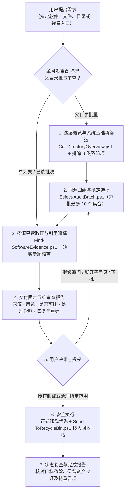

<div align="center">

# Windows Cleanup Skill

**面向 AI Agent 的证据驱动型 Windows 软件审查、安全卸载与残留清理技能**

[](https://github.com/dragonknightk/windows-cleanup/releases)
[](#环境要求)
[](#环境要求)
[](LICENSE)
[](SKILL.md)

**简体中文** | **[English](README_EN.md)**

</div>

---

## 项目简介

`windows-cleanup` 是一个专为支持 Skill 机制的 AI 编程助手（如 Codex CLI、Claude Code、Antigravity、Cursor 等）设计的 **Windows 系统与软件深度审查、卸载及清理技能**。

与传统“一键清理”工具仅凭文件名或目录名盲目删除不同，本仓库**不包含任何黑盒自动删除程序**。它通过结构化的调查规程与只读辅助脚本，引导 AI Agent 先在本地收集多维证据（注册表卸载项、进程、服务、计划任务、启动项、环境变量与文件签名），向用户交付固定五维度的审查结论，再在用户明确授权的范围内执行**正式卸载、回收站安全移入与结果复查**。

---

## 为什么选择本项目？（痛点直击）

在清理 Windows 用户目录（如 `AppData`、`ProgramData`）或旧软件残留时，传统工具与普通 AI 提问往往让人陷入“不敢删、怕删错”的困境：

| 对比维度 | 传统“一键清理”软件 | 直接向普通 AI 提问 | **本仓库 `windows-cleanup` Skill** |
|---|---|---|---|
| **判断依据** | 按目录名、后缀或陈旧规则库死板匹配 | 仅凭文件夹名字盲猜（看到 `Cache` / `Temp` 就建议删） | **跨注册表、进程、服务、计划任务 XML、签名多源实证** |
| **用户资产安全** | 极易误删游戏存档、虚拟机镜像或开发环境配置 | 不查引用链，容易删崩同厂商其他软件或共享运行时 | **自动识别并保护用户资产与共享 SDK，6 类系统基础项默认排除** |
| **分析深度与可读性** | 黑盒勾选列表，完全不解释目录用途与删除后果 | 目录一多就偷懒敷衍，把每个目录压缩成短短一句话 | **固定五维深度卡片 + 每批最多 10 项硬停点，绝不缩水敷衍** |
| **删除兜底机制** | 直接调用底层删除，一旦误删无法反悔 | 直接给出危险的 `Remove-Item -Recurse -Force` 命令 | **正式卸载优先 + Win32 `IFileOperation` 回收站双重回调确认** |
| **隐私与安全红线** | 扫描过程不透明 | 可能把命令或配置里的密钥/Token 直接发进上下文 | **12 项路径红线拦截（拒穿软链接/关键容器）+ 凭据自动 `[REDACTED]`** |

---

## 核心特性

- **证据驱动，拒绝盲猜**：不凭 `Cache`、`Temp` 或相似厂商名直接判定可删。跨注册表（32/64 位视图）、运行态进程、服务驱动、计划任务 XML、环境变量与文件数字签名交叉印证归属。
- **固定五维审查报告**：无论审查单个文件还是整批目录，每个对象始终按统一版式输出五项结论——**来源、用途、是否可以卸载或删除、处理影响、恢复与重建**，并如实标注证据缺口。
- **分批可控与系统保护**：父目录批量审查默认自动识别并排除 **6 类系统基础项**（如 `NTUSER.DAT`、系统兼容链接、`pagefile.sys` 等），每批最多深入审查 **10 个同源集合**，复杂目录支持按需下钻与返回。
- **多层防御级清理边界**：
  - **正式入口优先**：已安装软件优先调用官方卸载器或系统包管理入口，记录卸载前基线后再清查残留。
  - **原生回收站强校验**：普通文件与目录通过 C# P/Invoke 调用 Windows Shell `IFileOperation` 移入回收站，在 `PreDeleteItem` / `PostDeleteItem` 回调中强制校验回收标志与回收站落盘路径，拦截静默永久删除。
- **会话状态持久化与脱敏**：审查进度、分组编号（如 `G001`）与用户决策自动持久化在调用工作区的 `work/windows-cleanup/<任务名>/`（`session.json` + `report.md`），且自动遮盖命令行与配置中的 `Bearer`、`Basic`、Token 及密码字段。

---

## 工作流程



---

## 审查报告输出预览

加载本 Skill 后，Agent 会按统一、易读的版式交付审查结果（以下为批量审查中的报告片段示意）：

> 本次概览中，这个目录共有 42 个直接子项，已默认排除 6 个系统基础项（包含用户配置文件和系统兼容链接）。其余 36 项按来源归为 14 个待审集合，本批审查 10 个集合。
>
> G003 · `thumbnail-cache` — 图库缩略图缓存，可按条件清理
>
> - **来源：** 已从图库应用的本地配置文件确认，该目录由该应用创建并管理，当前配置仍指向此路径。
> - **用途：** 保存照片的小尺寸预览缩略图，用于打开图库时快速渲染图片列表；用户的原始照片存储在另一个独立的图片资料目录中。
> - **是否可以卸载或删除：** **接受预览图重新生成的加载开销时，可选择清理该缓存目录。** 处理范围仅限此缓存目录，应用本体、原始照片及其他用户配置均保留。
> - **处理影响：** 清理后首次打开图库会重新扫描原图并生成缩略图，列表首次加载速度变慢；原始照片与应用功能不受影响。
> - **恢复与重建：** 只要原始照片仍在且应用可正常读取，打开应用即可自动重建预览。若需找回清理前的原缓存文件，可在清空回收站前从回收站还原。
>
> 本批已审查 10 个集合，剩余 4 个待审集合。你可以指定“继续查 G005 的来源”、“清理 G003”，或告诉我“下一批”。

---

## 环境要求

- **操作系统**：Windows 10 / Windows 11
- **运行环境**：[PowerShell 7.2+](https://learn.microsoft.com/zh-cn/powershell/scripting/install/installing-powershell-on-windows)（脚本依赖 .NET 6+ 文件系统与链接元数据 API）
- **外部依赖**：无（`RecycleInterop.cs` 由 PowerShell 在运行时按需编译）
- **宿主工具**：支持 `SKILL.md` 规范的 AI Agent

---

## 安装与使用

### 1. 安装到 AI Agent 技能目录

将本仓库克隆到你所使用的 AI Agent 对应的 `skills` 目录下，保持目录名为 `windows-cleanup`：

```powershell
# Codex CLI
git clone https://github.com/dragonknightk/windows-cleanup.git "$env:USERPROFILE\.codex\skills\windows-cleanup"

# Claude Code
git clone https://github.com/dragonknightk/windows-cleanup.git "$env:USERPROFILE\.claude\skills\windows-cleanup"

# Antigravity
git clone https://github.com/dragonknightk/windows-cleanup.git "$env:USERPROFILE\.gemini\antigravity\skills\windows-cleanup"

# 项目级通用技能目录（Cursor / Windsurf / OpenCode 等）
git clone https://github.com/dragonknightk/windows-cleanup.git ".agents/skills/windows-cleanup"
```

### 2. 自然语言调用示例

加载技能后，直接向 Agent 提出需求即可：

- **查明陌生目录或文件**：“帮我看看 `C:\Users\<用户名>\AppData\Local\Temp` 或 `D:\Tools` 里都有什么，哪些能安全清理？”
- **分批盘点用户目录**：“审查我用户目录下的所有非系统文件夹，先看第一批。”
- **彻底卸载软件并清残留**：“帮我正式卸载某款旧软件，并检查它的服务、计划任务和 AppData 残留。”
- **排查失效系统入口**：“帮我检查系统环境变量 `PATH` 和开机启动项里有哪些已经失效的旧软件路径。”

---

## 安全防线与操作边界

本工具涉及系统变更与文件清理，设计上内置了严格的六层防护机制：

| 安全维度 | 防护机制说明 |
|---|---|
| **1. 只读审查默认边界** | 用户仅提出“看看、审查、能不能删”时，100% 仅执行只读取证与报告交付，绝不自动触发卸载或删除；发现的可执行文件与脚本仅作文本/元数据检查，不作为探测命令运行。 |
| **2. 回收站双重回调确认** | [`Send-ToRecycleBin.ps1`](scripts/Send-ToRecycleBin.ps1) 默认仅做预检（`Preflight`），显式传入 `-Apply` 才执行。底层通过 `IFileOperationProgressSink` 监控，若缺少可回收标志或未获得回收站路径凭证立即中止（`E_ABORT`），且保留 `FOF_WANTNUKEWARNING` 防止静默永久删除。 |
| **3. 12 项路径红线拦截** | 回收脚本通过 `QueryDosDevice` 强制验证直接连接的固定本地卷（`\Device\HarddiskVolume*`）；严禁操作卷根目录、UNC 路径、映射网络盘、SUBST 虚拟盘、设备前缀、ADS 交替数据流、短文件名别名（`~`）、尾随点/空格、重解析点（Junction/Symlink）以及 `Windows` / `Users` / `Program Files` 等关键容器整体。 |
| **4. 保护路径重叠拒止** | 支持传入 `-ProtectedPath`（保留的用户数据或共享组件路径）。只要清理目标与保留路径存在父子包含或重解析别名重叠，整批预检直接拒绝执行。 |
| **5. 6 类系统基础项过滤** | 批量概览自动识别并排除用户配置基础文件（`NTUSER.DAT`）、系统兼容连接点（`Application Data` 等）、`desktop.ini`、系统分页文件（`pagefile.sys`）、启动恢复文件与 `System Volume Information`，防止误伤系统根基。 |
| **6. 敏感凭据自动脱敏** | [`Find-SoftwareEvidence.ps1`](scripts/Find-SoftwareEvidence.ps1) 在采集进程命令行、服务路径、环境变量与计划任务 XML 时，自动将 `Authorization: Bearer/Basic`、密码、Token、API Key 与 URL 内嵌凭据替换为 `[REDACTED]`。 |

> [!IMPORTANT]
> - **回收站空间说明**：移入回收站的文件仍占用磁盘空间，确认无误并清空回收站后才会实际释放。
> - **非文件操作回滚**：修改注册表前会在任务目录精确导出所改分支备份；卸载器、服务与环境变量变更各有独立的恢复条件，无法通过回收站还原。

---

## 仓库结构与脚本一览

```text
windows-cleanup/
├── SKILL.md                        # Skill 核心入口：目标路由、共同原则与五维交付规范
├── agents/
│   └── openai.yaml                 # Agent 界面显示名称、简介与默认提示词
├── references/                     # 核心流程规范文档
│   ├── audit.md                    # 单对象审查、证据链构建与确定性分级
│   ├── batch.md                    # 父目录批量审查、三种计数口径与会话状态机
│   ├── cleanup.md                  # 6 步软件卸载、按类型清理边界与复查标准
│   ├── interaction.md              # 五维报告 Markdown 版式与各场景交互话术
│   ├── system-exclusions.md        # 6 类系统基础项默认排除规则与专项入口
│   ├── tools.md                    # 辅助脚本参数契约与 session.json (v2) 格式规范
│   └── topics/                     # 五大领域专项取证指南
│       ├── associations.md         # 快捷方式、URL 协议、文件关联、右键菜单、COM 与虚拟网卡
│       ├── environment.md          # Machine/User/Process 环境变量、PATH 解析与命令冲突
│       ├── filesystem.md           # 程序目录、缓存、共享组件与用户资产边界
│       ├── startup-runtime.md      # 启动项、服务、驱动、计划任务 XML 与运行态进程归因
│       └── web-apps.md             # PWA、AppX 包、浏览器配置 JSON 与 WebView2 宿主分析
└── scripts/                        # PowerShell 7.2+ 辅助脚本与自测套件
    ├── Get-DirectoryOverview.ps1   # 有限深度只读目录概览（输出 JSON）
    ├── Find-SoftwareEvidence.ps1   # 跨 7 大系统领域按关键词只读检索软件证据（自动脱敏）
    ├── Select-AuditBatch.ps1       # 校验会话记录并按稳定顺序选出最多 10 个待审集合
    ├── Send-ToRecycleBin.ps1       # 路径安全预检与回收站移入执行脚本
    ├── RecycleInterop.cs           # Windows Shell IFileOperation 回收站 COM 互操作实现
    ├── Test-Collectors.ps1         # 概览与取证脚本单元测试及本机只读烟测
    ├── Test-Batch.ps1              # 选批逻辑与 Schema v2 边界校验测试（62 项断言）
    └── Test-Recycle.ps1            # 回收路径边界测试与真实回收/还原往返测试
```

### 运行自测套件

你可以在任意处于本仓库之外的临时目录运行内置测试套件，验证所有脚本在当前系统环境下的工作状态：

```powershell
$testRoot = Join-Path $env:TEMP "windows-cleanup-test-$([guid]::NewGuid().ToString('N'))"
New-Item -ItemType Directory -Path $testRoot | Out-Null
try {
    ./scripts/Test-Collectors.ps1 -TestRoot $testRoot
    ./scripts/Test-Batch.ps1 -TestRoot $testRoot
    ./scripts/Test-Recycle.ps1 -TestRoot $testRoot -ApplyRoundTrip
} finally {
    Remove-Item -LiteralPath $testRoot -Recurse -Force -ErrorAction SilentlyContinue
}
```

---

## 开源协议

本项目基于 [MIT License](LICENSE) 开源。
