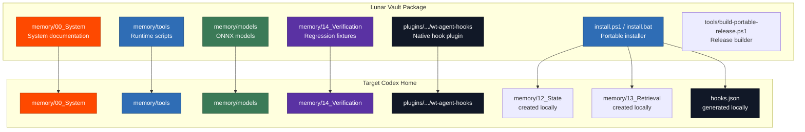
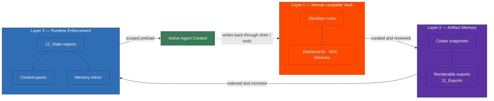
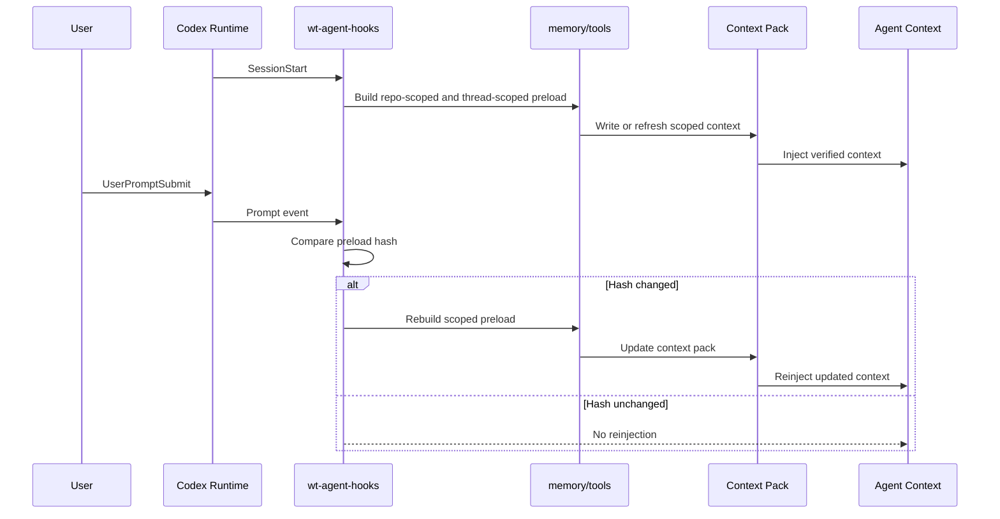
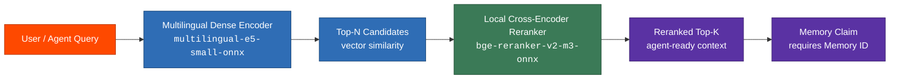
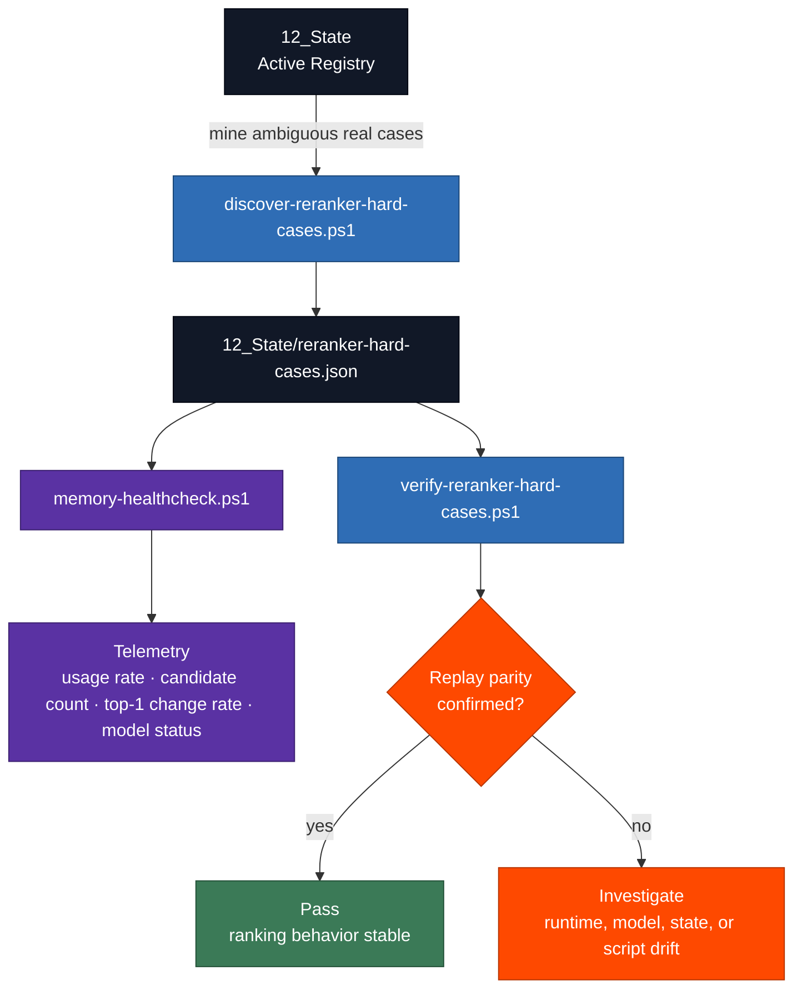
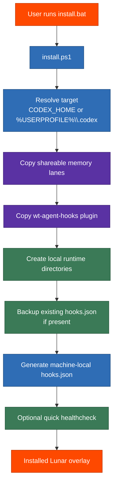
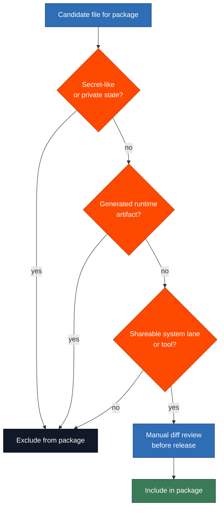
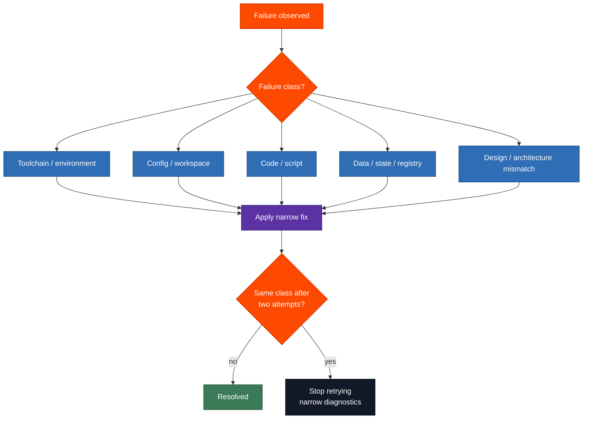

<div align="center">

# Lunar Vault

**Portable Codex Memory Overlay for Lunar Runtime**

<br/>


<br/>

<sub><i>A GitHub-shareable memory overlay for Codex-native preload, retrieval, verification, and portable runtime installation.</i></sub>

</div>

---

## Overview

<table>
  <tr>
    <td width="34%" align="center" valign="middle">
      
      <br/><br/>
      
      <br/>
      
    </td>
    <td width="66%" valign="top">
      <p><strong>Lunar Vault</strong> is a portable distribution package for the Lunar memory system used inside Codex. It packages the runtime-facing memory tools, retrieval models, preload hooks, documentation, verification fixtures, and release utilities required to install Lunar into a target Codex home without copying private sessions, journals, caches, credentials, or machine-specific state.</p>
      <p>The repository is intentionally designed as an <strong>overlay package</strong>, not as the live source-of-truth runtime. The live runtime belongs inside <code>%USERPROFILE%\.codex</code> or a configured <code>CODEX_HOME</code>. Lunar Vault exists to carry only the shareable, reviewable, reproducible parts of that runtime through GitHub, a ZIP release, or a controlled handoff.</p>
      <p>The package includes the native hook plugin, memory operation scripts, ONNX retrieval models, memory-system documentation, portable installers, release builders, and verification workflows. It excludes personal memory state and any sensitive runtime material by design.</p>
    </td>
  </tr>
</table>

<div align="center">


</div>

---

## Executive Summary

Lunar Vault solves a narrow but important distribution problem: the active Lunar runtime lives in a local Codex home, while the shareable implementation must live in a repository that can be reviewed, versioned, packaged, and safely installed elsewhere.

The package supports two primary installation modes:

| Mode | User Action | Best For |
| --- | --- | --- |
| Repository install | Clone or download the repository, then run `install.bat` | Developers, maintainers, local testing |
| Portable release install | Download `lunar-vault-portable.zip`, extract it, then run `install.bat` | End users, clean installs, GitHub Releases |

The installer performs four operational actions:

1. Copies the shareable Lunar lanes into the target Codex home.
2. Installs the native preload hook plugin.
3. Creates required runtime directories for state and retrieval outputs.
4. Generates a fresh machine-local `hooks.json` that points to the installed plugin path.

It deliberately does not ship personal memory state, generated context packs, SQLite state, caches, journals, credentials, browser secrets, API keys, tokens, or private runtime artifacts.

---

## Table of Contents

- [What Lunar Vault Is](#what-lunar-vault-is)
- [Design Principles](#design-principles)
- [Package Boundary](#package-boundary)
- [Architecture](#architecture)
- [Runtime Model](#runtime-model)
- [Retrieval Model](#retrieval-model)
- [Included Components](#included-components)
- [Repository Layout](#repository-layout)
- [Installation](#installation)
- [Release Workflow](#release-workflow)
- [Maintainer Workflow](#maintainer-workflow)
- [Verification](#verification)
- [Security and Data Boundaries](#security-and-data-boundaries)
- [Troubleshooting](#troubleshooting)
- [Failure Handling](#failure-handling)
- [Limitations](#limitations)
- [Glossary](#glossary)

---

## What Lunar Vault Is

Lunar Vault is a portable memory overlay for Codex. It exists to make Lunar installable and reproducible without turning the repository into a private memory dump.

| Classification | Description |
| --- | --- |
| Product category | Portable memory-runtime overlay |
| Primary runtime | Codex |
| Primary operating system | Windows |
| Main execution surfaces | PowerShell scripts, Python-backed retrieval helpers, native hook plugin |
| Retrieval stack | Local ONNX dense encoder + local ONNX cross-encoder reranker |
| Distribution surface | Git repository and portable ZIP artifact |
| Install target | `CODEX_HOME` or `%USERPROFILE%\.codex` |
| Safety posture | Exclude private state and credentials by default |

### What It Is Not

Lunar Vault is not a full Codex installer, not a personal memory backup, not a cloud sync service, not a credential migration tool, and not a generalized agent-memory platform yet. It is a focused package for distributing the safe, shareable, runtime-facing pieces of Lunar.

---

## Design Principles

The package follows the same operating principles as Lunar itself.

| Principle | Operational Meaning | README / Package Implication |
| --- | --- | --- |
| **Core-first** | The system must work without community Obsidian plugins. | Documentation and install flow cannot depend on non-core Obsidian behavior. |
| **Link-first** | Notes, wikilinks, backlinks, dashboards, and Maps of Content drive retrieval. | Folder structure is documented, but links remain the primary navigation layer. |
| **Schema-light** | Metadata must stay minimal and useful. | Avoid heavy frontmatter and tag explosion. |
| **Export-with-consumer** | Codex artifacts must be exported into readable notes. | No raw opaque dumps that cannot render in Obsidian. |
| **Safe-by-default** | Secret-like files must never be read, copied, summarized, or redistributed. | Install and release workflows must preserve exclusion boundaries. |
| **No ID, no memory** | A recalled memory claim needs a traceable memory ID. | Runtime documentation emphasizes provenance over vague recall. |

---

## Package Boundary

The central design decision is the separation between the live runtime and the portable package.

```mermaid
flowchart LR
    Live["Live Codex Home<br/><code>%USERPROFILE%\\.codex</code><br/>or <code>CODEX_HOME</code>"]
    Sync["Maintainer Sync<br/><code>tools/sync-from-codex.ps1</code>"]
    Repo["Lunar Vault Repository<br/>shareable overlay source"]
    Build["Release Builder<br/><code>build-portable-release.ps1</code>"]
    Zip["Portable ZIP<br/><code>dist/lunar-vault-portable.zip</code>"]
    Install["Installer<br/><code>install.ps1</code> / <code>install.bat</code>"]
    Target["Target Codex Home<br/>machine-local runtime"]

    Live -->|"curated shareable lanes only"| Sync
    Sync --> Repo
    Repo --> Build
    Build --> Zip
    Repo --> Install
    Zip --> Install
    Install --> Target

    classDef orange fill:#FE4900,stroke:#B73500,color:#fff;
    classDef blue fill:#2F6DB5,stroke:#1B4778,color:#fff;
    classDef green fill:#3B7A57,stroke:#245239,color:#fff;
    classDef purple fill:#5A32A3,stroke:#3C2070,color:#fff;
    classDef dark fill:#111827,stroke:#030712,color:#fff;

    class Live,Target dark;
    class Sync,Install blue;
    class Repo orange;
    class Build,Zip purple;
```



| Concern | Live `.codex` Runtime | Lunar Vault Package | Portable ZIP |
| --- | --- | --- | --- |
| Active session state | Yes | No | No |
| Personal journals | Yes | No | No |
| Durable registry state | Yes | No | No |
| Generated context packs | Yes | No | No |
| Memory operation tools | Yes | Yes | Yes |
| System documentation | Yes | Yes | Yes |
| ONNX retrieval models | Yes | Yes | Yes |
| Native hook plugin | Yes | Yes | Yes |
| Machine-specific `hooks.json` | Local only | Template/generated | Generated on install |
| GitHub release suitability | No | Yes | Yes |

---

## Architecture

Lunar Vault packages the implementation pieces that allow a target Codex home to perform preload, retrieval, verification, and memory operation workflows locally.



### Architectural Contract

The repository carries portable source material. The installer converts that portable source into a machine-local Codex runtime overlay by resolving paths and generating the final hook manifest. This prevents a portable package from accidentally shipping absolute paths from the maintainer's machine.

---

## Runtime Model

Lunar uses three overlapping memory layers: human-readable vault notes, reviewable exported artifacts, and runtime-enforced retrieval context.



### Context Injection Flow

At session start, the native hook plugin preloads scoped context. On later prompts, the hook should reinject only when the preload hash changes, keeping the conversation clean and avoiding duplicate context blocks.



---

## Retrieval Model

Lunar Vault packages a local two-stage retrieval stack.

<div align="center">


</div>



### Why Two Stages

A dense encoder is fast and good for broad semantic recall, but it scores the query and candidate independently. A cross-encoder is more precise because it scores each query-candidate pair jointly, but it is too expensive to run against the entire registry. Lunar uses the dense encoder first to shortlist candidates, then uses the cross-encoder only on that shortlist.

This gives the system the speed of vector search and the precision of pairwise reranking.

### Quality Verification

Retrieval quality is not asserted. It is checked through telemetry and replay.



Useful signals:

| Signal | Meaning |
| --- | --- |
| Reranker model status | Whether the local ONNX reranker is installed and available |
| Reranker usage rate | Whether real queries are actually reaching Stage 2 |
| Average candidates evaluated | Size of the shortlist being reranked |
| Top-1 change rate | How often the reranker changes the dense encoder's first result |
| Hard-case replay parity | Whether known ambiguous cases still behave as expected |

---

## Included Components

### Memory System Documents

The `memory/00_System` lane contains the system-level operating rules.

| File | Purpose |
| --- | --- |
| `Home.md` | Main entry point for the memory lane |
| `Memory Policy.md` | Operating policy and safety rules |
| `Memory Operations.md` | Save, load, mirror, retrieval, and context-pack operations |
| `Capture Protocol.md` | Capture discipline and intake behavior |
| `Review Protocol.md` | Review cycle and cleanup discipline |
| `Schema.md` | Minimal metadata and note structure |
| `Obsidian Setup.md` | Human-readable vault setup notes |

### Runtime Tools

The `memory/tools` lane contains the operational scripts.

| Category | Representative Scripts | Role |
| --- | --- | --- |
| Shim lifecycle | `start-memory-shim.ps1`, `status-memory-shim.ps1`, `stop-memory-shim.ps1` | Start, inspect, and stop the memory shim |
| Memory operations | `load-memory.ps1`, `save-memory.ps1`, `auto-commit-session-memory.ps1` | Load context and curate memory |
| Retrieval maintenance | `rebuild-semantic-index.ps1`, `rebuild-retrieval-mirror.ps1`, `build-context-pack.ps1` | Prepare search and preload context |
| Model support | `install-embedding-model.ps1`, `install-reranker-model.ps1` | Install local ONNX model bundles |
| Validation | `memory-healthcheck.ps1`, `test-memory-end-to-end.ps1` | Verify operational readiness |
| Hook checks | `verify-preload-hook.ps1`, `verify-runtime-hook-invocation.ps1` | Confirm hook behavior |
| Export / migration | `export-codex-memory.ps1`, `migrate-legacy-memory.ps1` | Export safe artifacts and migrate older memory formats |

### Retrieval Models

| Model Directory | Role | Runtime Use |
| --- | --- | --- |
| `memory/models/multilingual-e5-small-onnx` | Dense multilingual embedding | Initial recall over candidate memory |
| `memory/models/bge-reranker-v2-m3-onnx` | Cross-encoder reranking | Precision rerank of top-N candidates |

### Native Hook Plugin

The plugin path is:

```text
plugins/marketplaces/wt-local/plugins/wt-agent-hooks
```

Key files include:

| File | Role |
| --- | --- |
| `hooks/emit-memory-preload.ps1` | Emits scoped preload context |
| `hooks/send-event.ps1` | Sends hook event payloads |
| plugin-level `hooks.json` | Plugin-local hook configuration |

The installer generates the target machine's top-level `hooks.json` instead of copying a maintainer-specific manifest.

---

## Repository Layout

```text
lunar-vault/
|-- memory/
|   |-- 00_System/
|   |-- 14_Verification/
|   |-- models/
|   |   |-- multilingual-e5-small-onnx/
|   |   `-- bge-reranker-v2-m3-onnx/
|   `-- tools/
|-- plugins/
|   `-- marketplaces/
|       `-- wt-local/
|           `-- plugins/
|               `-- wt-agent-hooks/
|                   |-- hooks/
|                   `-- hooks.json
|-- tools/
|   |-- build-portable-release.ps1
|   `-- sync-from-codex.ps1
|-- install.bat
|-- install.ps1
|-- release-portable.bat
`-- README.md
```

---

## Installation

### Option A — Install from Repository Download

1. Clone or download this repository.
2. Open the repository folder.
3. Double-click `install.bat`.

### Option B — Install from Portable Release ZIP

1. Download `lunar-vault-portable.zip` from a GitHub Release.
2. Extract the ZIP.
3. Open the extracted folder.
4. Double-click `install.bat`.

### Default Target

If `CODEX_HOME` is set, the installer uses that path.

If `CODEX_HOME` is not set, the installer targets:

```text
%USERPROFILE%\.codex
```

### Optional CLI Install

Run from the repository root:

```powershell
powershell -NoProfile -ExecutionPolicy Bypass -File .\install.ps1
```

Install into a custom Codex home:

```powershell
powershell -NoProfile -ExecutionPolicy Bypass -File .\install.ps1 -CodexHome D:\Custom\.codex
```

Skip the optional quick healthcheck:

```powershell
powershell -NoProfile -ExecutionPolicy Bypass -File .\install.ps1 -SkipHealthcheck
```

### Installation Flow



### What the Installer Writes

| Target Path | Action |
| --- | --- |
| `<CodexHome>\memory\00_System` | Copy from package |
| `<CodexHome>\memory\14_Verification` | Copy from package |
| `<CodexHome>\memory\models` | Copy from package |
| `<CodexHome>\memory\tools` | Copy from package |
| `<CodexHome>\plugins\marketplaces\wt-local\plugins\wt-agent-hooks` | Copy from package |
| `<CodexHome>\memory\12_State` | Create if missing |
| `<CodexHome>\memory\13_Retrieval\Context Packs` | Create if missing |
| `<CodexHome>\memory\13_Retrieval\Memory Mirror` | Create if missing |
| `<CodexHome>\hooks.json` | Generate fresh |
| `<CodexHome>\hooks.backup.*.json` | Create if existing `hooks.json` is replaced |

---

## Release Workflow

The repository includes a dedicated portable-release builder.

### One-Click Build

Double-click:

```text
release-portable.bat
```

### CLI Build

```powershell
powershell -NoProfile -ExecutionPolicy Bypass -File .\tools\build-portable-release.ps1
```

### Release Build Flow


### Builder Output

| Output | Purpose |
| --- | --- |
| `dist/lunar-vault-portable/` | Expanded release staging folder |
| `dist/lunar-vault-portable.zip` | GitHub-release-ready artifact |
| SHA256 hash | Integrity check for the produced ZIP |

---

## Maintainer Workflow

Lunar Vault should be treated as a packaged mirror of selected shareable lanes from a live Lunar source tree.

### Sync from Live `.codex`

```powershell
powershell -ExecutionPolicy Bypass -File .\tools\sync-from-codex.ps1
```

Sync from a custom source:

```powershell
powershell -ExecutionPolicy Bypass -File .\tools\sync-from-codex.ps1 -SourceCodexHome D:\Custom\.codex
```

### Recommended Release Sequence

1. Update and validate the live Lunar runtime.
2. Run `tools/sync-from-codex.ps1`.
3. Review the repository diff.
4. Confirm no excluded files are staged.
5. Run `release-portable.bat`.
6. Inspect the generated ZIP contents.
7. Upload `dist/lunar-vault-portable.zip` to GitHub Releases.

### Maintainer Review Checklist

| Check | Required Outcome |
| --- | --- |
| Shareable lanes only | No personal journals, sessions, generated context packs, or runtime state |
| Hook portability | No absolute maintainer paths in committed top-level hook manifests |
| Models present | ONNX model directories included when expected |
| Docs render | README and `memory/00_System` markdown render cleanly |
| Safety boundary | No secrets, tokens, private keys, `.env`, auth caches, or credential files |
| Install path | Installer generates machine-local `hooks.json` |
| Release integrity | ZIP builds successfully and prints SHA256 |

---

## Verification

### Structural Install Verification

Use a temporary Codex home to validate installation without touching the real runtime:

```powershell
$temp = Join-Path $env:TEMP 'lunar-vault-install-test'
Remove-Item -LiteralPath $temp -Recurse -Force -ErrorAction SilentlyContinue
powershell -ExecutionPolicy Bypass -File .\install.ps1 -CodexHome $temp -SkipHealthcheck
```

Expected results:

| Check | Expected Result |
| --- | --- |
| `hooks.json` | Exists in the temp Codex home |
| `memory\tools` | Exists |
| `memory\models` | Exists |
| `memory\00_System` | Exists |
| `plugins\marketplaces\wt-local\plugins\wt-agent-hooks` | Exists |
| `memory\12_State` | Exists as local runtime directory |
| `memory\13_Retrieval` | Exists as local runtime directory |

### Portable Artifact Verification

1. Build the portable ZIP.
2. Extract it into a temporary folder.
3. Run the extracted `install.ps1` against a temporary Codex home.
4. Confirm the same structural checks listed above.

### Runtime Verification Commands

Run from the installed Codex home or from the expected runtime root, depending on script design:

```powershell
powershell -ExecutionPolicy Bypass -File .\memory\tools\memory-healthcheck.ps1
powershell -ExecutionPolicy Bypass -File .\memory\tools\verify-preload-hook.ps1
powershell -ExecutionPolicy Bypass -File .\memory\tools\verify-runtime-hook-invocation.ps1
powershell -ExecutionPolicy Bypass -File .\memory\tools\verify-reranker-hard-cases.ps1
```

### Verification Matrix

| Verification Area | Script / Method | Primary Evidence |
| --- | --- | --- |
| Install structure | Temporary install check | Required folders and `hooks.json` exist |
| Hook wiring | `verify-preload-hook.ps1` | Hook path resolves to installed plugin |
| Runtime invocation | `verify-runtime-hook-invocation.ps1` | Hook event can invoke preload behavior |
| Retrieval health | `memory-healthcheck.ps1` | Model status and reranker telemetry |
| Reranker parity | `verify-reranker-hard-cases.ps1` | Hard-case replay confirms or flags drift |
| End-to-end behavior | `test-memory-end-to-end.ps1` | Memory roundtrip and runtime flow pass |

---

## Security and Data Boundaries

Lunar Vault is designed to reduce accidental leakage of private memory and credential material.

### Never Include

| Class | Examples |
| --- | --- |
| Credentials | API keys, tokens, passwords, private keys |
| Auth caches | `auth.json`, browser auth caches, session cookies |
| Environment secrets | `.env`, `.env.local`, secret-bearing config |
| Secret directories | `secrets/`, `.sandbox-secrets/` |
| Private memory state | journals, personal sessions, generated context packs |
| Runtime databases | SQLite state, local caches, generated indexes |
| Machine-local manifests | top-level `hooks.json` with absolute local paths |

### Safe Boundary Diagram



If a task appears to require reading or packaging a protected file, stop and narrow the task. Do not work around the boundary.

---

## Troubleshooting

| Issue | Likely Cause | Recommended Action |
| --- | --- | --- |
| `install.bat` closes immediately | PowerShell execution failure | Run `install.ps1` directly in PowerShell to see the exact error |
| Installer targets the wrong location | `CODEX_HOME` is set unexpectedly | Check `$env:CODEX_HOME` or pass `-CodexHome` explicitly |
| Hook does not fire | `hooks.json` missing, overwritten, or pointing to wrong path | Inspect `<CodexHome>\hooks.json` and confirm the plugin path exists |
| Memory tools are missing | Install interrupted or wrong target selected | Re-run install against the intended target |
| Portable ZIP is missing | Release builder has not been run | Run `release-portable.bat` |
| Existing hooks appear lost | Installer backed up then regenerated `hooks.json` | Check `<CodexHome>\hooks.backup.*.json` |
| Reranker not active | Model missing or runtime cannot load it | Run `install-reranker-model.ps1`, then `memory-healthcheck.ps1` |
| Verification fails | Environment, config, model, script, or state issue | Classify the failure before patching |

---

## Failure Handling

Classify failures before fixing. Avoid patching symptoms blindly.



Failure classes:

| Class | Meaning |
| --- | --- |
| Toolchain / environment | PowerShell, Python, permissions, path, execution policy, missing runtime dependency |
| Config / workspace | Wrong `CODEX_HOME`, invalid hook path, wrong working directory |
| Code / script | Script logic error or incompatible interface |
| Data / state / registry | Missing registry, malformed hard-case file, stale generated artifact |
| Design / architecture mismatch | The requested behavior conflicts with package boundaries or runtime assumptions |

After two failed attempts with the same class, stop retrying and narrow diagnostics.

---

## Limitations

| Limitation | Current Position |
| --- | --- |
| Codex-first runtime | Full enforcement is currently Codex-oriented |
| Multi-agent native support | Strategic direction is native support for all agents, but do not assume parity until verified |
| Reranker value depends on data | Top-1 change rate determines whether reranking is useful on a given registry |
| Hard-case coverage is reactive | Hard cases are mined from ambiguity that has surfaced; new ambiguity must be captured and replayed |
| Installer is an overlay installer | It does not bootstrap every possible Codex dependency |
| GitHub color support is limited | Color is expressed through badges and Mermaid styling, not fragile inline CSS |

---

## Glossary

| Term | Definition |
| --- | --- |
| **Codex home** | The local runtime directory used by Codex, usually `%USERPROFILE%\.codex` or `CODEX_HOME`. |
| **Context pack** | A scoped context bundle prepared for runtime injection. |
| **Dense encoder** | An embedding model that recalls semantically similar candidates quickly. |
| **Cross-encoder** | A reranker that scores query-candidate pairs jointly for higher precision. |
| **Hook plugin** | Native plugin used by Codex events such as `SessionStart` and `UserPromptSubmit`. |
| **Memory ID** | A provenance handle required for verified memory claims. |
| **Memory mirror** | Derived retrieval layer that reflects reviewed memory state for runtime use. |
| **Overlay package** | A portable package installed into an existing target runtime without shipping private state. |
| **Registry** | Durable memory state under `12_State`. |
| **Shim** | Runtime process that bridges memory operations, preload, and writeback behavior. |
| **Top-1 change rate** | How often the reranker changes the dense encoder's first candidate. |

---

<div align="center">


</div>

<br/>

## 🤝 Let's Connect

[](https://ferdiiskandar.com)
[](https://discord.gg/1511829076313374745)
[](https://linkedin.com/in/dr-ferdi-iskandar-1b620a3b5)
[](https://medium.com/@codieverse)
[](https://quora.com/profile/drferdiiskadar@gmail.com)
[](https://reddit.com/user/SixCupaCoffee)
[](https://tiktok.com/@drferdii)
[](https://x.com/ClaudesyI81047)
[](mailto:drferdiiskadar@gmail.com)

---

## 🧰 Station Stacks


<sub><i>Maintained as the portable distribution layer for Lunar on Codex.

Dedicated to Aldebaran, Aimee, Audrey, and Del — & Indonesia Healthcare Ecosystem.
Sentra Artificial Intelligence · Healthcare AI for safer, clearer, more humane clinical systems.</i></sub>
