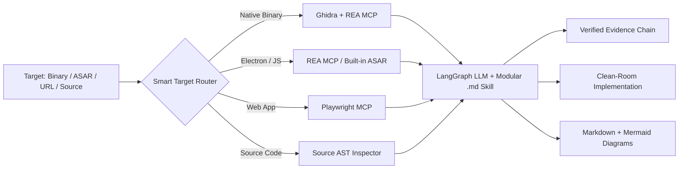

<div align="center">

# ⚡ DecompFlow — Professional AI Reverse Engineering Studio & Multi-Model Orchestrator

**Autonomous AI Reverse Engineering, Automated Binary Analysis & Feature Reconstruction Studio**  
*Powered by LangGraph, DeepSeek-R1, Ghidra, Mandiant Capa, Radare2, REA & Playwright MCP*

[](LICENSE)
[](#-cross-platform-packaging)
[](#%EF%B8%8F-architecture)
[](https://dropt1mx0.github.io/DecompFlow/)
[](https://github.com/dropt1mx0/DecompFlow/releases)

</div>

<p align="center">
  <a href="README.md"><b>English</b></a> •
  <a href="docs/i18n/README.ru.md">Русский</a> •
  <a href="docs/i18n/README.uk.md">Українська</a> •
  <a href="docs/i18n/README.hi.md">हिन्दी</a> •
  <a href="docs/i18n/README.zh-CN.md">简体中文</a> •
  <a href="docs/i18n/README.es.md">Español</a> •
  <a href="docs/i18n/README.de.md">Deutsch</a> •
  <a href="docs/i18n/README.pt-BR.md">Português</a> •
  <a href="docs/i18n/README.ja.md">日本語</a>
</p>

<p align="center">
  🌐 <a href="https://dropt1mx0.github.io/DecompFlow/"><b>Official Installation Website & Documentation</b></a> • 
  📦 <a href="https://github.com/dropt1mx0/DecompFlow/releases/latest"><b>Download Desktop Installers (.AppImage / .exe / .dmg)</b></a>
</p>

---


## 📖 Overview

**DecompFlow** is an open-source, cross-platform **AI reverse engineering studio** and powerful **DecompFlow CLI** tailored for **automated binary analysis**, executable triage, software architecture reconstruction, Electron/ASAR auditing, and API discovery. 

Instead of locking you into a fragile custom loop or a terminal-only chat, DecompFlow combines deterministic **LangGraph** multi-agent state orchestration with leading AI models (**DeepSeek-R1**, **DeepSeek-V3**, **Qwen 2.5 Coder**, **Llama 3.3**, and 100% offline **Ollama / LM Studio**) and industry-grade tools (**Ghidra**, **Mandiant Capa**, **Radare2 / Rizin**, **REA**, **Playwright**). DecompFlow delivers both a high-speed interactive **CLI client (`dfw` / `decomp`)** and an intuitive, modern **Desktop Studio GUI**.

### ✨ Key Capabilities

- **Multi-Target Auto-Detection (`detectTargetType`):**
  - 🧬 **Native Binaries (`.exe`, `.elf`, `.dll`, `.so`, `.dylib`, `.apk`):** Decompiles functions, traces cross-references (xrefs), extracts strings, and reconstructs control flow via **Ghidra MCP** + **REA**.
  - 📦 **Electron & JS Bundles (`.asar`, minified bundles):** Extracts IPC channels (`ipcMain` / `ipcRenderer`), preload bridges, and module boundaries via **REA MCP** (with a built-in local fallback inspector).
  - 🌐 **Web Applications (`http://`, `https://`):** Maps DOM structures, client bundles, and hidden REST/WebSocket endpoints via **Playwright MCP**.
  - 📂 **Source Repositories:** Builds module dependency graphs, security audits, and onboarding documentation.
- **Verified Evidence & Clean-Room Feature Reconstruction:** Every finding includes a verifiable evidence chain (file path, memory address, IPC channel, confidence score) and generates ready-to-use TypeScript/Python implementations.
- **Dual Interface (CLI + Desktop Studio):** Run automated pipelines in headless CI/terminal or use the interactive Desktop GUI with live **React Flow** node graphs, **Mermaid** diagrams, and iterative follow-up chat.
- **Native OS Integration (Linux, Windows, macOS):** Automatically adopts system theme/accent colors, OS proxy settings, native config paths (`XDG` / `AppData` / `Application Support`), and platform keyboard shortcuts (`Ctrl` / `⌘`).

---

## 🏗️ Architecture



---

## 🚀 Quick Start

### Prerequisites
- Node.js >= 20.x & npm
- Python >= 3.10 (optional, for local Ghidra MCP bridge)
- Ghidra / REA / Playwright (optional — DecompFlow includes deterministic local fallbacks for offline analysis)

### 1. Clone & Build
```bash
git clone https://github.com/your-username/DecompFlow.git
cd DecompFlow
npm install
npm run build
```

### 2. Launch Desktop Studio (GUI)
```bash
npm run desktop
```

### 3. Run via Terminal (CLI)
```bash
# Reconstruct a feature from a native binary
npm run dev -- analyze ./samples/sample_bin --mode binary --skill feature-reconstruct --prompt "buffer processing"

# Audit an Electron ASAR archive or source directory
npm run dev -- analyze ./app.asar --skill security-audit --out ./reports/audit.md

# Map endpoints of a web application
npm run dev -- analyze https://example.com --mode web --skill web-api-mapper
```

---

## 🧠 Modular Skills (`skills/*.md`)

DecompFlow uses plain Markdown files in the `skills/` directory to instruct the agent:

| Skill | Description |
|---|---|
| **feature-reconstruct.md** | Traces a specific feature, builds a verified evidence table, and generates a clean-room implementation. |
| **binary-architecture.md** | Reconstructs high-level modules, entry points, and Mermaid call graphs from decompiled C code. |
| **security-audit.md** | Scans for memory-safety defects, hardcoded secrets, unsafe IPC bridges, and OWASP risks. |
| **web-api-mapper.md** | Extracts REST/GraphQL/WebSocket schemas and authentication flows from web targets. |
| **repo-onboarding.md** | Generates architectural overviews and data-flow diagrams for unfamiliar codebases. |
| **refactoring-doc.md** | Cleans up decompiled or minified code and proposes semantic names for sub_* functions. |

---

## 🖥️ Cross-Platform Packaging

Build native standalone installers for your operating system:

```bash
# Linux (.AppImage, .deb, .rpm)
npm run dist:linux

# Windows (.exe NSIS & Portable)
npm run dist:win

# macOS (.dmg & .zip for Intel & Apple Silicon)
npm run dist:mac
```

---

## 📁 Monorepo Structure

```plaintext
DecompFlow/
├── config/                  # LLM settings (decompflow.yaml) & MCP registry (mcp-servers.json)
├── skills/                  # Modular Markdown skills for the AI agent
├── tools/                   # Local Ghidra JSON-RPC / MCP bridge
├── visual/                  # Exportable Dify DSL workflow template
└── packages/
    ├── core/                # @decompflow/core — LangGraph state machine & MCP client manager
    ├── cli/                 # decompflow — Terminal CLI interface
    └── desktop/             # @decompflow/desktop — Electron + React + Tailwind + React Flow Studio
```
