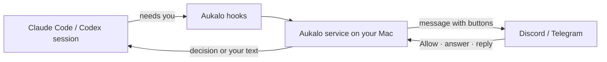

<p align="center">
  
</p>

<h1 align="center">Your AI agents never wait for you again</h1>

<p align="center">
  <b>Aukalo turns Discord and Telegram into the control room for Claude Code.</b><br>
  Approve, answer and steer every session from your phone while the work keeps going on your Mac.
</p>

<p align="center">
  <a href="#install-in-30-seconds"></a>
  <a href="#see-it-in-action"></a>
  <a href="https://github.com/dzotyara/aukalo"></a>
  <a href="https://boosty.to/dzotyara"></a>
</p>

<p align="center">
  <a href="https://github.com/dzotyara/aukalo/actions/workflows/test.yml"></a>
  
  
  
  
</p>

<p align="center">
  ⭐ <b>If Aukalo saves you time, <a href="https://github.com/dzotyara/aukalo">star the repo</a>.</b> It helps other people find it.
</p>

<p align="center">
  <b>English</b> · <a href="README.ru.md">Русский</a>
</p>

---

<p align="center"><sub><b>Aukalo</b> comes from the Russian <i>«ау!»</i>, the call you shout in a forest so that someone answers. Your agents call out, you answer.</sub></p>

## The problem

You give Claude Code a big task and step away. Five minutes later it stops at *"Allow this command?"* and waits. You come back an hour later to an idle session and a cold coffee.

## The fix

Aukalo sends every moment that needs you to the chat you already have open, with buttons. One tap and the agent is back at work.

<p align="center"></p>

<table>
<tr>
<td width="33%" valign="top">

### ✅ Approve from anywhere
Permission requests, multiple-choice questions and "I need you" turns arrive with **Allow / Deny** and answer buttons. Codex requests too, even from another machine.

</td>
<td width="33%" valign="top">

### 💬 Talk to every session
Each session gets its own private channel. Reply in plain text and the session wakes up and continues, as if you typed in the app.

</td>
<td width="33%" valign="top">

### 🔥 Run a fleet with a Boss
Write a task in the main channel. The Boss splits it across sessions, starts background workers after your **▶️ Start**, and reports back.

</td>
</tr>
</table>

<p align="center">
  <b>1 tap</b> to approve · <b>0 servers</b> to host · <b>100%</b> of your tokens stay on your machine
</p>

## See it in action

### Discord

**1. A request arrives.** The session posts its turn, a permission request with buttons and a question with options.

<p align="center"></p>

**2. You answer from your phone.** Allowed and answered in Discord; only you see the confirmation, and the session carries on.

<p align="center"></p>

**3. The Boss asks before it starts a background session.**

<p align="center"></p>

### Telegram

<table>
  <tr>
    <td width="50%" align="center"><br><sub>The same session as a Telegram topic</sub></td>
    <td width="50%" align="center"><br><sub>Allowed and answered from Telegram</sub></td>
  </tr>
</table>

### Your Discord profile and the settings panel

<table>
  <tr>
    <td width="62%" align="center"></td>
    <td width="38%" align="center"></td>
  </tr>
  <tr>
    <td colspan="2"><sub>While agents work, your Discord profile shows "Playing Aukalo" with how many are running, and a button to this repo for people who look at it.</sub></td>
  </tr>
</table>

<details>
<summary><b>Settings panel</b> (local, English or Russian)</summary>
<p align="center"></p>
</details>

## How it works



Everything runs on your machine: a small background service and the plugin's hooks. There is no Aukalo server and no account to create. Your bot tokens never leave your computer.

## Features

| | Discord | Telegram |
|---|---|---|
| A private channel or topic per session | ✅ `🤖・<name>` | ✅ forum topic |
| Buttons for permissions and questions | ✅ | ✅ |
| A text reply wakes the session | ✅ | ✅ |
| Allow once what auto mode blocked | ✅ | ✅ |
| Confirm outward actions (deploy, send, merge) with a real permission prompt | ✅ | ✅ |
| Sessions send you files: images, videos, audio, documents | ✅ up to 20 MiB (50 or 100 on a boosted server) | ✅ up to 50 MiB (photos 10) |
| A Boss in the main channel, always on, background sessions on demand | ✅ `📣・aukalo` | ✅ General |
| Codex approvals, across devices | ✅ | notifications |
| Quiet by default, a ping only when you're needed | ✅ | ✅ |
| `/status` `/away` `/here` `/mute` | ✅ slash commands | ✅ |
| "Playing Aukalo" with a live agent count on your profile | ✅ | — |
| English and Russian | ✅ | ✅ |

Use Discord, Telegram, or both. With both, a request shows up in both places and the first answer wins.

<a id="install-in-30-seconds"></a>
## Easy Setup

You need Claude Code and Node.js 22+. Presence detection (whether you're at your computer) works on macOS; on other systems you're treated as away.

```bash
claude plugin marketplace add dzotyara/aukalo
claude plugin install aukalo@aukalo
```

Open the settings panel:

```bash
node "$(ls -d ~/.claude/plugins/cache/aukalo/aukalo/*/ | tail -1)configure.mjs" --ui
```

The panel listens on `127.0.0.1` and masks stored tokens. The local bridge uses tokens to authenticate with the messaging services you connect. Pick **English** or **Русский** in the panel.

On a fresh install the **setup wizard** opens on top of the panel and walks you through Discord or Telegram step by step. The full walkthrough with troubleshooting is in the **[setup guide](docs/SETUP.md)**.

Connect Discord or Telegram in the wizard and press **Test message** to check delivery. Start a new Claude Code session or run `/reload-plugins` in an open one. For Codex, follow the [Codex setup](#codex).

<details>
<summary><b>Upgrading from AI Forge</b></summary>

Aukalo is the new name of AI Forge, from version 2.0.0. The plugin ID changed, so install it again. Your settings and bot tokens stay where they were (`~/.codex/telegram-action-notifier/config.json`).

```bash
claude plugin uninstall ai-forge@ai-forge
claude plugin marketplace remove ai-forge
claude plugin marketplace add dzotyara/aukalo
claude plugin install aukalo@aukalo
```

Then open the settings panel and press **Refresh look**: the bot, the category and the main channel get the new name and artwork. Rich Presence on your profile shows the name of your Discord application, so rename it to **Aukalo** in the [Developer Portal](https://discord.com/developers/applications) (**General Information → Name**). Skills are now `/aukalo:boss`, `/aukalo:team` and `/aukalo:alerts`. The old `AI_FORGE_LANG` and `AI_FORGE_LISTEN` variables still work.

</details>

### Discord

1. Create an application in the [Discord Developer Portal](https://discord.com/developers/applications). On the **Bot** tab turn on **Message Content Intent** and press **Save Changes**.
2. Invite the bot to your server with **Manage Channels**, **View Channel**, **Send Messages**, **Read Message History** and **Add Reactions**. Add **Manage Server** if you want the bot to set the server icon.
3. In the panel, **Discord** section: the bot token and your user ID (right-click yourself → Copy User ID; needs Developer Mode). The server ID is only needed if the bot is on several servers. Press **Connect Discord**.
4. In **Notifications → Where to send**, pick **Discord** or **Telegram and Discord**, save, and press **Test message**.

The bot creates an `Aukalo` category with a `📣・aukalo` channel and makes a channel for each session on its own. Only you and the bot see them (server owners keep access through Discord permissions). The bot takes commands and button presses from you only.

If the bot has no avatar or the server has no icon, Aukalo can set its default artwork. Existing pictures are preserved. It also switches the server's default notifications to "Only @mentions". [Bot cover PNG](docs/discord-telegram-cover.png) · [Telegram description video](docs/telegram-description.mp4) · [Rich Presence artwork](docs/rich-presence.gif)

### Telegram

1. Create a bot with [@BotFather](https://t.me/BotFather).
2. Create a group, turn on **Topics**, add the bot and make it an admin with "Manage topics".
3. Enter the token in the panel and press **Find groups**, or run the wizard: `node <plugin>/configure.mjs`.

A private chat with the bot works too: turn on Threaded Mode for the bot in @BotFather so sessions get their own topics.

## How to use it

**Reply to a session.** Write in its channel. The bot reacts with 👀, the session wakes up and gets your text. Replying to a specific message works too. A session listens for 12 hours after its last turn. If it is busy with a long turn, it sees your message at its next step.

**Permissions.** Every permission request comes with buttons. The prompt in the app works at the same time: whichever answers first wins, and the other message is marked "Decided in the app".

**Auto mode.** When the auto-mode classifier blocks an action, the channel gets what was blocked and why. **Allow once** allows exactly that call in that session for 30 minutes, and the session retries it.

**Confirm actions from your phone.** A reply from the chat is not consent for an action that touches other people, for example sending a message, deploying or merging: Claude Code marks chat replies as not user input. So the session doesn't ask in the chat. It arms `confirm-next` and makes the exact call; Claude Code then asks for permission, and you get that call with **Allow** / **Deny** and a "Confirm: …" line. Allow approves only that call.

**Files from a session.** Ask a session "send me the file" (a video, a screenshot, a voice sample) and it runs `send-file`. The file lands in that session's channel or topic, in Discord, Telegram or both, as you set in **Where to send**. Images show as images, `.mp4` as a playable video, `.mp3` as audio, everything else as a document. A file over a limit is not sent there, and the session tells you exactly which destination got it and which did not. Limits per file: Telegram 50 MiB (a photo 10 MiB, a bigger one goes as a document), Discord 20 MiB, or 50 and 100 MiB on a server with Boost level 2 and 3. By hand, with an optional caption:

```bash
node <plugin>/skills/telegram-action-notifier/scripts/telegram-action-notifier.mjs send-file --caption "Render v3" ./render.mp4
```

Only the files you name are sent: a directory, a missing or empty file is refused, and so is the Aukalo configuration with your bot tokens.

**The Boss.** Name any session "Boss" and it takes the main channel (`📣・aukalo`, or General in Telegram). Drop a task there; the Boss splits it across project sessions and starts background ones (`claude -p`) after you press **▶️ Start**. There is always a Boss: if the app closed it, a message in the main channel wakes it up in the background; if there is no Boss at all (deleted, or its conversation is gone), the bridge starts a new one in the background with the boss start prompt (in `bossCwd`, default your home folder) and hands it your message.

**Commands** (yours only):

| Command | What it does |
|---|---|
| `/status` | mode, presence and the list of sessions |
| `/away` | send everything right away for 12 hours, or until `/here` |
| `/here` | smart mode |
| `/mute 30m`, `/mute 2h`, `/mute off` | pause |

### When you get notified

By default Aukalo stays quiet while you're at your computer and pings you only when it needs you:

| Event | You're away | You're at your Mac |
|---|---|---|
| Permission request or question | right away, with a ping | after 90 s, if you haven't answered in the app |
| The agent needs you | right away, with a ping | after 180 s, if you haven't answered |
| A turn finished | silently | not sent |

In Discord every message is silent, and only the ones that need you mention you. During quiet hours (`quietHours`) the mention stays but makes no sound. Once you answer in the app, the bot removes the mention from that message.

### Discord status

While the background service runs, the bot shows "Playing Aukalo · working: N", where N counts every agent working right now: sessions in the middle of a turn or writing to their transcript in the last 90 seconds, child sessions, background sessions, and each running subagent. If Discord is open on the same Mac, your own profile shows it too: how many agents are working, for how long, and a button to this repo for people who look at your profile (Discord hides your own buttons from you). This needs **Settings → Activity Privacy → Share my activity** in Discord. The profile shows the name of your Discord application from the Developer Portal, so name it **Aukalo**.

### Several devices and Codex

The count covers all your devices. Each device keeps one line in the private `📡・presence` channel: its name, how many Claude Code agents and Codex sessions are working, and when it last reported. The daemon on each device adds up the lines that are fresher than two minutes, and the status shows where the work runs, for example "Claude Code · Codex".

- Codex on the same Mac is counted from `~/.codex/sessions`.
- On a device with only Codex, set up Aukalo with the same Discord bot. The Codex hooks start a small background reporter there. It exits after 30 minutes with nothing working.
- A device that sleeps or goes offline drops out of the count after two minutes.

## Settings

Everything is in the panel or in `~/.codex/telegram-action-notifier/config.json`. A missing key means the default.

| Key | Default | What it does |
|---|---|---|
| `language` | `en` | `ru` for the Russian interface |
| `notificationTarget` | `telegram` | `discord` or `both` |
| `deliveryMode` | `smart` | `always`: send right away; `never`: send nothing |
| `notify` | `all` | `action`: skip ordinary turns |
| `approvalWaitSec` | `42900` (almost 12 h) | how long buttons wait; `0`: no buttons |
| `codexApprovalWaitSec` | `900` | how long a Codex request waits for a button in Discord; `0`: notification only |
| `presenceIdleSec` / `approvalGraceSec` / `actionGraceSec` | `120` / `90` / `180` | smart delivery thresholds |
| `quietHours` | none | `{"from":"23:00","to":"08:00"}`: no sound |
| `chatReplies` | `true` | `false`: ignore replies |
| `telegramDenials` | `true` | `false`: don't send auto-mode blocks |
| `bossRevive` | `true` | `false`: don't wake or recreate the Boss |
| `bossCwd` | home folder | where a new Boss starts when none exists |
| `spawnConfirm` | `telegram` | `never`: start background sessions without asking |
| `workerPermissions` | `telegram` | `auto`: background sessions run in `auto` mode |
| `workerDefaults` | Sonnet 5.5, medium, `acceptEdits` | model, effort and mode for background sessions |
| `discordActivity` | `Aukalo` | the bot's status; `""` hides it |
| `discordRichPresence` | `true` | `false`: no status on your profile |

## Security

- Tokens and chat IDs are stored locally only (`0600`), never in the repo or logs; secrets are cut out of messages.
- The bot listens to its owner only: other people's messages and presses are silently ignored.
- Background sessions can't use `bypassPermissions`. They ask with buttons for risky commands unless you chose `workerPermissions: "auto"`.
- The profile status goes through Discord's local socket, with no token.

## Codex

Aukalo sends Codex turns that need your action to Discord or Telegram. Reply in Codex.

If you use manual approvals, enable **Notifications → Codex approval notifications**. On Codex 0.166+, Discord then shows **Allow** / **Deny** and Codex waits up to 15 minutes (`codexApprovalWaitSec`) before asking in its own window. The Claude Code daemon records the decision in the Discord message for the Codex hook to read, including across devices. Telegram stays notification-only. Leave this setting off with automatic review: Codex fires the same hook event before selecting the reviewer.

```bash
codex plugin marketplace add dzotyara/aukalo --ref main
codex plugin add aukalo@aukalo
```

Restart Codex and review the hooks in **Settings → Hooks**. If Codex still lists no hooks for Aukalo, run `node <installed-aukalo-directory>/configure.mjs --register-codex-hooks`. This option creates the user `hooks.json` only if it doesn't already exist. Reload the hooks list and review each hook in Codex. Remove the fallback entries once Codex lists the bundled hooks, so the same events aren't handled twice. After upgrading Aukalo, update any fallback paths that still point to the old version.

## Development

```bash
node --test plugins/aukalo/tests/*.test.mjs
```

Tests never touch the network: Telegram, Discord and Discord's socket are stubbed. The suite runs in Russian (`tests/lang-ru.mjs`); English checks import `tests/lang-en.mjs` first. Bump the version in both manifests: `plugins/aukalo/plugin.json` and `plugins/aukalo/.claude-plugin/plugin.json`.

## FAQ

**Is it safe to approve things from my phone?**
The bot obeys only you, in your own private server or group. An approval covers exactly one call: you see the command or the tool input before you tap. A reply in the chat is never treated as consent for a deploy or a message to someone else; that always goes through a real permission prompt.

**Do I need a server or a subscription?**
No. Aukalo is a plugin plus a small background service on your machine. It talks to Discord and Telegram with your own bot.

**Does it work with Codex?**
Yes. Codex requests come to Discord with Allow / Deny, even when Codex runs on another device, and the agent count covers all your devices.

**Windows and Linux?**
Approvals, replies and the Boss work everywhere Claude Code runs. Presence detection (staying quiet while you're at the computer) is macOS only; elsewhere you're treated as away.

**What does it cost?**
Nothing. Aukalo is free and open source.

## Support Aukalo

- ⭐ **Star the repo.** It's the fastest way to help other people find it.
- ☕ **[Support me on Boosty](https://boosty.to/dzotyara).** A one-time tip or a monthly subscription gives me more time to build Aukalo and new tools.
- 📣 **Share it** with a friend who runs Claude Code all day.
- 🐞 **Open an issue** with a bug or an idea: real use drives what comes next.

---

<p align="center">
  Like it? <a href="https://github.com/dzotyara/aukalo">⭐ Star the repo</a> or <a href="https://boosty.to/dzotyara">☕ support me on Boosty</a>.
</p>
