🇷🇺 Русский · [🇬🇧 English](README.en.md)

# SUPERSTACK

**Скажи, что хочешь построить. Получи версию, у которой «готово» закрыто кодом возврата, а не фразой в чате.**

<p align="center"></p>

[](.claude-plugin/marketplace.json)
[](tests)
[](tests/mutations.json)
[](#требования-и-платформы)
[](#что-под-капотом)
[](LICENSE)
[](#быстрый-старт)

2447 тестов · 702 мутаций, все ловятся · 469 механизмов.

## Что это

SUPERSTACK — плагин для Claude Code. Ты описываешь продукт своими словами —
*«хочу сайт, где можно записаться к парикмахеру»* — и он доводит дело до
версии, которую действительно проверили. Правило, вокруг которого построено
всё остальное, короткое: **отчёт — это утверждение, а не доказательство.**
«Должно работать» и «тесты должны проходить» означают, что работа не сделана.

Как это выглядит на том самом сайте записи. Твоя фраза записывается дословно,
дальше задаются только те вопросы, на которые можешь ответить один ты: кто
записывается, что делать при двойной записи, что клиент видит после. Всё
остальное система измеряет сама. Ответы превращаются в список требований и
спеку, интерфейс рисуется на холсте, и значения подтягиваются в код
значениями, а не пересказом. Потом показывается план. **План ты подтверждаешь
до того, как появится первая строка кода.** Дальше задачи уходят агенту-
исполнителю — по одной в свежем контексте, — а результат ставится перед
командами, чей код возврата и решает, можно ли закрыть ход.

Прежде чем сказать «готово», отдельный агент читает только твою исходную
просьбу и сделанные изменения — без спеки, плана и разговора — и отвечает на
единственный вопрос: сделали ли то, о чём просили. На выходе у тебя отчёт с
разделом **«Как открыть»**. Адрес, а не статус.

Ещё умеет посмотреть, как настроен твой Claude Code, объяснить, откуда взялся
каждый вывод, и без спроса ничего не поменять.

## Зачем это тебе

**Ход закрывает код возврата, а не фраза.** Проверка в конце хода
(`hooks/verify-gate.py`) запускает собственные команды проекта; пока они
возвращают не ноль, ход не закрывается, и никакая формулировка в чате этого
не меняет.

**Слепая приёмка перед словом «готово».** Отдельный агент
(`agents/blind-acceptance.md`) получает исходную просьбу и изменения — и
больше ничего. Он судит соответствие просьбе, а не соглашается с планом,
который только что прочитал.

**Снимки на границах этапов — «верни как было» одной фразой.**
`tools/checkpoint.py` снимает папку продукта до и после каждой правки, а
`/oops` сначала показывает, что именно вернётся. Здесь ничего не удаляется:
удаляемое уходит в карантин, а бэкап пишется до первой правки.

**Человеческий язык держится кодом, а не обещанием.** Жаргон невозможно
вычитать у себя самого: чтобы заметить непонятное слово, нужно перестать его
понимать. `tools/plain_ru.py` держит список слов данными, ищет их машиной и
отвечает кодом возврата.

**Ни одной внешней зависимости.** Python 3 и стандартная библиотека: 72
инструмента, около 24 800 строк, ноль сторонних пакетов — ставить нечего и
проверять на стороне нечего.

**Плагин держит ту же планку, которую продаёт.** Девять ворот, и самые злые из
них — мутационные: **702 зарегистрированных поломок** ломают код нарочно, и
каждая обязана уронить набор. Проверка, которая не может покраснеть, — не проверка.

## Быстрый старт

### Не открывая терминал

Плагин работает только в Claude Code. Вставьте этот текст своему Claude Code,
он всё сделает сам:

```
Поставь мне SUPERSTACK. Выполни в терминале ровно эти три команды, по одной,
и не останавливайся, если первая покраснеет:

CLAUDECODE= claude plugin marketplace add edvardgrishin27/superstack-plugin
CLAUDECODE= claude plugin marketplace update superstack
CLAUDECODE= claude plugin install superstack@superstack

Первая команда на машине, где SUPERSTACK уже стоял, ответит «Marketplace
'superstack' is already installed» и вернёт код 1. Это НЕ ошибка установки и
не повод остановиться: маркетплейс просто уже добавлен. Иди дальше.

Вторая команда — та, ради которой всё и переписано. Без неё на такой машине
берётся СТАРЫЙ список пакетов из кэша, и ставится прежняя версия. Внешне
успешно: команда зелёная, плагин установлен, только не тот. На чистой машине
она безвредна, поэтому выполняется всегда.

Префикс `CLAUDECODE=` обязателен: без него `claude` откажется запускаться
изнутри сессии («cannot be launched inside another Claude Code session»),
и это не поломка — это защита от вложенных сессий.

Больше ничего не устанавливай. Когда закончишь — напиши одной строкой, что
готово, и скажи человеку перезапустить не новым чатом в этом же окне, а
приложением целиком: закрыть его полностью (Cmd+Q на Mac) и открыть заново.
Плагины читаются при старте.
```

Проверено запуском, а не выведено: обе последовательности прогнаны на
изолированном конфиге (`CLAUDE_CONFIG_DIR`) — на чистой машине и повторно
поверх уже установленного. В обоих случаях на выходе рабочая версия.

### Из терминала

```bash
claude plugin marketplace add edvardgrishin27/superstack-plugin
claude plugin marketplace update superstack
claude plugin install superstack@superstack
```

Здесь префикс не нужен — вы уже вне сессии. Первая строка на машине, где
маркетплейс уже добавлен, вернёт код 1: это нормально, вторая всё поправит.

Дальше закройте Claude Code целиком (Cmd+Q на Mac) и откройте заново. После
этого он заговорит сам — специальных слов знать не нужно.

## Команды

Их семь. Печатать их не обязательно: каждая отзывается и на обычные слова —
ровно для этого средний столбец.

| Команда | Как позвать словами | Что даёт | Чего **не** делает |
|---|---|---|---|
| `/go` | «хочу сайт для записи к парикмахеру», «сделай бота, который…» | Новый продукт или крупную часть существующего — от фразы до доказанной версии: список требований → спека → дизайн на холсте → план, который подтверждаешь **ты** → работа исполнителями → проверка кодом возврата → безопасность → слепая приёмка → память проекта → отчёт с разделом «Как открыть» | Не пишет код до подтверждения плана; не называет работу готовой, пока проверка возвращает не ноль; не снимает требование сам |
| `/change` | «поправь кнопку», «измени текст», «добавь поле» | Одну малую правку того, что уже работает: снимок до, правку пишет агент-исполнитель, проверка, снимок после — чтобы «поправил цвет» и «уронил форму заказа» не выглядели в чате одинаково | Не берёт стройку большого — это `/go`; не правит файлы продукта руками и не чинит заодно соседнее |
| `/what` | «где я», «что дальше», «на чём я остановился» | Ровно одну строку состояния и ровно один следующий шаг — прочитанные инструментом, а не вспомненные из разговора | Не меню и не отчёт; паузу за тебя не снимает |
| `/stop` | «останови», «выключи суперстек» — и обратно: «включи» | Всё встаёт на паузу с одной фразы, без единой команды в терминале, и так же словами включается обратно. Тормоз держится, даже когда агент не отвечает: это файл на диске | Не уговаривает и не объясняет, почему проверки полезны; не ставит паузу по своей инициативе |
| `/oops` | «отмени», «верни как было» | Две разные вещи, которые он никогда не путает: настройки Claude Code, которые система меняла сама, и папку проекта — к снимку, снятому во время сборки. Сначала показывает, что вернётся, и откатывает только после согласия | Не возвращает того, чего система не трогала; не восстанавливает секрет — бэкап хранит файл, но не значение пароля |
| `/fix` | «не работает», «ничего не происходит», «опять ошибка» | Звенья самой системы, проверенные по порядку и с остановкой на первом разорванном: есть ли Python, все ли файлы плагина на месте, не ссылается ли автоматическая проверка на пропавший файл, не стоит ли всё на паузе, может ли система писать в свою папку. В ответ — одно звено и одно действие | Твой продукт не смотрит и не чинит — он про систему, а не про то, что ты построил. Без меню и без технической простыни |
| `/superstack` | «проверь мою установку», «что у меня стоит», «почему агент так себя ведёт» | Профиль машины и починку установки: пробы читают настройки, считают скиллы и автоматические проверки, смотрят память и подключения; вердикт открывается страницей, где у каждой находки есть происхождение — измерено · выведено · неоднозначно | Ничего не удаляет (карантин вместо удаления, бэкап до первой правки); не применяет блокирующую находку без явного согласия; не печатает числа, которых не вернула проба |

## Как это устроено

`/go` идёт фазами, и код пишется в предпоследней. Всё до неё выясняет, **что**
строить; всё после — доказывает, что построили **именно это**.

```mermaid
flowchart LR
    A["Твоя фраза"]
    B["0 Завести"]
    C["1 Понять · G1"]
    D["2 Спека · G2"]
    E["2.5 Дизайн"]
    F["3 План · G3, ты подтверждаешь"]
    G["4 Работа"]
    H["5 Проверка · код ≠ 0 держит ход"]
    I["5.4 Безопасность"]
    J["5.5 Глазами"]
    K["6 Приёмка вслепую · G4"]
    L["7 Память проекта"]
    M["8 Отчёт · «Как открыть»"]
    A --> B --> C --> D --> E --> F --> G --> H --> I --> J --> K --> L --> M
```



Пропустить фазу можно. Пропустить молча — нельзя: когда дизайн или
безопасность не нужны, это говорится одной строкой, потому что «решили, что не
нужно» и «забыли» иначе выглядят одинаково.


<p align="center"></p>

Панель хода: главное число — только проверенное машиной; «со слов помощника»
показано отдельно и никогда не складывается с ним. Это снимок настоящей
страницы на показательном состоянии, а не рисунок.

## Что под капотом

Python 3 и стандартная библиотека. Больше ничего. 72 инструмента (около
24 800 строк), 7 скиллов, 3 агента и три автоматические проверки в сеансе:
на старте, перед сжатием контекста и в конце хода.

Механизмы, которые стоит назвать, — каждый лежит в файле, который можно
открыть:

| Механизм | Где лежит | Что даёт |
|---|---|---|
| Верификация закрывает ход | `hooks/verify-gate.py`, `tools/verify.py` | «Готово» — это код возврата ноль; всё остальное держит ход открытым |
| Слепая приёмка | `agents/blind-acceptance.md`, `tools/blind_accept.py` | Вердикт по исходной просьбе и изменениям, без плана, с которым можно согласиться |
| Снимки и откат | `tools/checkpoint.py`, `tools/oops.py` | Каждая граница этапа — точка возврата; «верни как было» — одна фраза |
| Словарь простого русского | `tools/plain_ru.py` | Жаргон в тексте для человека ловится кодом, а не вычиткой |
| Панель хода | `tools/live_panel.py`, `tools/progress.py` | Страница на `localhost:8787` с честной оценкой «сколько ещё» |
| Уведомление о ходе | `tools/notify.py` | Тебе говорят, когда ход вернулся к тебе, — не надо сидеть в чате |
| Сторож волны исполнителей | `tools/watchdog.py`, `tools/stall.py` | Замерший агент замечается системой, а не тобой |
| Дизайн подтягивается, а не пересказывается | `tools/design_pull.py` | Значения с холста попадают в код значениями; контраст ниже 4.5:1 — отказ |
| Пакет безопасности | `tools/security_pack.py`, `tools/data_rollback.py` | Для продуктов, выходящих к людям; путь отката данных объявлен командами или не считается готовым |
| Контракты исполнителей | `tools/contract.py` | «DONE при красных тестах» ловится кодом, а не чтением |
| Файл-тормоз | `tools/pause.py`, `~/.claude/superstack/PAUSE` | Аварийный тормоз держится, даже когда агент не отвечает |
| Ничего не удаляется | `tools/apply.py`, карантин и бэкапы | Любая правка обратима, а секреты не копируются даже в бэкап |

### Планка, которую плагин держит на себе

Девять ворот, гоняет `tools/gauntlet.py`. Числа ниже измерены, а не вписаны
руками.

| Ворота | Что доказывают |
|---|---|
| **набор** | весь набор тестов зелёный |
| **герметичность** | тот же набор, всё ещё зелёный, при любом `HOME` |
| **мутации** | 702 зарегистрированных поломок, каждая обязана уронить набор |
| **проводка** | каждый инструмент достижим из скилла или автоматической проверки — «построено, но не подключено» здесь настоящий класс отказа |
| **правила** | файлы правил целы |
| **объявления пакета** | записи маркетплейса сходятся с деревом, версии совпадают, схемы валидны |
| **план** | каждый механизм карты на месте, и большинство проверено настоящей поломкой |
| **сверка** | карту читали против плана, и план с тех пор не менялся |
| **вес скиллов** | каждый скилл под потолком размера |

Числа наверху страницы — бейджи, строка-сводка и счёт поломок — переписывает
измерением выкладка (`tools/sync_public.py`), в обеих языковых версиях. Витрина
продукта, который обещает не утверждать неизмеренного, не имеет права вписывать
свои цифры руками.

## Чем это отличается от соседних наборов

Рядом стоят два набора для Claude Code, и вопрос «чем они отличаются» задают
раньше установки. Ячейки про SUPERSTACK названы файлом, который можно открыть.
Ячейки про остальные — только то, что проверено чтением их кода и описаний
3 сентября 2026 года; чего проверить не удалось, так и написано: «не
проверяли». Это не то же самое, что «нет».

| Что сравниваем | SUPERSTACK | Superpowers | Skills Matt Pocock |
| --- | --- | --- | --- |
| Кто решает «готово» | **код возврата**: не ноль — ход не закрыт (`hooks/verify-gate.py`) | модель, по тексту правил | модель, по тексту правил |
| Поломки, обязанные ронять набор | **да**, 702 зарегистрированных (`tests/mutations.json`) | нет | нет |
| Тесты у самого инструмента | **да**, набор зелёный при любом `HOME` (`tools/gauntlet.py`) | 44 файла | не найдено |
| Приёмка вслепую | **да**: проверяющему дают только просьбу и изменения (`tools/blind_accept.py`) | нет, спеку дают | нет, спеку дают |
| Числа на панели | **из файлов**, «со слов» отдельно и не складывается (`tools/progress.py`) | панели нет | панели нет |
| «Верни как было» | **да**, одной фразой, снимок на каждом этапе (`tools/checkpoint.py`) | ветка, команды нет | нет |
| Стоп одним словом | **да**, файл держит даже при молчащем агенте (`tools/pause.py`) | нет | нет |
| Твой список требований | **да**, дословно с номерами; снять — только с твоей цитатой, это проверяет код (`tools/manifest.py`) | задачи плана, не требования | тикеты с номерами |
| Видно, где работа | **да**: страница-файл со снимком, без сервера, RU/EN, с телефона (`tools/live_panel.py`) | журнал и список дел | трекер задач |
| Размер задачи | **да**: волны и ярус считает код (`tools/crew.py`) | да | да |
| Как запускается | плагин один раз, дальше семь команд и обычные слова | плагин, скиллы включаются сами | плагин или файлы |

## Чего SUPERSTACK не делает никогда

Каждая строка ниже — не обещание, а место в коде, где это заперто.

- **Не называет работу готовой, пока проверка возвращает не ноль.** Ход
  остаётся открытым до нулевого кода — `hooks/verify-gate.py`, `tools/verify.py`.
- **Не пишет код, пока ты не подтвердил план.** Фаза работы не открывается
  раньше — `tools/gates.py`, `skills/go/phases/3-план.md`.
- **Не снимает твоё требование сам.** Отмена требует твоих слов, и код
  проверяет, что они есть в исходной просьбе, — `tools/manifest.py`.
- **Ничего не удаляет.** Вместо удаления — карантин, перед первой правкой —
  копия — `tools/apply.py`.
- **Не копирует твои ключи.** Копия хранит файл, но не значение пароля, и в
  журнал оно тоже не попадает — `tools/apply.py`, `tools/log.py`.
- **Не продолжает после «стоп».** Тормоз — файл на диске, и он держит даже
  тогда, когда агент не отвечает — `tools/pause.py`.
- **Не выполняет разрушающие команды.** Список опасного один на весь набор, и
  исполняет его отдельный слой, а не память модели — `tools/deny_list.py`.
- **Не рисует чисел, которых не измерил.** Числа страницы хода считаются из
  файлов, числа этой витрины переписывает выкладка — `tools/progress.py`,
  `tools/sync_public.py`.

## Требования и платформы

- **Claude Code**, десктопное приложение или терминал. Больше плагин нигде не
  работает — команд `claude plugin …` нет ни в одном другом месте.
- **Python 3.8 или новее**, тот, что уже есть в системе. Нижняя граница взята
  из синтаксиса кода: используются присваивающие выражения (`:=`) и ничего
  новее. Сторонних пакетов нет ни одного, ни в какой версии.
- **pytest** — только если хочешь прогнать набор тестов.
- **macOS и Linux** — прогнаны живьём, от начала до конца.
- **Windows** — код готов (запирание файла переходит на `msvcrt` там, где нет
  `fcntl`; проверка «жив ли процесс» знает, что `os.kill` там ведёт себя
  иначе), но **живой прогон не делался ни разу**. Это статус, а не оговорка:
  `tools/platform_check.py` говорит это вслух на старте сеанса и называет
  поимённо, что перестаёт работать, — самозапуск там, где толкователь языка
  назван не `python3`, русские буквы в окне команд Windows и однострочные
  обёртки `.sh` рядом с инструментами.

## Статус

Версия 0.13.0. Все девять ворот зелёные на том дереве, из которого едет этот
текст.

Что известно как **не** сделанное — сказано здесь, а не обнаружено потом:

- Windows живьём не запускался. См. выше.

## Как участвовать

Порядок для всего нового один и не меняется:

> **механизм → карта → тест → мутация → код.**

Механизм готов, когда он есть в `data/plan-coverage.json` с файлом-уликой и
буквальной подстрокой исполняемого текста, у него есть тест в `tests/` и есть
зарегистрированная поломка в `tests/mutations.json`, которая действительно
роняет набор. Механизм, который нечем сломать, — не механизм.

```bash
python3 -m pytest tests/ -q          # набор
python3 tools/gauntlet.py --quick    # быстрая петля: без мутаций и герметичности
python3 tools/gauntlet.py            # всё целиком, примерно два часа
```

`--quick` возвращает код 2 намеренно: двое ворот в нём не запускаются, а
«пропущено» — специально не то же самое, что «пройдено».

## Лицензия

MIT — см. [LICENSE](LICENSE).

<details>
<summary>Если ставили до версии 0.3.0</summary>

До версии 0.3.0 система ставилась семью пакетами (`superstack-core`,
`-install`, `-spec`, `-guard`, `-build`, `-brain`, `-control`). Теперь пакет
один, и старые семь надо снять — иначе рядом окажутся две копии одних и тех же
скиллов, и по описанию подтянется любая из них.

В десктопном приложении: **настройки → плагины**, у каждого из семи старых —
удалить, затем у маркетплейса `superstack` — **обновить** и поставить
`superstack`. Порядок важен дважды. Пока старые на месте, рядом лежат две копии
одних и тех же скиллов, и по описанию подтянется любая. А без обновления
маркетплейса берётся старый список из кэша — тот самый, где пакетов семь, — и
поставится прежняя версия, ничем внешне не отличаясь от новой.

Почему разделения больше нет. Семь пакетов имели смысл, если бы их ставили и
обновляли по отдельности. Ни того, ни другого не случилось ни разу: ставилась
связка целиком, обновлялась тоже целиком — семью одинаковыми действиями подряд.
Платой была межпакетная адресация: скилл из одного пакета звал инструмент из
другого через путь, который в его пакете не существует. Так однажды оказались
недостижимы 14 инструментов из 29, и оба вызова единственного сборочного скилла
несколько заходов указывали в пустоту. Один пакет убирает этот класс отказов
целиком, а не чинит его очередной проверкой.

**Слэш-команда `/plugin` не подойдёт.** Она есть только в терминальном Claude
Code; в десктопном приложении её нет, и попытка выполнить её там отвечает
«isn't available in this environment». Проверено на десктопе, не выведено.

</details>
