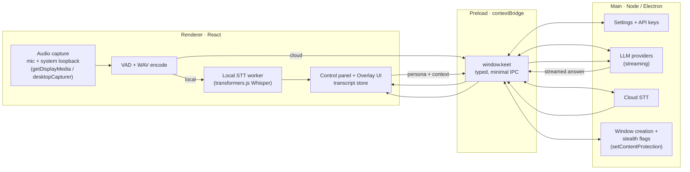

<div align="center">

# Keet

**The open, local-first meeting & interview copilot.**

Keet captures the other side of your call, transcribes it live, and shows AI answers and notes in a stealth overlay that stays out of your screen share. It is a privacy-respecting, MIT-licensed alternative to closed products like Parakeet AI and Cluely: your audio and your API keys stay on your machine, and nothing leaves it except the requests you send to the specific model provider you pick.

[](./LICENSE)
[](#quickstart)
[](./CONTRIBUTING.md)
[](https://www.electronjs.org/)

<!-- TODO: screenshot of the control panel + stealth overlay side by side -->

</div>

---

## Why Keet

Real-time meeting copilots are genuinely useful: live captions, notes you do not have to type, a prompt when you blank on a name, interview practice that actually talks back. The good ones are closed, cloud-only, and want your microphone piped to their servers. The open ones tend to be single-purpose clones that do one slice of the job well and stop there.

Keet takes a different bet. Instead of cloning one product, it is a deliberate **best-of-breed superset** that merges the strongest ideas from the leading open projects, NexQ, Natively, and Meetily, into one clean, local-first app. The headline of the roadmap is **NVIDIA's real Parakeet ASR** as the flagship local transcription engine: the open Parakeet, powered by the real Parakeet.

Two principles keep it honest:

- **Local-first.** Audio capture, voice-activity detection, and (optionally) transcription all run on your machine. The default Whisper engine never touches the network after it downloads its model once.
- **Bring your own key.** Cloud STT and LLM providers are opt-in and use *your* keys, stored in the app's user-data directory in the main process, never in the web page. Requests go straight to the provider you chose and nowhere else.

> The name is a small joke: a *keet* is a baby parakeet. It nods to Parakeet AI, the product this is an alternative to, and to NVIDIA's Parakeet ASR model, which is the roadmap's default local speech engine.

## Features

### Available today (v0.1)

- ✅ **Cross-platform desktop app** (Windows / macOS / Linux) built on Electron, with two windows: a **Control panel** and a **stealth Overlay**.
- ✅ **Stealth overlay:** transparent, frameless, always-on-top, hidden from the taskbar, with adjustable opacity and font size, optional click-through, and **content-protection so it is excluded from screen shares and screen recordings** (best-effort, via Electron's `setContentProtection`).
- ✅ **Dual-channel audio capture:** your microphone ("you") and system / loopback audio ("them"), captured separately so every line of the transcript is labeled by speaker.
- ✅ **Energy-based voice-activity detection (VAD)** that segments speech into utterances and flushes each one to the transcription engine.
- ✅ **Pluggable, local-first speech-to-text:** local **Whisper** in-app via transformers.js (private, no key, downloads the model on first use), plus **OpenAI** and **Groq** (`whisper-large-v3-turbo`) as cloud options.
- ✅ **Pluggable bring-your-own-key LLM with streaming answers:** **Anthropic Claude** (default), **OpenAI**, **Ollama** (100% local), and **any OpenAI-compatible endpoint** (LiteLLM, OpenRouter, LM Studio, and friends).
- ✅ **Live transcript** (you vs. them) and a **streaming AI answer** rendered in the overlay.
- ✅ **Persona modes:** interview, meeting, sales, lecture, coding, or a fully custom system prompt.
- ✅ **Context injection:** your role, resume, the job description, and freeform extra context are folded into the prompt.
- ✅ **Auto-answer** when the other party stops speaking (with an optional "questions only" filter), plus a manual "answer now" trigger.
- ✅ **Answer styles:** concise or detailed.
- ✅ **Local settings and API-key storage** in the app's user-data directory; keys live in the main process and never enter the renderer or the DOM.

### On the roadmap

- 🛣 **NVIDIA Parakeet streaming STT via sherpa-onnx**, the flagship local engine: roughly 4x faster than Whisper with true streaming. This is the headline item.
- 🛣 **True streaming cloud STT** (Deepgram / AssemblyAI websockets) for sub-500ms latency.
- 🛣 **Speaker diarization and naming.**
- 🛣 **Local RAG** over your resume and uploaded docs (PDF / DOCX / MD) with a local vector store (sqlite-vec), plus a profile-intelligence router that classifies each question and picks the right sources.
- 🛣 **Screenshot and slide OCR**, and coding-screen capture that returns code solutions.
- 🛣 **Post-call notes:** summary, action items, decisions, and a ready-to-send follow-up email, exportable to Markdown / JSON / plain text.
- 🛣 **Meeting history dashboard**, plus import and re-transcribe of existing audio files with a different model.
- 🛣 **Deeper stealth:** process-name masquerading, hide-from-dock, and a global hotkey to instantly hide or show.
- 🛣 **Multi-language translation** of the live transcript.
- 🛣 **Usage and cost tracking** (tokens and dollars).
- 🛣 **Signed installers and auto-update** (electron-builder) for all three platforms.

The full plan, with rationale and priorities, lives in [ROADMAP.md](./ROADMAP.md).

## Quickstart

Requirements: **Node >= 20**.

```bash
# 1. Clone
git clone https://github.com/eeshsaxena/keet.git
cd keet

# 2. Install
npm install

# 3. Run in development
npm run dev
```

Then, in the app:

1. Open the **Control panel** and go to settings.
2. Pick an **STT provider**. Local Whisper needs no key and downloads its model the first time you use it; Groq and OpenAI are fast cloud options if you have a key.
3. Pick an **LLM provider** and paste an **API key** if it needs one (Ollama and local endpoints do not). Claude is the default.
4. Choose a **persona** and fill in any context (role, resume, job description).
5. Start capture and watch the transcript and answers appear in the overlay.

Production build and installers:

```bash
npm run build          # type-check-safe production build (electron-vite)
npm run package        # build an installer for the current OS (electron-builder)
npm run package:win    # Windows
npm run package:mac    # macOS
npm run package:linux  # Linux
```

## Configuration

### Speech-to-text providers

| Provider | ID | Key required | Runs where | Notes |
| --- | --- | --- | --- | --- |
| Local Whisper | `local-whisper` | No | On your machine (transformers.js) | Default. Private. Downloads the model on first use, then works offline. |
| Groq | `groq` | Yes | Cloud | `whisper-large-v3-turbo`, fast and inexpensive. |
| OpenAI | `openai` | Yes | Cloud | `whisper-1` / `gpt-4o-transcribe` family. |

> NVIDIA Parakeet (via sherpa-onnx) and streaming cloud STT (Deepgram / AssemblyAI) are on the [roadmap](./ROADMAP.md).

### LLM providers

| Provider | ID | Key required | Runs where | Notes |
| --- | --- | --- | --- | --- |
| Anthropic Claude | `anthropic` | Yes | Cloud | Default provider. |
| OpenAI | `openai` | Yes | Cloud | GPT models. |
| Ollama | `ollama` | No | On your machine | 100% local. Point it at your Ollama base URL. |
| OpenAI-compatible | `openai-compatible` | Depends | Your choice | Any OpenAI-shaped endpoint: LiteLLM, OpenRouter, LM Studio, and more. |

### Where keys are stored

Settings and API keys live in a JSON store inside the app's **user-data directory** (the standard Electron `app.getPath('userData')` location for your OS). Keys are held in the **main process** only. The renderer, the web page, and the DOM never see them; the LLM and cloud-STT calls that need them run in main and stream results back over IPC.

## Architecture

Keet is a standard Electron three-layer app: a Node **main** process that owns secrets and windows, a React **renderer** that owns the UI and audio, and a thin **preload** bridge between them.



- **Main process (Node / Electron):** owns settings and API keys, runs the LLM providers (streaming over IPC), runs cloud STT, creates and gates the windows, and applies the stealth flags. Keys never enter the renderer.
- **Renderer (React):** captures audio (mic plus system loopback via `getDisplayMedia` / `desktopCapturer`), runs VAD and WAV encoding, runs the local STT worker (transformers.js), and renders the control panel and overlay.
- **Preload:** a `contextBridge` API (`window.keet`) exposing typed, minimal IPC: settings, LLM streaming, STT, and window control.

**Data flow:** audio → VAD / chunk → STT (local worker or cloud via IPC) → transcript store → (auto or manual) LLM request with persona and context → streamed answer to the overlay.

## How Keet compares

Keet's angle is the combination: local-first, MIT-licensed, and a merged superset of the best open ideas rather than one narrow clone. The peers below are all worth your attention; this table is a best-effort positioning summary, not a scorecard.

| | **Keet** | Parakeet AI | NexQ | Natively | Meetily |
| --- | --- | --- | --- | --- | --- |
| License | **MIT** | Proprietary | Open source | Open source | Open source |
| Local-first / offline STT | ✅ (Whisper today, Parakeet 🛣) | Cloud | Varies | Varies | ✅ |
| Bring-your-own-key models | ✅ | No | Varies | Varies | ✅ (local models) |
| Stealth overlay, hidden from screen share | ✅ | ✅ | Varies | Varies | Not a focus |
| Live interview answers | ✅ | ✅ | ✅ | ✅ | Not a focus |
| Post-call notes / summaries | 🛣 | ✅ | Varies | Varies | ✅ |
| NVIDIA Parakeet STT | 🛣 flagship | — | — | — | — |

<sub>Positioning as of 2026-09. Open-source peers move fast and feature sets change; check each project directly before relying on any cell. "Varies" means the capability differs by version or was not something we wanted to assert without verifying.</sub>

## Responsible use

Keet is a dual-use tool. Legitimate uses include meeting notes, accessibility and live captioning, language support, interview *preparation*, and sales or support copiloting. Using an undisclosed real-time answer feed during an interview or exam may violate the policies of the interviewer, employer, or institution, and recording people without consent is illegal in many places. You are responsible for using Keet lawfully and ethically, including obtaining consent to record where required and respecting the rules of any meeting or assessment you join. The maintainers provide this software for legitimate productivity and accessibility use.

## Contributing

Contributions are very welcome, from bug reports to roadmap features. See [CONTRIBUTING.md](./CONTRIBUTING.md) for the dev setup, project layout, and coding conventions, and [ROADMAP.md](./ROADMAP.md) for where the project is headed.

## Acknowledgements

Keet stands on the shoulders of the open ecosystem:

- **NexQ**, **Natively**, and **Meetily**, the open projects whose best ideas inspired Keet's merged-superset design.
- **NVIDIA Parakeet**, the ASR model that is the flagship local STT engine on the roadmap (and the reason for the name).
- **OpenAI Whisper**, the model powering local transcription today.
- **transformers.js** by Hugging Face, which runs Whisper in-app with no server.
- **Electron**, which makes a cross-platform stealth desktop app possible.

## License

[MIT](./LICENSE) © 2026 Eesh Saxena
