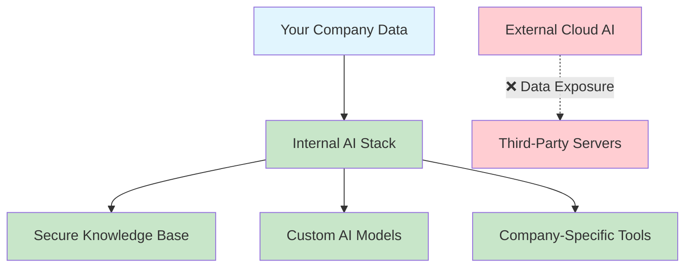

# 🏢 hugo - Your Complete On-Premise AI Solution

> **Transform your organization with a secure, scalable, and fully customizable AI platform that keeps your data where it belongs - within your company.**

[](https://openwebui.com/)
[](https://litellm.ai/)
[](https://docker.com/)

---

## **Why hugo?**

In today's AI-driven world, **data ownership** and **security** aren't just preferences—they're business imperatives. While cloud-based AI solutions expose your sensitive information to external providers, **hugo** ensures your company's knowledge remains **100% internal** and **fully under your control**—as a fully on-premise solution running inside your infrastructure.



---

## **What Makes This Special?**

### **Complete Data Sovereignty**

-   **Zero external data exposure** - Your conversations, documents, and insights never leave your infrastructure
-   **Air-gapped deployment options** for maximum security
-   **GDPR and HIPAA compliant** architecture ready

### **Your Company's Knowledge, AI-Powered**

Transform your organization's collective knowledge into an intelligent, queryable system:

-   **Document intelligence** - Upload PDFs, Word docs, presentations, and more
-   **Institutional memory** - Capture and preserve company expertise
-   **Instant knowledge retrieval** - Ask questions about your company data in natural language

### **Built on Battle-Tested Technology**

**Open WebUI** - The world's fastest-growing AI platform:

-   Effortless Setup
-   OpenAI API Integration
-   Granular Permissions and User Groups
-   Responsive Design
-   Supports: Document Extraction, WebSearch, Image Generation
-   Trusted by: NASA, Canadian & Dutch Governments, IBM, LG, Alibaba, Top academic institutions

**LiteLLM** - Universal AI gateway supporting 100+ AI providers:

-   Seamless model switching
-   Cost optimization
-   Rate limiting & monitoring
-   Unified API interface

---

## **Architecture Overview**


---

## **Extensibility & Custom Integration**

### **Unlimited Customization**

-   **Custom AI pipelines** - Build company-specific AI workflows
-   **Tool integration** - Connect to your existing systems (CRM, ERP, databases)
-   **Custom authentication** - LDAP, SSO, Active Directory integration

### **Real-World Use Cases**

-   **Construction Standards & Compliance:** Semantic retrieval across building acts, laws and norms.
-   **Template-Based Expert Report Generation:** Structured inspection / assessment reports from predefined templates.
-   **Sales Enablement:** Product specs, pricing, and competitive intelligence (e.g., for bidding and project acquisition).
-   **Technical Documentation:** Code repositories, API docs, and system knowledge (e.g., equipment manuals, BIM standards)
-   **HR Assistant:** Employee handbook, policies, and procedure queries.

---

## 🚀 **Quick Start**

Get your enterprise AI stack running in minutes:

### Prerequisites

-   Docker and Docker Compose installed
-   Git (for cloning the repository)
-   At least one AI provider API key (Azure OpenAI, Google Gemini, or Hugging Face) OR a pc with sufficient specs, including a strong GPU for locally hosted LLMs

### Estimated Minimum System Requirements

Estimated minimum requirements vary depending on your deployment configuration.

| Configuration                                 | RAM  | Storage | CPU      | GPU VRAM | GPU            | CUDA |
| --------------------------------------------- | ---- | ------- | -------- | -------- | -------------- | ---- |
| **LiteLLM + Open WebUI (Cloud Models)**       | 2GB  | 14GB    | Moderate | —        | —              | —    |
| **LiteLLM + Open WebUI (Self Hosted Models)** | 26GB | 54GB    | Good     | 12GB     | Nvidia Turing+ | ✓    |
| **All Services (Cloud Models)**               | 6GB  | 40GB    | Good     | —        | —              | —    |
| **All Services (Self-Hosted Models)**         | 30GB | 54GB+   | Good     | 12GB     | Nvidia Turing+ | ✓    |

### Setup & Deployment

**Quick setup:**

1. Clone the repository:

```bash
git clone https://github.com/ekkodale/hugo-Community
cd hugo/_docker
```

2. Follow the [Docker Deployment Guide](./_docker/README.md)

3. Access your AI platform at: `http://localhost:3000`

---

## **Ready to Transform Your Organization?**

### **Try It Now**

1. **Quick Demo**: Follow our [Docker Deployment Guide](./_docker/README.md) and have your AI stack running in 15 minutes
2. **Upload your documents** and start querying your company knowledge immediately
3. **Experience the power** of having your own ChatGPT-like interface with your data

### **Documentation**

Comprehensive guides are available to help you get the most out of hugo:

-   **[Admin Guide](./_docu/user/admin_guide/admin_guide.md)**: Configure settings, manage users, and control system features
-   **[User Guide](./_docu/user/user_guide/user_guide.md)**: Learn how to use hugo effectively for your daily tasks
-   **[Docker Deployment Guide](./_docker/README.md)**: Detailed setup and configuration instructions

Guides are available in multiple languages (English and German).

### **Need Enterprise-Grade Support?**

For **production deployments**, **custom integrations**, or **enterprise consulting**, our AI experts are here to help:

-   ✅ **Production-ready deployments** with high availability
-   ✅ **Integration with your existing systems** (CRM, ERP, databases)
-   ✅ **Training and change management** for your teams
-   ✅ **Ongoing support** and maintenance

**Ready to discuss your enterprise AI strategy?**

**Contact us:** ✉️ [contact@ekkodale.com](mailto:contact@ekkodale.com) 🌎[ekkodale GmbH](https://www.ekkodale.com/)

---

<div align="center">

**🔒 Your Data. Your AI. Your Competitive Advantage.**

_Built with ❤️ for enterprises that value data sovereignty and AI innovation_

</div>
