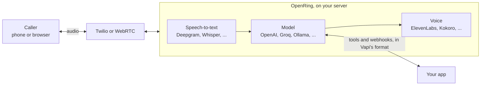

<div align="center">


# OpenRing

**Self-hosted voice AI agents with a Vapi-compatible API. No platform fee.**

[](https://github.com/elifalanrocha/openring/actions/workflows/ci.yml)
[](https://www.npmjs.com/package/openring)
[](https://pypi.org/project/openring/)
[](https://pypi.org/project/openring/)
[](LICENSE)

[](#-quick-start)
[](#-moving-from-vapi)

[Quick start](#-quick-start) · [How it works](#-how-it-works) · [Compare](#-how-it-compares) · [API guide](#-api-guide) · [Providers](#-providers) · [Roadmap](ROADMAP.md) · [Português](README.pt-BR.md)

</div>

Hosted voice platforms charge a fee for every minute of every call, on top of what you already pay for
speech-to-text, the model, the voice and the phone line. OpenRing does the same job on your own computer
or server, with your own provider keys, and speaks the same JSON as Vapi.

- 💸 **No platform fee, ever.** You pay Deepgram, OpenAI, Twilio or whoever you pick, directly, at their price.
- 🔁 **Vapi-compatible.** Same assistant JSON, provider names, tool calls and webhooks: a Vapi client moves
  over by changing its base URL, and **Import** copies an account in one click.
- 🖥️ **Yours.** Keys, calls and transcripts stay on your machine. No telemetry.
- 🆓 **Free to try.** A free local voice (Kokoro) is built in, so your first test call costs nothing.

<p align="center">
  
  <br><sub>The dashboard, with sample data.</sub>
</p>

## ⚡ Quick start

You need [Node.js](https://nodejs.org) 18 or later. Everything else, Python included, installs itself:

```bash
npx openring
```

The dashboard opens at http://localhost:8000. From there:

1. **Choose a password.** The first visit asks for one (only from this computer).
2. **Connect providers** on the **Providers** page: Deepgram for speech (new accounts get US$200 of credit)
   and a model, for example Groq's free tier or one-click sign-in with OpenRouter. Each key is checked with
   the provider before it's saved.
3. **Create an assistant** on **Assistants**: a greeting, instructions, a model and a voice.
4. **Talk to it.** Press **Test** and speak into your microphone. No phone number needed.
5. **Give it a number** when you're ready: see [Phone calls](#phone-calls).

Settings live in `~/.openring/.env`, created on the first run with a generated API key for apps that call
the API (it's under **Settings**). The free Kokoro voice downloads itself on the first start (about 120 MB).

## 🧭 How it works



Each call runs a [Pipecat](https://github.com/pipecat-ai/pipecat) pipeline: the caller's speech becomes
text, the model answers (and can call your tools), and the voice speaks the answer back. Every turn's
latency is recorded, step by step, and shown in the dashboard.

<table>
<tr>
<td width="50%"><br><b>Overview.</b> Calls, minutes, response time and what the providers charged.</td>
<td width="50%"><br><b>Every call.</b> Transcript, latency per turn, cost per provider, and each provider switch with its reason.</td>
</tr>
<tr>
<td width="50%"><br><b>Assistants.</b> Transcriber, model (or a route) and voice, in the order a call goes through them.</td>
<td width="50%"><br><b>Model routes.</b> Fastest, Cheapest, Reliable or Custom, with each model's measured speed and price.</td>
</tr>
</table>

## 📊 How it compares

|  | OpenRing | Vapi | Retell | Dograh |
|---|---|---|---|---|
| Source code | ✅ Open (MIT) | ❌ Closed | ❌ Closed | ✅ Open (BSD-2) |
| Platform fee | ✅ None | US$0.05/min | US$0.055/min | None self-hosted, US$0.01/min in its cloud |
| Run it on your server | ✅ `npx openring`, no Docker needed (Docker works too) | ❌ Their cloud | Their cloud; on-premise on Enterprise plans | ✅ With Docker |
| Calls and transcripts | ✅ On your server, no telemetry | Their cloud | Their cloud; on-premise on Enterprise plans | On your server when self-hosted; anonymous telemetry unless you turn it off |
| Vapi-compatible API | ✅ Change the base URL, import an account | (it's Vapi) | ❌ | ❌ |
| Free local stack | ✅ Whisper, Ollama, Kokoro | ❌ | ❌ | ✅ Open models you host |
| Calls at once | No limit of its own, your server decides (**beta**) | 4, then US$10 per line a month | 20, then US$8 per call a month | 10 by default when self-hosted, you can raise it; 10 in its cloud |
| Backup model | ✅ From any provider, when one fails or is slow (**beta**) | Same provider only, on OpenAI and Bedrock | ✅ Takes over when the main model fails or is slow | — |
| Phone lines | Twilio (outgoing in **beta**); Telnyx, Plivo and Vonage (**beta**); incoming only on Genesys (**beta**); any carrier by SIP trunk over UDP (**beta**) | ✅ Twilio, Vonage, Telnyx, SIP | ✅ Twilio, Telnyx, SIP | ✅ Twilio, Vonage, Telnyx, Plivo, Vobiz, Cloudonix, Asterisk |
| Campaigns | Every line that calls out (**beta**), no retries yet | ✅ | ✅ | ✅ With retries |
| Knowledge base (RAG) | ✅ Free, on your server, matching words; or your own search (**beta**) | ✅ Google Gemini, or your own server | ✅ | ✅ |
| Several assistants in one call | ✅ Squads, in Vapi's format (**beta**) | ✅ Squads | ✅ | ✅ |
| Visual flow builder | ❌ Not planned for now | Canvas for squads | ✅ | ✅ |
| Calls over WhatsApp | ❌ Not yet | — | — | ✅ Incoming only |

— means we didn't find it in their public docs. On every platform you also pay for the model, the voice and the
phone line, and for speech-to-text too, except that Retell's pricing page lists no separate charge for it. With
OpenRing, the server, its uptime and any compliance work are yours; hosted platforms take on the first two and help
with the third (for HIPAA, Vapi charges US$2,000 a month and Retell says there's no extra fee). Prices and features are
from each company's public pages and docs on November 2, 2026; check them before you decide. OpenRing isn't affiliated
with any of them.

## ✨ What works today

| Works today | Next |
|---|---|
| Browser test calls from the dashboard (WebRTC) | Routing speech-to-text and voices by cost |
| Model routes: Fastest, Cheapest, Reliable or Custom; the next model takes over when one fails or is slow (**beta**) | |
| A 100% local, free stack: Whisper, Ollama and Kokoro, one click in the editor | |
| Provider fallback in Vapi's format, across providers (**beta**) | |
| Callers in any language: the assistant answers in theirs (`"language": "multi"`) | |
| Several assistants on one call, handing the caller to one another: squads and the `handoff` tool (**beta**) | Handoffs chosen by your server, and to a whole squad |
| A knowledge base: files the assistant searches during a call, free and on your server, or your own search (**beta**) | Search by meaning, built in |
| Incoming phone calls through Twilio, confirmed on a real call | Outbound calls through Genesys |
| SIP trunks: any carrier, no Twilio in between, in and out (**beta**) | SIP over TCP and TLS |
| Outgoing calls through Twilio (**beta**: tell us how it goes) | |
| Campaigns: one assistant calls a list or CSV, a few at a time, greeting each person by name (**beta**) | |
| Calls in and out through Telnyx, Plivo and Vonage (**beta**, see [Telnyx](#telnyx-beta), [Plivo](#plivo-beta) and [Vonage](#vonage-beta)) | |
| Genesys Cloud calls through its Audio Connector, inside your Architect flows (**beta**, see [Genesys](#genesys-cloud-beta)) | |
| Vapi-style `/assistant`, `/phone-number`, `/call`, `/campaign` and `/tool` APIs | |
| Cost per call in dollars, per provider, at list prices (`cost` and `costBreakdown`) | The phone line's cost |
| Vapi tools: `function`, `apiRequest` (n8n, Make, Zapier), `endCall`, `transferCall` | |
| Vapi webhooks: `status-update`, `conversation-update`, `end-of-call-report`, `assistant-request` | Calls over WhatsApp |
| Import assistants, tools and numbers from a Vapi account | |
| 16 models, 6 speech-to-text and 9 voice providers, with Vapi's names | |
| Per-turn latency, time to first word, tokens and voice characters per call, with traffic lights | |
| Credit left on OpenRouter, Deepgram, ElevenLabs, Twilio, Telnyx and Plivo, on the Providers page | |
| Call history with transcripts, light and dark themes | |

The full plan is in the [roadmap](ROADMAP.md).

## 🔁 Moving from Vapi

Copy every assistant, squad, tool and Twilio number of an account in one request, or press **Import** on the
Assistants page. The key is used once and never stored; importing again updates what came in before.

```bash
curl -X POST http://localhost:8000/import \
  -H "Authorization: Bearer $OPENRING_API_KEY" -H "Content-Type: application/json" \
  -d '{"baseUrl": "https://api.vapi.ai", "apiKey": "YOUR_VAPI_PRIVATE_KEY"}'
```

The answer lists each assistant with anything that keeps it from taking calls here yet (for example a
provider OpenRing doesn't support yet). Documents keep their full JSON, so nothing is lost. Then point your
client's base URL at your server, and each imported Twilio number's voice webhook at
`$PUBLIC_URL/twilio/voice`.

## 📖 API guide

Every request takes `Authorization: Bearer $OPENRING_API_KEY`.

### Assistants

Same shape as Vapi:

```bash
curl -X POST http://localhost:8000/assistant \
  -H "Authorization: Bearer $OPENRING_API_KEY" -H "Content-Type: application/json" \
  -d '{
    "name": "Front desk",
    "firstMessage": "Hi! How can I help you today?",
    "model": {"provider": "openai", "model": "gpt-4.1-mini",
              "messages": [{"role": "system", "content": "You are a friendly receptionist."}]},
    "voice": {"provider": "11labs", "voiceId": "YOUR_VOICE_ID"},
    "transcriber": {"provider": "deepgram", "model": "nova-3", "language": "en"}
  }'
```

A call ends by itself after `maxDurationSeconds` (10 minutes by default), or after `silenceTimeoutSeconds` without
activity (30 seconds by default; the clock waits while someone talks, the model thinks or a tool runs), with Vapi's
`endedReason` (`exceeded-max-duration`, `silence-timed-out`); `endCallMessage` is said first. When the caller goes
quiet after the assistant spoke,
`messagePlan.idleMessages` are said (one at random, after `idleTimeoutSeconds`, up to
`idleMessageMaxSpokenCount` times), as on Vapi:

```json
{"maxDurationSeconds": 900, "silenceTimeoutSeconds": 20, "endCallMessage": "Thanks for calling, goodbye!",
 "messagePlan": {"idleMessages": ["Are you still there?"], "idleTimeoutSeconds": 8}}
```

### Names the transcriber should get right

Give it the words it will hear: names, brands, products. Use Vapi's fields, or **Words to recognize** in the assistant
editor:

```json
{"transcriber": {"provider": "deepgram", "model": "nova-3", "language": "pt-BR",
                 "keyterm": ["Clínica Sorriso", "Doutora Ana"]}}
```

`keyterm`, `keytermsPrompt` and `keywords` (one word, with an optional boost: `Sorriso:2`) are all accepted, up to 100
words of up to 50 characters, and go to the field each transcriber takes: Deepgram's nova-3 takes `keyterm` and refuses
`keywords`, and older models the reverse, so OpenRing sends the right one. Phrases don't fit Deepgram's older models.
Works on Deepgram, AssemblyAI, ElevenLabs, Cartesia's `ink-2` and Whisper; Gladia and Soniox ignore them, with a warning
in the log.

### Recording calls

With `"artifactPlan": {"recordingEnabled": true}`, or **Record calls** in the assistant editor, each call is saved
as a WAV file on your server, the caller on the left and the assistant on the right, about 2 MB per minute on the
phone and 6 MB in the browser. It's in
a `recordings` folder next to the database (`OPENRING_RECORDINGS_DIR` moves it). The call page plays it, and
`artifact.recordingUrl` is in the call and in the `end-of-call-report`. Fetching it needs your API key
(`GET /call/{id}/recording`), and `DELETE /call/{id}/recording` deletes it for good; both answer 409 while the call
is still going on. Recordings are deleted for good after 365 days: change it under **Settings > Recordings**, or
with `PATCH /settings/recordings {"retentionDays": 90}` (0 keeps them forever). While the assistant talks, its track can have gaps of a few hundredths of a second every so often; the call itself doesn't.

It's **off by default**, unlike on Vapi, where it's on. Many places require telling people they are being recorded,
and some require their consent, so say it in the greeting and check the rules where you and your callers are.
WAV is the only format for now: `recordingFormat` is ignored.

### Phone calls

Twilio has to reach your server, so it needs a public https URL. On your own computer, start a tunnel
(`cloudflared tunnel --url http://localhost:8000`), put its URL in `PUBLIC_URL` in `~/.openring/.env` and
restart. Then attach your Twilio number and point its **Voice webhook** (HTTP POST) at
`$PUBLIC_URL/twilio/voice`:

```bash
curl -X POST http://localhost:8000/phone-number \
  -H "Authorization: Bearer $OPENRING_API_KEY" -H "Content-Type: application/json" \
  -d '{"number": "+15551234567", "assistantId": "ASSISTANT_ID"}'
```

Call the number. Transcripts are at `GET /call` and on the **Calls** page.

To have the assistant call someone, send the same body as Vapi's `POST /call` (or use **Call a phone** in
the dashboard). Only call people who expect it: automated calls are regulated (the TCPA in the US, Anatel's
rules in Brazil). A Twilio trial account can only call numbers verified in its console.

```bash
curl -X POST http://localhost:8000/call \
  -H "Authorization: Bearer $OPENRING_API_KEY" -H "Content-Type: application/json" \
  -d '{"phoneNumberId": "PHONE_NUMBER_ID", "customer": {"number": "+5511912345678"}}'
```

**Voicemail (beta).** With `voicemailDetection` or a `voicemailMessage` on the assistant, Twilio's answering
machine detection checks who picked up and waits for the beep. A voicemail gets the `voicemailMessage`, in the
assistant's voice (or a recording, when it's the URL of a .wav or .mp3), then the call hangs up with
`endedReason: "voicemail"`; without a message it just hangs up. It's off by default: a person hears the greeting
a few seconds later, and Twilio charges a small fee per call. `"voicemailDetection": "off"` turns it off.

```json
{"voicemailMessage": "Hi {{customer.name}}, this is Ava from the clinic. Please call us back.",
 "voicemailDetection": {"provider": "twilio", "beepMaxAwaitSeconds": 30}}
```

### Campaigns (beta)

A campaign has one assistant call a list of people, a few at a time, with the body of Vapi's `POST /campaign`.
Each person gets an ordinary outbound call that carries the `campaignId`, so transcripts and webhooks work as
for any call. In the dashboard, **Campaigns > New campaign** takes a pasted list or a CSV; the CSV's other
columns become variables.

```bash
curl -X POST http://localhost:8000/campaign \
  -H "Authorization: Bearer $OPENRING_API_KEY" -H "Content-Type: application/json" \
  -d '{"name": "Appointment reminders", "phoneNumberId": "PHONE_NUMBER_ID", "assistantId": "ASSISTANT_ID",
       "maxConcurrency": 3,
       "schedulePlan": {"earliestAt": "2026-11-03T12:00:00Z", "latestAt": "2026-11-03T20:00:00Z"},
       "customers": [{"number": "+5511912345678", "name": "Maria",
                      "assistantOverrides": {"variableValues": {"time": "3 pm"}}}]}'
```

The assistant's first message and instructions can use `{{customer.name}}`, `{{customer.number}}` and any key
of `variableValues`: `"firstMessage": "Hi {{customer.name}}, I'm calling to confirm your {{time}} visit."`.
`POST /call` takes `assistantOverrides` too. Calling starts at `earliestAt` (or right away), and no new call
starts after `latestAt`. `GET /campaign/{id}` has Vapi's counters (`callsCounterScheduled`,
`callsCounterEnded`, ...) and each call; `PATCH` with `{"status": "cancelled"}` stops it. A restarted server
picks its campaigns back up without calling anyone twice. Workflows, squads and campaign webhooks are not
supported yet.

Only call people who agreed to get the call, at hours the law allows: automated calls are regulated (the
TCPA in the US, Anatel's rules in Brazil). The dashboard asks you to confirm that for every campaign.

### Tools

Tools use Vapi's format, so a server written for Vapi works unchanged. Put them in `model.tools`, or save
them once with `POST /tool` and list their ids in `model.toolIds`:

```json
"model": {
  "provider": "groq", "model": "openai/gpt-oss-20b",
  "tools": [
    {"type": "function",
     "function": {"name": "book_appointment", "description": "Book a cleaning",
                  "parameters": {"type": "object", "properties": {"day": {"type": "string"}}, "required": ["day"]}},
     "server": {"url": "https://your-app.com/tools"},
     "messages": [{"type": "request-start", "content": "One moment, let me check."}]},
    {"type": "endCall"},
    {"type": "transferCall", "destinations": [{"type": "number", "number": "+15551230000",
      "description": "front desk", "message": "Transferring you now."}]}
  ]
}
```

When the model calls `book_appointment`, OpenRing POSTs `{"message": {"type": "tool-calls", "toolCallList":
[...], "call": {...}}}` to the tool's `server.url` (or the assistant's) and reads back
`{"results": [{"toolCallId": "...", "result": "..."}]}`. `server.headers`, `server.secret`
(sent as `X-Vapi-Secret`), `server.timeoutSeconds`, `async` and the `request-start` / `request-failed`
messages work as on Vapi. `endCall` hangs up after the goodbye; `transferCall` moves a phone call to the
chosen number (Twilio) once the assistant stops talking. Tool calls and results show up in the call's
transcript.

**No server of your own? Use `apiRequest`.** The model fills in the `body`, and OpenRing sends it to your URL: an
n8n, Make or Zapier webhook, your CRM's API. There's no Vapi envelope, and the model reads the answer as it comes:

```json
{"type": "apiRequest", "name": "book_visit", "description": "Book a visit once the caller confirms the day",
 "method": "POST", "url": "https://hook.make.com/your-webhook",
 "headers": {"type": "object", "properties": {"Authorization": {"type": "string", "value": "Bearer YOUR_KEY"}}},
 "body": {"type": "object", "properties": {"day": {"type": "string", "description": "The day they chose"}},
          "required": ["day"]},
 "parameters": [{"key": "phone", "value": "{{customer.number}}"}],
 "timeoutSeconds": 20,
 "messages": [{"type": "request-start", "content": "One moment."},
              {"type": "request-response-delayed", "timingMilliseconds": 5000, "content": "Still checking."},
              {"type": "request-failed", "role": "system", "content": "Apologize, and don't promise it was booked."}]}
```

The URL, the headers and `parameters` are yours, not the model's, and `parameters` win over what it fills in: it can
only send the fields `body` declares, and a field with a `value` is fixed and hidden from it. They
can use `{{variables}}`, though not in the URL's host and not Liquid filters; a GET or DELETE carries the values
in its query. Vapi's `credentialId` isn't available: the key goes in `headers`, which stay on your server. A non-2xx
answer counts as a failure, and nothing is retried or redirected, so a booking isn't sent twice. Link-local and
cloud metadata addresses are refused; addresses on your own network work. The model reads the first 4,000
characters of the answer.

**Treat tool arguments as untrusted input.** The model chooses them during a conversation with whoever
called, and a caller can talk it into almost anything ("cancel every appointment", "my account number is
someone else's"). Check every argument on your server as you would a public web form: who the caller is
(`call.customer.number`), what they may see or change, and limits on how much. Set `server.secret` and verify
`X-Vapi-Secret` so only OpenRing reaches the tool. `transferCall` only ever dials the destinations you listed.

### Server messages

Your assistant's `server.url` gets Vapi's messages in Vapi's shape (`{"message": {"type": ..., "call": {...}}}`),
with `server.headers` and `server.secret` (as `X-Vapi-Secret`):

- `status-update` when the call starts (`in-progress`), is transferred (`forwarding`) and ends (`ended`, with
  `endedReason`);
- `conversation-update` after each answer, with the transcript so far;
- `end-of-call-report` with the transcript and per-turn latency.

Pick which ones with `serverMessages`, as on Vapi. A phone number without an assistant but with its own
`server.url` asks it on each incoming call (`assistant-request`) and uses the `assistantId` or the transient
`assistant` it answers. `POST /call` also takes a transient `assistant` instead of an `assistantId`.

### Knowledge base (beta)

Upload files, and the assistant looks things up in them during a call. Same calls as Vapi: `POST /file`, then a `query`
tool, or **Knowledge** in the dashboard and the boxes in the assistant editor.

```bash
curl -H "Authorization: Bearer $OPENRING_API_KEY" -F file=@prices.pdf http://localhost:8000/file
```

```json
{"model": {"tools": [{"type": "query", "function": {"name": "faq"},
  "knowledgeBases": [{"name": "faq", "description": "Prices and opening hours", "fileIds": ["FILE_ID"]}]}]}}
```

PDF, .docx, text, Markdown, CSV, JSON, YAML, XML and logs, up to 20 MB each. A scanned PDF has no text to read, a PDF
that takes over 3 minutes to read is refused, and old .doc files need saving as .docx. Only the text is kept, in
OpenRing's database.

The search runs on your server, for free, in a few milliseconds and with nothing to download. It **matches words, not
meanings**: the model picks the words, and tries others when nothing comes back, and a short file goes to the model
whole, so it can read what the search can't. For long documents, say in the instructions when to search and use the
files' own terms. For search by meaning, use your own: `provider: "custom-knowledge-base"` with a `server.url`, as a
`knowledgeBases` entry or through `POST /knowledge-base` and `model.knowledgeBaseId`. It gets Vapi's
`knowledge-base-request` and answers `documents` or a `custom-message`. Unlike on Vapi, where it's asked on every turn,
the model asks it when it needs to, and the message also has the `query`.

The import copies `query` tools, but not their files: upload them again and list the new ids.

### Squads (beta)

Several assistants on one call, each with its own instructions, tools, model and voice: one answers and hands the caller
to a specialist, who has the conversation so far. Same JSON as Vapi, in `POST /squad`, or **Squads** in the dashboard:

```json
{"name": "Front desk", "members": [
  {"assistantId": "RECEPTION_ID", "assistantDestinations": [
    {"type": "assistant", "assistantName": "Billing", "description": "the caller asks about an invoice",
     "message": "One moment, I'll pass you to billing."}]},
  {"assistantId": "BILLING_ID"}
]}
```

The first member answers. Put `squadId` on a phone number or in `POST /call` (or an inline `squad`), and an
`assistant-request` can answer with either. A `handoff` tool does the same as `assistantDestinations` with more control,
and works on an assistant with no squad; whoever it names by `assistantId` comes along to the call:

```json
{"type": "handoff", "function": {"name": "to_billing", "parameters": {"type": "object",
   "properties": {"reason": {"type": "string"}}}},
 "destinations": [{"type": "assistant", "assistantName": "Billing",
   "contextEngineeringPlan": {"type": "lastNMessages", "maxMessages": 10}}]}
```

- What the model fills in (`reason`) becomes a variable: the next assistant's prompt can say `{{reason}}`.
- `contextEngineeringPlan` is what the next assistant is given: `all` (the default), `lastNMessages`,
  `userAndAssistantMessages`, `previousAssistantMessages` or `none`. The call's record always keeps everything.
- On taking over, it follows its own `firstMessageMode`: it says its `firstMessage`, or, with none, answers with the
  model. `assistant-waits-for-user` waits for the caller.
- A tool still running at a handoff finishes for the record, and no model answers it.
- The call's `handoffs` lists each change. `membersOverrides`, a member's `assistantOverrides` and `tools:append` work.

The call's limits, idle messages, recording and webhooks come from the first assistant. If an assistant's providers all
fail, another's take over rather than leaving the caller in silence. The switch waits for the assistant to finish
talking, about a second of quiet. Not available yet: `dynamic` destinations, handing off to a whole squad,
`variableExtractionPlan`, rejection plans, and squads in campaigns. Assistants with different transcribers or voices
keep a connection open to each during the call.

### SIP trunks (beta)

Any carrier that speaks SIP, with no Twilio in between, so you pay the carrier's price. OpenRing speaks SIP and RTP
(G.711, over UDP) itself. Same JSON as Vapi, or **Phone numbers > SIP trunks** in the dashboard:

```bash
curl -X POST http://localhost:8000/credential -H "Authorization: Bearer $OPENRING_API_KEY" \
  -H "Content-Type: application/json" -d '{"provider": "byo-sip-trunk", "name": "My carrier",
    "gateways": [{"ip": "sip.carrier.example"}], "outboundLeadingPlusEnabled": true,
    "outboundAuthenticationPlan": {"authUsername": "USER", "authPassword": "PASSWORD"}}'

curl -X POST http://localhost:8000/phone-number -H "Authorization: Bearer $OPENRING_API_KEY" \
  -H "Content-Type: application/json" -d '{"provider": "byo-phone-number", "number": "+15551234567",
    "credentialId": "CREDENTIAL_ID", "assistantId": "ASSISTANT_ID"}'
```

Calls to the number reach the assistant, `POST /call` and campaigns dial out through the trunk, and `transferCall`
sends a SIP REFER; if the other line doesn't pick up, the caller goes back to the assistant. A carrier that wants registration gets it with `sipRegisterPlan: {"domain": "sip.carrier.example"}`
in the authentication plan. `numberE164CheckEnabled: false` allows an extension like `1000`, and `customer.sipUri`
calls a `sip:` address directly. The trunk's login goes only to its own gateways, so an address elsewhere that asks for
one is refused.

**The carrier has to reach your computer by UDP**, on port 5060 and on the audio ports 40000-40999, so this needs a server
with a public address or port forwarding: a web tunnel won't do. `SIP_PORT` and `SIP_RTP_PORTS` change them, and
behind a NAT `SIP_PUBLIC_IP` says what address to give the carrier.

Nothing listens until a trunk is saved. SIP servers on the internet get probed all day by people looking to make calls on
someone else's bill, so OpenRing answers only the gateways of your trunks and whoever is on a call with it, and ignores
everyone else without a word; a softphone on your network works by listing its address as a gateway. The password goes in and never comes back
through the API. It's kept in OpenRing's database, and SIP over UDP isn't encrypted, as is usual with carriers.

**With your carrier.** Whoever it is, it comes down to the same fields. SIP over UDP has to be on, with G.711:

| OpenRing | What it is at the carrier |
|---|---|
| `gateways[].ip` | The SIP server or termination address it gives you, like `sip.telnyx.com` or `sip.zadarma.com` |
| `authUsername`, `authPassword` | The trunk's SIP login. A carrier that goes by IP instead needs your public address on its allow-list |
| `sipRegisterPlan` | Only if it asks you to register, as many that give you a login do |
| Where to send calls | Your public address, port 5060, which the carrier calls the origination URI or the like |

The same goes for a PBX like Asterisk or FreePBX: add a SIP trunk pointing at OpenRing, and list the PBX's address as a
gateway.

Not available yet: SIP over TCP or TLS, voicemail detection, and codecs other than G.711. On Twilio or Telnyx, SIP
domains and trunks already reach their webhooks: the number in the `sip:` address finds the assistant, and
`customer.sipUri` dials out through Twilio. No real carrier has carried a call through this yet, so please tell us how
it goes.

### Provider fallback (beta)

Same fields as Vapi. When a provider fails during a call in a way a retry won't fix (a rejected key, no
credit left, the provider down), the next one in the list takes over for the rest of the call. Unlike Vapi,
a fallback model can come from another provider:

```json
"transcriber": {"provider": "deepgram", "fallbackPlan": {"transcribers": [{"provider": "assembly-ai"}]}},
"model": {"provider": "groq", "model": "openai/gpt-oss-20b",
          "fallbackModels": ["openai/gpt-oss-120b", {"provider": "openai", "model": "gpt-4.1-mini"}]},
"voice": {"provider": "cartesia", "voiceId": "YOUR_VOICE_ID",
          "fallbackPlan": {"voices": [{"provider": "kokoro", "voiceId": "af_heart"}]}}
```

When the model switches, the new one answers the caller's last message, so the turn isn't lost. A fallback
whose key is missing is skipped, and each switch is listed in the call's `providerFallbacks` and on its page.

### Model routes (beta)

A model route is a saved list of models, in order, that several assistants can share, like OmniRoute's
combos. Make one on the **Model routes** page (or `POST /model-route`) and pick it in the assistant editor
(`"model": {"routeId": "ROUTE_ID", ...}`; the assistant keeps its own instructions and tools):

```json
{"name": "Fast, then cheap", "preset": "fastest",
 "models": [{"provider": "groq", "model": "openai/gpt-oss-20b"},
            {"provider": "openrouter", "model": "openai/gpt-4.1-mini"},
            {"provider": "ollama", "model": "llama3.2"}]}
```

A call starts on the first model in the route's order. The next one takes over when a model fails (a rejected
key, no credit left, a rate limit, an outage) or when it hasn't started answering after `maxLatencyMs`: the
slow request is cancelled and the next model answers the same turn. The model that let the route down rests
for `cooldownMinutes`, so new calls start on the next one until it's back.

The `preset` sets the order and those two numbers. OmniRoute's combos offer many presets and sixteen scoring
sliders, for a gateway that serves coding tools; a phone call needs three things (answer fast, keep going,
cost little), so OpenRing keeps three presets, plus Custom for everything:

| Preset | Order | Switches after | Rests a model |
|---|---|---|---|
| `fastest` | The quickest measured answer first | 1.5 s | 5 min |
| `cheapest` | The lowest price first, local models before paid ones | 3 s | 5 min |
| `reliable` | Yours, as listed | 2 s | 15 min |
| `custom` | `"order"`: `listed`, `fastest` or `cheapest` | `"maxLatencyMs"` (or `null`: errors only) | `"cooldownMinutes"` |

"Fastest" goes by how long each model took to start answering on your recent calls; **Measure speed** on the
route's page (or `POST /model-route/{id}/measure`) asks each model for one short answer to time it, a few
tokens each. "Cheapest" goes by list prices (see [What a call costs](#what-a-call-costs)). Models not
measured or priced yet come after the others, in your order. Changing the order or a number on a preset
route makes it `custom`. Without a route, `"maxLatencyMs"` on an assistant's `model` does the same for its
`fallbackModels`.

### What a call costs

Every call records what its providers charge, at list prices, in Vapi's fields: `cost` (US$) and
`costBreakdown.llm`, `.stt`, `.tts` and `.total`, next to the tokens, voice characters and seconds of audio it
used. A call that switched providers is priced per provider. The dashboard shows it per call and per minute.
The phone line (Twilio, Telnyx, Plivo, Vonage) isn't included yet.

Model prices ship with OpenRing (`openring/llm_prices.json`, from [LiteLLM](https://github.com/BerriAI/litellm)'s
price list and OpenRouter's model list); speech-to-text and voice prices come from each provider's pricing
page (`openring/prices.py`). Local providers cost nothing. A provider without a known price is listed in
`costBreakdown.unpriced` and left out of the total, never guessed. For your own rates, or a model the list
doesn't have, write `~/.openring/prices.json` and restart OpenRing:

```json
{"llm": {"custom-llm": {"my-model": [0.2, 0.6]}},
 "stt": {"deepgram": {"nova-3": 0.0065}},
 "tts": {"rime-ai": {"*": 30}}}
```

Models are per 1M tokens (input, output), speech-to-text per minute, voices per 1M characters; `"*"` is any
model of that provider. `GET /prices` shows every price in use.

### Telnyx (beta)

Calls through Telnyx are new and not yet confirmed on a real Telnyx call. In the Telnyx portal,
create a **TeXML Application** whose voice URL is `$PUBLIC_URL/telnyx/voice` (HTTP POST) and assign your
number to it. Add the number in OpenRing with `"provider": "telnyx"`, and set `TELNYX_API_KEY` and
`TELNYX_PUBLIC_KEY` (Keys & Credentials > Public Key), or connect Telnyx from the Providers page. Every
webhook is checked against that public key.

To call out, name the TeXML application: `TELNYX_APPLICATION_ID`, or `texmlApplicationId` on the number. `POST /call` and
campaigns then work as on Twilio. Transfers and voicemail detection aren't available on Telnyx yet.

### Plivo (beta)

Not yet confirmed on a real Plivo call. In the Plivo console, create an **Application** whose Answer URL is
`$PUBLIC_URL/plivo/voice` and Hangup URL `$PUBLIC_URL/plivo/status` (both HTTP POST) and assign your number to it. Add
the number in OpenRing with `"provider": "plivo"`, and set `PLIVO_AUTH_ID` and `PLIVO_AUTH_TOKEN`, or connect Plivo from
the Providers page. Every webhook's signature is checked with that token. Calls in and out, campaigns and `transferCall`
work; voicemail detection isn't available on Plivo yet.

### Vonage (beta)

Not yet confirmed on a real Vonage call. In the Vonage dashboard, create a **Voice application** with signed webhooks on,
Answer URL `$PUBLIC_URL/vonage/voice` and Event URL `$PUBLIC_URL/vonage/event`, and link your number to it. Add the number
in OpenRing with `"provider": "vonage"`, and set `VONAGE_APPLICATION_ID`, `VONAGE_PRIVATE_KEY` (the path of the file
Vonage lets you download) and `VONAGE_SIGNATURE_SECRET` (Settings > API settings), or connect Vonage from the Providers
page. Calls in and out, campaigns and `transferCall` work, with audio at 16 kHz; voicemail detection isn't available on
Vonage yet.

### Genesys Cloud (beta)

If your contact center runs on Genesys Cloud, an assistant can take calls inside your Architect flows,
through Genesys's **Audio Connector** (the AudioHook protocol). Not yet confirmed on a real Genesys call.

1. On the **Providers** page, connect **Genesys Cloud**: press **Generate** for an API key and a client
   secret, copy both, and save. (Or set `GENESYS_API_KEY` and `GENESYS_CLIENT_SECRET`; the secret is base64.)
2. In Genesys, add an **Audio Connector** integration with the base connection URI
   `wss://YOUR_PUBLIC_HOST/ws/genesys` (shown on the **Phone numbers** page) and those two credentials.
3. In Architect, add a **Call Audio Connector** action. Pass the assistant as the input variable
   `assistantId`, or add the called number in OpenRing with `"provider": "genesys"` and its assistant. Every
   other input variable fills the assistant's `{{variables}}` (`{{accountId}}`, say); the caller's name
   fills `{{customer.name}}`.
4. After the action, the output variable `action` says what happened: `finished`, or `transfer` with the
   number in `transferTo` (from a `transferCall` tool), so the flow can route the call. `callId` points to
   the call in OpenRing.

Every connection must carry the API key and Genesys's signature made with the client secret; anything else
is refused. Transcripts, latency and webhooks work as for any other call.

## 🆓 The free stack

| Layer | Free option |
|---|---|
| Speech-to-text | `"provider": "whisper"`: runs on your computer, no key; or Deepgram's US$200 credit for new accounts |
| Model | `"provider": "ollama"` (local), `"provider": "groq"` (free tier) or `"provider": "omniroute"` (free local gateway to 150+ free providers) |
| Voice | `"provider": "kokoro"`: runs on your CPU, no key |
| Phone line | A Twilio trial account, for testing |

**100% local.** Whisper, Ollama and Kokoro together cost nothing per minute, and the call's audio never
leaves your computer. In the assistant editor, press **Use the free local stack**, or:

```json
"transcriber": {"provider": "whisper", "model": "base", "language": "en"},
"model": {"provider": "ollama", "model": "llama3.2"},
"voice": {"provider": "kokoro", "voiceId": "af_heart"}
```

Install [Ollama](https://ollama.com) and run `ollama pull llama3.2` first; the Providers page shows whether
it is running and which models it has. Whisper downloads its model once, when an assistant first uses it
(`tiny` 75 MB, `base` 145 MB, `small` 480 MB; also `medium`, `large-v3` and `large-v3-turbo`, or any
faster-whisper repo on Hugging Face). It runs on an NVIDIA GPU when there is one, otherwise on the CPU: on a
2018 laptop a four-second sentence takes about 0.6 s with `tiny` and 1.2 s with `base`, about twice that with
`"language": "multi"`, so pick the language when you know it. A local model on a laptop also answers slower
than a cloud one; a desktop GPU makes the whole stack quick.

## 🔌 Providers

Provider names are Vapi's, so an assistant JSON moves between the two unchanged. Connect each one from the
dashboard's **Providers** page, or put its key in `~/.openring/.env`.

| Layer | `provider` values | Key |
|---|---|---|
| Model | `openai`, `anthropic`, `google` (Gemini), `groq`, `openrouter`, `deepseek` / `deep-seek`, `xai`, `cerebras`, `together-ai`, `deepinfra`, `perplexity-ai`, `mistral`, `fireworks` | `OPENAI_API_KEY`, `ANTHROPIC_API_KEY`, `GOOGLE_API_KEY`, `GROQ_API_KEY`, ... (the provider's name) |
| Model, local | `ollama`, `omniroute`, or `custom-llm` with `model.url` (any OpenAI-compatible endpoint) | none |
| Speech-to-text | `deepgram`, `assembly-ai`, `gladia`, `soniox`, `cartesia`, `11labs` | `DEEPGRAM_API_KEY`, `ASSEMBLYAI_API_KEY`, `GLADIA_API_KEY`, `SONIOX_API_KEY`, `CARTESIA_API_KEY`, `ELEVENLABS_API_KEY` |
| Speech-to-text, local | `whisper` (free; `model`: `tiny`, `base`, `small`, `medium`, `large-v3`, `large-v3-turbo`) | none |
| Voice | `11labs` / `elevenlabs`, `cartesia`, `deepgram` (Aura), `openai`, `rime-ai`, `neuphonic`, `smallest-ai`, `inworld` | the provider's key (`RIME_API_KEY`, `NEUPHONIC_API_KEY`, `SMALLEST_API_KEY`, `INWORLD_API_KEY`, ...) |
| Voice, local | `kokoro` (free, runs on CPU) | none |

**Callers in any language.** With `"language": "multi"` (**Follow the caller** in the dashboard) the
transcriber detects the language, OpenRing tells the model to answer in it and to switch when the caller
switches, and an ElevenLabs or OpenAI voice reads whatever language it gets. Kokoro and Deepgram voices speak
one language each; the dashboard says so when you pick one. With a Deepgram key you already have a fast cloud
voice: `{"provider": "deepgram", "voiceId": "thalia"}`.

Requests to OpenRouter carry OpenRing's name, so OpenRouter can list it among the apps that use it;
`OPENRING_ATTRIBUTION=false` leaves that out.

## 🐳 Docker

```bash
cp .env.example .env          # fill in your keys and OPENRING_PASSWORD
docker compose up --build     # dashboard and API on http://localhost:8000
```

On a server, set `PUBLIC_URL` to its https address so Twilio can reach it.

## 🧱 Principles

OpenRing never charges per minute, keeps your keys and data on your machine, stays compatible with Vapi
clients, runs with one command and says plainly what works and what doesn't. The whole list, and how we
decide what to build, is in [PRINCIPLES.md](PRINCIPLES.md).

## 🤝 Contributing

```bash
git clone https://github.com/elifalanrocha/openring && cd openring
pip install -e ".[dev,kokoro,whisper]"
pytest                 # about 20 s, no paid services needed
python -m openring
```

Small pull requests get merged fastest. Start with [CONTRIBUTING.md](CONTRIBUTING.md) and the
[good first issues](https://github.com/elifalanrocha/openring/labels/good%20first%20issue); see
[CHANGELOG.md](CHANGELOG.md) for what shipped.

## 💛 Support the project

OpenRing is free and has no platform fee, and it stays that way. If it saves you money, you can help keep it going on
[Patreon](https://www.patreon.com/cw/elifalanrocha), or with Pix if you're in Brazil (random key):

```text
0e0094ed-3545-4bff-991c-4b927633ac4a
```

Telling someone who runs a voice agency about it helps just as much.

## 🔒 Security

`openring` generates `OPENRING_API_KEY` on its first run; without a key, the API answers only the computer it
runs on, and example values such as `change-me` are refused and replaced. The dashboard has its own password: the first one can
only be chosen from the server's own computer (`http://localhost`) or with `OPENRING_PASSWORD`, so a stranger
who finds your tunnel URL cannot claim it first. Sessions are `HttpOnly`, `SameSite=Strict` cookies, and
repeated wrong passwords are slowed down. Forgot it? `openring --reset-password`. Incoming calls need
`TWILIO_AUTH_TOKEN`: every Twilio webhook is checked against its `X-Twilio-Signature`, and calls are refused
while the token is missing (`VALIDATE_TWILIO_SIGNATURE=false` turns the check off, for local tests only).
Each call accepts a single media stream, so a replayed or second connection is dropped. Found a
vulnerability? Please report it privately: see [SECURITY.md](SECURITY.md).

## ⭐ Star history

[](https://star-history.com/#elifalanrocha/openring&Date)

## 📄 License

MIT. Not affiliated with Vapi, Retell, Dograh or Twilio. OpenRing builds on
[Pipecat](https://github.com/pipecat-ai/pipecat) and other open-source projects, credited in
[THIRD_PARTY.md](THIRD_PARTY.md).
