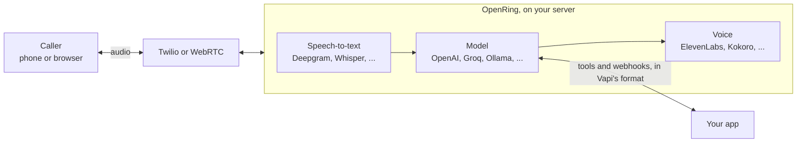

<div align="center">


# OpenRing

**The open-source, self-hosted Vapi alternative for voice AI agents. Vapi-compatible API, no platform fee.**

OpenRing runs AI phone agents, voice AI agents and AI receptionists that answer and place calls over Twilio, Telnyx,
Plivo, Vonage or any SIP trunk, with your own provider keys or a free, 100% local stack (Whisper, Ollama, Kokoro).

<sub>Latest release 0.1.6 · README updated November 9, 2026</sub>

[](https://github.com/elifalanrocha/openring/actions/workflows/ci.yml)
[](https://www.npmjs.com/package/openring)
[](https://pypi.org/project/openring/)
[](https://pypi.org/project/openring/)
[](LICENSE)

[](#-quick-start)
[](#-moving-from-vapi)

[Quick start](#-quick-start) · [How it works](#-how-it-works) · [Compare](#-how-it-compares) · [API guide](docs/api.md) · [Providers](#-providers) · [Roadmap](ROADMAP.md) · [Discussions](https://github.com/elifalanrocha/openring/discussions)

</div>

Hosted voice platforms charge a fee for every minute of every call, on top of what you already pay for
speech-to-text, the model, the voice and the phone line. OpenRing does the same job on your own computer
or server, with your own provider keys, and speaks the same JSON as Vapi.

- 💸 **No platform fee, ever.** You pay Deepgram, OpenAI, Twilio or whoever you pick, directly, at their price.
- 🔁 **Vapi-compatible.** Same assistant JSON, provider names, tool calls and webhooks: a Vapi client moves
  over by changing its base URL, and **Import** copies an account in one click.
- 🖥️ **Yours.** Keys, calls and transcripts stay on your machine. No telemetry.
- 🆓 **Free to try.** A free local voice (Kokoro) is built in, so your first test call costs nothing.

<p align="center">
  
  <br><sub>The dashboard, with sample data.</sub>
</p>

## ⚡ Quick start

You need [Node.js](https://nodejs.org) 18 or later. Everything else, Python included, installs itself:

```bash
npx openring
```

The dashboard opens at http://localhost:8000. From there:

1. **Choose a password.** The first visit asks for one (only from this computer).
2. **Connect providers** on the **Providers** page: Deepgram for speech (new accounts get US$200 of credit)
   and a model, for example Groq's free tier or one-click sign-in with OpenRouter. Each key is checked with
   the provider before it's saved.
3. **Create an assistant** on **Assistants**: a greeting, instructions, a model and a voice.
4. **Talk to it.** Press **Test** and speak into your microphone. No phone number needed.
5. **Give it a number** when you're ready: see [Phone calls](docs/api.md#phone-calls).

Settings live in `~/.openring/.env`, created on the first run with a generated API key for apps that call
the API (it's under **Settings**). The free Kokoro voice downloads itself on the first start (about 120 MB).

## 🧭 How it works



Each call runs a [Pipecat](https://github.com/pipecat-ai/pipecat) pipeline: the caller's speech becomes
text, the model answers (and can call your tools), and the voice speaks the answer back. Every turn's
latency is recorded, step by step, and shown in the dashboard.

<table>
<tr>
<td width="50%"><br><b>Overview.</b> Calls, minutes, response time and what the providers charged.</td>
<td width="50%"><br><b>Every call.</b> Transcript, latency per turn, cost per provider, and each provider switch with its reason.</td>
</tr>
<tr>
<td width="50%"><br><b>Assistants.</b> Transcriber, model (or a route) and voice, in the order a call goes through them.</td>
<td width="50%"><br><b>Model routes.</b> Fastest, Cheapest, Reliable or Custom, with each model's measured speed and price.</td>
</tr>
</table>

## 📊 How it compares

|  | OpenRing | Vapi | Retell | Dograh |
|---|---|---|---|---|
| Source code | ✅ Open (MIT) | ❌ Closed | ❌ Closed | ✅ Open (BSD-2) |
| Platform fee | ✅ None | US$0.05/min | US$0.055/min | None self-hosted, US$0.01/min in its cloud |
| Run it on your server | ✅ `npx openring`, no Docker needed (Docker works too) | ❌ Their cloud | Their cloud; on-premise on Enterprise plans | ✅ With Docker |
| Calls and transcripts | ✅ On your server, no telemetry | Their cloud | Their cloud; on-premise on Enterprise plans | On your server when self-hosted; anonymous telemetry unless you turn it off |
| Vapi-compatible API | ✅ Change the base URL, import an account | (it's Vapi) | ❌ | ❌ |
| Free local stack | ✅ Whisper, Ollama, Kokoro | ❌ | ❌ | ✅ Open models you host |
| Calls at once | ✅ No limit of its own, your server decides, never billed per line | 4, then US$10 per line a month | 20, then US$8 per call a month | 10 by default when self-hosted, you can raise it; 10 in its cloud |
| Backup model | ✅ From any provider, when one fails or is slow | Same provider only, on OpenAI and Bedrock | ✅ Takes over when the main model fails or is slow | — |
| Phone lines | ✅ Twilio, Telnyx, Plivo, Vonage and any carrier by SIP trunk, all included free; incoming only on Genesys | ✅ Twilio, Vonage, Telnyx, SIP | ✅ Twilio, Telnyx, SIP | ✅ Twilio, Vonage, Telnyx, Plivo, Vobiz, Cloudonix, Asterisk |
| Campaigns | ✅ Every line that calls out, free, no per-call platform fee, with retries | ✅ | ✅ | ✅ With retries |
| Knowledge base (RAG) | ✅ Free, on your server, matching words; or your own search | ✅ Google Gemini, or your own server | ✅ | ✅ |
| Several assistants in one call | ✅ Squads, in Vapi's format | ✅ Squads | ✅ | ✅ |

— means we didn't find it in their public docs. On every platform you also pay for the model, the voice and the
phone line, and for speech-to-text too, except that Retell's pricing page lists no separate charge for it. With
OpenRing, the server, its uptime and any compliance work are yours; hosted platforms take on the first two and help
with the third (for HIPAA, Vapi charges US$2,000 a month and Retell says there's no extra fee). Prices and features are
from each company's public pages and docs on November 8, 2026 (prices rechecked that day); check them before you decide. OpenRing isn't affiliated
with any of them.

## 🔁 Moving from Vapi

Copy every assistant, squad, tool and Twilio number of an account in one request, or press **Import** on the
Assistants page. The key is used once and never stored; importing again updates what came in before.

```bash
curl -X POST http://localhost:8000/import \
  -H "Authorization: Bearer $OPENRING_API_KEY" -H "Content-Type: application/json" \
  -d '{"baseUrl": "https://api.vapi.ai", "apiKey": "YOUR_VAPI_PRIVATE_KEY"}'
```

The answer lists each assistant with anything that keeps it from taking calls here yet (for example a
provider OpenRing doesn't support yet). Documents keep their full JSON, so nothing is lost. Then point your
client's base URL at your server, and each imported Twilio number's voice webhook at
`$PUBLIC_URL/twilio/voice`.

## 📖 API guide

Every request takes `Authorization: Bearer $OPENRING_API_KEY`, and the JSON is Vapi's. The full guide is in
[docs/api.md](docs/api.md):

- [Assistants](docs/api.md#assistants), [names the transcriber should get right](docs/api.md#names-the-transcriber-should-get-right) and [recording calls](docs/api.md#recording-calls)
- [Phone calls](docs/api.md#phone-calls), [campaigns](docs/api.md#campaigns), [Telnyx](docs/api.md#telnyx), [Plivo](docs/api.md#plivo), [Vonage](docs/api.md#vonage), [Genesys Cloud](docs/api.md#genesys-cloud) and [SIP trunks](docs/api.md#sip-trunks)
- [Tools](docs/api.md#tools), [server messages](docs/api.md#server-messages), [knowledge bases](docs/api.md#knowledge-base) and [squads](docs/api.md#squads)
- [Provider fallback](docs/api.md#provider-fallback), [model routes](docs/api.md#model-routes) and [what a call costs](docs/api.md#what-a-call-costs)

## 🆓 The free stack

| Layer | Free option |
|---|---|
| Speech-to-text | `"provider": "whisper"`: runs on your computer, no key; or Deepgram's US$200 credit for new accounts |
| Model | `"provider": "ollama"` (local), `"provider": "groq"` (free tier) or `"provider": "omniroute"` (free local gateway to 150+ free providers) |
| Voice | `"provider": "kokoro"`: runs on your CPU, no key |
| Phone line | A Twilio trial account, for testing |

**100% local.** Whisper, Ollama and Kokoro together cost nothing per minute, and the call's audio never
leaves your computer. In the assistant editor, press **Use the free local stack**, or:

```json
"transcriber": {"provider": "whisper", "model": "base", "language": "en"},
"model": {"provider": "ollama", "model": "llama3.2"},
"voice": {"provider": "kokoro", "voiceId": "af_heart"}
```

Install [Ollama](https://ollama.com) and run `ollama pull llama3.2` first; the Providers page shows whether
it is running and which models it has. Whisper downloads its model once, when an assistant first uses it
(`tiny` 75 MB, `base` 145 MB, `small` 480 MB; also `medium`, `large-v3` and `large-v3-turbo`, or any
faster-whisper repo on Hugging Face). It runs on an NVIDIA GPU when there is one, otherwise on the CPU: on a
2018 laptop a four-second sentence takes about 0.6 s with `tiny` and 1.2 s with `base`, about twice that with
`"language": "multi"`, so pick the language when you know it. A local model on a laptop also answers slower
than a cloud one; a desktop GPU makes the whole stack quick.

## 🔌 Providers

Provider names are Vapi's, so an assistant JSON moves between the two unchanged. Connect each one from the
dashboard's **Providers** page, or put its key in `~/.openring/.env`.

| Layer | `provider` values | Key |
|---|---|---|
| Model | `openai`, `anthropic`, `google` (Gemini), `groq`, `openrouter`, `deepseek` / `deep-seek`, `xai`, `cerebras`, `together-ai`, `deepinfra`, `perplexity-ai`, `mistral`, `fireworks` | `OPENAI_API_KEY`, `ANTHROPIC_API_KEY`, `GOOGLE_API_KEY`, `GROQ_API_KEY`, ... (the provider's name) |
| Model, local | `ollama`, `omniroute`, or `custom-llm` with `model.url` (any OpenAI-compatible endpoint) | none (`OMNIROUTE_API_KEY` once OmniRoute's API key protection is on) |
| Speech-to-text | `deepgram`, `assembly-ai`, `gladia`, `soniox`, `cartesia`, `11labs` | `DEEPGRAM_API_KEY`, `ASSEMBLYAI_API_KEY`, `GLADIA_API_KEY`, `SONIOX_API_KEY`, `CARTESIA_API_KEY`, `ELEVENLABS_API_KEY` |
| Speech-to-text, local | `whisper` (free; `model`: `tiny`, `base`, `small`, `medium`, `large-v3`, `large-v3-turbo`) | none |
| Voice | `11labs` / `elevenlabs`, `cartesia`, `deepgram` (Aura), `openai`, `rime-ai`, `neuphonic`, `smallest-ai`, `inworld` | the provider's key (`RIME_API_KEY`, `NEUPHONIC_API_KEY`, `SMALLEST_API_KEY`, `INWORLD_API_KEY`, ...) |
| Voice, local | `kokoro` (free, runs on CPU) | none |

**Callers in any language.** With `"language": "multi"` (**Follow the caller** in the dashboard) the
transcriber detects the language, OpenRing tells the model to answer in it and to switch when the caller
switches, and an ElevenLabs or OpenAI voice reads whatever language it gets. Kokoro and Deepgram voices speak
one language each; the dashboard says so when you pick one. With a Deepgram key you already have a fast cloud
voice: `{"provider": "deepgram", "voiceId": "thalia"}`.

Requests to OpenRouter carry OpenRing's name, so OpenRouter can list it among the apps that use it;
`OPENRING_ATTRIBUTION=false` leaves that out.

## 🐳 Docker

```bash
cp .env.example .env          # fill in your keys and OPENRING_PASSWORD
docker compose up --build     # dashboard and API on http://localhost:8000
```

On a server, set `PUBLIC_URL` to its https address so Twilio can reach it. There is a ready image,
`ghcr.io/elifalanrocha/openring`, and a one-click [Render](https://render.com/deploy?repo=https://github.com/elifalanrocha/openring)
blueprint; [docs/deploy.md](docs/deploy.md) covers those, Railway and a plain VPS.

## ❓ FAQ

**Can I move my Vapi assistants to OpenRing?** Yes. OpenRing reads the same assistant JSON, provider names, tools
and webhooks. Point your client at your server's base URL, or press **Import** to copy an account's assistants,
tools, squads and Twilio numbers.

**Can I run a voice AI agent for free?** Yes, on your own computer: Whisper for speech-to-text, a model through
Ollama and the Kokoro voice cost nothing per minute. Only a phone line costs money; browser test calls don't.

**Which phone providers work?** Twilio, Telnyx, Plivo, Vonage, Genesys Cloud and SIP trunks. Only Twilio has taken
real calls so far; the others are tested against simulated carriers, and each one's section says what's left to confirm.
The [comparison](#-how-it-compares) says what each one does today.

**What does a call cost?** What your providers charge, nothing more. Every call records its cost per provider at
list prices, so the dashboard shows what you spent.

**Do I need Docker or a GPU?** No. `npx openring` installs everything, Python included. A GPU makes the local
stack faster; cloud providers need none.

## 🧱 Principles

OpenRing never charges per minute, keeps your keys and data on your machine, stays compatible with Vapi
clients, runs with one command and says plainly what works and what doesn't. The whole list, and how we
decide what to build, is in [PRINCIPLES.md](PRINCIPLES.md).

## 🤝 Contributing

```bash
git clone https://github.com/elifalanrocha/openring && cd openring
pip install -e ".[dev,kokoro,whisper]"
pytest                 # a few minutes, no paid services or internet needed
python -m openring
```

Small pull requests get merged fastest. Start with [CONTRIBUTING.md](CONTRIBUTING.md) and the
[good first issues](https://github.com/elifalanrocha/openring/labels/good%20first%20issue); see
[CHANGELOG.md](CHANGELOG.md) for what shipped.

Questions, ideas and "look what I built" go to [Discussions](https://github.com/elifalanrocha/openring/discussions);
bugs go to [issues](https://github.com/elifalanrocha/openring/issues/new/choose). If you have a phone provider account,
[testing it on a real call](https://github.com/elifalanrocha/openring/labels/needs-testing) helps more than anything.

## 💛 Support the project

OpenRing is free and has no platform fee, and it stays that way. If it saves you money, you can help keep it going on
[Patreon](https://www.patreon.com/cw/elifalanrocha), or with Pix if you're in Brazil (random key):

```text
0e0094ed-3545-4bff-991c-4b927633ac4a
```

Telling someone who runs a voice agency about it helps just as much.

## 🔒 Security

`openring` generates `OPENRING_API_KEY` on its first run; without a key, the API answers only the computer it
runs on, and example values such as `change-me` are refused and replaced. The dashboard has its own password: the first one can
only be chosen from the server's own computer (`http://localhost`) or with `OPENRING_PASSWORD`, so a stranger
who finds your tunnel URL cannot claim it first. Sessions are `HttpOnly`, `SameSite=Strict` cookies, and
repeated wrong passwords are slowed down. Forgot it? `openring --reset-password`. Incoming calls need
`TWILIO_AUTH_TOKEN`: every Twilio webhook is checked against its `X-Twilio-Signature`, and calls are refused
while the token is missing (`VALIDATE_TWILIO_SIGNATURE=false` turns the check off, for local tests only).
Each call accepts a single media stream, so a replayed or second connection is dropped. Found a
vulnerability? Please report it privately: see [SECURITY.md](SECURITY.md).

## ⭐ Star history

<a href="https://star-history.com/#elifalanrocha/openring&Date">
  <picture>
    <source media="(prefers-color-scheme: dark)" srcset="https://api.star-history.com/svg?repos=elifalanrocha/openring&type=Date&theme=dark&v=20261109">
    
  </picture>
</a>

## 📄 License

MIT. Not affiliated with Vapi, Retell, Dograh or Twilio. OpenRing builds on
[Pipecat](https://github.com/pipecat-ai/pipecat) and other open-source projects, credited in
[THIRD_PARTY.md](THIRD_PARTY.md).
