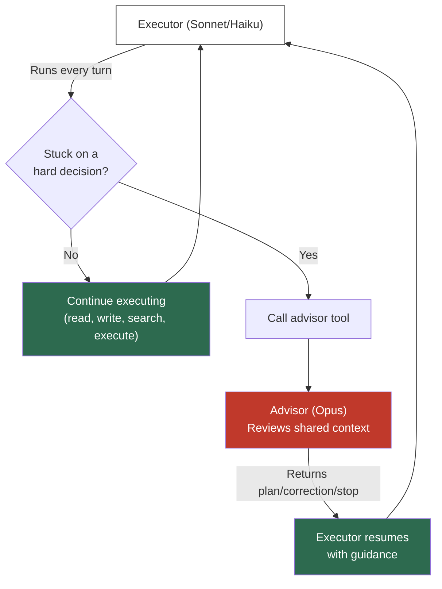

<h1 align="center">
  <br>
  <code>advisor-middleware</code>
  <br>
</h1>

<h3 align="center">Anthropic's Advisor Strategy as a drop-in DeepAgents middleware.</h3>

<p align="center">
  <a href="https://pypi.org/project/advisor-middleware"></a>
  <a href="LICENSE"></a>
  <a href="https://www.python.org/"></a>
  <a href="https://github.com/langchain-ai/deepagents"></a>
</p>

<p align="center">
  <a href="#the-problem">Problem</a> &bull;
  <a href="#how-it-works">How it works</a> &bull;
  <a href="#quick-start">Quick start</a> &bull;
  <a href="#configuration">Configuration</a> &bull;
  <a href="#benchmark">Benchmark</a>
</p>

---

Open-source implementation of Anthropic's **[Advisor Strategy](https://claude.com/blog/the-advisor-strategy)** — a pattern that pairs a fast, cheap executor model with a powerful advisor model. The executor runs end-to-end; the advisor is consulted only on critical decisions. Result: **better performance at lower cost**.

<p align="center">
  
</p>

**advisor-middleware** makes this a single import for [DeepAgents](https://github.com/langchain-ai/deepagents). It handles provider detection, native API routing, fallback invocation, cost guardrails, and context curation — so you just plug it in and your agents get smarter.


Created and maintained by [Emanuele Ielo](https://github.com/emanueleielo) ([LinkedIn](https://www.linkedin.com/in/emanuele-ielo/)), AI Engineer and Forward Deployed Engineer based in Rome, Italy. Also the author of [CianaParrot](https://github.com/emanueleielo/ciana-parrot) and [compact-middleware](https://github.com/emanueleielo/compact-middleware).

---

## The Problem

| Traditional sub-agent pattern | Advisor Strategy |
|---|---|
| Large orchestrator decomposes work into tasks | **Small executor** drives end-to-end |
| Expensive model runs every turn | Expensive model consulted **only when needed** |
| Worker pools + orchestration overhead | **Zero orchestration** — just a tool call |
| Hard to predict costs | **`max_uses` guardrail** caps advisor spend |

---

## How It Works



The middleware operates in **two modes** depending on the executor's provider:

- **Native mode** (Anthropic executor): Injects the `advisor_20260301` server-side tool spec. The API handles everything internally — zero extra round-trips, zero overhead on simple turns.
- **Fallback mode** (any provider): Exposes an `advisor` tool backed by a direct LLM call to the advisor model. Works with any executor/advisor combination.

---

## Quick Start

### Install

```bash
pip install advisor-middleware

# Or from source
pip install git+https://github.com/emanueleielo/advisor-middleware.git
```

### Minimal — zero config

```python
from deepagents import create_deep_agent
from advisor_middleware import AdvisorMiddleware

mw = AdvisorMiddleware(advisor_model="claude-opus-4-6")

agent = create_deep_agent(
    model="anthropic:claude-sonnet-4-6",
    system_prompt="You are a senior software engineer.",
    backend=backend,
    middleware=[mw],
)
```

That's it. Sonnet executes, Opus advises. The middleware auto-detects Anthropic and uses the native API tool — no extra configuration needed.

### Cross-provider

```python
from advisor_middleware import AdvisorMiddleware, AdvisorConfig

mw = AdvisorMiddleware(
    config=AdvisorConfig(
        advisor_model="anthropic:claude-opus-4-6",
        prefer_native=False,  # force fallback mode
        max_uses_per_turn=2,
    ),
)

agent = create_deep_agent(
    model="openai:gpt-4o",  # any provider as executor
    middleware=[mw],
)
```

### With compact-middleware

```python
from advisor_middleware import AdvisorMiddleware
from compact_middleware import CompactionMiddleware, CompactionToolMiddleware

advisor_mw = AdvisorMiddleware(advisor_model="claude-opus-4-6")
compact_mw = CompactionMiddleware(model="anthropic:claude-sonnet-4-6", backend=backend)
compact_tool_mw = CompactionToolMiddleware(compact_mw)

agent = create_deep_agent(
    model="anthropic:claude-sonnet-4-6",
    backend=backend,
    middleware=[advisor_mw, compact_mw, compact_tool_mw],
)
```

---

## Configuration

### `AdvisorConfig`

| Parameter | Type | Default | Description |
|---|---|---|---|
| `advisor_model` | `str \| BaseChatModel` | `"claude-opus-4-6"` | Advisor model ID or resolved instance |
| `max_uses_per_turn` | `int` | `3` | Max advisor calls per agent turn |
| `max_uses_per_session` | `int \| None` | `None` | Lifetime cap (None = unlimited) |
| `prefer_native` | `bool` | `True` | Use native `advisor_20260301` when possible |
| `max_tokens` | `int` | `1024` | Max tokens the advisor can generate per consultation |
| `temperature` | `float` | `1.0` | Advisor temperature (fallback mode only) |
| `advisor_system_prompt` | `str \| None` | `None` | Override advisor prompt (fallback only) |
| `context` | `ContextCurationConfig` | *(see below)* | Controls context forwarded to advisor |

### `ContextCurationConfig`

| Parameter | Type | Default | Description |
|---|---|---|---|
| `include_system_prompt` | `bool` | `True` | Forward executor's system prompt |
| `include_tool_results` | `bool` | `True` | Include tool results in context |
| `max_context_messages` | `int \| None` | `None` | Limit messages sent to advisor |
| `max_context_chars` | `int \| None` | `None` | Hard character budget for context |

### Cost control example

```python
config = AdvisorConfig(
    max_uses_per_turn=2,        # max 2 consultations per turn
    max_uses_per_session=10,    # max 10 total in the session
    context=ContextCurationConfig(
        max_context_messages=10,  # only last 10 messages
        include_tool_results=False,  # skip bulky tool outputs
    ),
)
```

---

## Native vs Fallback

| | Native (`advisor_20260301`) | Fallback (LLM call) |
|---|---|---|
| **When** | Anthropic executor + `prefer_native=True` | Any other executor, or `prefer_native=False` |
| **How** | Server-side tool spec injected into API call | Direct LLM call to advisor model |
| **Round-trips** | 0 extra (handled by API) | 1 per consultation |
| **Overhead** | Zero on simple turns | Minimal (only when called) |
| **Model freedom** | Anthropic advisor only | Any model as advisor |
| **Context curation** | Handled by API | Configurable via `ContextCurationConfig` |

The middleware auto-detects the executor's provider and routes accordingly. You can force fallback mode with `prefer_native=False` for full control over context curation.

---

## Benchmark

We tested with a real debugging task: a 4-file async task queue system (connection pool + circuit breaker + rate limiter + retry logic) with interacting bugs that cause tasks to be silently dropped under load. The agent must read all files, diagnose cross-component interactions, and fix every bug.

```bash
python examples/benchmark.py
```

### Results: Haiku solo vs Haiku + Opus Advisor

| | Haiku Solo | Haiku + Opus Advisor |
|---|---|---|
| **Tests passing** | **11/12** | **12/12** |
| Turns | 11 | **6** |
| File writes | 7 (3 rewrites) | **3** (all correct first try) |
| Advisor calls | 0 | 1 |
| Duration | 210.7s | **90.3s** |

**What happened**: Haiku solo rewrote `connection.py` four times, going in circles trying to fix the semaphore leak. It never solved the circuit breaker recovery issue.

Haiku + Advisor consulted Opus **once** after reading all files. Opus confirmed the bug diagnosis, corrected a proposed fix, and flagged an issue Haiku missed. Haiku then wrote all three fixes correctly on the first attempt.

### Why it works

The advisor doesn't help on simple tasks — Haiku handles routine reads, writes, and obvious fixes alone. The value shows on **cross-file reasoning** where Haiku gets stuck in trial-and-error loops:

- Opus identified that a semaphore release was needed for **each discarded connection**, not just one
- Opus correctly noted the circuit breaker race condition is a non-issue under asyncio's GIL (avoiding an unnecessary lock)
- Opus flagged that rate-limit timeouts should requeue tasks without consuming retry attempts

One well-timed consultation eliminated multiple cycles of incorrect rewrites.

### Anthropic's benchmarks

From the [original blog post](https://claude.com/blog/the-advisor-strategy):

| Config | SWE-bench Multilingual | Cost per task |
|---|---|---|
| Sonnet + Opus Advisor | **+2.7pp** vs Sonnet solo | **-11.9%** |
| Haiku + Opus Advisor (BrowseComp) | **41.2%** vs 19.7% solo | **85% cheaper** than Sonnet |

---

## Introspection

Track advisor usage programmatically:

```python
mw = AdvisorMiddleware(advisor_model="claude-opus-4-6")

# ... after agent execution ...

print(f"Total consultations: {mw.get_total_uses()}")
print(f"Total advisor tokens: {mw.get_total_advisor_tokens()}")

for event in mw.get_events():
    print(f"  Turn {event['turn']}: {event['strategy']} — {event['advisor_tokens']} tokens")
    print(f"    Q: {event['question'][:80]}...")
    print(f"    A: {event['advice'][:80]}...")
```

---

## Architecture

```
advisor_middleware/
├── __init__.py        # Public API: AdvisorMiddleware, AdvisorConfig, ...
├── middleware.py       # Core middleware — dual-mode wrap_model_call
├── config.py          # AdvisorConfig + ContextCurationConfig dataclasses
├── state.py           # AdvisorState + AdvisorEvent TypedDicts
├── prompts.py         # Executor + advisor system prompts
├── providers.py       # Provider detection, native spec, fallback invocation
└── py.typed           # PEP 561 type marker
```

---

## Development

```bash
# Install with dev dependencies
pip install -e ".[dev,deepagents,anthropic]"

# Run tests
pytest

# Lint
ruff check advisor_middleware/

# Type check
mypy advisor_middleware/
```

---

## License

[MIT](LICENSE) — Emanuele Ielo
