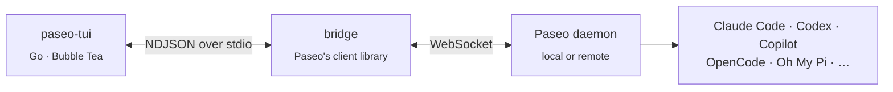

<div align="center">

# paseo-tui

**A fast, keyboard-first terminal client for [Paseo](https://github.com/getpaseo/paseo): run and steer your coding agents without leaving the terminal.**

[](https://github.com/emielvangoor/paseo-tui/actions/workflows/ci.yml)
[](https://github.com/emielvangoor/paseo-tui/releases/latest)
[](LICENSE)


</div>

Paseo runs AI coding agents (Claude Code, Codex, Copilot, OpenCode, Oh My Pi, and more) in isolated workspaces
and worktrees. Its desktop app is great, but if you live in the terminal you want the same power one keystroke
away. paseo-tui gives you the desktop app's model (**projects → workspaces → agent tabs**) as a snappy TUI.
It works with your local Paseo daemon or any remote one, over SSH or the network.

> [!NOTE]
> paseo-tui is an independent, community-built client. It is not affiliated with or endorsed by the Paseo project.

## Highlights

- **Everything live.** Agent state, transcripts, permissions and subagents stream from the daemon in real time.
  Nothing is polled.
- **The desktop's mental model.** A sidebar of projects and workspaces with status at a glance: needs input,
  failed, working, ready to review. Agents appear as tabs on top of each workspace. Group by project or by
  status.
- **Start work fast.** `N` opens **New workspace**: pick the project, the project directory or a fresh
  **git worktree**, the branch to start from, the provider, model and thinking level, then type the task.
  The daemon names the workspace and branch after your prompt.
- **Steer agents.** Send follow-ups, paste images, stop a run, review tool permissions, and switch
  model, thinking or mode mid-session (`m`). **Fork** an agent (`f`) into a new tab or workspace that
  starts from its chat history, as the desktop does, and **rename** agents (`r`).
- **Peek at the code.** `e` opens the workspace in your editor (`$VISUAL` / `$EDITOR`, else nvim or vim) in a
  pane floating over the UI, while agents keep streaming behind it. `ctrl+\` hides it, `e` brings it back,
  quitting the editor closes it.
- **See what's happening.** Markdown transcripts, collapsible thinking, tool calls with diffs and output,
  a live progress line ("⠋ Running Bash: npm test · 1:24"), and a **details panel** with context-window
  use, tokens, cost and the agent's task list.
- **Subagents.** Claude Code tasks, Oh My Pi runs and delegated Paseo agents appear as a track under the
  conversation, and each can open as its own tab.
- **Command center.** `p` fuzzy-searches every workspace *and the agents inside them*, plus actions.
- **Mouse too.** Click workspaces and tabs, drag to resize panels, select text to copy it, and scroll with
  wheel acceleration.
- **One self-contained binary** for macOS, Linux and Windows (arm64 and amd64). It doesn't even need
  Node.js installed when the Paseo app is.

## Install

### Package managers (recommended)

```sh
# macOS and Linux: Homebrew
brew install emielvangoor/tap/paseo-tui

# Debian / Ubuntu, Fedora / RHEL / openSUSE, Alpine: the package from the latest release
sudo apt install ./paseo-tui_*_amd64.deb      # or: sudo dnf install ./paseo-tui-*.x86_64.rpm
                                              # or: sudo apk add --allow-untrusted ./paseo-tui_*.apk
```

```powershell
# Windows: Scoop
scoop bucket add emielvangoor https://github.com/emielvangoor/scoop-bucket
scoop install emielvangoor/paseo-tui
```

Each new release updates the Homebrew tap and the Scoop bucket automatically. Run
`brew update && brew upgrade paseo-tui` (plain `brew upgrade` refreshes the tap only once a day) or
`scoop update paseo-tui`. The `.deb`, `.rpm` and `.apk` files are attached to every
[release](https://github.com/emielvangoor/paseo-tui/releases/latest).

**Arch Linux:** there's no AUR package yet; see [#8](https://github.com/emielvangoor/paseo-tui/issues/8) if
you'd like to maintain one. Until then, use the [prebuilt binary](#prebuilt-binaries) (or Homebrew), and
`paseo-tui update` keeps it current.

### Prebuilt binaries

Download the archive for your platform from the **[latest release](https://github.com/emielvangoor/paseo-tui/releases/latest)**,
or use a one-liner:

```sh
# macOS (Apple Silicon)
curl -fsSL https://github.com/emielvangoor/paseo-tui/releases/latest/download/paseo-tui_darwin_arm64.tar.gz | tar -xz
sudo mv paseo-tui_darwin_arm64/paseo-tui /usr/local/bin/

# Linux (x86_64; use linux_arm64 on ARM)
curl -fsSL https://github.com/emielvangoor/paseo-tui/releases/latest/download/paseo-tui_linux_amd64.tar.gz | tar -xz
sudo mv paseo-tui_linux_amd64/paseo-tui /usr/local/bin/
```

```powershell
# Windows (PowerShell)
Invoke-WebRequest https://github.com/emielvangoor/paseo-tui/releases/latest/download/paseo-tui_windows_amd64.zip -OutFile paseo-tui.zip
Expand-Archive paseo-tui.zip .
.\paseo-tui_windows_amd64\paseo-tui.exe
```

| Platform | Archive |
|---|---|
| macOS, Apple Silicon | `paseo-tui_darwin_arm64.tar.gz` |
| macOS, Intel | `paseo-tui_darwin_amd64.tar.gz` |
| Linux, x86_64 / ARM64 | `paseo-tui_linux_amd64.tar.gz` / `paseo-tui_linux_arm64.tar.gz` |
| Windows, x86_64 / ARM64 | `paseo-tui_windows_amd64.zip` / `paseo-tui_windows_arm64.zip` |

Each release includes `checksums.txt` (SHA-256), and each archive has a signed build provenance
attestation; see [verifying a release](SECURITY.md#verifying-a-release). The macOS binaries aren't
notarized: if you download through a browser and macOS blocks the binary, run
`xattr -d com.apple.quarantine paseo-tui`.

### Updating

paseo-tui checks for a new release once a day, in the background, and shows `↑ vX.Y.Z available` in the
footer. To install it:

```sh
paseo-tui update           # download, verify and replace this binary
paseo-tui update --check   # only report whether there's a newer release
```

The update is installed only if the release's checksums carry a valid signature from the paseo-tui
release key, and the archive matches its checksum. Installed with a package manager? Then `update` tells
you to use it instead. To turn the check off, pass `--no-update-check` or set
`PASEO_TUI_NO_UPDATE_CHECK=1`. The check sends nothing beyond a plain request to GitHub's releases API.

### From source

Requires Go (see `go.mod`), Node.js 22+ and git.

```sh
git clone https://github.com/emielvangoor/paseo-tui.git && cd paseo-tui
make            # the first build fetches Paseo's source to build the bridge (a few minutes)
./paseo-tui
```

### Requirements

- A **Paseo daemon** to talk to. The [Paseo desktop app](https://github.com/getpaseo/paseo) runs one for you;
  without the app, start one with `paseo daemon start` (or press `S` in paseo-tui).
- A JavaScript runtime for the embedded bridge. paseo-tui uses `node` from your `PATH`, or else the
  runtime built into the Paseo app, so nothing extra is usually needed.
- A terminal with true color and mouse support (Ghostty, kitty, WezTerm, Alacritty, iTerm2,
  Windows Terminal, …). tmux works too.

## Usage

```sh
paseo-tui                              # your local Paseo daemon (~/.paseo)
paseo-tui --host 192.168.1.20:6767     # a daemon elsewhere: host:port, tcp://, SSH, or a pairing URL
paseo-tui --home ~/.paseo-work         # another local daemon home
paseo-tui --version
```

Press `?` inside the app for every shortcut.

<table>
<tr>
<td width="50%"><br><sub><b>Command center</b> (<code>p</code>): fuzzy search across workspaces and their agents</sub></td>
<td width="50%"><br><sub><b>New workspace</b> (<code>N</code>): project, worktree, branch, model, prompt</sub></td>
</tr>
</table>

## Keyboard shortcuts

Single keys, as in lazygit, k9s or tig: `j` / `k` (and the arrows) move through the sidebar, `J` / `K`
scroll the transcript, and anything that stops or removes something asks first. Keys only act outside the
message box: `esc` leaves it, `i` or `enter` goes back in.

<details open>
<summary><b>Navigate</b></summary>

| Key | Action |
|---|---|
| `p` · `ctrl+p` · `:` | Command center: workspaces, agents, actions |
| `j` / `k` · `↓` / `↑` | Move through the sidebar (`home` / `end`: first / last row) |
| `{` / `}` | Previous / next workspace in tree order (works with the sidebar hidden) |
| `[` / `]` · `tab` · `1`…`9` | Previous / next agent tab, or jump to tab N (`alt+1…9` while writing) |
| `h` / `l` · `←` / `→` · `space` · `z` | Collapse / expand a project · toggle · collapse all the others |
| `o` | Group the sidebar by project or by status |
| `b` · `d` | Hide or show the sidebar · the details panel |
| `<` `>` · `,` `.` | Resize the sidebar · the details panel (or drag the dividers) |

</details>

<details open>
<summary><b>Work with agents</b></summary>

| Key | Action |
|---|---|
| `i` · `enter` | Write to the focused agent (`enter` sends, `alt+enter` adds a newline, `esc` leaves). When the agent waits on you, `enter` opens that instead |
| `/` | The agent's commands and skills, as in the desktop: `/` at the start of a message lists both, `/` later in a message lists skills. Type to filter, `↑` / `↓` choose, `tab` or `enter` inserts, `esc` closes |
| `/clear` · `/new` · `/exit` · `/q` | Handled by paseo-tui, as in the desktop: `/exit` archives the agent; `/clear` archives it and opens a fresh one with the same setup |
| `↑` / `↓` (in the composer) | Previous / next prompt from history |
| `ctrl+v` | Paste an image from the clipboard (pasting or dropping an image path works too) |
| `n` · `ctrl+n` | New agent in this workspace (a new tab) |
| `N` | New workspace (project directory or worktree, branch, provider, model, thinking) |
| `f` | Fork the agent: a new tab (or, via *Where*, a new workspace) with the same provider, model and mode that starts from its chat history |
| `r` | Rename the agent (its tab) |
| `m` | Agent settings: model, thinking level, mode, toggles such as Fast |
| `s` | Stop the running agent (asks; `s` again or `y` confirms) |
| `enter` · `x` | A pending tool permission: review it (the full command; `y` allows, `n` denies, `esc` decides later) · deny it straight away |
| `enter` · `x` | A pending question (e.g. Claude's AskUserQuestion): answer it in one scrollable form with every question, picking options or typing your own answer · dismiss it |
| `u` | Subagents of this agent; open one as a `↳` tab (`w` or `ctrl+w` closes it) |
| `a` | Archive the agent or the workspace, delete the agent, or remove a project (always confirms) |
| `delete` | Delete the agent permanently (asks; `fn+delete` on a Mac keyboard) |
| `H` | History, like the desktop's: every agent including archived ones, searchable; `enter` opens one, and restores it first (with its workspace or worktree) when archived |
| `c` | Settings: start-up view, header (branch, PR, diff), model label, workspace numbers, thinking and tool output, scroll speed, keyboard hints, quit confirmation, terminal title, update check, editor and file manager. Saved to `config.toml` on every change |
| `e` | Open the workspace in your editor in a floating pane: `$VISUAL`, `$EDITOR`, else nvim or vim (`ctrl+\` hides it, `e` brings it back, quitting the editor closes it). GUI editors need their terminal mode, e.g. `VISUAL="emacs -nw"` |
| `F` | Browse the workspace's files in a floating pane with ranger, yazi, lf or nnn (the first one installed; `ctrl+\` hides it, `F` brings it back). Without one, opens the directory in Finder, Explorer or the Linux file manager |

</details>

<details>
<summary><b>View</b></summary>

| Key | Action |
|---|---|
| `J` / `K` · mouse wheel | Scroll the transcript (the wheel accelerates) |
| `ctrl+d` / `ctrl+u` · `pgdn` / `pgup` | Scroll half a page · a page |
| `g` / `G` | Top / bottom of the transcript (`G` follows new output) |
| `t` | Show / hide thinking |
| `v` | Verbose tool output: command output and diffs |
| `alt+j` / `alt+k` · `alt+↓` / `alt+↑` | Scroll the details panel |
| `A` | Show archived agents |
| `ctrl+r` · `S` | Reload / reconnect · start the local daemon |
| `?` | All shortcuts |
| `q` · `ctrl+c` | Quit (asks first; `y`, or the same key again, confirms) |

</details>

**Mouse:** click a workspace to open it, a project header to fold it, and a tab to switch (`×` or a
middle-click closes a subagent tab). Drag a `│` divider to resize. Drag over the transcript to select text;
it's copied when you let go.

## How it works



The Go program draws the interface. All communication with Paseo goes through a small **bridge**: a
JavaScript bundle built from Paseo's own client library and CLI code, embedded in the binary and started on
demand. Because it is Paseo's real client, it handles the protocol handshake, authentication, relays and
version differences exactly like the desktop app and the `paseo` CLI do. The daemon pushes updates, so the
UI reacts instantly and nothing is polled.

## Files

| What | Where |
|---|---|
| UI state per host (folded projects, panel widths, grouping, New-workspace choices) | `<config dir>/paseo-tui/state.json` |
| Settings (`c`, or edit the file: changes apply while the app runs) | `<config dir>/paseo-tui/config.toml` |
| Prompt history | `~/.local/state/paseo-tui/history.json` (`$XDG_STATE_HOME`) |
| Unpacked bridge, pasted images | `<cache dir>/paseo-tui/` |

`<config dir>` and `<cache dir>` are your OS defaults: `~/.config` and `~/.cache` on Linux,
`~/Library/Application Support` and `~/Library/Caches` on macOS, `%AppData%` and `%LocalAppData%` on Windows.

## Troubleshooting

<details>
<summary><b>"Daemon unreachable" or no workspaces</b></summary>

paseo-tui connects to `~/.paseo` by default. If your agents live in another daemon (the desktop app on
another machine, or a VM host), pass `--host host:port`. To start a local daemon without the desktop app,
run `paseo daemon start` or press `S`.
</details>

<details>
<summary><b>"no JavaScript runtime found"</b></summary>

Install Node.js 20+ or the Paseo desktop app; paseo-tui uses either automatically. You can also point it at
a runtime with `--node /path/to/node`.
</details>

<details>
<summary><b>Colors look off or text selection doesn't work</b></summary>

Use a terminal with true color support. paseo-tui captures the mouse for clicks and selection; most
terminals still allow native selection with `shift`+drag (`option`+drag in iTerm2).
</details>

<details>
<summary><b>Pasting images</b></summary>

`ctrl+v` reads an image from the clipboard via `wl-paste` (Wayland), `xclip` (X11), AppleScript (macOS)
or PowerShell (Windows). Pasting or dragging an image file's path works everywhere.
</details>

## Contributing

Issues and pull requests are very welcome. See **[CONTRIBUTING.md](CONTRIBUTING.md)** for the dev setup
(`make`, `make test`, `make lint`), a map of the code, and how releases work. The changes in each version
are in the **[changelog](CHANGELOG.md)**.

## Acknowledgements

- [**Paseo**](https://github.com/getpaseo/paseo) by Mohamed Boudra, the agent platform this client is built
  for; the bridge is built from its source.
- [**Charm**](https://charm.sh): Bubble Tea, Bubbles, Lip Gloss and Glamour power the interface.

## License

[Apache-2.0](LICENSE). Release binaries embed code from Paseo (also Apache-2.0); see [NOTICE](NOTICE).
