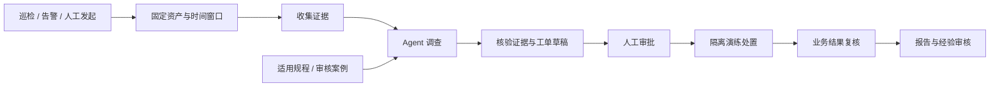

<div align="center">

# 企业信息系统智能运维 Agent

**自动巡检发现异常，按需取证辅助排查，把处理过程留在工单里。**

[](https://github.com/emma-sue/-Agent-/actions/workflows/ci.yml)

[界面预览](#界面预览) · [功能与设计](#功能与设计) · [实测结果](#实测结果) · [快速开始](#快速开始) · [文档中心](docs/INDEX.md)

</div>

面向企业内部信息系统的运维工作台。把巡检、告警、Agent 诊断、工单、审批和结果复核放在同一个流程中，帮助值班人员收集证据、确认排查方向、交接处理任务。

项目提供无密钥演示、真实模型诊断和隔离故障演练。当前验证环境为自建服务与公开微服务故障回放。

## 界面预览


<details>
<summary><strong>查看诊断报告与证据</strong></summary>


截图使用本地演示观测；模型模式与数据来源分别标注。报告保留支持与反对证据、缺失信息和下一步检查建议。

</details>

<details>
<summary><strong>查看优化前后的实测对照</strong></summary>


</details>

## 从一次文件处理积压开始

1. **发现问题**：定时巡检或规则告警发现任务积压；也可以手动发起“文件处理变慢”的排查。
2. **寻找依据**：Agent 查看同一时间窗口的指标、日志、调用链与变更记录，结合依赖关系分析候选原因。
3. **交接处理**：生成带证据的工单草稿，保留待核实项，由处理人员补充记录、指派和复核。
4. **确认结果**：演练处置须经授权人员审批；执行后检查业务状态及实际产物，确认是否恢复。

巡检规则负责发现异常，Agent 负责解释异常。尚未接入的观测明确显示缺失。

## 功能与设计

| 能力 | 具体实现 |
| --- | --- |
| 运维巡检与告警 | 8 项巡检规则、定时任务、告警去重与关联；保留原始告警，关联结果可确认或拆分 |
| Agent 故障排查 | LangGraph 管理流程，Deep Agents 承担调查；按需加载 Skills，通过只读工具与 MCP 适配读取任务证据 |
| 证据与工单 | 固定资产和时间窗口，保存证据原文与哈希；报告关联证据，工单支持指派、处理记录、附件与复核 |
| 规程与经验复用 | 文档按组织、系统、环境和版本筛选；关键词检索、可选 pgvector 向量检索，案例与技能经人工审核后复用 |
| 人工审批与恢复 | 审批绑定操作参数、版本及有效期；检查点、租约和幂等写入支持中断续跑；处置后复查业务结果 |
| 进度与资源管理 | SSE 展示任务进度；限制取证轮数、模型请求和 Token，保存调用用量、耗时及失败记录 |

### 技术栈

| 层次 | 技术与职责 |
| --- | --- |
| Agent | **LangGraph · Deep Agents · Skills · MCP**：诊断编排、上下文管理、受限工具调用 |
| 数据与任务 | **PostgreSQL / pgvector · Redis Streams**：业务记录、知识检索、检查点与异步任务 |
| 服务与界面 | **Spring Boot · FastAPI · Vue 3**：业务权限、Agent worker、中文运维工作台 |
| 运行与验证 | **Compose · pytest · JUnit · Playwright**：服务编排、协议测试、业务检查和浏览器测试 |

版本和兼容性记录见 [依赖说明](docs/dependency-decisions.md)。

### 工作流程



业务后台负责权限、审批和业务写入；Agent 只在授权范围内取证和提出建议。诊断模型不能直接调用宿主 shell 或任意修改系统。

## 实测结果

同一 DeepSeek 模型，对 **12 个公开故障案例进行 24 次配对调查**。两种策略均完成全部报告，首选故障服务均命中 12 例。

| 指标 | 逐页取证 | 证据速览与定向查证 | 变化 |
| --- | ---: | ---: | ---: |
| 诊断耗时中位数 | 23.52 秒 | 15.59 秒 | **降低 33.7%** |
| 同批任务总 Token | 1,083,460 | 501,653 | **降低 53.7%** |
| 模型调用次数 | 108 | 60 | **减少 44.4%** |

另完成 **20 次进程中断恢复测试**，原任务均继续完成且未重复创建工单；自建服务完成 **5 类故障、15 次恢复演练**。

这些结果来自公开数据回归与本地演练，不代表企业生产效果。优化同时调整了证据呈现、查证方式与取证轮数（8 → 4），耗时仅统计调查阶段。完整口径、原始记录与复现入口见 [实测记录](docs/benchmarks.md)。

## 快速开始

### 1. 获取代码

```bash
git clone https://github.com/emma-sue/-Agent-.git
cd -- -Agent-
cp .env.example .env
```

默认 `AI_MODE=fixture`，无需模型密钥即可体验演示流程。已有 `.env` 时保留原配置。

### 2. 启动

**macOS Apple Silicon** 可使用项目自带的独立运行时：

```bash
make demo-local
```

首次启动会下载锁定版本的运行依赖。其他平台提供 Compose 配置：

```bash
docker compose --env-file .env --profile live-lab up --build -d --wait
```

当前已验证 macOS 原生运行；Compose 已通过配置校验，容器构建与运行尚未实测。端口和排错说明见 [运行指南](docs/running.md)。

### 3. 打开工作台

访问 **http://127.0.0.1:5173**，使用 `ops-demo` 登录。初始演示密码为 `.env` 中的 `DEMO_PASSWORD`（示例值 `demo-ops-2026`）。

选择“文件处理平台 · 任务消费者”，使用内置的 **2026-09-10 01:45–02:15 UTC** 窗口发起诊断，即可查看进度、证据和工单草稿。

> 公开截图使用演示账号和自建数据。接入实际企业前，需要配置真实身份源、监控数据与操作权限。

## 配置 AI 能力

两类模型分别配置，密钥只保存在本地 `.env` 或部署环境中。

| 能力 | 配置项 | 当前行为 |
| --- | --- | --- |
| 对话与工具调用 | `CHAT_BASE_URL` / `CHAT_MODEL` / `CHAT_API_KEY` | `AI_MODE=live` 时调用真实模型；缺失配置会报错 |
| 文档向量化 | `EMBEDDING_BASE_URL` / `EMBEDDING_MODEL` / `EMBEDDING_API_KEY` / `EMBEDDING_DIMENSIONS` | 默认关闭；启用后需匹配模型与维度 |

已验证 DeepSeek 工具调用与结构化诊断，配置示例：

```dotenv
AI_MODE=live
CHAT_BASE_URL=https://api.deepseek.com
CHAT_MODEL=deepseek-flash
CHAT_THINKING_MODE=disabled
CHAT_API_KEY=填写自己的密钥
```

默认知识检索使用中文关键词；向量检索的供应商效果尚未验证。演示模式不调用真实模型，也不生成模型质量成绩。

## 开发与测试

```bash
make unit              # Python / Java 检查与前端构建
make e2e               # 服务启动后的浏览器测试
make data              # 下载公开案例并生成本地回放数据
```

中断、审批和故障注入测试需要独立演练环境，操作方法见 [运行指南](docs/running.md)。GitHub Actions 运行无密钥单元检查与构建，不调用付费模型。

```text
apps/web/                 Vue 工作台
services/ops-api/          业务、权限、工单与审批
services/agent-service/    Agent、工具、检查点与知识检索
services/lab/              隔离演练服务
skills/ · knowledge/       排查技能与示例规程
scripts/ · eval/           启动、数据准备、测试与评估
docs/                     使用文档、截图与实测记录
```

## 文档与反馈

[文档中心](docs/INDEX.md) · [运行指南](docs/running.md) · [代码阅读](docs/code-reading-guide.md) · [API](docs/api.md) · [实测记录](docs/benchmarks.md) · [问题反馈](https://github.com/emma-sue/-Agent-/issues)

项目使用官方 Deep Agents、LangGraph、MCP SDK 等组件；公开回放来自 RCAEval 和 Loghub。具体复用范围与上游链接见 [上游说明](docs/upstream-reuse.md)。
