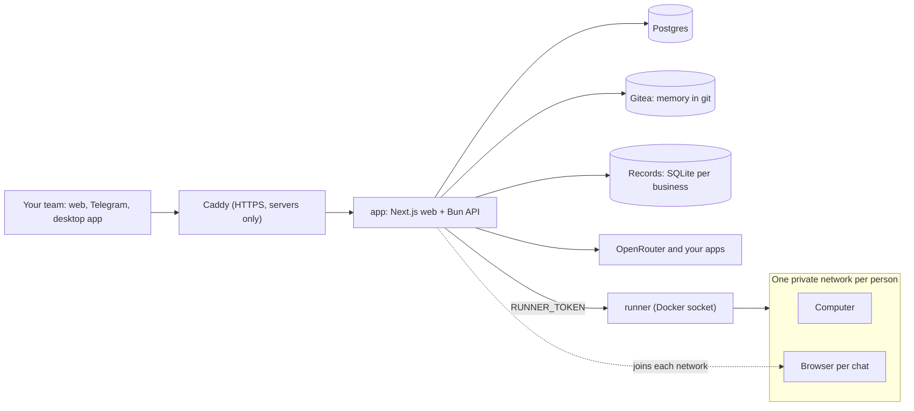

<p align="center">
  <picture>
    <source media="(prefers-color-scheme: dark)" srcset="docs/images/logo-dark.png">
    
  </picture>
</p>

<h3 align="center">An AI employee your whole team shares, not a personal assistant.</h3>

<p align="center">
  <a href="#run-it">Run it</a> ·
  <a href="#how-its-built">How it's built</a> ·
  <a href="#security">Security</a> ·
  <a href="#where-your-data-goes">Your data</a> ·
  <a href="#whats-rough">What's rough</a> ·
  <a href="https://docs.emplio.app">Docs</a> ·
  <a href="https://discord.gg/vjAr5ARex">Discord</a> ·
  <a href="LICENSE">AGPL-3.0</a>
</p>

Emplio is one agent for a whole business. Everyone on the team talks to it, on the web, on Telegram or in the desktop app. It does the work on its own computer and browser, in your apps, and it writes what it learns about the business into git repos you can read.

<p align="center">
  
</p>

<p align="center"><sub>A real session on a fresh install from the ready-made images, recorded 13 Nov 2026. Waiting is sped up 4× and a two-minute idle pause is cut; nothing else is edited. <a href="docs/real-session.mp4">Video</a>.</sub></p>

## Run it

You need [Docker](https://docs.docker.com/get-docker/) and an [OpenRouter](https://openrouter.ai/keys) key.

```bash
curl -fsSL https://emplio.app/install.sh | bash
```

It asks for the key, your email and a web address (leave it empty on your own computer), then prints a link that signs you in as the owner at http://localhost:3000. Run it again to update; your data stays. [Read the script and check its checksum first](#check-the-script-before-running-it) if you'd rather.

Plan for 4 GB of memory, plus 2 GB for each person working at the same time. Ready-made images are built for Intel and ARM.

## How it's built

A few Docker services on one machine. The app does the thinking and holds the rules. The runner is the only part that can start containers.



These are the decisions that make it what it is.

### One tool: `bash`

The model gets one tool, `bash`, on its own computer: a Linux container, or your Mac or PC through the desktop app ([`chat.ts`](backend/src/chat.ts)). Everything beyond a plain shell goes through one command, `emplio`: apps, the browser, tasks, the team, records, skills, hand-offs ([`sandbox.ts`](backend/src/sandbox.ts), listed in [docs](https://docs.emplio.app/developers/cli)).

Models are good at shells, so we don't spend the prompt on dozens of tool schemas. Most `emplio` subcommands are thin calls to the API, which checks who may do what. The rules live on the server, not in the prompt. Adding a capability means adding a subcommand.

### A manager that hands off and checks

The main chat is a manager, not a worker. Anything long goes out with `emplio hand`: a thread with a fresh context on the same computer, briefed with what "done" means, that reports back when it's finished. Several run at once, and threads can hand off too, three levels deep. Each thread is a chat you can open, watch and write to, and people keep talking to the main chat while the work runs ([`jobs.ts`](backend/src/jobs.ts)). The main chat's context holds decisions and results, not every command's output.

The manager is also the checker. It holds each report against the brief's "Done when" and against the server's own record of what was sent or changed through apps, and sends unfinished work back to the same agent instead of redoing it. When an agent gets its kind of work wrong, the manager fixes that agent's instructions.

Agents are saved roles named like job titles, such as Web Researcher or Invoice Chaser, and Emplio makes them itself as kinds of work come back. Each is `company/agents/<slug>/AGENT.md` with instructions, the skills it uses and a level. Next to it, `LESSONS.md` keeps the last 40 dated lessons from past jobs, shown to the agent as notes, never as instructions. Work that repeats becomes a repeating task on the work list, naming its agent.

The split is also what keeps it affordable. On the default setting the manager runs on Claude Sonnet and light agents on Claude Haiku; a `strong` agent gets the manager's model ([`MODEL_SETS`](shared/src/index.ts)). The recording above shows a hand-off: the Web Researcher was made during that chat.

### A computer and a browser per person, not per company

Each person gets their own container and their own Docker network, holding their computer and a Chromium per chat. The networks can't reach Postgres, Gitea, the runner or the cloud metadata address. A computer sleeps about 15 minutes after its last command and keeps its files.

The business is shared; people's sign-ins and files aren't. The owner's Gmail session never sits in the same browser as a new hire's.

The [desktop app](desktop/) can stand in for that computer, so the work runs on your own machine. While it's open, Emplio works in `~/Emplio/<business>/` and a Chrome on that computer, and commands can only write inside that folder ([`box.js`](desktop/src/box.js)):

- **Mac:** commands run under `sandbox-exec` and can't read `~/.ssh`, keychains, browser data, `Documents`, `Desktop` or `Downloads`.
- **Windows:** commands run in Git for Windows' bash at Low integrity, the way Chrome fences its tabs, with no admin rights needed ([`fence-win.js`](desktop/src/fence-win.js)). The PC takes work only after a test from inside the fence passes.
- **Linux:** the app only shows notifications for now. Commands there have no fence yet, so the work stays on the server's computer.

Close the lid and the server's computer carries on from the last save.

### Memory is git

Each business is a Gitea organization with three kinds of repo: `company` for everyone, `restricted` for owners and admins, and `me-<userId>` for each person. On the computer they're folders of Markdown at `/work/company/` and `/work/me/`, saved once per reply.

You get diff, history and revert for free, and "who can see this note" is a repo permission. The computer never talks to Gitea: commits travel as git bundles through the API, so the git credential never enters it. When staff change a company note, it goes to the owner as a proposal.

### Skills it writes itself

A skill is a folder with a `SKILL.md` and any scripts it needs, in `company/skills/` or `me/skills/`. Emplio writes and fixes them as it works. You can also record yourself doing a task in its browser, with or without talking it through, and it turns the recording into a skill. Passwords aren't recorded. It can install skills from [skills.sh](https://skills.sh) too, after reading them and asking you.

### Approvals, records, background work

- **Approvals.** App actions that send, change or delete show **Allow**, **Always allow** or **Deny**; lookups don't ask. Automations declare in their file which actions they may take.
- **Records.** Each business has its own SQLite database for leads, orders and stock, queried with `emplio db`.
- **Background work.** Morning briefs, check-ins and reminders ([`heartbeat.ts`](backend/src/heartbeat.ts)), Emplio's own due tasks, and automations on a cron or an app event ([`automations.ts`](backend/src/automations.ts)), each as a Markdown file in `company/automations/`.

File formats for skills, agents and automations are in [Extend Emplio](https://docs.emplio.app/developers/extend). Where everything lives is in the [project map](https://docs.emplio.app/developers/project-map).

## Built for a team

Most agents work for one person. Emplio works for a company, and that shows up in the code, not just the copy:

- **Roles.** Owner, admin and staff. Staff can't see `restricted`, can't make agents or automations, and their changes to company notes and skills go to the owner as proposals.
- **One memory.** Teach it a rule in one chat and it applies in everyone's.
- **Work for people, too.** Tasks go to Emplio or to people. It does its own, reminds people of theirs, and knows who reports to whom.
- **Goals.** The owner's goals live in `company/goals.md`. Every job sees them, and the background agent keeps track of progress.

## What it works with

- **Talk to it:** the web app, a Telegram bot, desktop apps for Mac, Windows and Linux, and an iPhone app for [Emplio Cloud](https://emplio.app). Voice notes are turned into text.
- **Apps:** our own integrations for GitHub, Slack, Zoom, Notion, HubSpot, Stripe, Razorpay, Google Calendar, Docs, Sheets, Meet, Search Console, Analytics and Business Profile, Zoho Mail, Books and Invoice, and more in [`integrations/own`](backend/src/integrations/own). Gmail, Outlook, Google Drive, OneDrive, Teams, WhatsApp and LinkedIn still go through [Composio](https://composio.dev).
- **MCP:** any remote MCP server over Streamable HTTP or SSE. A header like `{{ACME_KEY}}` is filled from each person's own saved key on the server, so the token never enters the computer.
- **Models:** anything on OpenRouter. Settings has three presets (Standard, Smarter, Best), or you pick a model for chat, for agents and for background work yourself.

## Security

Emplio runs commands and opens websites for you. Treat it like a member of staff with a computer.

- **The runner** ([`runner.ts`](runner/runner.ts)) is the only process with the Docker socket. It starts containers from Emplio's two images only, with fixed memory, CPU and process limits, never privileged, never with a folder from the machine, never with Docker inside. It has no public port and every request needs `RUNNER_TOKEN`. Don't give Docker access to anything else.
- **Networks.** Each person's computer and browsers sit on their own network, which can't reach Postgres, Gitea, the runner or the cloud metadata address.
- **Secrets.** Saved passwords and app keys are encrypted with `ENCRYPTION_KEY`. Emplio sees their names, never their values; the server uses them itself. A saved password is filled in only on the site it was saved for.
- **Sign-in.** No passwords for Emplio itself: a code by email, with limits on tries per code and per address.
- **HTTPS.** Never put it on the internet without it. On a server with a web address, the installer sets up Caddy for you.

Found a problem? See [SECURITY.md](SECURITY.md) and report it privately.

## Where your data goes

Emplio thinks with a model through [OpenRouter](https://openrouter.ai), so the model company sees what it works on:

- what people send it in chat, files included
- the notes it opens for a job (staff never get the restricted ones)
- what its commands print, the text of pages it reads, and what it pulls from connected apps
- new messages in a quiet chat, which a smaller model reads so the background agent knows what's going on

The model never gets:

- saved passwords and keys, or the keys and sign-ins for connected apps. Once a password is typed into a website, though, the agent could read it back from that browser.
- browser cookies, your database or your encryption key

Every call Emplio makes to its own models asks OpenRouter for hosts that neither keep nor train on what's sent (`data_collection: deny` in [`models.ts`](backend/src/models.ts)), which can leave some models with fewer hosts. For zero data retention on top of that, turn it on in your [OpenRouter privacy settings](https://openrouter.ai/settings/privacy).

Other services get data only if you add their key: Exa (web search), Composio (the apps listed above), Sarvam (voice notes), Resend (sign-in emails), Telegram (messages sent there), and each app you connect.

## What's rough

We've used Emplio every day at Kulp Labs, our software agency, since May 2026. Opening it to everyone is new, and your business will use it in ways ours hasn't.

- **OpenRouter is the only model provider.** We're working on others, and on local models.
- **The self-hosted browser is plain Chromium.** Some sites block it.
- **Some apps still need Composio**, including Gmail and Google Drive, so you need a Composio key for them.
- **Links to apps the agent starts on its computer** don't work self-hosted yet; you get files and screenshots instead.
- **iPhone notifications** need the App Store app's Apple key, so they only work on Emplio Cloud. Browser notifications work self-hosted.
- **The desktop apps are young.** The Windows app is new and hasn't been tested on a real PC yet, and the Linux app only shows notifications. They connect to emplio.app unless you start them with `EMPLIO_URL` set to your own server.
- **Telegram is the only chat app.** It works in private chats, not groups.

It isn't a personal assistant for one person's inbox, a coding agent, or a framework for building agents. It's one employee for one business.

## Self-hosting details

### Check the script before running it

`emplio.app/install.sh` redirects to [install.sh](install.sh) in this repo, and its checksum is in [install.sh.sha256](install.sh.sha256):

```bash
curl -fsSLo install.sh https://emplio.app/install.sh
curl -fsSL https://raw.githubusercontent.com/emplio-app/emplio/main/install.sh.sha256 | shasum -a 256 -c
bash install.sh
```

The second line prints `install.sh: OK` when the file matches. If it doesn't, don't run it, and please [tell us](https://github.com/emplio-app/emplio/issues).

On a server, point your web address at it and open ports 80 and 443 first. On Linux the installer can add Docker for you; on a Mac or Windows, install Docker Desktop first.

<details>
<summary><b>Adding your team</b></summary>

Add people from the Team page. With no email service set up, their sign-in codes are written to the log:

```bash
cd ~/emplio && docker compose logs app | grep "sign-in code"
```

Add `RESEND_API_KEY` to `~/emplio/.env` and run `docker compose up -d` so people get their codes by email.

</details>

<details>
<summary><b>Optional features</b></summary>

Each turns on when you add its key to `~/emplio/.env` and run `docker compose up -d`. See [`.env.example`](.env.example) for every setting.

- **Telegram:** `TELEGRAM_BOT_TOKEN`, from @BotFather.
- **Web search:** `EXA_API_KEY`.
- **Voice notes:** `SARVAM_API_KEY`.
- **Browser notifications:** a VAPID key pair, made with `bun backend/scripts/vapid-keys.ts`.
- **Apps that sign in:** a client id and secret for GitHub, Slack, Zoom, Google or Zoho, each with its callback at `<API address>/oauth/<app>/callback`. Without one, GitHub takes a pasted token and the others stay hidden.
- **Gmail, Drive and the other Composio apps:** `COMPOSIO_API_KEY`.
- **App events for automations:** `WEBHOOK_URL`, this server's public API address.

Apps like Razorpay, Vercel and Stripe only need a key pasted into the Integrations page.

</details>

<details>
<summary><b>Backups</b></summary>

Back up the Docker volumes `postgres-data`, `gitea-data` and `app-data`, and keep your `.env`. Without `ENCRYPTION_KEY`, saved passwords can't be read.

</details>

<details>
<summary><b>Build it yourself</b></summary>

To run your own changes instead of the ready-made images:

```bash
git clone https://github.com/emplio-app/emplio && cd emplio && ./setup.sh --build
```

It's one Bun workspace: `backend` (Bun, Fastify, Drizzle), `frontend` (Next.js, shadcn/ui) and `shared`, plus `runner`, `docker`, `desktop` and `mobile`. See [build from source](https://docs.emplio.app/developers/build-from-source).

</details>

## Emplio Cloud

Same code, run for you at [emplio.app](https://emplio.app), on paid plans.

| | Self-hosted | Emplio Cloud |
|---|---|---|
| Cost | Free, plus your own AI and other provider bills | Paid plans |
| Computer | A container on your machine | Managed for you |
| Browser | Plain Chromium; some sites will block it | Managed, with protection against blocking |
| Links to apps the agent starts | Not available yet | Yes |
| iPhone app notifications | No | Yes |
| Keys and setup | Yours | Done for you |

## Why we built it

### The vision

Most AI agents are built for one person. Emplio is built for the whole company.

Every business, from a freelancer to an enterprise, should have an employee who knows the whole company: what it sells, who does what, and where it's trying to go. Emplio works alongside every person on the team, takes the repetitive work off everyone's plate so people can spend their time on growth, and keeps pushing the business toward its goals around the clock. It gets better every day, and everything it learns belongs to the business.

Our launch video, which tells that story:

https://github.com/user-attachments/assets/fa225020-2aa2-4892-8895-dcc1fe1760b1

## Community and contributing

Questions, ideas, or something it did for your business? [Discord](https://discord.gg/vjAr5ARex). Bugs: [open an issue](https://github.com/emplio-app/emplio/issues).

Pull requests are welcome. See [CONTRIBUTING.md](CONTRIBUTING.md). First-time contributors sign a short [contributor agreement](CLA.md) on their first pull request.

## License

[GNU Affero General Public License v3.0](LICENSE). If you run a changed version as a service, you must offer your users its source code.

"Emplio" and its logo are trademarks and aren't covered by that license. If you offer your own changed or hosted version, give it another name.
