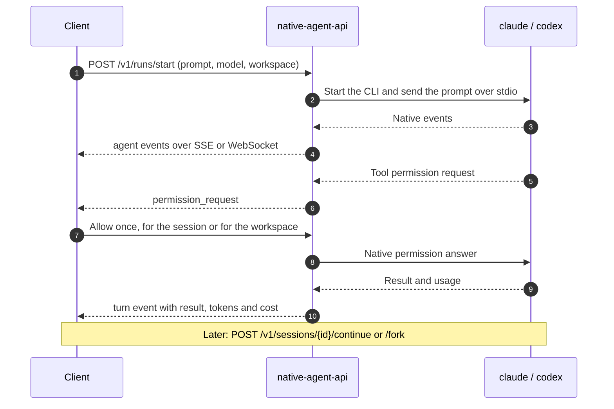

# native-agent-api

[](https://github.com/emreuyguc/native-agent-api/actions/workflows/ci.yml)
[](https://scorecard.dev/viewer/?uri=github.com/emreuyguc/native-agent-api)
[](LICENSE)

**An HTTP API for Claude Code and Codex CLI.** native-agent-api runs the real coding-agent CLI and
serves it over REST, Server-Sent Events and WebSocket. Sessions, login, tools, skills, hooks,
plugins, subagents and MCP servers keep working exactly as in a terminal.

<p align="center">
  
</p>

> **Status: 0.x.** The API may still change between minor versions; see the [changelog](CHANGELOG.md).

## Why

The AI providers' own CLIs are excellent agents. Claude Code and Codex CLI manage sessions, run
tools, skills, hooks, plugins and MCP servers, and sign in with your subscription. But they are
built for a person at a terminal on one machine.

Once the CLI runs on a server or another computer, reaching it takes extra tools:

- SSH with `tmux` or `screen`
- remote desktops such as RustDesk, VNC or Chrome Remote Desktop
- browser terminals such as `ttyd`
- agent apps with remote companions, such as Orca or Hermes Desktop

These give a person a screen. They do not give your software an interface.

native-agent-api turns the native CLI into a service:

- **Reach it from anything.** Web apps, mobile apps, bots, scripts and other services talk to the
  agent over plain HTTP, SSE or WebSocket, from any language.
- **Use your subscription, not an API key.** The CLI keeps its own login, so a Claude or ChatGPT
  plan you already have can power your projects and personal tools. Check the provider's terms
  first (see [Notes](#notes)).
- **Native, not re-implemented.** The gateway drives the CLI's own protocol. Every native event
  reaches the client unchanged, and the agent's features keep working.
- **One API for both agents.** Runs, sessions, events, permissions and usage look the same for
  Claude Code and Codex CLI. Agent-only data stays in a typed `provider` section.
- **Your machine, your control.** The gateway runs next to the CLI. No third-party service sits
  between your client and the agent.

## Features

| Area | What you get |
|---|---|
| **Runs** | One-shot asks, or interactive runs you can message, interrupt, close and cancel |
| **Sessions** | Continue with remembered settings, fork, list and delete |
| **Live events** | SSE and WebSocket; reconnect without losing events; optional partial output |
| **Permissions** | Approve or deny each tool use from the client, once or for a session or workspace |
| **Workspaces** | Managed workspaces with a file API, or attached project directories |
| **Native features** | Tools, skills, hooks, plugins, subagents, MCP servers, native control requests |
| **Results and usage** | Structured output, turn and session tokens, context window, cost (Claude Code), subscription allowance |
| **Agent management** | Login without a terminal, logout, status, model list, diagnostics |
| **Security** | Token auth, IP allowlist, DNS-rebinding and cross-origin protection, redacted logs |
| **Operation** | Explicit configuration, generated OpenAPI 3.1, optional hardened Docker setup |

Per-agent details are in the [roadmap and feature status](ROADMAP.md).

## How a run works



## Supported agents

| Agent | Native CLI | Tested CLI version | Support |
|---|---|---|---|
| `claude` | Claude Code | 2.1.318 | [Support details](docs/agents/claude-code.md) |
| `codex` | Codex CLI | 0.167.0 | [Support details](docs/agents/codex-cli.md) |

The adapters are verified against the tested CLI version, which the Docker images install. Other
versions can differ in commands, flags and events. `GET /v1/agent` reports both the installed
`cli.version` and `cli.tested_version`.

One gateway process serves one agent. Run two processes to serve both. Each has its own login,
port and token, and both speak the same API. Two processes can attach the same directory, so
both agents work on the same files.

<p align="center">
  
</p>

With Docker, each installation is one container with its own volumes; see
[several installations](docker/README.md#several-installations).

## Quick start

Requires macOS or Linux. The fastest way is `make setup`: it asks how to run the gateway, writes
the env files, creates the client token and starts the gateway.

```sh
git clone https://github.com/emreuyguc/native-agent-api && cd native-agent-api
make setup
```

| Choice in `make setup` | Needs | Agent login |
|---|---|---|
| Docker, published image (fastest) | Docker with Compose v2 | Through the API, once per installation |
| Docker, image built from source | Docker with Compose v2 | Through the API, once per installation |
| Host, built from source | Go, the agent CLI on `PATH` | The CLI's login on this machine |
| Host, installed binary | A [release](https://github.com/emreuyguc/native-agent-api/releases) binary ([verify it](docs/releasing.md#verify-a-release)), the agent CLI on `PATH` | The CLI's login on this machine |

To set up by hand on the host:

```sh
go install ./cmd/native-agent-api
cp .env.example .env && chmod 600 .env   # every setting is explicit; review the file
native-agent-api new-token               # client token for $TOKEN, digest for NATIVE_AGENT_TOKEN_SHA256
native-agent-api login claude
native-agent-api serve --env-file .env
```

In Docker, follow [Docker setup](docker/README.md#setup). Then send a first request; a Docker
installation uses its published port, such as `8701`:

```sh
curl -s http://127.0.0.1:8080/v1/ask -H "Authorization: Bearer $TOKEN" -H 'Content-Type: application/json' \
  -d '{"prompt":"Explain HTTP/2 in one sentence.","model":{"id":"sonnet","effort":"low"}}' | jq -r .result.text
```

The interactive API reference is served at `/docs`, and the OpenAPI 3.1 document at
`/openapi.yaml`.

## Documentation

- [API concepts](docs/api.md): runs, sessions, events, permissions, provider sections
- [Configuration](docs/configuration.md): every `NATIVE_AGENT_*` setting
- [Security model](docs/security.md): read this before exposing the gateway
- [Roadmap and feature status](ROADMAP.md): what works per agent, what is planned
- [Platform support](docs/platforms.md), [development](docs/development.md),
  [testing](docs/testing.md), [releasing](docs/releasing.md)

## Notes

native-agent-api is an independent project, not affiliated with Anthropic or OpenAI. It uses the
CLI and the login you provide; your use of each CLI and account stays subject to that provider's
terms, so check them before serving a personal subscription to other people or applications.

Vulnerabilities: see [SECURITY.md](SECURITY.md). Contributions: see [CONTRIBUTING.md](CONTRIBUTING.md). License: [Apache-2.0](LICENSE).
