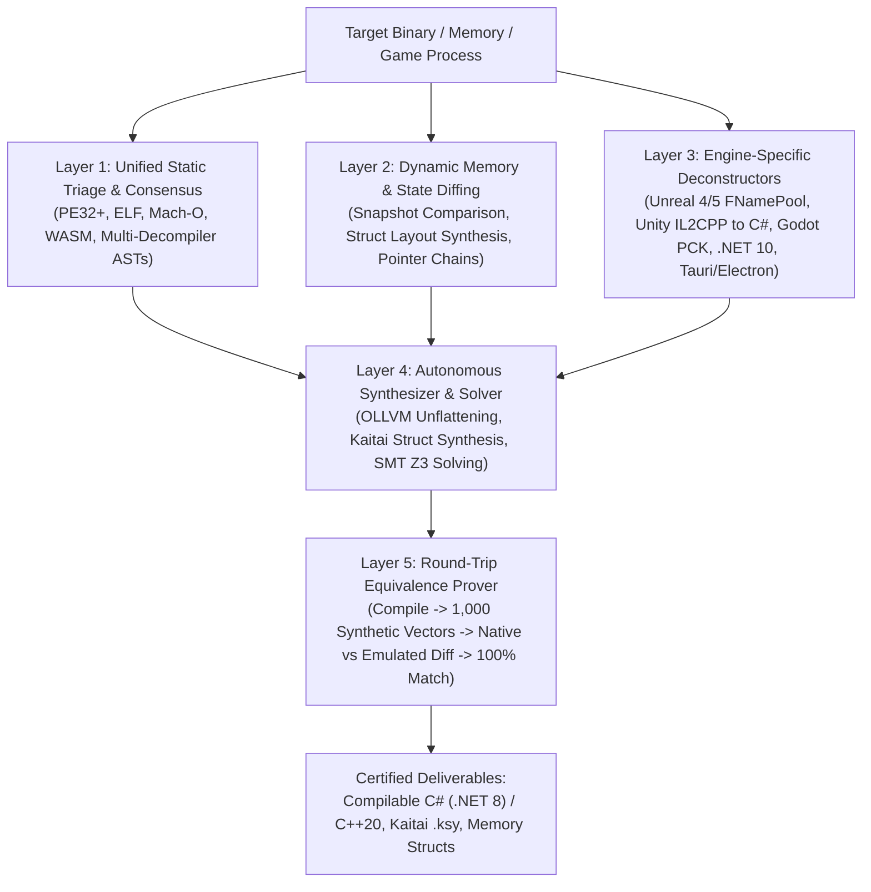

<p align="center">
  
</p>

#  Apex-RE: Master-Tier Reverse Engineering Skill for AI Agents

**Autonomous Binary Analysis, Consensus Decompilation, Dynamic Memory Diffing, and Control Flow Unflattening for AI Coding Agents.**

[](https://github.com/emrewyt/apex-re/stargazers)
[](LICENSE)
[](.github/workflows/ci.yml)


>  **Star this repository** to support autonomous, zero-hallucination reverse engineering for AI coding agents!

---

##  Overview

Most reverse engineering skills for AI agents suffer from critical limitations:
1. **Static Blindness:** They inspect static decompilation text without understanding live memory layout or dynamic state mutations.
2. **Obfuscation Paralysis:** Control Flow Flattening (OLLVM), opaque predicates, and bytecode dispatchers force models into speculative guesswork.
3. **Engine-Specific Gaps:** They lack deep heuristics for Unreal Engine reflection (`FNamePool`, `GUObjectArray`), Unity IL2CPP solution reconstruction, Godot PCK packaging, and .NET NativeAOT method tables.
4. **No Verification Loop:** They cannot mathematically prove that reconstructed C# or C++ code behaves identically to the original binary.

**Apex-RE** provides a five-layer operational methodology that equips AI agents with the diagnostic workflow of an expert reverse engineer:



---

##  1-Line Installation

Apex-RE integrates with **Antigravity 2.0**, **Claude Code**, **Codex**, **Cursor**, and **Gemini CLI**.

### Windows (PowerShell)
```powershell
irm https://raw.githubusercontent.com/emrewyt/apex-re/main/install.ps1 | iex
```

Or from local clone:
```powershell
.\install.ps1 -Target all -Scope user
```

### Linux & macOS (Bash)
```bash
curl -fsSL https://raw.githubusercontent.com/emrewyt/apex-re/main/install.sh | bash
```

Or from local clone:
```bash
./install.sh --target all --scope user
```

---

##  Bundled Analysis Utilities

The `skills/apex-re/scripts/` directory contains four zero-dependency Python tools:

| Utility | Purpose | Capabilities |
| :--- | :--- | :--- |
| **`apex_triage.py`** | Deep Binary Triager | Parses PE32/PE32+, ELF, Mach-O, WASM. Calculates Shannon entropy, identifies W+X anomalies, extracts MSVC Rich Header build telemetry, detects packers/VMs, and fingerprints game engines & runtimes. |
| **`memory_diff.py`** | Memory State Differ | Compares two binary memory dumps (before/after action), isolates variable mutations (int8..int64, float32, float64, pointer), and synthesizes compilable C++ and C# explicit struct definitions. |
| **`sig_scan.py`** | Signature & Offset Scanner | Wildcard IDA/CE pattern search, automated x86_64 RIP-relative displacement math, and autonomous stable signature synthesis. |
| **`vm_analyzer.py`** | VM Bytecode Trace Analyzer | Deconstructs obfuscated code virtualization loops. Identifies interpreter dispatchers, strips VIP overhead, and performs backward symbolic register slicing. |
| **`kaitai_synth.py`** | Kaitai Format Synthesizer | Analyzes binary structures, packets, or save games. Identifies headers, endianness, primitive sequences, and emits valid Kaitai Struct (`.ksy`) YAML specifications. |
| **`unflatten_trace.py`**| Control Flow Unflattener | Deobfuscates OLLVM state-dispatcher loops. Eliminates the artificial switch machine and reconstructs clean linear C control flow or Mermaid diagrams. |

### CLI Usage Examples

#### Deep Binary Triage
```bash
python skills/apex-re/scripts/apex_triage.py GameAssembly.dll
```
```text
========================================================================
 APEX-RE TRIAGE REPORT : GameAssembly.dll
========================================================================
  Format        : PE32+ (64-bit)
  Architecture  : x64 (AMD64 / 64-bit)
  File Size     : 48,234,496 bytes
  Total Entropy : 6.4210 / 8.0000
  Entry Point   : 0x140001000
  Game Engine   : Unity (IL2CPP)
  Runtimes      : Unity IL2CPP AOT, MSVC C/C++ Runtime
  Protections   : None Detected
------------------------------------------------------------------------
```

#### Differential Memory Struct Synthesis
```bash
python skills/apex-re/scripts/memory_diff.py before.bin after.bin --align 4 --struct PlayerEntity
```
```cpp
// Auto-generated by Apex-RE Memory Synthesizer
#include <cstdint>

struct PlayerEntity {
    uint8_t _pad_00[0x24];       // 0x0000 -> 0x0024
    int32_t Health;              // changed: 100 -> 85 (delta: -15)
    uint8_t _pad_01[0x04];
    float   MoveSpeed;           // changed: 1.0000f -> 1.5000f
    uintptr_t InventoryPointer;  // ptr: 0x00007FF720000000
};
```

---

##  Master Technical References

Comprehensive documentation included in `skills/apex-re/references/`:

| Guide | Description |
| :--- | :--- |
| [`game-engines-unreal-unity.md`](skills/apex-re/references/game-engines-unreal-unity.md) | Unreal Engine 4/5 FNamePool, GUObjectArray, ProcessEvent hooking, Unity Mono & IL2CPP solution reconstruction. |
| [`godot-engine.md`](skills/apex-re/references/godot-engine.md) | Godot 3/4 `.pck` structure, GDScript bytecode disassembly, AES decryption, GDExtension C++ bindings. |
| [`dotnet-and-nativeaot.md`](skills/apex-re/references/dotnet-and-nativeaot.md) | .NET 3.5 to 10, single-file bundle extraction, ReadyToRun (R2R) native code, and NativeAOT EEType recovery. |
| [`desktop-electron-tauri.md`](skills/apex-re/references/desktop-electron-tauri.md) | Electron ASAR extraction, IPC channel tracing, Tauri Rust command routing, and embedded web asset carving. |
| [`msvc-cmake-native.md`](skills/apex-re/references/msvc-cmake-native.md) | PE/ELF conventions, MSVC C++ RTTI (`CompleteObjectLocator`), vtable reconstruction, and STL memory layouts. |
| [`python-bytecodes.md`](skills/apex-re/references/python-bytecodes.md) | PyInstaller extraction, `.pyc` magic restoration, `pycdc` decompilation, and PyArmor frame hooking. |
| [`obfuscation-and-virtual-machines.md`](skills/apex-re/references/obfuscation-and-virtual-machines.md) | OLLVM unflattening, opaque predicate solving with Z3, and VM devirtualization (VMProtect/Themida). |
| [`dynamic-memory-diffing.md`](skills/apex-re/references/dynamic-memory-diffing.md) | Memory snapshot diffing, multi-level pointer chains, and Frida runtime instrumentation. |
| [`symbolic-and-emulation.md`](skills/apex-re/references/symbolic-and-emulation.md) | Unicorn CPU emulation, Qiling OS emulation, angr path exploration, and Z3 constraint solving. |
| [`decompilation-consensus.md`](skills/apex-re/references/decompilation-consensus.md) | Reconciling Ghidra, IDA Pro, Binary Ninja, and ILSpy outputs while preventing LLM context starvation. |
| [`pseudocode-to-raw-code.md`](skills/apex-re/references/pseudocode-to-raw-code.md) | Transforming raw pseudocode into production-ready, compilable C# (.NET 8), modern C++20, and Python. |
| [`verification-loop.md`](skills/apex-re/references/verification-loop.md) | Differential testing with 1,000 synthetic test vectors under Unicorn to certify 100% equivalence. |
| [`signature-and-pattern-scanning.md`](skills/apex-re/references/signature-and-pattern-scanning.md) | Dynamic offset tracking, IDA/CE wildcard patterns, and x86_64 RIP-relative displacement math. |
| [`vm-bytecode-analysis.md`](skills/apex-re/references/vm-bytecode-analysis.md) | Devirtualization pipeline, dispatcher loop filtering, and backward symbolic register slicing. |
| [`compiler-artifacts-and-telemetry.md`](skills/apex-re/references/compiler-artifacts-and-telemetry.md) | Decoding MSVC Rich Headers (`@comp.id`), toolchain telemetry, and universal symbol demangling. |

---

##  Deep Analysis Architecture

<p align="center">
  
</p>

<p align="center">
  
</p>

---

##  Agent Prompts Library

Looking for ready-to-paste prompts for your AI agents? Check out [`PROMPTS.md`](PROMPTS.md) for 10 curated prompt templates in both English and Turkish covering:
- Unreal Engine 5 Actor Tracing
- Unity IL2CPP Solution Recovery
- .NET 8 NativeAOT Deconstruction
- OLLVM Control Flow Unflattening
- Proprietary Format to Kaitai Struct
- Memory Snapshot State Diffing
- Multi-Engine Consensus Decompilation
- Round-Trip Equivalence Verification
- Wildcard Pattern & RIP-Relative Offset Hunting
- VM Devirtualization & Backward Slicing

---

##  Project Structure

```text
apex-re/
├── .github/
│   ├── workflows/ci.yml           # Automated cross-platform CI tests (Py 3.8-3.14)
│   └── ISSUE_TEMPLATE/            # Bug reports and feature request templates
├── assets/
│   ├── banner.svg                 # High-resolution vector hero banner
│   ├── sig-scan-pipeline.svg      # Pattern scanner & RIP resolution architecture
│   ├── vm-devirt-architecture.svg # VM devirtualization & slicing pipeline
│   └── icons/                     # Apple/Steam-style vector iconography
│       ├── terminal.svg, star.svg, bolt.svg, rocket.svg, cpu.svg
│       ├── document.svg, prompt.svg, shield.svg, folder.svg, test.svg, user.svg
├── skills/
│   └── apex-re/
│       ├── SKILL.md               # Standard skill contract for AI agents
│       ├── scripts/               # Zero-dependency autonomous analysis utilities
│       │   ├── apex_triage.py     # Binary triager, entropy & Rich Header parser
│       │   ├── memory_diff.py     # Dynamic memory state differ & struct builder
│       │   ├── sig_scan.py        # Wildcard pattern & RIP-relative offset resolver
│       │   ├── vm_analyzer.py     # VM bytecode interpreter trace analyzer & slicer
│       │   ├── kaitai_synth.py    # Kaitai Struct (.ksy) format generator
│       │   └── unflatten_trace.py # OLLVM control flow switch-dispatcher unflattener
│       └── references/            # 15 in-depth technical guides & deconstruction specs
│           ├── game-engines-unreal-unity.md
│           ├── godot-engine.md
│           ├── dotnet-and-nativeaot.md
│           ├── desktop-electron-tauri.md
│           ├── msvc-cmake-native.md
│           ├── python-bytecodes.md
│           ├── obfuscation-and-virtual-machines.md
│           ├── dynamic-memory-diffing.md
│           ├── symbolic-and-emulation.md
│           ├── decompilation-consensus.md
│           ├── pseudocode-to-raw-code.md
│           ├── verification-loop.md
│           ├── signature-and-pattern-scanning.md
│           ├── vm-bytecode-analysis.md
│           └── compiler-artifacts-and-telemetry.md
├── tests/
│   └── test_apex_scripts.py       # 20 automated unit tests (PE, ELF, Mach-O, VM, Diff)
├── install.sh                     # Linux / macOS 1-line installer
├── install.ps1                    # Windows PowerShell 1-line installer
├── push-to-github.sh              # GitHub deployment automation (Bash)
├── push-to-github.ps1             # GitHub deployment automation (PowerShell)
├── PROMPTS.md                     # Curated agent prompt library (TR & EN)
├── CONTRIBUTING.md                # Contribution guidelines
├── CODE_OF_CONDUCT.md             # Contributor Covenant Code of Conduct
├── SECURITY.md                    # Security & vulnerability reporting policy
├── LICENSE                        # MIT License
└── README.md                      # Documentation, architecture & SEO hub
```

---

##  Testing & Verification

Run the comprehensive unit test suite locally:
```bash
python -m unittest discover -s tests -p "test_*.py" -v
```

---

##  Disclaimer

**Apex-RE** is an independent open-source research and engineering framework designed for software comprehension, binary interoperability, defensive analysis, game engine research, and architecture recovery. 
All trademarks, product names, and logos are the property of their respective owners. Content and code reconstruction workflows are intended strictly for educational, security auditing, and compatibility purposes.

---

##  License

Licensed under the [MIT License](LICENSE).

---

###  Created by
**Emre** ([@emrewyt](https://github.com/emrewyt)) · Founder of **FLUVEA**

<sub>**SEO Keywords & Search Indexing:** Reverse engineering skill, AI agent reverse engineering, Antigravity 2.0 skill, Claude Code skill, Codex skill, Cursor skill, Unreal Engine reverse engineering, Unity IL2CPP decompiler, Godot PCK unpacker, .NET NativeAOT deconstruction, memory forensics, dynamic memory diffing, IDA Pro pattern scanner, Cheat Engine signature generator, OLLVM control flow unflattener, VMProtect devirtualizer, Themida trace analyzer, Kaitai Struct synthesizer, SKILL.md specification.</sub>
