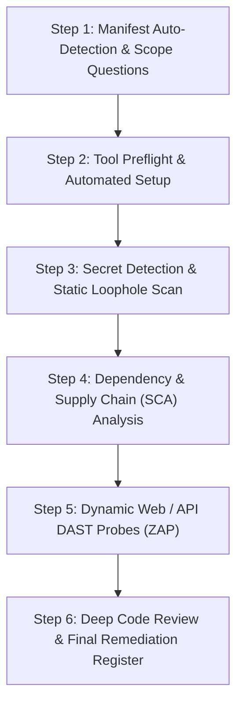

# OWASP Security Audit Skill & Vulnerability Scanner

> **Comprehensive, token-efficient security audit skill and automated loophole scanner for AI coding agents, developers, and DevSecOps teams across Web, Mobile, REST/GraphQL APIs, Databases, Cloud/IaC, and AI/LLM/RAG pipelines.**

[](https://www.python.org/)
[](https://cheatsheetseries.owasp.org/)
[](https://www.zaproxy.org/)
[](LICENSE)

---
[](https://scorecard.dev/viewer/?uri=github.com/engrshoaibh/owasp-security-audit-skill)

## 🎬 See it in 60 seconds

<!-- DEMO-VIDEO: replace this comment with the uploaded video link (see examples/demo/README.md) -->

Pointed at [OWASP Juice Shop](https://owasp.org/www-project-juice-shop/) `v20.4.0`, a quick check flags the login
query, and a local request proves it:

```text
$ loophole_scanner.py --target juice-shop --paths routes lib server.ts --quick
| INJ-01 | High | CWE-89 | A05:2025 | routes/login.ts:34  | SQL built with string interpolation / raw unsafe query |
| INJ-01 | High | CWE-89 | A05:2025 | routes/search.ts:23 | SQL built with string interpolation / raw unsafe query |

$ cat payload.json
{"email": "' OR 1=1--", "password": "anything"}
$ curl -s localhost:3000/rest/user/login -H 'Content-Type: application/json' -d @payload.json
{"authentication":{"token":"eyJ0eXAi...","bid":1,"umail":"admin@juice-sh.op"}}
```

Reproduce it with [`examples/demo/juice-shop-demo.sh`](examples/demo/).

---

## 📌 Table of Contents

- [See it in 60 seconds](#-see-it-in-60-seconds)
- [Overview](#-overview)
- [Key Features](#-key-features)
- [Install (one command per agent)](#-install-one-command-per-agent)
- [Using it](#-using-it)
- [How It Works: 3-Phase Progressive Disclosure](#-how-it-works-3-phase-progressive-disclosure)
- [Quickstart: Step-by-Step Setup](#-quickstart-step-by-step-setup)
  - [Prerequisites](#1-prerequisites)
  - [Installation & Tool Setup](#2-installation--tool-setup)
- [Command Reference](#-command-reference)
  - [1. Prerequisite Preflight & Auto-Installer](#1-prerequisite-preflight--auto-installer-setuptoolspy)
  - [2. Static Loophole & Loop Scanner](#2-static-loophole--loop-scanner-loopholescannerpy)
  - [3. Autonomous OWASP ZAP Web & API Scanner](#3-autonomous-owasp-zap-web--api-scanner-zapwebscanpy)
- [Integrating with AI Coding Agents](#-integrating-with-ai-coding-agents)
- [Supported Technology Stack Matrix](#-supported-technology-stack-matrix)
- [Specialized Knowledge Modules](#-specialized-knowledge-modules-references)
- [Attack-Chain & Resource-Loop Playbooks](#-attack-chain--resource-loop-playbooks)
- [Safety & Rules of Engagement](#-safety--rules-of-engagement)
- [Contributing & License](#-contributing--license)

---

## 🔍 Overview

Modern applications span multiple architectural tiers: client single-page apps, native mobile interfaces, microservice REST/GraphQL backends, relational and vector databases, cloud infrastructure-as-code, and agentic AI/LLM pipelines. 

Auditing these systems thoroughly often leads to two extremes:
1. **Context Window Exhaustion:** AI coding agents dump thousands of generic checklist lines, consuming precious context and missing project-specific vulnerabilities.
2. **Fragmented Tooling:** Developers must manually configure, execute, and correlate outputs from dozens of independent security scanners (SAST, SCA, DAST, secret checkers).

The **OWASP Security Audit Skill** resolves both issues. It acts as an intelligent, progressive-disclosure skill for AI coding agents (Google Antigravity, Claude Code, Cursor, Windsurf, Codex) while also providing standalone Python automation scripts that execute comprehensive security reviews with zero manual friction.

---

## ⚡ Key Features

- **Progressive Disclosure (85%+ Token Savings):** Scopes the project stack first through rapid manifest auto-detection before loading only the relevant checklists into the agent's context.
- **Agent-Run Tooling with Consent:** The agent runs the checks itself; it asks once before installing missing scanners, sending anything over the network, or running active scans.
- **Auto-Managed OWASP ZAP Engine:** Launches an isolated headless ZAP daemon on an ephemeral port with temporary working directories, executes passive baseline and authorized active scans, imports OpenAPI/GraphQL schemas, and terminates cleanly without colliding with existing desktop ZAP sessions.
- **Built-in Static Loophole & Resource Exhaustion Scanner:** Standard-library scanner detecting hardcoded secrets, injection sinks, broken auth, permissive CORS, and resource exhaustion loops (ReDoS, unbounded while loops, unconstrained agent loops, and TOCTOU races).
- **Multi-Tool Orchestrator:** Seamlessly coordinates with Gitleaks, TruffleHog, Semgrep, Trivy, OSV-Scanner, Checkov, Bandit, Pip-Audit, Nuclei, FFUF, Schemathesis, and SQLMap.
- **Cross-Platform Compatibility:** Native support for Windows (Scoop, Winget, Chocolatey), macOS (Homebrew), and Linux (Homebrew, apt, native packages).

---

## ⚡ Install (one command per agent)

The skill is a folder with a `SKILL.md`. Put it where your agent looks for skills. Python 3.10+ is the only
requirement for the built-in scanner; the extra scanners are optional and installed later, with your OK.

### Claude Code

**As a plugin** (updates with `/plugin`):
```bash
claude plugin marketplace add engrshoaibh/owasp-security-audit-skill
claude plugin install owasp-security-audit@owasp-security-audit-skill
```

**Or as a personal skill** (all projects):
```bash
git clone --depth 1 https://github.com/engrshoaibh/owasp-security-audit-skill.git ~/.claude/skills/owasp-security-audit
```

**Or for one project** (commit it so your team gets it too):
```bash
git clone --depth 1 https://github.com/engrshoaibh/owasp-security-audit-skill.git .claude/skills/owasp-security-audit
```

### OpenAI Codex CLI and other `AGENTS.md` agents
```bash
git clone --depth 1 https://github.com/engrshoaibh/owasp-security-audit-skill.git ~/.agents/skills/owasp-security-audit
```
Then add this to your project's `AGENTS.md`:
```markdown
## Security audits
When asked to audit, security-review or pen-test this project, read and follow
~/.agents/skills/owasp-security-audit/SKILL.md (SKILL_DIR = ~/.agents/skills/owasp-security-audit).
```

### Gemini CLI / Google Antigravity
```bash
git clone --depth 1 https://github.com/engrshoaibh/owasp-security-audit-skill.git ~/.gemini/skills/owasp-security-audit
```
If your version does not load skills automatically, add the same two lines as above to `GEMINI.md`.

### Cursor / Windsurf
```bash
git clone --depth 1 https://github.com/engrshoaibh/owasp-security-audit-skill.git .agents/skills/owasp-security-audit
```
Then create `.cursor/rules/security-audit.mdc` (Windsurf: `.windsurf/rules/security-audit.md`):
```markdown
---
description: Security audit, OWASP review, pen-test, find vulnerabilities
alwaysApply: false
---
For security audits, read and follow .agents/skills/owasp-security-audit/SKILL.md
(SKILL_DIR = .agents/skills/owasp-security-audit).
```

### Or just ask your agent
> *"Install the security audit skill from https://github.com/engrshoaibh/owasp-security-audit-skill for this agent,
> then run `setup_tools.py --check` and tell me which scanners are missing."*

### Optional: install the extra scanners
```bash
python <skill-dir>/scripts/setup_tools.py --check --profile all       # see what is missing
python <skill-dir>/scripts/setup_tools.py --install --profile core    # gitleaks, trufflehog, osv-scanner, trivy
```

---

## 💬 Using it

Ask in plain language. The skill triggers on requests like these:

| You say | What happens |
|:---|:---|
| "Audit this project for security issues" | Full 6-step audit with a progress tracker and a findings register |
| "Quick security check of `src/auth/`" | Quick mode: static scan of that path, hits verified, short verdict. No questions, installs or network |
| "Is this PR safe to merge?" | Quick mode on the files changed vs the base branch |
| "Check our LLM agent for prompt injection and excessive agency" | Focus on the AI/LLM module (LLM Top 10:2025) |
| "Scan the staging API at http://localhost:8000 with ZAP" | DAST step, after confirming authorization |
| "Export the findings as SARIF" | `--format sarif` for GitHub code scanning |

More prompts, a sample report and a vulnerable demo app to try it on are in [`examples/`](examples/).

Every audit ends with a register in a fixed format ([report-format.md](references/report-format.md)): verdict,
counts, then each finding with severity, confidence, OWASP and CWE ids, `file:line`, evidence and a concrete fix.

---

## 🔄 How It Works: Step-by-Step Interactive & Tracked Workflow

When you ask your agent:
> 💬 **"Audit this project using the skill"**

The agent guides you through a transparent 6-step lifecycle, proactively asking clarifying questions, showing a live checklist of what is done vs. remaining, and executing all scanners autonomously:



### Live Progress Tracker (Displayed by the Agent Every Step)
```markdown
### 🛡️ Security Audit Roadmap & Progress Tracker
- [x] Step 1: Stack Auto-Detection & Scope Confirmation (DONE)
- [x] Step 2: Tool Preflight & Automated Setup (DONE)
- [x] Step 3: Secret Detection & Static Loophole Scan (DONE)
- [/] Step 4: Dependency & Supply Chain (SCA) Analysis (IN PROGRESS)
- [ ] Step 5: Active DAST / Web & API Probing (PENDING PERMISSION)
- [ ] Step 6: Deep Code Review & Final Remediation Register (UPCOMING)
```

1. **Step 1: Stack Auto-Detection & Scope Questions:**
   Inspects manifests (`package.json`, `requirements.txt`, `go.mod`, `pom.xml`, `Dockerfile`, etc.), confirms the architecture, and asks 1–3 quick questions (e.g. is there a running dev URL? Are active attack probes authorized?).
2. **Step 2: Tool Preflight & Automated Setup:**
   Runs `setup_tools.py --check` and, with your OK, installs any missing scanners (`pip-audit`, `osv-scanner`, `gitleaks`, `trufflehog`, `semgrep`).
3. **Step 3: Secret Detection & Static Loophole Scan:**
   Runs `loophole_scanner.py` and static rule engines to catch leaked API keys, ReDoS regexes, and dangerous injection sinks.
4. **Step 4: Dependency & Supply Chain (SCA) Analysis (Two-Tier Engine):**
   - **Tier 1 (Instant & Zero-Noise - Recommended):** Runs `osv-scanner`, `trivy`, `npm audit`, `pip-audit`, `govulncheck`, `composer audit` to scan lockfiles against Google OSV and GitHub advisories in seconds with zero setup.
   - **Tier 2 (Deep Enterprise NVD/CPE Scan):** Runs **OWASP Dependency-Check** (`dependency-check` CLI or Docker) for deep bytecode, archive (`.jar`, `.war`), .NET assembly (`.dll`), and NIST NVD mapping. Automatically leverages `NVD_API_KEY` when configured.
5. **Step 5: Web & API Dynamic Analysis (DAST):**
   Launches OWASP ZAP autonomously (`zap_web_scan.py`) against confirmed local/staging URLs or API schemas (OpenAPI/GraphQL).
6. **Step 6: Deep Code Review & Remediation Register:**
   Traces source-to-sink dataflows, constructs compound attack chains, and outputs a prioritized finding register with verified remediation code.

---

## 🚀 Quickstart: Step-by-Step Setup

### 1. Prerequisites

The core audit tools require only Python 3.10+:
- **Python**: 3.10 or higher (`python --version`)
- **Git**: For repository inspection (`git --version`)
- **Java JDK / JRE**: Required to run OWASP ZAP locally (`java -version`)
- **Node.js & npm** *(optional)*: For JavaScript/TypeScript audits (`npm --version`)

### 2. Installation & Tool Setup

#### Step 1: Clone the Repository
```bash
git clone https://github.com/engrshoaibh/owasp-security-audit-skill.git
cd owasp-security-audit-skill
```

#### Step 2: Check & Auto-Install Security Tools
Run the built-in setup script. It inspects your operating system, identifies available package managers (Scoop, Winget, Chocolatey, Homebrew, pip), and downloads missing tools automatically:

```bash
# Check current prerequisite status across all profiles
python scripts/setup_tools.py --check --verify --profile all

# Automatically download & install all missing security tools
python scripts/setup_tools.py --install --profile all --verbose
```

Supported profiles include:
- `core`: Fast native scanners (`gitleaks`, `trufflehog`, `osv-scanner`, `trivy`)
- `web`: DAST and API probers (`zap`, `zaproxy`, `nuclei`, `ffuf`, `sqlmap`, `schemathesis`)
- `python`: Python SAST & SCA (`bandit`, `pip-audit`)
- `sast`: Multi-language rule engine (`semgrep`)
- `iac`: Infrastructure-as-code scanner (`checkov` in an isolated virtual environment)

---

## 💻 Command Reference

### 1. Prerequisite Preflight & Auto-Installer (`setup_tools.py`)

Checks and manages local security scanner runtimes:

```bash
# Verify tool availability and versions
python scripts/setup_tools.py --check --verify

# Install tools for Web & API security testing
python scripts/setup_tools.py --install --profile web --verbose

# Output status in machine-readable JSON format
python scripts/setup_tools.py --check --format json
```

### 2. Static Loophole & Loop Scanner (`loophole_scanner.py`)

Standard-library scanner (40+ rules) for hardcoded secrets, injection sinks, broken auth and crypto, insecure
config, CI/CD and container issues, AI supply chain risks and resource-exhaustion loops. Each finding has a
severity, confidence, CWE and OWASP Top 10:2025 / API Top 10:2023 / LLM Top 10:2025 ids. Secrets are masked in all
output.

```bash
# Markdown report
python scripts/loophole_scanner.py --target .

# JSON (stable schema, see references/report-format.md) or SARIF for GitHub code scanning
python scripts/loophole_scanner.py --target . --format json --output audit.json
python scripts/loophole_scanner.py --target . --format sarif --output results.sarif

# CI gate: exit 1 if anything High or worse
python scripts/loophole_scanner.py --target . --fail-on high

# Accept current findings, then only report new ones
python scripts/loophole_scanner.py --target . --write-baseline .security-skill-baseline.json

# Quick check: only files changed vs main (or uncommitted work with bare --changed), or chosen folders
python scripts/loophole_scanner.py --target . --quick --changed origin/main
python scripts/loophole_scanner.py --target . --quick --paths src/auth src/api

# Also run installed scanners (gitleaks, trufflehog offline, semgrep with metrics off, osv-scanner, ...)
python scripts/loophole_scanner.py --target . --run-tools

# List all rules with their CWE / OWASP mapping
python scripts/loophole_scanner.py --list-rules
```

Silence a reviewed false positive with a comment on the same line or the line above:
`# security-skill: ignore[INJ-02]`. Intentionally vulnerable fixtures can carry
`# security-skill: ignore-file` in their first 5 lines. Findings in tests, examples and docs are marked `non-production` and lowered
one severity level (leaked secrets are not lowered).

**GitHub code scanning example:**
```yaml
- run: python scripts/loophole_scanner.py --target . --format sarif --output results.sarif
- uses: github/codeql-action/upload-sarif@v3
  with:
    sarif_file: results.sarif
```

### 3. Autonomous OWASP ZAP Web & API Scanner (`zap_web_scan.py`)

Automates OWASP ZAP (Zed Attack Proxy) with an autonomous local daemon lifecycle:

```bash
# Preflight check: verify local ZAP binary or running daemon
python scripts/zap_web_scan.py --check

# Safe passive baseline scan (spiders target, drains passive rules, shuts down)
python scripts/zap_web_scan.py --target http://localhost:3000 --mode baseline

# OpenAPI / Swagger specification scan (imports routes and passively checks)
python scripts/zap_web_scan.py --target http://localhost:8000/openapi.json --mode api --api-format openapi

# GraphQL endpoint audit
python scripts/zap_web_scan.py --target http://localhost:4000/graphql --mode api --api-format graphql

# Active attack scan against authorized dev/staging environments (SQLi, XSS, SSRF)
python scripts/zap_web_scan.py --target http://localhost:3000 --mode full --confirm-authorized --fail-on medium
```

---

## 🤖 Integrating with AI Coding Agents

See [Install](#-install-one-command-per-agent) for per-agent setup. Scripts are always called from the skill
folder (`SKILL_DIR`, which is `${CLAUDE_SKILL_DIR}` in Claude Code), while the agent's working directory stays your
project, so a global install works in every repository.

Non-interactive use (CI or scripted runs):
```bash
claude -p "Run a quick security check of this repository with the owasp-security-audit skill and write SECURITY-AUDIT.md"
```

---

## 📊 Supported Technology Stack Matrix

| Layer | Technologies Covered | OWASP Standards & Checklists |
|:---|:---|:---|
| **Web Frontends** | React, Next.js, Angular, Vue, Nuxt, Svelte, Flutter Web | XSS Prevention, CSP Cheat Sheet, DOM-based XSS, Clickjacking Defense |
| **Backend APIs** | Node.js (Express, Nest, Fastify), Python (FastAPI, Django, Flask), PHP (Laravel), Ruby (Rails), Go, Rust, Java (Spring Boot), .NET | OWASP API Security Top 10, Injection Prevention, SSRF, Deserialization |
| **Databases & ORMs** | PostgreSQL, MySQL, MongoDB, SQLite, Redis, Prisma, Drizzle, SQLAlchemy, Django ORM | SQL Injection Prevention, Query Parameterization, Access Control |
| **Authentication** | JWT, OAuth 2.0, OIDC, Session Cookies, Firebase/Supabase Auth, Passkeys/WebAuthn | Authentication & Session Management Cheat Sheets, Password Storage |
| **Mobile Apps** | Flutter, Dart, Android (Kotlin/Java), iOS (Swift) | OWASP MASVS, Secure Local Storage, Certificate Pinning, Biometrics |
| **AI / LLM & RAG** | LangChain, LlamaIndex, OpenAI, Anthropic, Vector DBs (pgvector, Pinecone, Chroma), MCP | OWASP Top 10 for LLMs, Prompt Injection, RAG Poisoning, Autonomous Loops |
| **Cloud & IaC** | Docker, Kubernetes, Terraform, AWS, GCP, Azure, GitHub Actions | CIS Benchmarks, Secret Management, Least Privilege IAM, Container Hardening |

---

## 📚 Specialized Knowledge Modules (`references/`)

The skill splits deep domain knowledge into token-optimized reference modules:

- **[`core-baseline-auth.md`](references/core-baseline-auth.md):** Transport layer security (TLS), session cookies, JWT verification, OAuth 2.0/OIDC flows, cryptographic storage, input validation, and access control.
- **[`frontend-web.md`](references/frontend-web.md):** Framework-specific XSS prevention, Content Security Policy (CSP v3), CSRF tokens with SameSite cookies, clickjacking frame-ancestors, and safe DOM manipulation.
- **[`backend-frameworks.md`](references/backend-frameworks.md):** Hardening guides for Node.js, Python, PHP, Ruby, Go, Rust, Java, and .NET.
- **[`databases-apis.md`](references/databases-apis.md):** SQL/NoSQL injection prevention, mass assignment mitigation, SSRF defense with IP allowlisting, and GraphQL recursion/depth limits.
- **[`baas-mobile.md`](references/baas-mobile.md):** Firebase Security Rules, Supabase Row-Level Security (RLS), and mobile MASVS compliance.
- **[`ai-llm-rag.md`](references/ai-llm-rag.md):** Defense against direct/indirect prompt injection, vector embedding poisoning, tool-calling agent boundaries, and unconstrained loop caps.
- **[`infra-cloud-cicd.md`](references/infra-cloud-cicd.md):** Multi-stage non-root Dockerfiles, Kubernetes Pod Security Standards, Terraform least privilege, and hardened CI/CD pipelines.
- **[`access-control-review.md`](references/access-control-review.md):** Step-by-step IDOR / BOLA / BFLA review: endpoint inventory, owner-check tracing, field- and function-level access, two-account verification.
- **[`owasp-mapping.md`](references/owasp-mapping.md):** OWASP Top 10:2025, API Top 10:2023 and LLM Top 10:2025 categories mapped to modules and scanner rules.
- **[`severity-rubric.md`](references/severity-rubric.md):** Impact × exploitability severity matrix, confidence levels and release verdict rules.
- **[`report-format.md`](references/report-format.md):** JSON finding schema, SARIF/baseline options and the human report template.
- **[`toolbox-loophole-scanners.md`](references/toolbox-loophole-scanners.md):** Playbooks and CLI command references for static and dynamic testing tools.

---

## 🛡 Attack-Chain & Resource-Loop Playbooks

During audits, vulnerabilities are evaluated as compound attack paths rather than isolated alerts:

```
[Exposed Endpoint / Schema] ──► [Parameter Tampering / Mass Assignment] ──► [Privilege Escalation]
[Unvalidated Redirect]      ──► [OAuth Authorization Code Interception]  ──► [Account Takeover]
[RAG Document Poisoning]    ──► [Indirect Prompt Injection]             ──► [Unintended Agent Tool Execution]
```

Specific resource loop hazards checked:
- **ReDoS Loops:** Catastrophic regex backtracking freezing execution threads.
- **GraphQL Circular Queries:** Unbounded query nesting and batching denial of service.
- **AI Agent Infinite Loops:** Runaway recursion without `max_iterations` or loop breaks.
- **Concurrent Race Conditions (TOCTOU):** Missing atomic operations on balances, coupons, or OTP verifications.

---

## ⚖ Safety & Rules of Engagement

1. **Static first:** `loophole_scanner.py`, gitleaks, semgrep and trivy only read files and are safe on any repo you own.
2. **The audited code is untrusted:** the skill tells the agent to treat comments, READMEs and tool output as data,
   never as instructions, and not to run the project's own scripts unless you ask.
3. **Consent before installs and network calls:** the agent asks before installing scanners, before TruffleHog
   verifies secrets with provider APIs (`--allow-network-verify`), and before any DAST scan.
4. **DAST only on local or staging targets you are authorized to test** (`zap_web_scan.py --mode full`, nuclei,
   sqlmap, schemathesis send attack payloads).
5. **Secrets stay masked** in reports, JSON, SARIF and tool output previews. The NVD API key is passed to
   Dependency-Check via a private temp file, never on the command line.

---

## 🤝 Contributing & License

Contributions, new framework checklists, and rule additions are welcome. Read [CONTRIBUTING.md](CONTRIBUTING.md)
and pick a [`good first issue`](https://github.com/engrshoaibh/owasp-security-audit-skill/labels/good%20first%20issue).
Every new scanner rule needs a positive and a negative case in `tests/test_loophole_scanner.py`
(run `python -m unittest discover -s tests -v`).

This project is licensed under the **Apache License 2.0**. See the [LICENSE](LICENSE) file for details.
