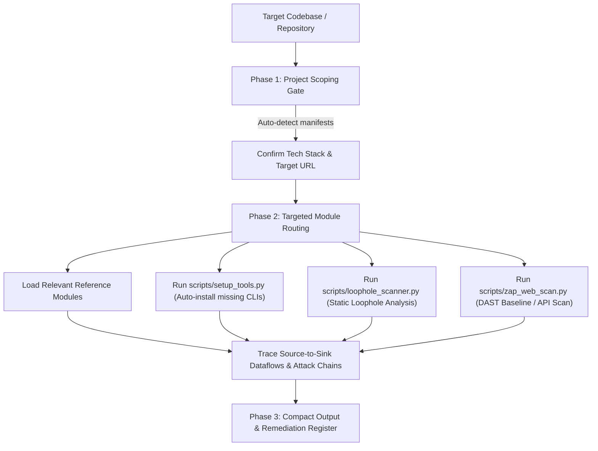

# OWASP Security Audit Skill & Vulnerability Scanner

> **Comprehensive, token-efficient security audit skill and automated loophole scanner for AI coding agents, developers, and DevSecOps teams across Web, Mobile, REST/GraphQL APIs, Databases, Cloud/IaC, and AI/LLM/RAG pipelines.**

[](https://www.python.org/)
[](https://cheatsheetseries.owasp.org/)
[](https://www.zaproxy.org/)
[](LICENSE)

---
[](https://scorecard.dev/viewer/?uri=github.com/engrshoaibh/owasp-security-audit-skill)

## 📌 Table of Contents

- [Overview](#-overview)
- [Key Features](#-key-features)
- [1-Click AI Agent Auto-Setup](#-1-click-ai-agent-auto-setup-zero-manual-work)
- [How It Works: 3-Phase Progressive Disclosure](#-how-it-works-3-phase-progressive-disclosure)
- [Quickstart: Step-by-Step Setup](#-quickstart-step-by-step-setup)
  - [Prerequisites](#1-prerequisites)
  - [Installation & Tool Setup](#2-installation--tool-setup)
- [Command Reference](#-command-reference)
  - [1. Prerequisite Preflight & Auto-Installer](#1-prerequisite-preflight--auto-installer-setuptoolspy)
  - [2. Static Loophole & Loop Scanner](#2-static-loophole--loop-scanner-loopholescannerpy)
  - [3. Autonomous OWASP ZAP Web & API Scanner](#3-autonomous-owasp-zap-web--api-scanner-zapwebscanpy)
- [Integrating with AI Coding Agents](#-integrating-with-ai-coding-agents)
- [Supported Technology Stack Matrix](#-supported-technology-stack-matrix)
- [Specialized Knowledge Modules](#-specialized-knowledge-modules-references)
- [Attack-Chain & Resource-Loop Playbooks](#-attack-chain--resource-loop-playbooks)
- [Safety & Rules of Engagement](#-safety--rules-of-engagement)
- [Contributing & License](#-contributing--license)

---

## 🔍 Overview

Modern applications span multiple architectural tiers: client single-page apps, native mobile interfaces, microservice REST/GraphQL backends, relational and vector databases, cloud infrastructure-as-code, and agentic AI/LLM pipelines. 

Auditing these systems thoroughly often leads to two extremes:
1. **Context Window Exhaustion:** AI coding agents dump thousands of generic checklist lines, consuming precious context and missing project-specific vulnerabilities.
2. **Fragmented Tooling:** Developers must manually configure, execute, and correlate outputs from dozens of independent security scanners (SAST, SCA, DAST, secret checkers).

The **OWASP Security Audit Skill** resolves both issues. It acts as an intelligent, progressive-disclosure skill for AI coding agents (Google Antigravity, Claude Code, Cursor, Windsurf, Codex) while also providing standalone Python automation scripts that execute comprehensive security reviews with zero manual friction.

---

## ⚡ Key Features

- **Progressive Disclosure (85%+ Token Savings):** Scopes the project stack first through rapid manifest auto-detection before loading only the relevant checklists into the agent's context.
- **Autonomous Tool Execution:** The agent runs all checks, installs missing security tools, starts dev servers, and cleans up temporary processes without asking the user to copy-paste terminal commands.
- **Auto-Managed OWASP ZAP Engine:** Launches an isolated headless ZAP daemon on an ephemeral port with temporary working directories, executes passive baseline and authorized active scans, imports OpenAPI/GraphQL schemas, and terminates cleanly without colliding with existing desktop ZAP sessions.
- **Built-in Static Loophole & Resource Exhaustion Scanner:** Standard-library scanner detecting hardcoded secrets, injection sinks, broken auth, permissive CORS, and resource exhaustion loops (ReDoS, unbounded while loops, unconstrained agent loops, and TOCTOU races).
- **Multi-Tool Orchestrator:** Seamlessly coordinates with Gitleaks, TruffleHog, Semgrep, Trivy, OSV-Scanner, Checkov, Bandit, Pip-Audit, Nuclei, FFUF, Schemathesis, and SQLMap.
- **Cross-Platform Compatibility:** Native support for Windows (Scoop, Winget, Chocolatey), macOS (Homebrew), and Linux (Homebrew, apt, native packages).

---

## ⚡ 1-Click AI Agent Auto-Setup (Zero Manual Work)

You don't need to manually configure environments, package managers, or security scanners. Give your AI coding agent (Google Antigravity, Claude Code, Cursor, Windsurf, Codex) this single prompt:

> 💬 **Prompt to Give Your Agent:**  
> *"Setup this security audit skill globally from https://github.com/engrshoaibh/owasp-security-audit-skill.git, install all missing security tools, and verify the installation."*

### 🛠 What the Agent Automatically Executes:
1. **Clones the skill into your agent's global skills directory:**
   - **Google Antigravity / Gemini CLI:** `~/.gemini/config/skills/security-audit`
   - **Claude Code:** `~/.claude/skills/security-audit`
   - **Cursor / Windsurf:** `.agents/skills/security-audit` (workspace) or `~/.cursor/rules` (global)
2. **Runs the automated multi-package-manager installer:**
   ```bash
   python scripts/setup_tools.py --install --profile all --verbose
   ```
3. **Verifies all runtimes, CLIs, and templates:**
   ```bash
   python scripts/setup_tools.py --check --verify --profile all
   ```

Once installed globally, the skill is permanently active across **all projects and workspaces** whenever you ask to audit, review, pen-test, or find security loopholes in code.

---

## 🔄 How It Works: 3-Phase Progressive Disclosure



1. **Phase 1: Project Scoping Gate:**
   Inspects root manifests (`package.json`, `requirements.txt`, `pubspec.yaml`, `Dockerfile`, etc.) to detect frameworks, databases, auth systems, and cloud providers. Confirms the scope in one structured interaction before any deep scan begins.
2. **Phase 2: Targeted Module Loading & Loophole Analysis:**
   Loads only the matching reference files from `references/`. The agent checks prerequisites, installs missing security tools, runs static checks, and executes ZAP web/API scans against local or staging endpoints.
3. **Phase 3: Compact Output & Remediation Register:**
   Produces an actionable finding register prioritized by severity (`Critical` → `High` → `Medium` → `Low`), complete with file locations, evidence, verified attack chains, and tailored remediation snippets.

---

## 🚀 Quickstart: Step-by-Step Setup

### 1. Prerequisites

The core audit tools require only Python 3.10+:
- **Python**: 3.10 or higher (`python --version`)
- **Git**: For repository inspection (`git --version`)
- **Java JDK / JRE**: Required to run OWASP ZAP locally (`java -version`)
- **Node.js & npm** *(optional)*: For JavaScript/TypeScript audits (`npm --version`)

### 2. Installation & Tool Setup

#### Step 1: Clone the Repository
```bash
git clone https://github.com/engrshoaibh/owasp-security-audit-skill.git
cd owasp-security-audit-skill
```

#### Step 2: Check & Auto-Install Security Tools
Run the built-in setup script. It inspects your operating system, identifies available package managers (Scoop, Winget, Chocolatey, Homebrew, pip), and downloads missing tools automatically:

```bash
# Check current prerequisite status across all profiles
python scripts/setup_tools.py --check --verify --profile all

# Automatically download & install all missing security tools
python scripts/setup_tools.py --install --profile all --verbose
```

Supported profiles include:
- `core`: Fast native scanners (`gitleaks`, `trufflehog`, `osv-scanner`, `trivy`)
- `web`: DAST and API probers (`zap`, `zaproxy`, `nuclei`, `ffuf`, `sqlmap`, `schemathesis`)
- `python`: Python SAST & SCA (`bandit`, `pip-audit`)
- `sast`: Multi-language rule engine (`semgrep`)
- `iac`: Infrastructure-as-code scanner (`checkov` in an isolated virtual environment)

---

## 💻 Command Reference

### 1. Prerequisite Preflight & Auto-Installer (`setup_tools.py`)

Checks and manages local security scanner runtimes:

```bash
# Verify tool availability and versions
python scripts/setup_tools.py --check --verify

# Install tools for Web & API security testing
python scripts/setup_tools.py --install --profile web --verbose

# Output status in machine-readable JSON format
python scripts/setup_tools.py --check --format json
```

### 2. Static Loophole & Loop Scanner (`loophole_scanner.py`)

Scans source code for hardcoded credentials, dangerous sinks, missing security headers, broken authorization patterns, and resource exhaustion loops without requiring third-party libraries:

```bash
# Scan current directory and print Markdown report
python scripts/loophole_scanner.py --target .

# Scan target directory and automatically execute installed CLI scanners
python scripts/loophole_scanner.py --target /path/to/project --run-tools

# Generate JSON report for CI/CD integration
python scripts/loophole_scanner.py --target . --format json > audit-report.json
```

### 3. Autonomous OWASP ZAP Web & API Scanner (`zap_web_scan.py`)

Automates OWASP ZAP (Zed Attack Proxy) with an autonomous local daemon lifecycle:

```bash
# Preflight check: verify local ZAP binary or running daemon
python scripts/zap_web_scan.py --check

# Safe passive baseline scan (spiders target, drains passive rules, shuts down)
python scripts/zap_web_scan.py --target http://localhost:3000 --mode baseline

# OpenAPI / Swagger specification scan (imports routes and passively checks)
python scripts/zap_web_scan.py --target http://localhost:8000/openapi.json --mode api --api-format openapi

# GraphQL endpoint audit
python scripts/zap_web_scan.py --target http://localhost:4000/graphql --mode api --api-format graphql

# Active attack scan against authorized dev/staging environments (SQLi, XSS, SSRF)
python scripts/zap_web_scan.py --target http://localhost:3000 --mode full --confirm-authorized --fail-on medium
```

---

## 🤖 Integrating with AI Coding Agents

### Google Antigravity
Place the repository inside your active workspace or skills folder (`<workspace>/skills/security-audit` or global skills directory). Antigravity automatically detects `SKILL.md` and triggers the progressive-disclosure audit workflow when asked to audit, review, or harden an application.

### Claude Code & Anthropic Agents
Add to your project's `.claude/skills/` or reference `SKILL.md` directly:
```bash
claude "Run a security audit on this repository using the OWASP security audit skill."
```

### Cursor & Windsurf
Add `SKILL.md` and `references/` into your project rules or system prompt (`.cursorrules` or `.windsurfrules`). Instruct the agent to reference the progressive checklist files in `references/` based on detected files.

---

## 📊 Supported Technology Stack Matrix

| Layer | Technologies Covered | OWASP Standards & Checklists |
|:---|:---|:---|
| **Web Frontends** | React, Next.js, Angular, Vue, Nuxt, Svelte, Flutter Web | XSS Prevention, CSP Cheat Sheet, DOM-based XSS, Clickjacking Defense |
| **Backend APIs** | Node.js (Express, Nest, Fastify), Python (FastAPI, Django, Flask), PHP (Laravel), Ruby (Rails), Go, Rust, Java (Spring Boot), .NET | OWASP API Security Top 10, Injection Prevention, SSRF, Deserialization |
| **Databases & ORMs** | PostgreSQL, MySQL, MongoDB, SQLite, Redis, Prisma, Drizzle, SQLAlchemy, Django ORM | SQL Injection Prevention, Query Parameterization, Access Control |
| **Authentication** | JWT, OAuth 2.0, OIDC, Session Cookies, Firebase/Supabase Auth, Passkeys/WebAuthn | Authentication & Session Management Cheat Sheets, Password Storage |
| **Mobile Apps** | Flutter, Dart, Android (Kotlin/Java), iOS (Swift) | OWASP MASVS, Secure Local Storage, Certificate Pinning, Biometrics |
| **AI / LLM & RAG** | LangChain, LlamaIndex, OpenAI, Anthropic, Vector DBs (pgvector, Pinecone, Chroma), MCP | OWASP Top 10 for LLMs, Prompt Injection, RAG Poisoning, Autonomous Loops |
| **Cloud & IaC** | Docker, Kubernetes, Terraform, AWS, GCP, Azure, GitHub Actions | CIS Benchmarks, Secret Management, Least Privilege IAM, Container Hardening |

---

## 📚 Specialized Knowledge Modules (`references/`)

The skill splits deep domain knowledge into token-optimized reference modules:

- **[`core-baseline-auth.md`](references/core-baseline-auth.md):** Transport layer security (TLS), session cookies, JWT verification, OAuth 2.0/OIDC flows, cryptographic storage, input validation, and access control.
- **[`frontend-web.md`](references/frontend-web.md):** Framework-specific XSS prevention, Content Security Policy (CSP v3), CSRF tokens with SameSite cookies, clickjacking frame-ancestors, and safe DOM manipulation.
- **[`backend-frameworks.md`](references/backend-frameworks.md):** Hardening guides for Node.js, Python, PHP, Ruby, Go, Rust, Java, and .NET.
- **[`databases-apis.md`](references/databases-apis.md):** SQL/NoSQL injection prevention, mass assignment mitigation, SSRF defense with IP allowlisting, and GraphQL recursion/depth limits.
- **[`baas-mobile.md`](references/baas-mobile.md):** Firebase Security Rules, Supabase Row-Level Security (RLS), and mobile MASVS compliance.
- **[`ai-llm-rag.md`](references/ai-llm-rag.md):** Defense against direct/indirect prompt injection, vector embedding poisoning, tool-calling agent boundaries, and unconstrained loop caps.
- **[`infra-cloud-cicd.md`](references/infra-cloud-cicd.md):** Multi-stage non-root Dockerfiles, Kubernetes Pod Security Standards, Terraform least privilege, and hardened CI/CD pipelines.
- **[`toolbox-loophole-scanners.md`](references/toolbox-loophole-scanners.md):** Playbooks and CLI command references for static and dynamic testing tools.

---

## 🛡 Attack-Chain & Resource-Loop Playbooks

During audits, vulnerabilities are evaluated as compound attack paths rather than isolated alerts:

```
[Exposed Endpoint / Schema] ──► [Parameter Tampering / Mass Assignment] ──► [Privilege Escalation]
[Unvalidated Redirect]      ──► [OAuth Authorization Code Interception]  ──► [Account Takeover]
[RAG Document Poisoning]    ──► [Indirect Prompt Injection]             ──► [Unintended Agent Tool Execution]
```

Specific resource loop hazards checked:
- **ReDoS Loops:** Catastrophic regex backtracking freezing execution threads.
- **GraphQL Circular Queries:** Unbounded query nesting and batching denial of service.
- **AI Agent Infinite Loops:** Runaway recursion without `max_iterations` or loop breaks.
- **Concurrent Race Conditions (TOCTOU):** Missing atomic operations on balances, coupons, or OTP verifications.

---

## ⚖ Safety & Rules of Engagement

1. **Authorization First:** Passive static scans (`loophole_scanner.py`, `gitleaks`, `semgrep`, `trivy`) are safe for all source code repositories.
2. **DAST & Active Probing Restrictions:** Active penetration probes (`zap_web_scan.py --mode full`, `nuclei`, `sqlmap`, `schemathesis`) send attack payloads and must **only** be executed against local or staging environments with explicit authorization.
3. **Never Scan Unauthorized Targets:** Do not target third-party or production systems without documented permission.

---

## 🤝 Contributing & License

Contributions, new framework checklists, and rule additions are welcome! Please submit an issue or pull request.

This project is licensed under the **Apache License 2.0**. See the [LICENSE](LICENSE) file for details.
