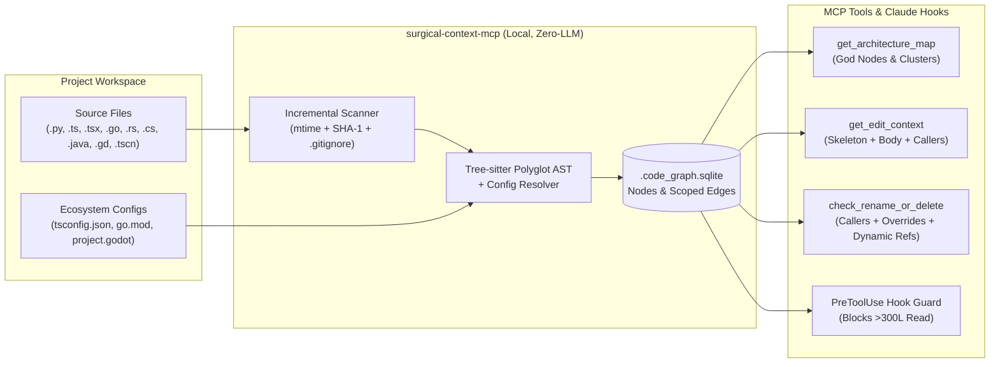

# `surgical-context-mcp` — Surgical AST Code Context & Knowledge Graph for AI Coding Agents

<!-- mcp-name: io.github.erayerturk/surgical-context-mcp -->

[](https://pypi.org/project/surgical-context-mcp/)
[](https://pepy.tech/project/surgical-context-mcp)
[](https://registry.modelcontextprotocol.io/v0/servers?search=surgical-context-mcp)
[](https://github.com/erayerturk/surgical-context-mcp/actions/workflows/ci.yml)
[](LICENSE)
[](https://www.python.org/)
[](#how-to-use-step-by-step-setup-guide)
[](https://github.com/erayerturk/surgical-context-mcp/stargazers)

> **Stop feeding 3,000-line files into your LLM context window.**
> `surgical-context-mcp` is a zero-LLM-cost, embedded SQLite + Tree-sitter Code Knowledge Graph and MCP Server that gives AI coding agents (**Claude Code, Cursor, Windsurf, Cline, Claude Desktop**) the **exact surgical context** they need to edit, refactor, and navigate codebases safely — cutting token consumption by **70–95%** without sacrificing code quality.

<p align="center">
  
  <br><sub>Real run on this repo: editing a function in a 1,264-line file costs <b>~3.7k tokens</b> instead of <b>~13.3k</b> (−72%) — and you still get the skeleton, callers and helpers.</sub>
</p>

## ⚡ Quick Start (30 seconds)

```bash
# 1. Install (or: pipx install / pip install surgical-context-mcp)
uv tool install surgical-context-mcp

# 2. Register with Claude Code
claude mcp add code-graph -- code-graph serve

# 3. Index your project + install the token-saving guard hook
code-graph install-hooks /path/to/your/project
```

That's it — your agent now calls `get_edit_context` instead of reading whole files. Using Cursor, Windsurf, Cline or Claude Desktop? See [Step 1](#step-1-register-the-mcp-server-with-your-ai-coding-tool). Also listed on the [official MCP Registry](https://registry.modelcontextprotocol.io/v0/servers?search=surgical-context-mcp) as `io.github.erayerturk/surgical-context-mcp`.

---

## Table of Contents

0. [Quick Start (30 seconds)](#-quick-start-30-seconds)
1. [Why Use `surgical-context-mcp`?](#why-use-surgical-context-mcp)
2. [How Much Does It Save & When Should You Use It?](#how-much-does-it-save--when-should-you-use-it)
3. [Supported Languages & Ecosystem Resolvers](#supported-languages--ecosystem-resolvers)
4. [How It Works (Architecture)](#how-it-works-architecture)
5. [Installation](#installation)
6. [How to Use (Step-by-Step Setup Guide)](#how-to-use-step-by-step-setup-guide)
7. [Real Output Examples](#real-output-examples)
8. [MCP Tools Reference](#mcp-tools-reference)
9. [CLI Reference](#cli-reference)
10. [Recommended `CLAUDE.md` / `.cursorrules` Configuration](#recommended-claudemd--cursorrules-configuration)

---

## Why Use `surgical-context-mcp`?

### The 3 Core Problems with AI Coding Agents Today

1. **Full-File Reads Burn Hundreds of Thousands of Tokens:**
   When you ask an AI agent (or when it spawns subagents) to fix a bug or add a feature, its default instinct is to run `Grep` and then `Read` entire 1,500–3,000 line files into the context window. Because every subsequent tool call re-sends the entire conversation history (cache reads), a single large file read early in a session compounds into **100k–300k wasted tokens**.
2. **Narrow Line-Range Reads Cause Hallucinations & Code Duplication:**
   If you force an agent to read only `lines 240–260` of a file to save tokens, the agent becomes blind to:
   - Class attributes, `self.x` fields, `@onready` / `@export` variables, constants, and `struct` / `interface` definitions at the top of the file.
   - Helper functions that already exist in the same file (causing the LLM to write duplicate code).
   - How callers actually pass arguments to the function (`±5` lines around call sites).
   - The file's coding style (indentation, typing conventions, error handling idioms).
3. **Pure Static AST Graphs Miss Dynamic Dispatch & Scene/Template Wiring:**
   Standard call graphs only see static `foo()` calls. If a function is invoked via `getattr(obj, "foo")` in Python, `call("foo")` or a `.tscn` signal connection in Godot, `SendMessage("foo")` in Unity/C#, or referenced in a `.vue`/`.html`/`.proto` file, a naive graph reports *"0 callers — safe to delete"*, breaking production code.

### How `surgical-context-mcp` Solves All Three

- **`get_edit_context(symbol)` — One Call Before Any Edit:**
  Instead of reading a 2,500-line file, the agent makes **one** MCP call (`get_edit_context`) and receives a strictly budgeted (`≤ 4,000` tokens) surgical package containing:
  1. **Target Function Full Body** (with exact line numbers for `Edit`)
  2. **File Skeleton** (all imports, `interface`/`struct`/`enum` blocks, class fields, constants — **without** other function bodies)
  3. **Used Members & Direct Callees** (definitions of class fields used by the target function + full bodies of short same-file helpers `≤ 25` lines)
  4. **Direct Callers (`d=1`, `±5` Line Windows)** (exact call-site context without dumping 200-line caller functions)
  5. **Other Function Signatures in the File** (so the agent reuses existing helpers instead of duplicating them)
  6. **Style Hints & Coverage Warnings** (flags dynamic string calls, `.tscn` connections, templates, and protocol references)
- **`check_rename_or_delete(symbol)` — One Call Before Any Refactor:**
  Checks AST callers (`exact`/`scoped`), inheritance overrides across parent/child classes, `.tscn`/template connections, signal `emit`/`connect` sites, and workspace-wide dynamic string references.
- **Cross-Language Contracts (`shares_contract`) — Server ↔ Client ↔ Config in One Call:**
  - **Protocol Opcodes (`contract::opcode::0xCC`):** Automatically links hex opcode constants across languages (e.g., Go `OpSGMOnline = 0xCC` and GDScript/TypeScript `const S_GM_ONLINE = 0xCC`), so querying either constant shows both server senders and client packet handlers together.
  - **Config & Schema Keys (`contract::config::<key>`):** Automatically links Go struct `json:"max_chars_per_ip"` field tags, frontend/panel schema strings (`'multi_guard.max_chars_per_ip'`), and `seed/*.json` config entries (`"max_chars_per_ip": 2`) into a single shared contract node.
- **Data, Seed & Translation (`i18n`) Graph (`check_translations`):**
  Indexes `seed/*.json`, `shared/maps/*.json`, `locales/*.json`, and `.po` files alongside code. Links `tr("...")` and `noticeT(..., "n.x")` calls to locale definitions and audits missing keys, accidental raw non-key literals, `%d`/`%s`/`{}` placeholder count mismatches, and unused locale keys.
- **Automated Test Discovery (`tests_for`) & Git Diff Blast Radius (`get_diff_impact`):**
  - `tests_for(symbol)` identifies every test exercising a symbol and returns the exact runnable CLI command (`go test ./pkg -run '^TestFoo$'`, `godot --headless --path client -s tests/...`, `pytest ... -k ...`).
  - `get_diff_impact(base_ref="HEAD")` parses `git diff` hunks, maps changed lines to modified AST symbols, and reports their callers, affected cross-language contracts, and runnable test commands in one call — built for code-review subagents (`final-reviewer`).
- **Concept Search & Engine Lifecycle Noise Suppression:**
  - Indexes inline/preceding comments and docstrings (`doc_comment`) so searching by concept (e.g. `"attack stat"`) finds `KOAP` (`// attack power stat bonus`).
  - Recognizes engine-invoked virtual callbacks (`_ready`, `_draw`, `_process`, `_physics_process`, `_input`, `Awake`, `Update`) and suppresses false text-match noise warnings when AST upstream is empty.
- **Direct Token Savings Telemetry (`get_token_savings`):**
  Every MCP/CLI query records its returned token count vs. the raw token size of touched files in SQLite (`usage_telemetry`), answering *"How many tokens did `code-graph` save?"* with direct measurements instead of estimates.
- **Zero LLM Indexing Cost & Sub-Second Speed:**
  Built on native C Tree-sitter grammars and embedded SQLite (`WAL` mode). Indexes **~600 files in `< 0.6` seconds** using `0` API tokens, and automatically refreshes modified files (`mtime` + `SHA-1`) on every query.
- **Enforced via Claude Code `PreToolUse` Hook:**
  Includes a built-in hook guard (`code-graph install-hooks`) that **blocks unbounded `Read` calls on files `> 300` lines** and returns the file's AST symbol table (`Lstart-end: signature`), ensuring both main agents and subagents stay on the surgical path.

---

## How Much Does It Save & When Should You Use It?

### 1. Token & Cost Economics (Single-Turn vs. Multi-Turn Compounding Savings)

In agentic coding tools (Claude Code, Cursor, Cline), **every tool call re-sends the entire conversation history** up to that point. When an agent reads a 2,500-line file (`~22,000` tokens) on Turn 2 of a 12-turn coding task, those `22,000` tokens are billed on Turn 2, Turn 3, Turn 4 ... all the way to Turn 12 (`22,000 × 10 = 220,000` cumulative context tokens).

By replacing full-file reads with `get_edit_context` (`~2,500–3,500` tokens), `surgical-context-mcp` prevents context bloat from compounding across turns.

#### Benchmark Across Common Developer Tasks
*(Measured on a 593-file multi-language repository: 2,607-line Godot client controller + Go backend + JS web dashboard)*

| Developer Scenario | Standard Agent (`Read` + `Grep`) | With `surgical-context-mcp` | Direct Token Savings | 10-Turn Compounded Savings |
| :--- | :--- | :--- | :--- | :--- |
| **1. Initial Repo Orientation** ("How is this codebase structured?") | `~18,500` tokens (multiple `ls`, `Glob`, `Read` calls) | **`~650` tokens** (`GRAPH_REPORT.md` / `get_architecture_map`) | **96% fewer tokens** | **~178,000 tokens saved** |
| **2. Modifying a Function in a Large File** (`2,607` lines) | `~22,400` tokens (reads whole target file + 1 caller file) | **`~2,900` tokens** (`get_edit_context` returns skeleton + body + callers) | **87% fewer tokens** | **~195,000 tokens saved** |
| **3. Tracing an End-to-End Request / Event Flow** (Client -> Packet -> Server Handler) | `~31,000` tokens (grepping strings and reading 4–6 files) | **`~1,200` tokens** (`find_flow` + `get_symbol_impact`) | **96% fewer tokens** | **~298,000 tokens saved** |
| **4. Safe Refactoring / Dead-Code Deletion** ("Can I delete or rename this method?") | `~14,000` tokens (grepping & reading candidate files; still misses dynamic refs) | **`~450` tokens** (`check_rename_or_delete` checks AST + overrides + `.tscn` + dynamic strings) | **97% fewer tokens** | **~135,000 tokens saved** |
| **5. Multi-Subagent Parallel Execution** (Spawning 2–3 subagents for backend/frontend) | `200,000–350,000` tokens (each subagent independently reads huge files) | **`35,000–60,000` tokens** (`PreToolUse` hook blocks >300L reads in all subagents) | **80–85% fewer tokens** | **Prevents rate-limits & context compaction** |

---

### 2. When Does `surgical-context-mcp` Provide the Biggest Gains?

#### High-Impact Scenarios (80%–97% Savings & Higher Code Accuracy)
- **Large or Monolithic Source Files (`300` to `5,000+` lines):**
  Game controllers (`main.gd`, `PlayerController.cs`), large backend services (`server.go`, `views.py`), or complex React/TypeScript modules where you only need to edit 1–2 functions without losing sight of class fields, types, and existing helpers.
- **Cross-File Refactoring & Signature Changes:**
  When changing parameters on a widely used function or method, `check_rename_or_delete` and `get_edit_context` show every caller's exact `±5` line call window without loading entire caller files into memory.
- **Event-Driven, Signal & Scene-Wired Architectures:**
  Codebases using Godot signals & `.tscn` connections, Node/JS `EventEmitter` / `bus.on`, Python `@on_event` decorators, or C# events — where standard `Grep` cannot trace execution flow from emitter to listener.
- **Polyglot & Full-Stack Monorepos:**
  Projects combining **Go + TypeScript**, **Python + React**, or **Godot + Go + JS**, where naive text search mixes up identically named methods (`connect`, `refresh`, `update`, `send`) across languages.
- **Long Coding Sessions & Subagent Workflows:**
  Keeps your main conversation window lean so Claude Code / Cursor doesn't hit the context limit or degrade in reasoning quality after 15 minutes of work.

#### When Are Savings Smaller? (Full Transparency)
- **Small Files (`< 300` lines):**
  If a file is only 150 lines long, slicing it into a skeleton + body is unnecessary overhead. `surgical-context-mcp` detects this automatically: **for files `< 300` lines, `get_edit_context` returns the full numbered file directly.**
- **Pure Test-Runner / Compiler Output Loops:**
  If a subagent spends 20 minutes running `go test ./...` or `pytest` in a loop and reading 5,000 lines of stack traces from terminal `stdout`, those tokens come from bash test output rather than source-file reads.
- **Greenfield Scaffolding (0 existing files):**
  When generating a brand-new project from scratch in an empty directory, there is no existing codebase graph to query until the first files are written.

---

## Supported Languages & Ecosystem Resolvers

`surgical-context-mcp` strictly isolates language families (so a method in JavaScript or Go never collides with a method of the same name in Python or GDScript) and parses real ecosystem configuration files to resolve cross-file imports with `exact` confidence:

| Language / Ecosystem | File Extensions | Extracted Skeleton & Symbols | Language-Specific Intelligence (Imports, Contracts, Lifecycle & Tests) |
| :--- | :--- | :--- | :--- |
| **TypeScript / JavaScript / React** | `.ts`, `.tsx`, `.js`, `.jsx`, `.mjs`, `.cjs` | `class`, `interface`, `type`, `enum`, functions, arrow components, React hooks, module `const` | `tsconfig.json` / `jsconfig.json` (`paths`, `baseUrl`), React/Vue/Angular/Next.js lifecycle hooks, `/api/...` route contracts, `vitest` / `jest` test commands |
| **Python** | `.py` | `class`, `def` / `async def`, `@decorator` event/route links, dataclass/Pydantic `Field(alias=...)`, `self.attr` in `__init__` | Relative imports (`from .models import ...`), `__dunder__` & pytest lifecycle hooks, `getattr` warnings, `pytest -k` test commands |
| **Go** | `.go` | `package`, `import`, `type ... struct`, `type ... interface`, `const`/`var`, functions & `(r *Recv)` methods | `go.mod` cross-package calls, `json:`/`yaml:`/`mapstructure:`/`env:` struct tags, `0x...` opcodes, `ServeHTTP`/`MarshalJSON` lifecycle, stdlib receiver filtering (`strings`, `strconv`, `fmt`), `go test -run` commands |
| **Rust** | `.rs` | `struct`, `enum`, `trait`, `impl Type`, `fn`, `const`/`static`, `use` declarations | `crate::...` & `impl` resolution, `#[serde(rename = "...")]` field contracts, `Drop`/`Default`/`From` trait hooks, `#[test]` / `cargo test` commands |
| **C# (.NET / Unity / Godot)** | `.cs` | `namespace`, `class`, `interface`, `struct`, `enum`, properties, fields, methods, `[Attributes]` | `[JsonPropertyName]` / `[JsonProperty]` contracts, Unity (`Awake`, `Update`, `FixedUpdate`, `SendMessage`) & Godot C# (`_Ready`, `_Process`) lifecycle hooks, `dotnet test --filter` commands |
| **Java** | `.java` | `package`, `class`, `interface`, `enum`, `record`, fields, constructors, methods, `@Annotations` | `@JsonProperty` / `@SerializedName` contracts, Spring/Android/JUnit lifecycle hooks (`afterPropertiesSet`, `onCreate`), `getMethod` warnings, `mvn test` / `./gradlew test` commands |
| **Godot 4 (GDScript & Scenes)** | `.gd`, `.tscn`, `project.godot` | `extends`, `class_name`, `signal`, `const`, `enum`, `@export`, `@onready`, `var`, `func` | `project.godot` `[autoload]` singletons, `res://` `preload`/`load`, `.tscn` `[connection signal=...]`, engine virtual lifecycle suppression (`_ready`, `_draw`, `_process`), built-in `KEY_*`/`MOUSE_*`/`ERR_*` constant filtering, `godot --headless -s` test commands |
| **Data, Seed & Locale Files** | `.json`, `.po` | Seed/map records (`seed/*.json`, `shared/maps/*.json`), config keys, and `locales/*.json` / `.po` translation entries | Links struct tags & dotted config keys via `contract::config::*`, and audits `tr()` / `noticeT()` calls against `i18n::*` keys |

---

## How It Works (Architecture)



### Confidence Levels on Every Graph Edge
Every relationship in `.code_graph.sqlite` is tagged with one of three confidence levels:
- **`exact`**: Resolved within the same file/class, via an explicit file import (`tsconfig.json` `@/` alias, `go.mod` package, Python relative import, Godot `project.godot` Autoload, `.tscn` script), or direct `super`/inheritance chain.
- **`scoped`**: Unambiguous symbol resolved via imported modules or unique within the same language family.
- **`name_only`**: Ambiguous name match with multiple candidates. Excluded from primary output and summarized separately under `### Uncertain (name_only, max 5)` so it never pollutes context.

---

## Installation

### Prerequisites
- **Python 3.10 – 3.13** (Python 3.12 recommended)
- macOS, Linux, or Windows

### Quick Install (recommended)

Published on [PyPI](https://pypi.org/project/surgical-context-mcp/) and the [official MCP Registry](https://registry.modelcontextprotocol.io/v0/servers?search=surgical-context-mcp).

```bash
# with uv (fastest)
uv tool install surgical-context-mcp

# or with pipx
pipx install surgical-context-mcp

# or plain pip
pip install surgical-context-mcp
```

This puts two commands on your `PATH`: `code-graph` (CLI + MCP server) and `surgical-context-mcp` (MCP server shortcut).

```bash
code-graph --help
```

> Prefer a persistent install (`uv tool` / `pipx` / `pip`) over one-off `uvx` runs: `install-hooks` writes the absolute path of the `code-graph` binary into your Claude Code settings, so it must not live in a temporary cache.

### Install from Source

```bash
git clone https://github.com/erayerturk/surgical-context-mcp.git
cd surgical-context-mcp
python3.12 -m venv .venv
source .venv/bin/activate
pip install -e .
```

---

## How to Use (Step-by-Step Setup Guide)

### Step 1: Register the MCP Server with Your AI Coding Tool

#### Option A: Claude Code (CLI)
Run this once to register `code-graph` globally in Claude Code:

```bash
claude mcp add code-graph -- code-graph serve
```

#### Option B: Cursor / Windsurf / Claude Desktop (`.mcp.json` or `claude_desktop_config.json`)
Add the following to your `.mcp.json` (project root) or global MCP settings file (if your editor doesn't inherit your shell `PATH`, use the absolute path from `which code-graph`):

```json
{
  "mcpServers": {
    "code-graph": {
      "command": "code-graph",
      "args": ["serve"]
    }
  }
}
```

---

### Step 2: Initialize Your Target Project & Install the Guard Hook

Run `install-hooks` on any project repository you want to work on:

```bash
code-graph install-hooks /path/to/your/project
```

**What this command does automatically:**
1. **Builds `.code_graph.sqlite`** in `/path/to/your/project/.code_graph.sqlite` (respecting `.gitignore`, nested `.gitignore`, `.codegraphignore`, and skipping `node_modules`, `.venv`, `.git` worktrees, build artifacts, etc.).
2. **Generates `GRAPH_REPORT.md`** in your project root — a compact architectural summary (~60 lines) listing your **Subsystem Clusters**, **God Nodes** (most connected production classes/functions), **Autoloads**, and **Top Event/Signal Bus Channels**.
3. **Installs the Claude Code `PreToolUse` Hook** into `/path/to/your/project/.claude/settings.local.json`:
   - Whenever Claude Code (or any subagent it spawns) attempts an unbounded `Read` on a code file larger than `300` lines, the hook intercepts the call, blocks the 3,000-line read, and returns a compact list of all functions/classes and their line numbers (`Lstart-end: signature`) in that file, instructing the agent to call `get_edit_context` or `Read(offset, limit)`.
   - Whenever the agent runs `Grep` for a symbol name, the hook appends the exact AST definition coordinates from `.code_graph.sqlite`.

> **Tip:** Add `.code_graph.sqlite*` to your project's `.gitignore` so the local SQLite database is not committed to git.

---

### Step 3: Add the Workflow Rules to `CLAUDE.md` or `.cursorrules`

Copy the [Recommended `CLAUDE.md` Configuration](#recommended-claudemd--cursorrules-configuration) below into your project's `CLAUDE.md` (or `.cursorrules`).

---

### Step 4: How Your AI Agent Uses It in Practice

Once configured, you don't need to run manual commands — your AI agent will automatically follow this workflow:

1. **Exploring the Project:** The agent reads `GRAPH_REPORT.md` or calls `get_architecture_map()` to immediately see the project's directory clusters and hub classes.
2. **Editing a Function or Method:** Before touching any symbol, the agent calls:
   ```text
   get_edit_context(symbol="computeFinalScore", project_path="/path/to/project")
   ```
   It gets the exact function body, the file skeleton (`interface`/`struct`/`var` declarations), used members, short helper bodies, and caller windows in one shot, and immediately applies `Edit` without reading the whole file.
3. **Renaming or Deleting Code:** Before removing a function or changing its parameters, the agent calls:
   ```text
   check_rename_or_delete(symbol="computeFinalScore", project_path="/path/to/project")
   ```
   It verifies all callers, inheritance overrides, scene/template links, and dynamic string references.

---

## Real Output Examples

### Example 1: `get_edit_context` on a Large File

Command:
```bash
code-graph edit-context build_edit_context -p /path/to/surgical-context-mcp
```

Output (abbreviated):
```markdown
index: fresh
## Edit Context: `build_edit_context` (`src/code_graph/context_builder.py:462-649`, 188L / file 1264L)

### Style Hint
- indent: 4 spaces
- conventions: type annotations (`-> ReturnType`); `_private` helpers

### 1. Target Function Body (`src/code_graph/context_builder.py:462-649`, exact)
```python
 462: def build_edit_context(
 463:     db: CodeGraphDB,
 464:     symbol: str,
 465:     budget_tokens: int = 4000,
 466:     refreshed_files: int = 0,
 467: ) -> dict[str, Any]:
 ...
```

### 2. File Skeleton (`src/code_graph/context_builder.py` — imports, signals, vars, consts)
```python
   3: from __future__ import annotations
   5: import os
   6: import re
   7: from pathlib import Path
  10: from .db import CodeGraphDB
  12: from .models import GraphNode
  22: SMALL_EDIT_FILE_LINES = 300
  23: SHORT_CALLEE_MAX_LINES = 25
```

### 3. Used Members & Direct Callees
**Referenced File Members:**
- `  22: SMALL_EDIT_FILE_LINES = 300`
- `  23: SHORT_CALLEE_MAX_LINES = 25`
**Same-File Callees:**
- **`_read_file_lines`** [exact] (`src/code_graph/context_builder.py:26-30`):
```python
  26: def _read_file_lines(full_path: Path) -> list[str]:
  27:     try:
  28:         return full_path.read_text(encoding="utf-8", errors="replace").splitlines()
  29:     except OSError:
  30:         return []
```
**External Callees:**
- `CodeGraphDB.find_symbol_nodes` [scoped] (`src/code_graph/db.py:694-781`) — `def find_symbol_nodes(self, symbol: str) -> list[GraphNode]:`

### 4. Direct Callers (d=1, ±5 Line Windows)
- **`_cmd_edit_context`** [scoped, calls @ `src/code_graph/cli.py:130`] (window `src/code_graph/cli.py:125-135`):
```text
 128:         stats = indexer.index(force=False)
 129:         refreshed = stats.files_indexed + stats.files_removed
 130:         ctx = build_edit_context(
 131:             db=indexer.db,
 132:             symbol=args.symbol,
```

### 5. Other Function Signatures in `src/code_graph/context_builder.py`
- L419-455 (37L): `def format_coverage_warnings_section(`
- L652-797 (146L): `def format_edit_context_markdown(ctx: dict[str, Any]) -> str:`
- L826-988 (163L): `def build_rename_or_delete_check(`

### Coverage Warnings
- No unresolved textual references found.
```

---

## MCP Tools Reference

All MCP tools have concise `≤ 2`-sentence docstrings to minimize system-prompt overhead in every session, and all tools auto-refresh modified files before running.

| MCP Tool | Parameters | Description |
| :--- | :--- | :--- |
| **`get_edit_context`** | `symbol`, `budget_tokens=4000`, `project_path=None` | **Call before editing any symbol.** Returns file skeleton, full target body, used members, short same-file callees, `±5L` caller windows, other function signatures, style hints, and coverage warnings within `budget_tokens` (or full file if `<300` lines). |
| **`get_architecture_map`** | `top_n=15`, `project_path=None` | **Call to understand repo structure.** Returns Subsystem Clusters (directories), God Nodes (highest-centrality production classes/functions), Godot Autoloads, and Top Event/Signal Hubs. |
| **`check_rename_or_delete`** | `symbol`, `project_path=None` | **Call before deleting, renaming, or changing a signature.** Returns all `exact`/`scoped` call sites, inheritance overrides, `.tscn`/template connections, signal `emit`/`connect` sites, and dynamic string matches. |
| **`get_symbol_impact`** | `symbol`, `depth=2`, `max_lines=300`, `max_tokens=800`, `include_uncertain=False`, `project_path=None` | Returns upstream callers, downstream callees, event bus connections, cross-language contracts (`contract::opcode::*`, `contract::config::*`), and surgical `±5L` read windows up to `depth` hops. |
| **`find_flow`** | `from_symbol`, `to_symbol`, `max_depth=8`, `project_path=None` | Finds the shortest call/event path between two symbols across functions, methods, and signals/events. |
| **`search_symbols`** | `query=""`, `kind=None`, `limit=30`, `project_path=None` | Searches AST nodes, data/i18n entries, and inline comments/docstrings (`doc_comment`) by name, substring, or multi-word concept query (`function`, `method`, `class`, `event`, `constant`, `field`, `data`, `i18n`). |
| **`tests_for`** | `symbol`, `project_path=None` | **Call to find tests for a symbol.** Traverses call/contract graphs and test naming conventions to return all tests exercising `symbol` along with exact runnable CLI commands (`go test -run ...`, `godot --headless -s ...`, `pytest -k ...`). |
| **`get_diff_impact`** | `base_ref="HEAD"`, `project_path=None` | **Call during code review (`final-reviewer`) or pre-commit.** Parses `git diff` hunks, identifies modified AST symbols, and returns their upstream callers, affected cross-language contracts, and runnable test commands in one report. |
| **`check_translations`** | `project_path=None` | **Call to audit `i18n` / translation keys.** Links `tr("...")` and `noticeT(..., "n.x")` calls with `.json`/`.po` locale files and reports missing keys (flagging suspicious raw non-key words), `%d`/`%s`/`{}` placeholder count mismatches, and unused keys. |
| **`get_token_savings`** | `project_path=None`, `reset=False` | **Call to measure exact MCP token savings.** Returns cumulative telemetry comparing returned tokens against raw touched file token sizes across all recorded tool calls. |
| **`reindex_project`** | `project_path=None`, `force=False` | Runs incremental `mtime` + `SHA-1` indexing (or full re-index if `force=True`) and updates `.code_graph.sqlite`. |

---

## CLI Reference

You can also use `code-graph` directly from your terminal:

```bash
# 1. Index a project (fast incremental mtime + SHA-1 scan)
code-graph index /path/to/project

# 2. Force a full re-index from scratch
code-graph index /path/to/project --force

# 3. Generate GRAPH_REPORT.md + install Claude Code PreToolUse guard hooks
code-graph install-hooks /path/to/project

# 4. Get surgical edit context for a symbol (<= 4000 tokens)
code-graph edit-context MyClass.my_method -p /path/to/project --budget 4000

# 5. Check if a symbol is safe to rename, change signature, or delete
code-graph check my_method -p /path/to/project

# 6. Inspect upstream callers, downstream callees & cross-language contracts (depth 1..5)
code-graph impact OpSGMOnline --depth 2 -p /path/to/project

# 7. Find tests exercising a symbol and get exact runnable commands
code-graph tests-for BroadcastGMOnline -p /path/to/project

# 8. Analyze git diff blast radius (modified symbols, callers, contracts, runnable tests)
code-graph diff-impact --base HEAD -p /path/to/project

# 9. Audit translation keys (missing keys, raw non-key literals, %d/%s mismatches, unused keys)
code-graph i18n -p /path/to/project

# 10. Search symbols, data entries, or concepts (comments/docstrings)
code-graph search "attack stat" -p /path/to/project

# 11. View measured token savings telemetry
code-graph savings -p /path/to/project

# 12. Find shortest call/event path between two symbols
code-graph flow handle_request send_notification -p /path/to/project

# 13. Print or write the Architecture Map (GRAPH_REPORT.md)
code-graph report /path/to/project --write

# 14. Run diagnostics (DB size, language breakdown, confidence breakdown, token savings)
code-graph doctor /path/to/project

# 15. Watch directory for live changes and auto-update .code_graph.sqlite
code-graph watch /path/to/project

# 16. Start the MCP server over stdio
code-graph serve
```

---

## Recommended `CLAUDE.md` / `.cursorrules` Configuration

Paste this section into your project's `CLAUDE.md`, `AGENTS.md`, or `.cursorrules` so main agents and subagents follow the surgical workflow automatically:

```markdown
## Code Graph (`code-graph` MCP) — Mandatory Token-Saving Workflow

1. **Architecture First (`GRAPH_REPORT.md` / `get_architecture_map`):**
   - At the start of a task, check `GRAPH_REPORT.md` (or call `get_architecture_map`) to identify subsystem clusters, God Nodes, and event channels before browsing directories.
2. **Before Editing Any Symbol (`get_edit_context`):**
   - Always call `get_edit_context(symbol="<name>", budget_tokens=4000)` BEFORE modifying a function, method, or class.
   - It provides: (1) File skeleton (imports, types, structs/interfaces, class vars, constants), (2) Full target function body with line numbers, (3) Used member definitions & short same-file callee bodies, (4) Direct caller `±5L` windows, (5) Other function signatures in the file, (6) Style hints, and (7) `Coverage Warnings`.
   - Do **NOT** read the full file after calling `get_edit_context`; apply your `Edit` directly using the returned line numbers.
3. **Before Deleting, Renaming, or Changing Signatures (`check_rename_or_delete`):**
   - Always call `check_rename_or_delete(symbol="<name>")` before removing a symbol or changing its signature to verify all `exact`/`scoped` callers, inheritance overrides, scene/template connections, and dynamic string references (`getattr`, `call("x")`).
4. **Targeted Impact, Cross-Language Contracts & Flow Queries:**
   - Use `get_symbol_impact(symbol="<name>", depth=2)` to inspect upstream/downstream call chains and cross-language contracts (`OpSGMOnline` <-> `S_GM_ONLINE = 0xCC`, `json:"max_chars_per_ip"` <-> `'multi_guard.max_chars_per_ip'` <-> `seed/*.json`).
   - Use `find_flow(from_symbol="<A>", to_symbol="<B>")` to trace execution or event paths between two symbols.
   - Use `search_symbols(query="<concept or name>")` to search code symbols, comments/docstrings (`"attack stat"` -> `KOAP`), `seed/*.json` records, and `locales/*.json` keys together.
5. **Testing, Translation Audits & Code Review (`tests_for`, `check_translations`, `get_diff_impact`):**
   - Call `tests_for(symbol="<name>")` instead of guessing test commands (`go test -run ...`, `godot --headless -s ...`).
   - Call `check_translations()` after touching `tr("...")`, `noticeT(...)`, or `locales/` files to catch missing keys, accidental raw non-key strings, and `%d`/`%s` placeholder mismatches.
   - For code review (`final-reviewer`), call `get_diff_impact(base_ref="HEAD")` to get modified symbols, affected callers, cross-language contracts, and runnable tests in a single call.
6. **No Unbounded Reads on Large Files (>300 Lines):**
   - Never call `Read` on a source file >300 lines without `offset` and `limit` (enforced by the `code-graph` `PreToolUse` hook).
```

---

## Custom Ignore Rules (`.codegraphignore`)

By default, `surgical-context-mcp` automatically respects:
- Root and nested `.gitignore` files
- Nested git worktrees / submodules (any subdirectory containing its own `.git`)
- Built-in ignored directories (`.git`, `.claude`, `.aider*`, `.venv`, `venv`, `node_modules`, `dist`, `build`, `target`, `vendor`, `.next`, `.godot`, `Library`, `Temp`, `Binaries`, etc.)

If you want to exclude additional directories or generated files from the graph without adding them to `.gitignore`, create a `.codegraphignore` file in your project root using standard `.gitignore` syntax:

```gitignore
# .codegraphignore
*.pb.go
*.generated.ts
third_party/
fixtures/large_dumps/
```

---

## Running the Test Suite

```bash
.venv/bin/python tests/test_end_to_end.py
```

---

## Acknowledgements

The `GRAPH_REPORT.md` / "God Nodes" architecture-summary idea was inspired by [graphify](https://github.com/Graphify-Labs/graphify). `surgical-context-mcp` is an independent implementation with a different focus: per-edit surgical context (`get_edit_context`), refactor safety checks (`check_rename_or_delete`), and a `PreToolUse` hook that keeps agents off full-file reads.

## Contributing

Issues and PRs are welcome — especially new language resolvers and real-world token benchmarks. If `surgical-context-mcp` saves you tokens, a ⭐ helps others find it.

## License

[MIT](LICENSE) © Eray Erturk. Free for personal and commercial use.
