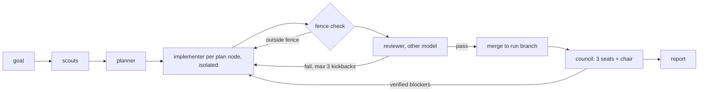

# node-loop

node-loop is a plugin for [omp](https://github.com/can1357/oh-my-pi), a terminal coding agent.
You give it a goal, and it runs a loop of agents that plan, build and review the change in your repo.
Scouts map the repo, and a planner cuts the work into small **plan nodes**.
Each plan node is built in its own isolated checkout and reviewed by a different model until the review passes.
When every node has merged, a council of three models reviews the whole branch.

## Before you start

- **omp 18.11.1 or newer.** Full runs were tested on 18.12.2; 18.11.1 was only checked for loading the extension and reading its settings.
- **git**, and a repo with at least one commit and a clean working tree.
- **bash.** macOS and Linux work; Windows is not supported.
- **Model access.** At least one omp provider you are signed in to. Two providers give cross-provider review; with one, review is same-provider.

## Quick start

In omp, run:

```text
/marketplace add exit-node/node-loop
/marketplace install node-loop@exit-node
```

Restart omp, then run:

```text
exitnode setup
exitnode add magic-link login to the API
```

`exitnode setup` picks a model for each role and writes the global settings listed under "What setup changes".

| Type | What it does |
|---|---|
| `exitnode <goal>` | Start a run in the current repo |
| `exitnode resume` | Continue the latest run after a restart |
| `exitnode setup` | Pick a model for each role and turn on isolation (rerun any time) |
| `exitnode view` | Open the live forge view in your browser |

`exitnode` only triggers as the first word of a prompt; `/exitnode ...` works too.

## How it works



- **Plan node.** One change small enough for one agent to build and one reviewer to pass or fail from the diff.
- **Wave.** Plan nodes whose dependencies have all passed; they run in parallel.
- **Fence.** The files a plan node may touch. Changes outside it fail automatically, and good ideas outside it go to `parking.md`.
- **No approval wait.** The plan is posted for you to read and the run keeps going; interrupt any time to change it.
- **Fresh agents.** A failed review sends the work to a new implementer that reads the findings, not the old conversation.
- **Council.** Three models review the branch blind. The chair checks every finding against the code; one verified blocker is enough, with no voting.
- **Isolated work.** Each implementer works on its own branch, and nothing is pushed.

## Cost and time

These numbers come from three small test runs on one Mac, using Anthropic and OpenAI Codex, with a todo-list goal.
They are examples, not promises; your numbers depend on goal size, repo size and providers.

| Run | Plan nodes | Wall time | Cached input tokens | Output tokens |
|---|---|---|---|---|
| A | 2, no kickback | 16 min | about 4.1 M | about 66 K |
| B | 1, one review kickback | 9 min | about 3.3 M | about 49 K |
| C | 1, one review kickback | 10 min | about 3.7 M | about 48 K |

Every agent counts: scouts, planner, implementers, reviewers and the council.
Measure your first run before you budget for more.

## What a run changes in your repo

- Your checkout switches to a `node-loop/<run-id>` branch. Go back with `git switch <your-branch>`.
- Each implementer works on an `omp/task/*` branch. The final report lists the `git branch -D` commands to clean them up.
- Run state lives in `~/.omp/node-loop/` (set `NODE_LOOP_HOME` to move it).
- Nothing is pushed.

## Safety

Agents run shell commands with your permissions, and the acceptance commands the planner writes run unattended.
Commit anything you cannot lose before a run.
Read `plan.md` first when the goal touches deployment, credentials or data.

## What setup changes

`exitnode setup` writes to your global omp config, `~/.omp/agent/config.yml`:

- `modelRoles`: one entry for each of the seven node-loop roles (`node-*` and `council-seat-*`).
- `task.isolation.enabled: true`, `task.isolation.merge: branch`, `task.isolation.apply: false`.

The isolation settings apply to every omp subagent task in every session, not only node-loop runs.
To go back to omp's defaults:

```bash
omp config reset task.isolation.enabled
omp config reset task.isolation.merge
omp config reset task.isolation.apply
```

Then delete the `node-*` and `council-seat-*` lines under `modelRoles` in `~/.omp/agent/config.yml`.

## Models

Each agent uses an omp model role, so you choose the models with `exitnode setup`.
Setup offers only models omp can resolve for you.

| Role | Used by | Example |
|---|---|---|
| `node-plan` | planner | `anthropic/claude-opus-5-5` |
| `node-implement` | implementer | `anthropic/claude-sonnet-5-5` |
| `node-review` | reviewer | `openai-codex/gpt-6.1-sol` |
| `node-chair` | council chair | `anthropic/claude-opus-5-5` |
| `council-seat-1..3` | council seats | one model from each provider you have |

The examples are the author's own picks; setup offers an author default only when you have that provider.
Put the reviewer on a different provider than the implementer.
Setup warns when the reviewer and implementer share a provider, or when council seats share a model.

## Uninstall

1. `omp plugin uninstall node-loop` (check the name with `omp plugin list`).
2. Revert the settings under "What setup changes".
3. Optional: `rm -rf ~/.omp/node-loop` to delete run history.

## Troubleshooting

| Symptom | Fix |
|---|---|
| `exitnode` does nothing | Restart omp. The keyword works only as the first word, and a session that was already open does not load it. |
| `exitnode` does nothing under `omp -p` | `-p` skips the keyword hook. Headless and scripted runs use `omp -p '/skill:node-loop <goal>'`. |
| Preflight: `model role missing` | Run `exitnode setup`. |
| Preflight: `model role unresolved` | omp does not list that model for you (not signed in, or a typo). Run `exitnode setup` and pick from the list. |
| Preflight: `task.isolation.* is ...` | Run `exitnode setup`. If it still fails, a project config is overriding the global one. |
| Preflight: `git identity missing` | The target repo has no `user.name` or `user.email`. Run `git config user.name '<name>'` and `git config user.email '<email>'` in that repo. |
| Run refuses: dirty working tree | Commit or stash, including untracked files. |
| Run refuses: detached HEAD | `git switch <branch>` first. |
| Forge says no free port | Ports 4747 to 4767 are all taken. Close the other forge. |
| Forge page is empty | No run exists yet. Start one with `exitnode <goal>`. |
| Forge stops | The forge runs inside omp. Closing omp stops it. |

## Reporting issues

Open an issue at <https://github.com/exit-node/node-loop/issues> with the output of `omp --version`, the output of `scripts/preflight`, and the last 20 lines of the run's `ledger.md`.
Remove any secrets first.

## For contributors and agents

[`docs/CONTRACT.md`](docs/CONTRACT.md) is the source of truth for names, file layout, agent schemas, the ledger grammar and the loop's steps.
Skills live in `skills/`, agents in `agents/`, the keyword hook, setup and forge view in `extensions/node-loop/`.

## License

MIT
