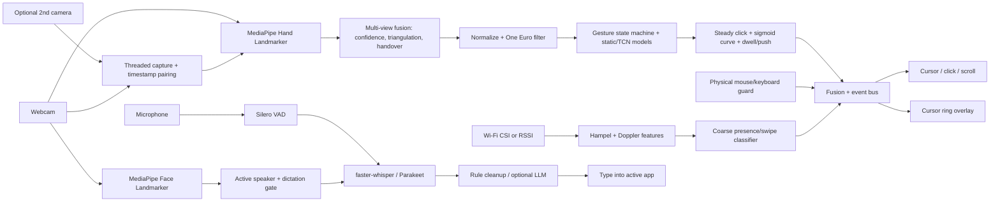

# Project Away

**The bridge between you and your AI agents, controlled by your hands, face and voice.**

**Website:** [fernandogarzaaa.github.io/project-away](https://fernandogarzaaa.github.io/project-away/) · **[Download for Windows](https://github.com/fernandogarzaaa/project-away/releases/latest)**

Project Away sees your gestures, notices whether you are at the screen and paying attention, and listens for your
voice. You use that to run your PC hands-free (point to move the cursor, pinch to click, talk to type), and, new in
v0.1.20, to work with the AI agent you already use (Claude, ChatGPT, Cursor or any other): it can ask you a quick
question you answer with a thumbs up, tell you when something is done, look at your screen or camera when you allow
it, tune Project Away to how you like it, and even use your computer while you watch. Free and local-first.

Nothing leaves your machine unless you connect an agent and press **Allow** on your own screen (or point the
optional LLM cleanup at an endpoint yourself).

[Privacy policy](PRIVACY.md) · [Code signing policy](#code-signing-policy)

## User guide (no technical knowledge needed)

### 1. Installing

1. Download `ProjectAway-…-windows-x64-setup.exe` from the [Releases page](https://github.com/fernandogarzaaa/project-away/releases/latest).
2. Windows will warn that the app is unrecognized (it isn't code-signed yet). Click **More info → Run anyway**, then **Install**.
3. The installer then downloads the speech and tracking models, about **1.6 GB**. **This is the slow part — read this first:**
   - On a slow or unstable connection it can take **hours**, and the progress bar may **stall** at the same number for a long time. That's normal; it isn't frozen for good.
   - **If it fails, stalls for ages, or the window closes: just open Project Away again.** Each time it starts, it checks for missing models and carries on downloading **from where it stopped** — nothing already downloaded is lost. You may need to do this a few times.
   - You can also use **Start menu → Project Away: re-download models** to resume.
   - Leave the PC awake and plugged in, and avoid other big downloads while it runs.
4. When it's done, a hand icon appears in the system tray (bottom-right, by the clock — check the **^** arrow). Gestures and voice are on straight away.
5. **Have an NVIDIA graphics card?** Open **Settings → Performance → Install GPU pack** (about 570 MB, once). Voice typing gets much faster and more accurate.

### 1b. Your first five minutes (guided first run)

The first time Project Away starts, a friendly guide opens by itself. It has big buttons, a row of dots that
shows how far you are, and a **Skip this step** button on every page: everything already works with the standard
settings, so skipping is always fine.

1. **Find your camera:** one button checks that it turns on. If it doesn't, you get a plain explanation and a
   button that fixes the usual cause (open the camera privacy settings, download a missing file, try again).
2. **Sit comfortably:** a live picture and tips like "You're a bit far away" or "It's a bit dark" until it says
   *Looks great*.
3. **Try it out (about 2 minutes):** point at three circles, pinch to click, scroll, and pause with an open palm.
   Each one turns green as soon as Project Away sees it. Nothing on your computer is clicked while you practise.
4. **Make it comfortable:** two optional switches, *Only respond when I'm looking at the screen* and
   *Switch to head control when my arm is tired* (see section 6).
5. **Eye setup (optional):** follow a few dots with your eyes.

Run it again any time: tray menu → **Guided first run...**, or **Settings → Getting started**
(or type `away tour`). People who already used Project Away before v0.1.20 just get a one-time note about it.

### 2. Setting up your space

- **Camera:** at or just above your screen, facing you, with your hand clearly visible from about 40–80 cm away.
- **Light:** light coming from in front of you, not a bright window behind you.
- **Background:** plain is best. Busy backgrounds and other people's hands in view make tracking jumpier.
- **Two webcams (optional):** better accuracy. Add the second one in **Settings → Cameras**, then press **Calibrate** and slowly wave an open hand where both cameras can see it for about 20 seconds.

### 3. Gestures: how to project away

Hold up one hand, palm toward the screen, and point.

| Do this | What happens |
|---|---|
| **Point** with your index finger | Moves the cursor |
| **Pinch** — tap thumb and index finger together | Left-click |
| **Pinch twice** quickly | Double-click |
| **Pinch and hold**, then move | Drag (select text, move windows) — open your fingers to drop |
| **Two fingers up** (index + middle), move up or down | Scroll |
| **Four fingers up, thumb tucked in**, then move your hand up or down | **Auto-scroll**: keeps scrolling on its own, faster the further you move from where you started. Make a **fist** to stop |
| **Open palm** (thumb out too), held still for a moment | Pause / resume gestures |
| **Swipe** left or right | Left / right arrow key (previous / next slide or photo) |
| **Palm glide** — hold one hand flat, slide the other hand's index fingertip along it | Scroll, like a trackpad (two fingers slide sideways = scroll sideways) |
| **Clap once** | Turn gestures on (resume) |
| **Clap twice** quickly | Pause gestures |

**Auto-scroll, step by step:** hold up four fingers with your thumb folded across your palm (or just held
against the side of your index finger) for a moment (the cursor ring, if you turned it on, goes orange). Where
your hand is at that moment is the "middle": you do not have to move away from it first. Move your hand
a little above it to scroll up, below it to scroll down; the further away, the faster. Hold your hand still and
it keeps scrolling at that speed, so you can read a long page without moving. Moving left or right scrolls
sideways. Close your hand into a **fist** to stop (it also stops if your hand leaves the camera for more than
half a second, if you pause, or if you make another gesture). Keeping your thumb tucked in matters: with the
thumb out it is the open palm, which pauses.

**Claps:** the microphone listens for a sharp hand clap. One clap turns gestures back on; two claps within about
half a second pause them (a single clap waits that half second to make sure a second one isn't coming). Claps
are ignored while you're in the middle of saying something. If the camera can see both your hands come together
it is extra sure it was a clap. Turn it off, or make it pickier, in **Settings → Voice & input**.

**Big cursor:** while gestures are on, the Windows mouse pointer is made bigger so you can see it from across the
room. It shrinks back to your normal size whenever gestures pause, so the size also tells you whether gestures
are on. Choose the size (or 0 for off) in **Settings → Voice & input → Cursor size while gestures are active**.
On Mac and Linux the pointer itself isn't changed; the cursor ring grows instead.

**Palm-glide scroll (v0.1.14), step by step:** hold one hand up flat, palm toward the screen, fingers
together — that hand is your "trackpad". Touch the middle of that palm with the index fingertip of your other
hand and hold it there for a moment (about a sixth of a second; the cursor ring, if you turned it on, goes
cyan). Now slide the fingertip along the palm: **toward the fingers scrolls up, toward the wrist scrolls down**.
Put your **index and middle finger** on the palm together and slide **sideways** to scroll left or right. Flick
and lift, and the page keeps going for a moment and slows down, like on a phone; touch the palm again or make
any other gesture to stop it. A quick **tap** on the palm (touch and lift, without sliding) can be given an
action in **Settings → Bindings → gesture:palm_tap** (it does nothing until you do). While your fingertip is on
the palm the cursor holds still and nothing clicks, and the flat hand never pauses gestures. Speed, the dead
zone, the momentum and the rest are in **Settings → Tuning → Palm scroll**.

**Which hand is which (hand roles, v0.1.14):** Away works out by itself which hand is the *pointer* (moves the
cursor, clicks and does every one-hand gesture) and which is the *helper* (the flat "trackpad" hand). The first
hand that **points** gets the pointer (or simply the only hand in view), and it keeps it — even if the camera
mixes up left and right, or the hand disappears for up to a second. Raised your flat "trackpad" hand first?
That's fine: as soon as the other hand points, it becomes the pointer. Holding your phone in the other hand?
Pick **Settings → Voice & input → Hand roles → Right** or **Left** to use only that hand as the pointer;
**Auto** is the default. You can also say **"use left hand"**, **"use right hand"**, or **"use either hand"**
(back to Auto).

Tips for smooth control:
- **Small movements go a long way.** The cursor speeds up when you move fast and slows for precise work, so slow down near small buttons.
- **Pinch crisply** and keep your hand still while you do — the cursor locks briefly so the click lands where you aimed.
- **Rest your elbow** on the desk or armrest. Holding your arm up in the air gets tiring fast.
- Touching your real mouse or keyboard pauses gestures automatically. They come back after a second or two of not touching them.
- **F9** turns gesture control on or off at any time. The tray menu does the same.
- Several monitors? The cursor covers all of them. Say **"next monitor"**, **"previous monitor"** or **"monitor two"** to jump.
- **Your hand stays in view on its own** (auto-centering): the camera frame quietly nudges your resting hand back
  toward the middle, and a quick swing back from the edge of the camera's view doesn't drag the cursor back (like
  lifting a mouse). Lost the cursor? Say **"center"** to put it in the middle of the screen you're on.

### Teaching your own gestures (Settings → Gesture Studio)

Open **Settings** and pick the **Gesture Studio** tab.

1. Press **Turn camera on**. You see yourself like in a mirror, with your hand drawn on top. (Project Away pauses
   while the Studio uses the camera and carries on when you turn it off.)
2. Press **Teach a new gesture** and follow the 3 steps: give it a name, show it when the app says **Now!**
   (15 times, in 3 short rounds, with a short "just relax" moment after each round), then try it and choose what it
   should do: press a key, click, type some text, open an app or a website, or a voice action.
3. **Practice mode** is on by default: you see what would happen, but nothing is really pressed or opened. Untick
   it when you are happy.
4. Did something happen that you did not want? Press **That was wrong** straight away. The last 2 seconds are
   kept as an example of "no gesture" so it learns not to do that. Then press **Learn my gestures now**.
5. **Where gestures work:** the picture is split into squares. Pick **Ignore here** and click the squares where
   gestures should be ignored (where your coffee cup is, or where your hand rests on the keyboard). You can also
   draw a box or say "only above a line". The cursor still moves everywhere unless you tick **Also stop the cursor
   there** (under **Show details**). Areas are saved for each camera, and can differ for each app profile.
6. **Show details** adds charts: the last 5 seconds, the points of your hand it looks at, which practice example the
   hand looks most like, and what it mixed up when it checked itself.

Your practice recordings stay on this computer (only hand points, never pictures). **Delete all my recordings**
removes them. **Share my gestures...** saves your gestures to a file for someone else; recordings are only added
if you say so.

### 4. Voice

Voice is always listening by default. Just talk, and your words are typed wherever the text cursor is.

- **Punctuation:** say "comma", "period", "question mark", "new line", "new paragraph".
- **Mistake?** Say **"scratch that"** to remove the sentence you just said, or **"no wait, make it Tuesday"** to fix the last word.
- **Smart cleanup (optional):** Settings > Voice & input > **Smart cleanup**. Tick it, press **Download** once
  (about 0.5-1.1 GB, shown on the button) and your dictation gets proper punctuation, and is casual in chat apps
  and tidy in email. If it is ever slow, the basic cleanup is typed instead, so you never wait.
- **My words:** add names and terms to the **My words** list in the same tab (or say **"add Jonie to my
  dictionary"**). Right after a mistake you can say **"correct Jonnie to Jonie"**. Words you fix by hand are
  learned too.
- **Commands:** "click", "double click", "right click", "scroll up", "scroll down", "go back", "go forward", "open browser", "pause gestures", "resume gestures", "stop listening", "start listening", "use left hand", "use right hand", "use either hand", "center" (cursor to the middle of this screen), "look here" (cursor to where you're looking, after gaze calibration).
- **Shortcuts:** `Ctrl+Alt+Space` pauses/resumes listening, `Ctrl+Alt+M` mutes the mic, `Ctrl+Alt+E` lets you edit selected text by voice.
- **Tray icon colour:** green = listening, amber = not listening, red = mic off, blue = recording, grey = paused.
- **Words not being typed?** If you're looking away from the webcam, the face check may ignore you. Turn **Face gate** off in the tray menu.
- **Videos and other people aren't typed (v0.1.22).** Words count as yours when the camera sees your mouth move.
  If it barely moved, only a very clear recognition is typed, and while another app plays sound (a YouTube video,
  a call) your mouth must be seen moving. The computer's own voice (an agent speaking to you) is never typed.
- **Talk to your AI agent (v0.1.22):** say **"Hey"** and your agent's name, for example **"Hey Claude, remind me to
  call Mom at five"**, and the words go to that agent instead of being typed. You see **"Sent to Claude"**. Say
  "Hey Claude" on its own and then your message, or use the summon gesture and speak. See *Talk to your agent*.
- Speech is processed on your PC and never saved or uploaded.
- **Click things by name (Windows):** say **"click Save"**, **"double click Photos"** or **"focus Search"**. Look at
  something (or point at it) and say **"click that"**. If two things have the same name, numbers appear next to
  them: say the number, or "cancel".
- **Snap to buttons (Windows):** the pointer is gently drawn to buttons and links and holds still over them, so
  a shaky camera image doesn't make you miss. Both are on by default; turn them off, or turn on
  **Smoother cursor**, under Settings > Voice & input > Smart pointer.

### Shortcuts: show it once, then a gesture or a word repeats it

Something you do often, like opening your mail and starting a new message? Teach it once:

1. Open **Settings > Shortcuts** and press the big **Record a shortcut** button (or say **"record shortcut"**, or pick
   **Record a shortcut** in the tray menu).
2. Do the clicks and typing yourself, the normal way, or hands-free: pinch-clicks and dictated text count too. A small red **Recording** bar shows at the top; press its **Stop**
   button when you are done (or say **"stop recording"**).
3. Give it a name, then choose what runs it: **say** a phrase ("open mail") or **make a gesture**. That's it.

To stop a shortcut while it runs, press **Esc**, move the mouse, or say **"stop"**. If a shortcut can't run (the app it
was made in isn't open, or another window is in the way), Settings > Shortcuts tells you why and shows a button that
fixes it. Shortcuts never record what you type into a password box, and a shortcut that types text stays on your PC.
**Edit steps** lets you remove or reorder steps, change pauses, add text, a key or a wait, and pick the speed.

### 5. Head and eye tracking (optional, off until you set it up)

- **Head pointer:** with your hands busy, turn your head to move the cursor and click with a wink, smile or
  eyebrow raise (turn those on in the face settings). Set `hands.cursor.head_assist: pointer`.
- **Head + hand:** `head_assist: coarse` makes the cursor jump to the part of the screen you turn toward; your
  hand does the fine aiming.
- **Eye tracking ("where am I looking?"):** Settings → Performance → **Calibrate gaze…** (or `away gaze calibrate`).
  Look at the dots on each screen until they vanish (about 2 seconds each). Afterwards Project Away knows where
  your screens are and roughly where on them you look: when you start moving your hand after resting it, the
  cursor first jumps to where you're looking, then your hand fine-tunes. Webcams are only good for "which screen
  and which area" (roughly a hand-width on the screen), not for small buttons.
- **Optional gaze model:** a learned eye-gaze network can be downloaded in Settings → Performance → Models. Its
  weights are for **research use only** (see below), so it is never installed automatically.

### 6. Comfort: only when you're looking, tired arms and breaks

All of these are plain switches in **Settings → Getting started** (the first tab). The numbers behind them are
under **Advanced** there, and in **Settings → Tuning**; you never need to touch them.

- **Only respond when I'm looking at the screen** (off until you turn it on; also a check box in the tray menu):
  gestures count only while you face the screen and hold your hand up in front of you. Rest your hand on the desk,
  turn to talk to someone, or reach for your coffee, and nothing gets clicked. The ring at the cursor turns grey
  while it waits for you, and the tray says what to do ("raise your hand a little higher"). A short glance away
  is forgiven, so it doesn't flicker on and off. Without face tracking (or before the face model has loaded) it
  only checks your hand.
- **Switch to head control when my arm is tired** (off until you turn it on): after a long time with your arm up,
  or when your hand starts to sink or shake, Project Away tells you to lower your hand and steers the pointer with
  your head instead. Raise your hand again and it takes back over. Needs face tracking.
- **Tell me when my arm looks tired** (on): just the gentle note, at most once every 10 minutes.
- **Remind me to take a break** (on): a short note after 30 minutes of continuous gesture use. Being away from the
  camera for 2 minutes counts as a break.

### 7. If something goes wrong

- **Models didn't finish downloading:** reopen the app (see Installing above). It resumes.
- **Cursor doesn't move:** check another app isn't using the camera (Zoom, Teams, the Camera app), then restart Project Away from the tray.
- **Voice is slow or lagging:** install the GPU pack (Settings → Performance, NVIDIA cards only).
- **Want to change a gesture or phrase?** Tray → **Settings…** → Bindings.
- **A camera is "too slow":** Settings → Cameras → **Test both cameras** reports any camera below 10 frames per
  second as FAILED. Project Away has already tried every format and size on it; if NVIDIA Broadcast is
  installed it can use Broadcast's camera instead (and says so). Otherwise use the other camera alone.
- **A camera never opens, but the Windows Camera app shows it:** Project Away now also tries the Camera app's
  own way of reading cameras (WinRT). Settings → Cameras → **Diagnose** shows, for every camera, which way
  works and how fast. If a camera keeps failing, Project Away stops retrying it after a while and says so; fix
  it, then press **Retry cameras** (Settings → Cameras, or the tray menu).
- **"The app crashed last time":** the details are in `crash.log` in the logs folder
  (`%LOCALAPPDATA%\ProjectAway\logs\crash.log` on Windows, next to `away.log`). Please attach it to a bug report.

## Connect your AI agent

### 30-second quick start

1. Open **Settings → Agent Link** and press **Connect an AI agent**.
2. Pick your AI: **Claude Desktop**, **ChatGPT**, **Cursor**, **Claude (web or phone)** or **Other**.
3. Choose what it may do (the safe choices are already ticked) and press **Next**.
   - **Claude Desktop / Cursor on this PC:** press **Connect**. Project Away adds itself to the app's settings
     (a backup is kept), then restart the app.
   - **ChatGPT, Claude.ai or anything else:** you get a private link, a QR code and a 6-digit code. Paste the link
     into the app's "add custom connector" box (ChatGPT: *Settings → Apps & Connectors → Advanced → Developer mode →
     Create*; Claude: *Settings → Connectors → Add custom connector*) or open it on your phone.
4. Your PC asks **"Claude wants to connect: Allow / Deny"**. Answer with a click, a thumbs up, or by saying "allow".
   You see **Connected to Claude ✓**. **Disconnect all** ends every connection at once.
5. *(v0.1.24, optional)* When an agent connects with the 6-digit code, the question also offers **Keep this agent
   connected**. Choose it and that agent comes back by itself after restarts and reboots, without asking you again,
   until you revoke it in **Settings → Agent Link → Agent tokens** (see [Keep this agent connected](#keep-this-agent-connected-v0124)).

Then just talk to your agent: *"What can you see in Project Away?"*, *"The cursor is too fast, fix it"*,
*"Ask me with a thumbs up before you send the email"*.

**Link stopped working? Press "New link".** ChatGPT or Claude.ai sometimes cannot reach one particular link
(Cloudflare blocks that agent's servers on that address, and every request fails). **New link** in Settings →
Agent Link makes a fresh address and copies it; paste it into your AI app again. Nobody is disconnected, and agents
on this PC (Claude Desktop, Cursor) are not affected.

### Talk to your agent (v0.1.22)

Say **"Hey"** and an agent's name, then what you want: **"Hey Claude, what's on my calendar?"**. Your words go to
that agent only, instead of being typed, and a small **"Sent to Claude"** shows on screen. The agent answers on
your screen and out loud.

* **Every connected agent answers to "Hey <its name>"** automatically. Give one its own wake word (for example
  "Jarvis") with **Wake word** next to the agent in Settings → Agent Link; the agent row shows what to say.
* **"Hey agent"** or the **summon gesture** (then say your message) goes to your **default agent**, chosen under
  *Talk to your agent* in Settings → Agent Link. With no default it goes to every connected agent.
* Say only "Hey Claude" and pause: you have about 8 seconds to say the message.
* If the computer mishears the name ("hey heart" for **Hark**, "hey cloud" for **Claude**), the message still goes
  to that agent, as long as you started with "Hey" (or "Hi", "OK") and only one agent's name sounds like it.
* It needs always-on listening (the default). The same rules as dictation apply, so a video playing in the
  background does not send messages.
* **Wake-up address (optional, off by default).** Some agents can be woken up by a web address (a "webhook"). If
  your agent gives you one, paste it under **Wake word** → *Wake-up address*; each message to that agent is then
  sent there too. Only `https://` addresses (or an address on this PC) are accepted.

For agents: messages arrive as a `user.message` event only the addressed agent sees, and in the `inbox` tool
(`list`, `read`, `reply`), `GET /v1/inbox`, `GET /v1/inbox/read?id=`, `POST /v1/inbox/reply {id, text, speak}` and
the `away://inbox` resource. A reply is shown and read aloud (like `notify_user` with `speak=true`). The wake-up
POST body is `{"event": "user.message", "id", "text", "agent", "t", "source", "how_to_reply"}`. Messages are kept
in memory only (the newest 200), never written to disk.

| Permission | What it means | Default |
|---|---|---|
| ☝ See my gestures | your gestures, whether you are at the screen, what you said to Project Away, its settings and health | always on |
| ◉ See my camera when I allow | one small still photo at a time; your screen flashes every time | off |
| ▣ See my screen when I allow | one small screenshot at a time, or a slow (1 per second) live view with a badge on screen the whole time | off |
| ⚙ Change my settings | sliders, gestures, voice commands, per-app profiles, presets; it asks you first (before/after) and everything can be undone | off |
| ⌨ Let it use my computer | mouse and keyboard, after you allow it on the PC each time, for 30 minutes at most | off |
| ✉ Share my logs and recordings | its logs, short gesture recordings (no video) and problem reports, with passwords, keys, e-mail addresses and your user folder hidden | off |
| (Advanced) Run camera and speed checks | camera checks and speed tests | on |

**While an agent uses your computer** a bright border and the banner *"Claude is using your computer — move your hand
or mouse to take over"* are on screen. Touching the mouse or keyboard, or making a gesture, pauses it instantly; it
must ask again to continue. **Ctrl+Alt+Esc**, saying **"stop"**, or holding up an **open palm** for a second stops it.
It never types into password fields, never touches Windows security prompts, and asks you before clicking anything
like *Send, Pay, Buy, Delete, Install* (with "Always allow for this agent"). Settings → Agent Link shows everything it
did, with a picture of the screen for each step, and **Undo last**.

**Answering your agent with your hands:** thumbs up = yes / the first choice, thumbs down = no / the last choice,
1–4 fingers = choice 1–4, open palm = choice 5, or say the answer, or click it.

**Talking to your agent with gestures/voice:** say **"hey agent"** (it is called), **"hey agent, look"** (it gets a
camera picture, if allowed) or **"hey agent, look at my screen"**, and **"that was wrong"** when Project Away did
something you did not want (agents can then suggest a fix). Bind them to any gesture in Settings → Bindings
(`agent:summon`, `agent:look`, `agent:screen`, `agent:wrong`, `agent:stop`).

**My preferences:** Settings → Agent Link → *My preferences* is a plain list ("I hate accidental right-clicks",
"slower cursor in Photoshop") that you and your agents share; agents read it and cite it when they change something.
Changes run in **Ask me first** mode by default; **Just do it and tell me** lets them make small adjustments
(thresholds and sliders within their normal range) right away and tell you. Every change is in a history with who and
why, with **Undo** and **Undo its changes today**, and the config is snapshotted before each batch.

### Technical details

**Transports.** One server, three ways in, the same permissions and rules for all of them:

* **MCP over stdio** for apps on this PC: the app runs `away mcp --scopes read,diagnose` (the wizard writes it).
  It forwards to the running Project Away app over 127.0.0.1; the first call shows the Allow prompt (proof of "same
  user, same PC": a key file only you can read), and the token is kept until it expires (30 days) or you revoke it.
* **MCP over Streamable HTTP** for remote agents: `https://<random>.trycloudflare.com/mcp` with
  `Authorization: Bearer <token>`, or the pairing link `https://<random>.trycloudflare.com/c/<code>` used directly
  as the connector URL (no header needed; ChatGPT and Claude.ai connectors). OAuth is not implemented in v1; the
  pairing link is the credential and only becomes one after you press Allow.
* **REST/JSON** for agents without MCP: the same tools under `/v1/...` (`POST /v1/rpc/<tool>` for any of them),
  server-sent events at `/v1/events/stream`, OpenAPI at `/openapi.json`. Exchange a pairing code or the 6-digit code
  for a token with `POST /v1/pair {"pin": "123456", "name": "My agent"}`.

**Claude Desktop by hand** (what the wizard writes into `claude_desktop_config.json`; Windows path shown, macOS uses
`/Applications/ProjectAway.app/Contents/MacOS/ProjectAway`, a pip install uses `away`):

```json
{"mcpServers": {"project-away": {
  "command": "C:\\Program Files\\ProjectAway\\ProjectAway.exe",
  "args": ["mcp", "--scopes", "read,diagnose,tune"]}}}
```

Cursor uses the same entry in `~/.cursor/mcp.json`; `away agent connect claude|cursor` writes it from the command
line, `away agent snippets` prints them.

**Remote Streamable HTTP client** (tested from a cloud sandbox through a real quick tunnel):

```python
from mcp import ClientSession
from mcp.client.streamable_http import streamablehttp_client

async with streamablehttp_client("https://<random>.trycloudflare.com/c/<code>") as (r, w, _):
    async with ClientSession(r, w) as s:
        await s.initialize()  # the person sees "<your client name> wants to connect"
        print(await s.call_tool("get_context", {}))
```

or without MCP: `python scripts/agent_link_client.py --url <link> pair --pin 123456`, then `... status`, `stream`,
`ask "Ready?" Yes No`, `look out.jpg`, `set hands.cursor.gain 1.8 --why "..."`, `bundle out.zip`.

**Tools (18; 15 in v0.1.21, `inbox` added in v0.1.22, `shell` and `ui_query` in v0.1.28).** Related tools are grouped into one tool with an `action`, so an agent sees a short list:

| Tool | Actions / arguments | Permission |
|---|---|---|
| `get_status`, `get_context` | (none) | see my gestures |
| `inbox` | `list` (`unread_only`), `read` (`id`), `reply` (`id`, `text`, `speak`) - what the person said to you | always (only your own messages) |
| `events` | `poll` (`since`, `landmarks`), `wait` (`since`, `timeout_s`, `topics`) | see my gestures |
| `settings` | `list` (`domain`), `change` (`changes`, `why`), `undo` (`what`), `history` (`limit`), `config` | change my settings (`list`/`history`/`config`: see my gestures) |
| `preferences` | `list`, `add` (`text`), `remove` (`number`) | change my settings to add/remove |
| `diagnostics` | `run` (`kind` = `cameras` \| `sweep` \| `benchmark`, `device`, `seconds`), `job` (`job_id`), `record`, `bundle`, `files`, `download` (`path`), `logs` (`lines`) | run camera and speed checks (`record`, `bundle`, `files`, `download`, `logs`: share my logs and recordings) |
| `look` | `camera` | see my camera when I allow |
| `get_screen` | `scale`, `monitor`, `region`, `elements` (see below) | see my screen when I allow |
| `ui_query` | (none) - the foreground window's interactable elements with ids, names, roles and exact bounds (Windows UI Automation, no screenshot taken); pass an id back as `element_id` to `pointer` or `keyboard` | use my computer |
| `ask_user` | `question` (or `message`), `options`, `timeout_s`, `urgency`, `speak` | always |
| `notify_user` | `text` (or `message`), `level`, `speak` | always |
| `control` | `request` (`why`, `minutes`), `resume`, `stop`, `undo`, `log` | use my computer (`stop` and `log` always; `log` shows only your own actions) |
| `pointer` | `move`, `click`, `double_click`, `right_click`, `drag`, `scroll` (`x`, `y`, `element`, `from_image`, ...) | use my computer |
| `keyboard` | `type` (`text`), `press` (`keys`) | use my computer |
| `open` | `app` (`name`), `system` (`name`), `url` (`url`) | use my computer |
| `shell` | `list`, `run` (`command` = tier-1 name \| `argv` = tier 2, `why`), `log` (`limit`) - staged shell: tier 1 read-only diagnostics run at once in an approved session, tier 2 asks the person every time | use my computer |
| `disconnect` | (none) | always |

Example: `settings(action="change", changes=[{"key": "hands.cursor.gain", "value": 1.6}], why="you said it is too
fast")`. **The old names still work** on the REST API and `/v1/rpc/<name>` (`change_settings`, `get_job`, `act`,
`request_control`, `list_files`, `read_file`...), and the group names work there too:
`POST /v1/rpc/diagnostics {"action": "job", "job_id": "82557239"}`.

**Check ids** (`diagnostics action="run"` returns one) are strings such as `"82557239"`; `GET /v1/jobs?job_id=...`
and `?id=...` both work. A finished check is kept 10 minutes after it finished once it has been read (30 minutes if
nobody read it yet); an id that never existed answers **404 unknown**, one whose result was dropped answers **410 expired**.

**Seeing the screen: wide shot first, then zoom.** `get_screen` with no arguments returns the whole desktop at
`scale` 0.5 (the longest side is capped at 2560 px, so a 5206x1080 three-monitor desktop comes back at 2560x531)
plus metadata listing every monitor (`index` 1..N left to right, `x`, `y`, `w`, `h`, `primary`), the area shown
and the scale used. Then zoom in:

* `scale` 0.1-1.0: the share of the area's real pixels (1.0 to read small text);
* `monitor=N`: one display, numbered from 1 (`monitor=0` is an error that lists the valid numbers; leave
  `monitor` out for the whole desktop);
* `region={x, y, width, height}` (also `"x,y,w,h"` or `[x, y, w, h]`) in screen coordinates, which are negative left
  of or above the main display; clipped to the desktop.

`monitor` and `region` cannot be combined. Image coordinates map back with
`screen_x = origin.x + image_x / scale` (and the same for y); pointer actions with `from_image=true` do this using
the agent's last screenshot. The live view (`screen_watch`) takes the same options and is capped at 1600 px.

**Speaking (v0.1.21).** `notify_user` and `ask_user` with `speak=true` read the message (or the question and its
choices) aloud with the computer's own voice: on Windows the built-in Windows voice (SAPI, through comtypes, or
PowerShell's System.Speech when comtypes is missing), else pyttsx3 when installed, macOS `say`, Linux `spd-say` /
`espeak-ng` / `espeak`. It never blocks the agent, and the result is truthful: `shown` / `spoken` are only true when
that happened, with a `reason` / `speech` explaining why not (for example "speaking is turned off"). When the
message window cannot appear, a tray notification is shown instead (`via: "tray notification"`). Config:

```yaml
speech:
  enabled: true              # "Let agents talk to me"
  read_messages_aloud: false # read every agent message aloud, even without speak=true
  rate: normal               # slow | normal | fast
  volume: normal             # quiet | normal | loud
  voice: ""                  # part of a voice name ("Zira", "Samantha"); "" = the system default
```

**Resources:** `away://about` (briefing: what Project Away is, your permissions, live context, how to talk to the
person; also sent as the MCP `instructions`), `away://preferences`, `away://context`, `away://events` and
`away://screen/live` (both subscribable: `resources/subscribe` → `notifications/resources/updated`),
`away://user/last-capture`. Events: `presence` (sat down / left), `attention`, `summon`, `user.look`, `user.screen`,
`wrong`, `misfire`, `detector`, `control.*`, `prompt.*`, `change.*`.

**Polite prompts.** `ask_user` with `urgency` `low`/`normal` waits until you are present, facing the screen and not
typing (normal waits at most half its timeout); `high` shows at once.

**Settings agents can change** go through a registry of domains (`settings`, `zones`, `bindings`, `custom_gestures`,
`profiles`, `presets`, plus placeholders for features on other branches). Every value is checked with the same range
table as the Tuning sliders, and the whole config must still validate before anything is saved.

**CLI:** `away agent status|pair|start|stop|disconnect|agents|revoke ID|connect claude|cursor|snippets|prefs|changes|
undo|github-token` (aliases `away link`, `away remote`), `away mcp`, `away replay FILE`, `away diagnose bundle`.

**New config keys** (`agent_link:`): `enabled` (true), `remote_ttl_min` (60), `local_ttl_days` (30),
`pairing_ttl_s` (600), `control_ttl_min` (30), `port` (0 = any), `rate_per_s` (10) / `rate_burst` (40),
`action_rate_per_s` (4), `cloudflared_download` (true), `cloudflared_path`, `screen_fps` (1), `screen_max_width`
(960), `snapshot_max_width` (320), `record_buffer_s` (30), `detectors` (true), `detector_cooldown_s` (600),
`fps_drop_ratio` (0.5), `misfire_threshold` (4), `autofix` (`ask` | `auto_low_risk`), `stop_hotkey`
(`ctrl+alt+esc`), `github_issues` (false), `github_repo`.

**Recordings and replay.** `record_session` / the 30 s ring buffer store hand landmarks and app events (never video
or audio) as gzip JSON lines (`.awayrec`, ~25 KB for 5 s). `away replay FILE` re-runs them through the gesture
pipeline headless and deterministically; drop one into `tests/replays/` and run the tests once with
`AWAY_UPDATE_REPLAYS=1` to pin it as a regression test.

**Auto-detectors.** A camera frame-rate drop, a camera that will not open, a retry loop, a crash, or a spike of
"that was wrong" / cancelled actions saves a diagnostics bundle (logs, redacted config, the last camera check,
stats, the last 30 s of landmarks) to `<data>/diagnostics/` and tells connected agents. Optional, off by default:
`agent_link.github_issues: true` files a GitHub issue (stats only, never the bundle) with a token you store in the OS
keyring with `away agent github-token`.

### Safety guarantees

These are enforced by Project Away itself, whatever the agent asks for, and each one has an automatic test:

* **Nothing without your OK.** Using your computer needs your Allow every session. A click, drag, Enter, Delete or
  shortcut on something Project Away can't identify asks you first, like Send, Pay, Delete or Install do. Dropping
  something on the Recycle Bin or Trash asks too. You can say "Allow for this session" to stop the questions until
  the session ends.
* **You can always take over.** Moving your mouse pauses the agent at once, even while it is typing. Your stop keys
  (Ctrl+Alt+Esc), saying "stop" and holding up an open palm always work, straight away. An action that is already
  running stops before its next step (a drag, the next few letters), and Project Away lets go of the mouse button
  and Shift, Ctrl, Alt and Win.
* **Undo is yours or the agent's own.** An agent can only undo its own actions, and only while you are letting it use
  your computer.
* **No picture without a notice.** Every camera picture and screenshot shows a notice on screen. If the notice can't
  be shown, the picture is not taken. The live screen view only runs while its "watching" badge is on screen.
* **Turning a permission off works at once.** Turn off "Let it use my computer" and its session ends and the border
  goes away. Turn off "See my screen" and its live view stops. Disconnect does both.
* **Your logs are yours.** Sending logs, recordings and problem reports to an agent needs its own permission, "Share
  my logs and recordings", off unless you turn it on (agents connected earlier don't get it either). Passwords,
  keys, tokens, e-mail addresses and your user folder are hidden in what is sent. An agent sees only its own actions
  in the action list.
* **Fails safe.** If Windows can't tell whether a security prompt (UAC, Ctrl+Alt+Del) is on screen, the agent is
  stopped. Oversized requests are refused before they are read (64 KB, 256 KB for MCP).

### Security notes (honest)

* The local server listens on **127.0.0.1 only**. Remote access exists only while a pairing link or a remote agent is
  active, through a Cloudflare quick tunnel; Cloudflare can see that traffic (TLS ends at their edge).
* A pairing link / QR / 6-digit code **grants nothing by itself**: the first client to use it creates a request you
  must Allow on the PC (permissions listed, plus the matching code). Links are single-use and expire after 10
  minutes; a 6-digit code is guessable in principle, so failed attempts lock the server for a minute after 10 tries
  and requests are rate-limited per client.
* Tokens are 256-bit random, stored only as SHA-256 hashes, compared in constant time; remote access expires after
  1 hour, local after 30 days; **Disconnect all**, the tray menu, or `away agent disconnect` revoke everything at once.
* A connector that uses the pairing link as its URL keeps that link as its credential until it expires or is revoked:
  treat the link like a password and do not share it.
* Requests with a browser `Origin` header are refused (a web page cannot drive it); every request is in
  `<data>/logs/agent-access.log` (codes and tokens never written).
* Never possible through Agent Link: running shell commands, reading or writing your files (downloads are limited to
  bundles, recordings and logs inside Project Away's data folder, with path-traversal and symlink checks, and need
  "Share my logs and recordings"), changing
  `allow_shell`, hotkeys, updates or the agents' own permissions.
* "Let it use my computer" is the riskiest permission. Its protections (approval every session, expiry, takeover
  pause, password-field and secure-desktop blocks, risky-click confirmation, blocked Win+R / Ctrl+Alt+Del, no
  terminals, rate limit, full action log) reduce but cannot remove risk: an allowed agent can still click and type
  anything you could in ordinary windows. Turn it on only for agents you trust, and watch.
* Password fields are detected with Windows UI Automation (`IsPassword`). Without UI Automation, typing is refused on
  Windows; on macOS/Linux only window titles that look like sign-in prompts are blocked.

## Live agent (optional)

Talk to your computer and it talks back. Say **"Hey Away"** (you can change the name), then a question or a small
job: "Hey Away, what's 15% of 80?", "Hey Away, open Notepad and type hello". It answers out loud, does small jobs on
this PC, and hands big jobs (write code, research, long documents) to your other AI agents.

**It is off by default.** Nothing is downloaded, nothing is sent anywhere, and nothing listens for "Hey Away" until
you turn it on in **Settings → Live agent**.

### Turn it on in one click (free models)

Click **Use free models (opencode)**. That is all: no account, no key, no card.

* Away uses [opencode](https://github.com/anomalyco/opencode) (free, MIT license) to reach its free models. If
  opencode is not on your PC, the button downloads the official build (about 60 MB) and checks its fingerprint
  (SHA-256) against the one GitHub publishes. A file that does not match is thrown away.
* opencode runs privately, only for Away: on your PC only (127.0.0.1) with a random password, with its own settings
  folder (your own opencode setup and keys are not touched), and with every tool it might want (shell, files, web)
  refused. It only writes text for Away.
* The button tries a few free models and picks one that answers quickly.
* **Good to know:** the free models may keep what you send them. So **pictures of your screen and camera are never
  sent to them**, nor anything typed into password fields, and e-mail addresses, phone and card numbers and keys
  are hidden before anything is sent.
* Free models have limits. When one says "Free usage exceeded", Away moves on to the next one right away.

If opencode cannot be downloaded or started, the tab offers **Use a free key instead** (Gemini or Groq, both free
with no card, with a link to get the key), or Ollama if it runs on your PC.

### Add your own API key

Under **Add my API key**: pick the provider, paste the key, click **Save and test**. Providers: Groq, Google Gemini,
OpenAI, Anthropic (Claude), OpenRouter, OpenCode Zen, DeepSeek, Mistral, Together AI, Ollama and LM Studio on this
PC, or any other OpenAI-compatible address.

* The key is kept in your system's own safe store (Windows Credential Manager, the macOS Keychain, or the Secret
  Service on Linux), **never in a file**, a log, or an answer to another agent.
* Your own paid keys and models on your PC may see the screen, but only when you tick **Let it look at my screen**.

### Which model answers (the fallback order)

For each job Away tries models in this order, and moves to the next one if a model fails, is rate-limited, or does
not start answering within 8 seconds:

1. The model you chose for that job, or your **Preferred model**.
2. Your other models (your API keys).
3. Free models (opencode).
4. Models on this PC (Ollama, LM Studio).

A model that keeps failing is rested for a while (a minute, doubling up to ten; an hour for a refused key). Once a
model starts answering, it finishes the turn. Looking at the screen only ever uses models that accept pictures and
do not keep prompts.

### Jev (quick decisions)

Jev is a small, fast decision model (TypeSafe AI's "System One"). It does not write text; it answers short yes/no
and pick-one questions in about 0.3 s. Away uses it to decide: is this a chat, a job on this PC, or a big job for
another agent; is this action risky (send, pay, delete, anything you cannot undo, which is always confirmed on your
PC first); which button on screen you meant; and whether the action worked. Jev's free version needs no key. Under
**Advanced** it is set to *auto* (use it when it answers). When Jev is off or not answering, the chat model answers
the same questions, and when that fails too, simple built-in rules do.

### Daily budget

Paid API keys stop for the day once today's spend reaches your daily limit: **$1.00 a day** by default, changed
under **Advanced** (0 means paid keys are never used). Free models and models on your PC always count as $0. When a
model's price is unknown, it is counted at a cautious $1 / $5 per million tokens so the limit still holds.

### Talking over it, and what it may do

* **Barge-in:** just start talking while it speaks and it stops. (The classic Windows voice finishes its current
  few words first.)
* By default it may not look at your screen or camera or use the mouse and keyboard. Each is a switch in the tab.
  Mouse and keyboard use is approved on the PC each session, with the same safety rules as Agent Link.
* **Recent turns** in the tab shows what was asked, which model answered, how fast, and what happened.
* From a terminal: `python -m away.liveagent status | free | models | ask "..." | jev | update-engine`.

### Talking back and forth (conversational mode)

In **Settings → Voice & input → Talking to your agent**:

* **Keep listening after "Hey <name>"** (3–30 seconds, default 8): after you say "Hey Cookie" (or any agent's wake
  word, or the live agent's name) and pause, it waits this long for your message. Same for every agent.
* **Conversational mode** (off by default): after the agent answers, just keep talking; no wake word needed. It
  keeps listening for the time above, counted from when it stops speaking. Say **"stop"** or **"that's all"**, or
  stay quiet, to end the conversation. Talk over it and it stops and listens to you.
* **Play a short sound when it starts listening** (on by default): a soft two-note sound after "Hey <name>", and a
  single note when it has your message.

From a terminal: `away voice listen-seconds 12`, `away voice conversational on`, `away voice listen-sound off`, and
`away voice agent-pause-ms 450` (how long a pause ends what you say to an agent; dictation keeps its own,
longer `end_silence_ms`). In `config.yaml` these are `voice.listen_seconds`, `voice.conversational`,
`voice.listen_sound` and `voice.agent_end_silence_ms`.

**Faster answers (v0.1.26).** Every spoken request now writes a timing line to the log
(`latency: endpoint=450ms stt=250ms route=0ms first_token=600ms first_sentence=300ms first_audio=250ms total=1856ms`).
Measured with the same fake speech recognizer, model and voice on both versions
(`python scripts/bench_voice_latency.py`; real numbers depend on your PC and model):

| Stage | Before | Now | What changed |
|---|---|---|---|
| End of speech | 690 ms | 450 ms | A shorter pause ends what you say to an agent (dictation keeps 700 ms) |
| Speech to text | 250 ms | 250 ms | (fake) |
| Routing | 900 ms | 0 ms | A plain question goes straight to the answer model; only requests that may be an action ask Jev / a model first |
| First word from the model | 680 ms | 600 ms | Providers are reused instead of rebuilt (and keys re-read) on every call |
| First whole sentence | 300 ms | 300 ms | Already streamed sentence by sentence |
| First sound | 1450 ms | 250 ms | The voice loads while you speak and stays loaded for 10 minutes (it used to load again after 30 idle seconds) |
| **Total** | **4272 ms** | **1856 ms** | |

### What is tested and what is not

| Part | Status |
|---|---|
| Router, fallback order, rest periods, daily budget, redaction, fencing of screen text, Jev answers, barge-in logic, Settings tab logic, key storage | Unit-tested with fake providers, a fake opencode server, a fake key store and fake clocks (58 tests) |
| Settings → Live agent tab | Drawn under Xvfb on Linux (a render test and a screenshot check) |
| opencode download, SHA-256 check, private `opencode serve`, free models answering | **Verified for real on Linux (arm64)** on 2026-10-14: opencode 1.19.0 downloaded and checked, a free model answered "15% of 80 is 12" in about 3.5 s at $0, and "Free usage exceeded" moved on to the next model |
| Jev (free) | **Verified for real** on 2026-10-14: routing and the risk check answered in about 0.3 s |
| opencode settings isolation on Windows | **Untested** |
| opencode installed by npm (`opencode.cmd`) on Windows | **Untested** (code path unit-tested only) |
| Stopping opencode and its child processes on Windows (`taskkill /T`) | **Untested** |
| Windows Credential Manager (and the macOS Keychain) | **Untested** with the real stores (a fake store in tests) |
| The real voice loop (microphone, "Hey Away", speaking, barge-in on real audio) | **Untested** |
| Conversational mode, listening window, listening sound, timing log (v0.1.26) | Unit-tested with fake clocks, a fake recognizer, fake models and a fake voice (`tests/test_v0126_conversational_voice.py`, 22 of its 27 tests fail on v0.1.25): follow-ups without the wake word, the window honoured and held while the agent speaks, "stop" / "that's all", barge-in keeping your first words, the shorter end-of-speech pause, streaming speech starting before the reply is complete, warm voice. **Untested with a real microphone and speakers**: real barge-in levels, room echo, the earcon through real speakers, and the real latency numbers on a laptop |
| Your own API keys against the real providers (OpenAI-compatible, Anthropic) | **Untested** live (fake HTTP in tests) |

## Architecture



| Module | Role |
|---|---|
| `hands/` | landmarks, One Euro filter, cursor mapping (power or sigmoid curve, per-direction speed), gesture state machine, `stabilize.py` (steady click, dwell) |
| `multicam/` | `capture.py` (enumeration, camera threads, `FramePairer`), `geometry.py` (intrinsics, pose from hands, triangulation, checkerboard), `calibration.py`, `fusion.py` (per-view confidence, best-view/weighted fusion, 3D pinch, push) |
| `face/` | face landmarker, active speaker, brow / mouth / wink triggers, optional iPhone (Live Link Face) source |
| `voice/` | always-on + push-to-talk, ASR (vocabulary as prompt + `hotwords`), cleanup, `numbers.py`, `edit.py` (edit selected text) |
| `app/` | runner (pipeline + device threads), tray, settings GUI, overlays, `autopause.py` |
| `bindings.py` / `actions.py` | trigger -> action mapping and execution |

## Quickstart

Full per-OS instructions: [docs/INSTALL.md](docs/INSTALL.md). Wi-Fi sensing: [docs/wifi-setup.md](docs/wifi-setup.md).
Experimental iPhone face tracking (free Live Link Face app over Wi-Fi): [docs/iphone.md](docs/iphone.md).

```bash
pipx install ".[all]"        # Python 3.10–3.12
away setup                   # downloads models, checks camera + mic
away demo                    # synthetic end-to-end check
away run                     # or: away tray ; away autostart on
```

**One-click installers** (Releases page) bundle every feature: tracking, dictation, tray, settings
window and on-device training (CPU PyTorch). Parakeet/NeMo is the one exception (multi-GB,
NVIDIA-oriented; use `pipx install "project-away[all,parakeet]"`). Installers are ~0.4–0.8 GB; the models
(~1.6 GB, or ~0.5 GB with Whisper `small`) download during install on Windows and on first launch elsewhere.

- **Windows:** run the `setup.exe`. It's unsigned, so choose *More info → Run anyway*, then **Install**. Models,
  start-at-sign-in, a desktop shortcut and launching the tray app are all on by default.
- **macOS:** open the `.dmg` and drag Project Away onto Applications. The app is not signed by Apple, so open
  Terminal once and run `xattr -dr com.apple.quarantine "/Applications/Project Away.app"` (or use *Open Anyway*
  in System Settings > Privacy & Security). The first launch shows a setup window while it downloads the models,
  then the app lives in the menu bar. Allow Camera, Microphone, Accessibility and Input Monitoring when asked.
  Step by step: [docs/INSTALL.md, Option C](docs/INSTALL.md#option-c--macos-disk-image-apple-silicon).
- **Linux:** run the AppImage or install the `.deb`; the first launch downloads the models. Mouse and keyboard
  control needs X11; Wayland is untested.

## Customizing controls

Every control is a **trigger → action** binding you can change without touching code: from the
**Settings** window (tray → *Settings...*, or `away settings`), from the CLI, or in `config.yaml`
(`away config path` shows where it is). A running Away reloads the file within a second of a save.

### Default bindings

| Trigger | Default action |
|---|---|
| `gesture:point` (index finger) | `mouse:move` (cursor) |
| `gesture:pinch` | `mouse:click` |
| `gesture:double_pinch` | `mouse:double_click` |
| `gesture:pinch_hold` | `mouse:drag` |
| `gesture:two_finger_scroll` | `mouse:scroll` |
| `gesture:four_finger_scroll` (thumb folded; `hands.gestures.autoscroll_enabled`) | `mouse:autoscroll` |
| `gesture:clap` / `double_clap` (microphone; `voice.clap_enabled`) | `pause:off` / `pause:on` |
| `gesture:open_palm` (hold) | `pause:toggle` (pause/resume gestures) |
| `gesture:swipe_left` / `swipe_right` | `key:left` / `key:right` |
| `gesture:palm_tap` (fingertip tapped on the helper hand's palm; `hands.palm_scroll`) | `none` (bind it to anything) |
| `face:brow_raise` (needs `face.brow_raise_toggle: true`) | `dictation:toggle` |
| `face:mouth_open` (needs `face.mouth_open_trigger: true`) | `none` |
| `face:wink_left` / `wink_right` (needs `face.wink_trigger: true`) | `mouse:click` / `mouse:right_click` |
| `gesture:dwell` (needs `hands.dwell.enabled: true`) | `mouse:click` |
| `gesture:push` (needs depth: two calibrated cameras, or `hands.multicam.push_monocular`) | `mouse:click` |
| `hotkey:ptt` (= `voice.hotkey`, Ctrl+Alt+Space) | `dictation:toggle` |
| `hotkey:mute` (= `voice.mute_hotkey`, Ctrl+Alt+M) | `mic:toggle` |
| `voice:"click"`, `"double click"`, `"right click"`, `"scroll up"`, `"scroll down"` | the matching `mouse:` action |
| `voice:"go back"` / `"go forward"` | `key:alt+left` / `key:alt+right` |
| `voice:"open browser"` | `launch:https://www.google.com` |
| `voice:"stop listening"` / `"start listening"` | `dictation:stop` / `dictation:start` |
| `voice:"command mode"` / `"dictation mode"` | `voice:command_mode` / `voice:dictation_mode` |
| `voice:"pause gestures"` / `"resume gestures"` | `pause:on` / `pause:off` |
| `voice:"next monitor"` / `"previous monitor"` | `cursor:next_monitor` / `cursor:prev_monitor` |
| `voice:"monitor one"` / `"monitor two"` / `"monitor three"` | `cursor:monitor 1` / `2` / `3` |
| `voice:"use left hand"` / `"use right hand"` / `"use either hand"` | `hands:left` / `hands:right` / `hands:auto` |
| `voice:"center"` / `"centre"` / `"center cursor"` | `cursor:center` (middle of the current monitor, re-anchors the hand) |
| `voice:"look here"` | `cursor:gaze` (jump to the gaze point; needs `away gaze calibrate`) |

**Triggers:** the gestures above plus your own (record with `away record --custom --label wave`, then
`away calibrate`), any spoken phrase (matched ignoring case and punctuation), `face:brow_raise`,
`face:mouth_open`, `face:wink_left|wink_right`, `gesture:dwell`, `gesture:push`, and any key combo
(`hotkey:ctrl+alt+k`). Two fixed hotkeys sit outside the bindings: `app.toggle_hotkey` (default F9,
gestures on/off) and `voice.edit_hotkey` (default Ctrl+Alt+E, edit the selected text by voice).

**Actions:** `none` · `mouse:click|double_click|right_click|middle_click|scroll_up|scroll_down`
(`mouse:move`, `mouse:drag`, `mouse:scroll`, `mouse:autoscroll` only on point / pinch_hold /
two_finger_scroll / four_finger_scroll) ·
`key:ctrl+tab` · `type:any text` · `launch:firefox` or `launch:https://…` (no shell) ·
`shell:command` (**off unless** `bindings.allow_shell: true`) · `dictation:toggle|start|stop` ·
`mic:toggle|on|off` · `voice:command_mode|dictation_mode|toggle_mode` · `pause:toggle|on|off` ·
`cursor:next_monitor|prev_monitor|primary_monitor|monitor N` (jump to the centre of a monitor) ·
`cursor:center` (centre of the current monitor + re-anchor; bind it to a gesture or hotkey, e.g.
`away bindings set hotkey:ctrl+alt+c cursor:center` or `away bindings set gesture:palm_tap cursor:center`) ·
`cursor:gaze` (jump to where you look) ·
`hands:auto|right|left|any` (which hand is the pointer until the app restarts).

### Multiple monitors

The cursor moves across every monitor (v0.1.6; before that it was stuck on the primary). `away monitors`
lists them, numbered 1..N **left to right** (then top to bottom), with where the list came from: Windows
`EnumDisplayMonitors`, macOS Quartz/AppKit, Linux `screeninfo` or `xrandr --listmonitors`, falling back to the
primary monitor only (with the reason) when none works. The same list is in `away hardware` and the selftest.

- **Layouts:** side by side, stacked, a monitor left of / above the primary (negative coordinates), mixed
  sizes. The cursor is always clamped onto a real monitor, never into the gap beside a smaller screen.
- **Speed:** relative-mode speed is measured against the **primary** monitor, so slow, precise moves feel
  exactly as on one screen. Only fast moves get extra reach on a bigger desktop:
  `(desktop width / primary width) ** hands.cursor.monitor_reach`. With three equal monitors and the default
  `monitor_reach: 0.5` a quick flick goes ~1.7x further, so crossing all three takes a few flicks rather than
  three times the arm sweep. `0` = no extra reach, `1` = scales fully with the desktop.
- **Jump:** say "next monitor", "previous monitor" or "monitor two" (Whisper writing "monitor 2" works too),
  or bind `cursor:next_monitor` / `cursor:monitor 3` to any gesture or hotkey. A held drag stays held, so
  "next monitor" while dragging carries a window across.
- **Which monitors:** `hands.cursor.monitors: all` (default) | `primary` | `[1, 3]`.
- **Hot-plug:** monitors are re-detected every `hands.cursor.monitor_refresh_s` (3 s; `0` = only at start),
  no restart needed.
- **Windows DPI:** the app makes itself per-monitor DPI aware at startup (before pynput/tkinter), so monitor
  rectangles and cursor positions are both physical pixels on mixed-scaling setups. `AWAY_DPI_AWARE=0` turns
  that off.

```yaml
hands:
  cursor:
    monitors: all          # all | primary | [1, 3]
    monitor_reach: 0.5     # extra reach for fast moves on a wide desktop
    monitor_refresh_s: 3   # re-detect plugged/unplugged monitors
```

### Per-app profiles

`default` holds the full map. Any other profile names the apps (process names, case-insensitive,
`.exe` optional) it applies to and overrides only the triggers it lists; everything else falls through
to `default`. `active_profile: auto` switches profile with the focused app (Linux needs `xdotool`);
`away profile use chrome` pins one. A profile can also carry its own hand and face `tuning:` (Settings →
Tuning → Save as profile..., see [The Tuning tab](#the-tuning-tab)).

### CLI

```bash
away bindings list [--profile chrome] [--json]
away bindings set gesture:swipe_left key:alt+left
away bindings set "voice:new tab" key:ctrl+t --profile chrome
away bindings reset [TRIGGER] [--profile NAME | --all]
away bindings export my-controls.yaml        # or "-" for stdout
away bindings import my-controls.yaml [--replace]   # default merges
away profile list | use NAME|auto | new NAME --apps chrome chrome.exe [--copy-from default] | remove NAME
away voice show | mode always_on|push_to_talk|toggle | wake-word away|off | intent dictation|command | sensitivity 0.6
away settings                                # GUI editor (tkinter); prints CLI help when there is no display
away update --check                          # current vs latest release (exit 0 up to date, 10 update available)
away update [--yes]                          # download, verify SHA-256, install (see "Updates")
away hardware [--json]                       # detected CPU/RAM/GPU + the performance profile and why
away gpu install | status | remove           # NVIDIA GPU pack (cuBLAS 12) for Whisper on CUDA
away iphone listen | compare [--seconds N]   # experimental iPhone face source (docs/iphone.md)
away gaze calibrate | test [--seconds N] | clear [--all] | status    # eye tracking + the screen map
away gaze model status | install l2cs|mobilegaze [--accept-license] | remove NAME   # optional gaze network
away tour [--text]                           # guided first run (window); --text: camera check + tips in the terminal
```

Invalid configs fail with every problem listed and its YAML path, e.g.
`bindings.profiles.default.gestures.pinchh: unknown gesture 'pinchh' (did you mean 'pinch'?)`.

### Tunables

Every Settings tab scrolls (scroll bar or mouse wheel over the tab); the Save / Reset / Import / Export /
Close bar and the status line below it stay visible at any window size (v0.1.10).

#### The Tuning tab

**Settings → Tuning** groups every slider by area in collapsible sections: **Cursor, Clicks, Scroll, Gestures,
Face, Head & eyes, Voice, Other** (a section with nothing in it is hidden). Each slider has a plain-language
name, a grey line saying what raising or lowering it does, its current value with units (`0.32 palm`,
`800 ms`, `2.2×`) and a **↺** button that puts just that slider back to its default (greyed out while it is at
the default). Each section has **Reset section**.

- **Presets: Precise / Balanced / Fast.** Balanced is the shipped defaults. Precise is a slower, steadier
  pointer with a tighter pinch and more smoothing; Fast is a quicker pointer, less smoothing and an easier
  pinch. The line under the buttons says which preset your values match ("custom" once you move a slider).
- **Sensitivity** (master slider): scales cursor speed, acceleration, the hold-still zone and the pinch
  thresholds together around their defaults (the middle = defaults; right = up to 2× speed, half the dead zone,
  a 25 % looser pinch; left = the opposite). `pinch_off` moves with `pinch_on`, so the click hysteresis is kept.
  It shows "mixed" once one of those sliders was moved on its own.
- **Undo** reverts the last change (a stack of 100 steps; one slider drag or one preset is one step).
- **Save as profile...** keeps your hand and face tuning (whatever differs from the defaults) in a per-app
  profile, new or existing, under `tuning:` in that profile. While that app is focused the app uses those
  values; everywhere else it uses the global ones. Voice, camera and app-wide settings stay global. Click
  **Save** to write it to the config file. YAML:

  ```yaml
  bindings:
    profiles:
      chrome:
        apps: [chrome]
        tuning: {hands.cursor.gain: 3.0, hands.gestures.pinch_on: 0.36}
  ```

- **Live view: why did a gesture (not) fire?** Start it and the tab borrows the camera from the running app
  (like the Test gesture tab; it is handed back when you stop or close the window), draws your hand skeleton
  (pointer in blue, the helper hand in grey) and shows live gauges against their thresholds (the red mark):
  **pinch distance** vs `pinch_on`, **thumb fold** vs `autoscroll_thumb_fold`, **index finger out** (fingers
  count as out above 1.1; how many of four are up) and **fingertip to palm** vs `palm_scroll.depth_threshold`
  (needs both hands). A gauge turns green when its condition is met, so you can see which part of a gesture
  was missing. Moving a slider moves the red mark at once.
- **Auto-tune a gesture** (Pinch click, Auto-scroll thumb fold, Palm scroll depth): press Start, do the
  gesture 5 times when asked (2 s each, with a countdown), then do "something else" 5 times (for the pinch:
  point and move without pinching; for the thumb: an open palm with the thumb out; for palm scroll: hover the
  fingertip just above the palm). For each try the most gesture-like moment is taken (10th percentile, so one
  bad frame does not count) and the threshold that best separates the two sets is suggested (best balanced
  accuracy, the middle of the widest gap). You see before → after and whether the two sets overlapped;
  **Apply** sets it (undoable; for the pinch, `pinch_off` moves by the same amount) and saves the 10 tries as
  labelled clips in your recordings folder (`away record` format with a shared `session_id`, labels
  `pinch_click`/`move`, `four_finger_scroll`/`palm_clutch`, `palm_scroll`/`move`) so `away calibrate` can use
  them for your personal classifier. Note that `four_finger_scroll` and `palm_scroll` become extra classes of
  the temporal model the next time you calibrate.

New tunables added to `away.config.tunable_ranges` appear in the tab automatically: an entry in
`away.app.tunables.TUNABLE_META` gives the section, title, help line and unit; without one the section comes
from the setting's name (`head`, `gaze`, `eye`, `auto_center` → Head & eyes; `hands.cursor.` → Cursor;
`voice.` → Voice...; anything else → Other).

Sliders in the Settings window, or in YAML: `hands.cursor.gain` (sensitivity), `dead_zone`,
`acceleration`, One Euro `min_cutoff` / `beta` / `d_cutoff`; `hands.gestures.pinch_on` / `pinch_off`
(pinch threshold), `scroll_gain` (scroll speed), `swipe_min_dx` + `swipe_max_time` (swipe velocity =
distance / time), `double_pinch_window`, `drag_hold`, `clutch_hold`; `voice.vad_sensitivity`,
`end_silence_ms`, `max_utterance_s`. Each is range-checked.

v0.1.9 additions:

- **Big cursor** (`hands.cursor.big_cursor_size`, 0 = off, 1-5 = 1.5x/2x/3x/4x/6x of 32 px, default 2): on
  Windows the accessibility cursor size (`HKCU\Control Panel\Cursors\CursorBaseSize`) is raised while gesture
  control is active and put back on pause, auto-pause, clutch, F9, double clap, disable and quit (at most one
  change per 300 ms so auto-pause flapping does not thrash it). Your original size is saved to
  `big_cursor.json` in the data folder first; if Away crashes while the cursor is big, the next start restores it.
- **Hand choice** (`hands.max_hands: 2`): MediaPipe looks for two hands. Two-hand detection is only run every
  few frames until a second hand actually appears, so one hand costs about the same CPU as before.
  `max_hands: 1` turns it off (and palm-glide scroll with it). v0.1.9's `hands.prefer` is replaced by
  `hands.roles` (below) in v0.1.14; an old `prefer: right|left` becomes `roles.mode: right|left` and
  `prefer: any` becomes `roles.mode: auto` automatically.
- **Auto-scroll** (`hands.gestures.autoscroll_*`): `autoscroll_enabled`, `autoscroll_hold` (0.2 s before it
  starts), `autoscroll_thumb_fold` (0.95, v0.1.16: the thumb counts as folded below this thumb-fold ratio and
  stays folded until 0.1 above it; it was a fixed 0.75, which a real hand rarely reached, so the pose read as
  the open palm and paused gestures instead; raise it if auto-scroll is still hard to start, lower it if an open
  palm starts it), `autoscroll_dead_zone` (0.15 palm lengths, was 0.25), `autoscroll_gain` (20 notches/s per palm
  length beyond the dead zone, was 12 on a power curve; speed is now proportional to the distance from the
  neutral point), `autoscroll_max_speed` (30 notches/s), `autoscroll_stop_hold` (fist, 0.2 s),
  `autoscroll_horizontal`. The neutral point is where the hand is while the pose is held (the average over the
  hold), so scrolling starts from there. Four fingers with the thumb folded always win over the open-palm pause:
  a hand whose thumb is neither clearly folded nor clearly out never toggles pause. Offsets are measured in palm
  lengths, so it feels the same near or far from the camera. `autoscroll_thumb_fold` is in Settings → Tuning.
- **Claps** (`voice.clap_*`): `clap_enabled`, `clap_sensitivity` (0.5), `clap_double_window` (0.6 s),
  `clap_require_hands` (only when the camera sees both hands close together). Detection uses the voice
  microphone: a sharp, short (under ~50 ms), broadband transient that is far louder than the moment before it.
  Two hands close together on camera lower the bar; with no camera frames it is stricter. Ignored while you are
  mid-utterance and while the mic is muted. The Settings **Test gesture** tab shows claps as well as gestures.

v0.1.14 additions:

- **Hand roles** (`hands.roles`): `mode: auto` (default; the first hand that points, or the only hand in view, is
  the pointer) `| right | left` (that real hand, MediaPipe's label corrected for the mirrored image) `| any` (the
  first hand seen, whatever its pose; config only). `release_s: 1.0`: the pointer keeps its role while it is out
  of view this long (it is released sooner when it was last seen at the image border). Hands are told apart
  frame to frame by palm-centre position and size (a minimum-cost assignment), not by MediaPipe's handedness
  label, which flips; the label is only a weak, smoothed prior (and what `right`/`left` read, with hysteresis).
  A lone hand that has only held a flat palm hands the role to the first hand that points. Only the pointer
  drives the cursor, clicks and gestures; the helper feeds palm-glide scroll. A helper that becomes the pointer
  (the other hand left) cannot pause with its open palm until it has shown another pose; when the role moves to
  the other hand, a running drag ends and the cursor re-anchors without a jump.
- **Palm-glide scroll** (`hands.palm_scroll`): `enabled: true`, `engage_s: 0.15` (fingertip on the palm this
  long before it scrolls), `depth_threshold: 0.6` (fingertip at most this far off the palm plane, in palm
  lengths; 0 = no depth check), `margin: 0.25` (palm outline padding, palm lengths), `gain: 12` (wheel notches
  per palm length of glide), `dead_zone: 0.05` (palm lengths; also the most a tap may move), `invert: false`,
  `horizontal: true` (index + middle = sideways), `momentum: true`, `friction: 4.0` (1/s; speed ×
  e^(−friction·t) after the lift). It engages when the helper is flat (four fingers out), the pointer's index
  fingertip falls inside the palm outline (wrist, thumb base, the four knuckles) and is near the palm plane. The
  glide is measured in the palm's own frame (wrist → middle knuckle = up), so a rotated or tilted palm scrolls
  the same way. With one camera, depth comes from MediaPipe's relative z and the hands' apparent sizes (both
  palms are assumed to be the same size); with two calibrated cameras the triangulated 3D points of both hands
  are used. If the helper's landmarks drop out or jump while the fingertip covers it, the last good palm is used
  for 0.3 s. The fingertip is smoothed with the One Euro filter. A tap (touch and lift within 0.25 s) fires
  `gesture:palm_tap`. While engaged, the pointer's cursor movement, clicks, four-finger auto-scroll and
  open-palm pause are suppressed.

Pointer accuracy:

- **Steady click** (`hands.cursor.click_freeze: true`): the cursor freezes while the pinch is closing
  (ratio below `pinch_on * (1 + freeze_margin)`), and the click lands where the cursor was
  `click_rewind_ms` (100) before closing began, because closing thumb and index drags the index tip.
  Drags unfreeze immediately.
- **Curve** (`hands.cursor.curve`): `sigmoid` (default) gives a slow plateau (`sigmoid_low`) for precise
  work and a fast plateau (`sigmoid_high`) with `sigmoid_mid` / `sigmoid_slope` in between. `power`
  is the original `|d|^acceleration` curve. `speed_up/down/left/right` scale each direction, for
  limited reach or an angled camera. The sigmoid idea comes from Google Project Gameface (Apache-2.0)
  and is re-implemented.
- **Dwell click** (`hands.dwell`): rest the cursor within `radius_px` for `time_s` and `gesture:dwell` fires.
- **Face clicks**: `face.wink_trigger` / `wink_threshold` / `wink_open_max` / `wink_hold`, plus
  `brow_threshold`, `mouth_threshold` and the hold times. Thresholds are per user, so tune them in Settings.
  `face.source: webcam|iphone|auto` (default `webcam`) can take the blendshapes from an iPhone's TrueDepth
  camera instead; see [docs/iphone.md](docs/iphone.md) (experimental).
- **Cursor ring** (`cursor_overlay: true` or `away run --cursor-overlay`): a small ring by the pointer
  that fills as the pinch closes, turns solid on pinch, blue while dragging, purple while dwelling,
  orange with an arrow while auto-scrolling and grey when paused.
- **Auto-pause** (`app.auto_pause: true`): touching the real mouse or keyboard pauses gesture output
  until it has been idle for `app.auto_pause_idle_ms`. Away's own synthetic input is ignored.

Dictation extras: the vocabulary file is passed to faster-whisper as `initial_prompt` and as
`hotwords` (when the installed version supports it; 1.2.1 does). The prompt holds only the vocabulary
(`Vocabulary: a, b, c.`), never the focused app: Whisper repeats its prompt on short or noisy audio, and
up to v0.1.5 that typed "Dictating into <app>." into the app. Since v0.1.6 every transcript (push-to-talk,
always-on and the edit hotkey) is filtered before it is typed: prompt echoes ("Vocabulary: ...",
"Dictating into ...") and bare lists of vocabulary terms are dropped or stripped, segments with a high
`no_speech_prob` *and* a low `avg_logprob` are discarded, and stock silence phrases ("Thank you.",
"Thanks for watching!", "Please subscribe") are dropped when the utterance is under 2 s. A phrase you bound
as a voice command is never filtered. Dropped transcripts show in the log as `dropped: <reason>`.
`voice.numbers_as_digits` turns
"twenty five" into 25 from `numbers_min_value` (10) up. `voice.edit_hotkey` works like this:
select text, press the hotkey, say an instruction ("uppercase", "replace cat with dog", "clean it up",
"make it a bullet list", or anything else when an LLM endpoint is configured), then press it again.

### Voice input modes

`voice.mode` is `always_on` (default), `push_to_talk` (hold `voice.hold_key`) or `toggle` (press
`voice.hotkey`).

Always-on listens continuously, cuts speech into utterances with an energy VAD (end-pointing after
`end_silence_ms` of silence) and decides per utterance:

- **Wake word on** (`voice.wake_word_enabled: true`, `wake_word: away`): only utterances starting with
  the wake word count ("away, scroll down"). A bare "away" opens a `wake_window` for the next utterance.
- **Wake word off:** text is typed only when the face gate agrees that you are at the screen and your
  mouth is moving (active-speaker detection), so TV or background talk is ignored. A visible face whose
  mouth moves counts even when the head is turned (off-axis webcam), and a short gap in face tracking
  while the CPU is busy is tolerated. Since v0.1.12 "mouth moving" is judged against your own resting
  mouth level (a webcam at arm's length and off-angle sees small movements), and when your enrolled face
  is at the screen and facing the camera in at least 60% of an utterance's frames it is typed even with
  weak mouth motion, unless another face is clearly the speaker. Each `voice.utterance` log line carries
  the gate's evidence (face frames, frontal fraction, speaking fraction, mouth score and threshold). After
  10 rejections in a row the tray suggests turning the gate off (tray menu **Face gate**, or Settings). With the face gate off (`face.gate_dictation: false`), speech
  is typed without a wake word. With no camera, `voice.ambient_fallback: commands_only` (default) runs
  bound phrases but types nothing.
- If speech recognition cannot keep up (e.g. a big model on the CPU), a short backlog is kept, the oldest
  utterance is dropped, and you get one notification saying so.
- `voice.intent: command` never types, it only runs voice commands. Say "command mode" /
  "dictation mode" to switch.
- "stop listening" / "start listening", the mute hotkey and the tray's **Mic on** item control it.
  The tray icon shows the state (green active, red mic off, amber not listening, blue recording, grey paused).
- Audio is kept in memory only and dropped after transcription. Nothing is written to disk.

`app.always_on: true` (default) makes gestures and voice active as soon as the app starts;
`false` starts paused and muted until you resume from the tray. `app.start_minimized: false` also opens
Settings at launch.

### Example `config.yaml`

```yaml
app:
  always_on: true
  start_minimized: true
voice:
  mode: always_on            # always_on | push_to_talk | toggle
  wake_word_enabled: false
  wake_word: away
  intent: dictation          # dictation | command
  vad_sensitivity: 0.5
  mute_hotkey: <ctrl>+<alt>+m
hands:
  cursor: {curve: sigmoid, gain: 2.2, dead_zone: 0.004, min_cutoff: 1.0, beta: 0.02, click_freeze: true}
  gestures: {pinch_on: 0.32, pinch_off: 0.45, scroll_gain: 40.0, swipe_min_dx: 0.25, swipe_max_time: 0.45}
bindings:
  active_profile: auto
  allow_shell: false
  custom_gestures: [wave]
  profiles:
    default:
      gestures:
        swipe_left: key:alt+left
        swipe_right: key:alt+right
        wave: launch:https://calendar.google.com
      voice:
        "screenshot": key:cmd+shift+s
      hotkeys:
        ctrl+alt+d: type:Best regards,
    chrome:
      apps: [chrome, chrome.exe, Google Chrome]
      gestures:
        two_finger_scroll: key:ctrl+tab
      voice:
        "new tab": key:ctrl+t
        "close tab": key:ctrl+w
    code:
      apps: [code, Code.exe]
      gestures:
        open_palm: key:ctrl+shift+p   # open palm no longer pauses in VS Code
```

## Multi-camera

A laptop webcam and an external camera can work together. A hand that one camera sees edge-on, or
that is occluded, is usually clear in the other.

```bash
away cameras list                 # device names (V4L2 / Windows DirectShow / macOS) without opening them
away cameras use "HD User Facing" # single-camera mode: pick the camera by name
away cameras add 2                # index, /dev/video2, or part of the name ("brio"); saved by name
away cameras test                 # can all configured cameras stream at the same time? (~10 s)
away cameras test --save          # ...and save the combination that works (e.g. secondary at 320x240 MJPG)
away cameras diagnose [NAME]      # every camera x every backend: native formats, does each mode open, fps
away calibrate-cameras            # wave an open hand through both views for ~20 s
away calibrate-cameras --method checkerboard --checkerboard 9x6 --square-mm 25   # accurate option
away calibrate-cameras --print-board board.png --checkerboard 9x6                # printable board
```

The same is available in **Settings → Cameras** (device pickers, roles, calibrate button, live
per-camera confidence). *Calibrate* runs `calibrate-cameras` as a separate process (in the installed
Windows app that is `ProjectAway.exe calibrate-cameras`, not `python -m away`), borrows the cameras from
the running app, shows progress in the status line and ends with "calibrated, reprojection error X px" or
the error. Its full output is saved as `calibration.log` next to `calibration-status.json` in the data folder.

**Two cameras at the same time (v0.1.15).** The app, Settings' *Live confidence* and *Test both cameras*,
`away calibrate-cameras` and `away cameras test` now all open the cameras the same way: the primary first,
then each other camera once the primary has delivered its first frame (at most 8 s later), one after another
on Windows, with the same fallbacks (MJPG/YUY2/NV12, the device default, and for a secondary 320x240 and
320x240 @ 15 fps, then the NVIDIA Broadcast camera if `hands.virtual_fallback`). *Live confidence* shows each
camera's state in the Confidence column (`opening…`, the confidence, `no frames`, or a short error) and the
mode that worked in the status line. *Calibrate* and *Live confidence* never run together: Calibrate stops the
live view and waits until its cameras are released, and keeps them borrowed from the app across the hand-over.
If the secondary still fails, calibration retries it once at 320x240 MJPG after the primary is open. A camera
that only works in a fallback mode is remembered by name (`camera-modes.json` in the data folder) and opened
in that mode right away at the next start. *Test both cameras* / `away cameras test` streams every camera for
~10 s and reports backend, mode, measured fps, frames and errors; if they do not all stream at the configured
size it tries the secondary at 320x240 MJPG @ 15 and offers to save what works. While the app is still
probing a slow camera it now says it holds the cameras and lets go as soon as Settings or calibration asks.

**Slow cameras, honest verdicts and the NVIDIA Broadcast fallback (v0.1.16).** On the reported laptop the
built-in camera "worked" at 1.0 fps (10 frames in 10 s, the same at 320x240, so not USB bandwidth) and the test
still said both cameras stream together. Now:

- `hands.min_camera_fps` (default **10**): a camera measured below it is **FAILED (too slow: X fps)**, never
  "ok", in `away cameras test` / *Test both cameras*, in *Live confidence* and in `away.log` (each camera's
  measured rate is logged once it has streamed 5 s). Calibration measures every camera first and refuses with a
  clear message when one is too slow (instead of "no secondary camera could be calibrated").
- Every mode tried is measured for ~1.5 s (not just one frame), and the fastest wins: a mode at or above the
  minimum is used at once; otherwise every FOURCC (MJPG, YUY2, NV12, the driver's format) is tried with
  `CAP_PROP_FPS` set, on DirectShow and then on Media Foundation (at its own index), at the configured size,
  640x480 and 320x240 (at most ~60 s, once). Each attempt is one line in `away.log`: backend, the FOURCC, size
  and fps the driver reports back, exposure / auto-exposure (logged only; auto-exposure is never changed) and
  the measured fps. The best mode is remembered per camera name in `camera-modes.json` with its measured rate;
  a camera that stayed too slow is checked in that one mode at the next start instead of being searched again.
- If a camera stays below the minimum in every mode and a free `Camera (NVIDIA Broadcast)` is listed, it is
  used instead when `hands.virtual_fallback: true` (default), but only if Broadcast itself reaches the minimum.
  The slow camera is closed first and not kept open (Broadcast usually shows that same camera). The test,
  *Live confidence* and the log say "using Camera (NVIDIA Broadcast) instead (HD User Facing is too slow ...)";
  `away cameras test --save` / *Save* writes Broadcast's camera into `hands.cameras`. With
  `virtual_fallback: false` the test only offers it.

**WinRT MediaCapture backend, diagnose, retries that back off (v0.1.19).** On the reported Acer the built-in
camera ("HD User Facing") never opens through OpenCV's DirectShow or Media Foundation (a fast "did not open",
even when it is the only camera), while the Windows Camera app shows it smoothly. The Camera app uses WinRT
`MediaCapture` through the Windows Camera Frame Server, so Project Away can now too:

- **WinRT backend** (`away.multicam.winrt_capture`, Windows only, pywinrt packages: the `[winrt]` extra, part of
  `[all]` and bundled in the Windows installer). The camera is found by its name among WinRT's source groups;
  `MediaCapture` is opened with exclusive control (so the format can be chosen), else shared read-only (the
  current format, when another app controls it). The native format closest to the configured one is used:
  30 fps first, then the smallest size that covers the configured one, up to 1280x720, downscaled to fit the
  configured size (aspect ratio kept). Frames come from a `MediaFrameReader` as BGRA8 and are converted to BGR
  on the capture's own thread / asyncio loop; the rest of the app reads them like an OpenCV camera.
- **Order** (`hands.camera_backend: auto`, the default): DirectShow → Media Foundation → **WinRT** (when both
  failed or stayed below `hands.min_camera_fps`) → the slow-camera sweep → the NVIDIA Broadcast fallback. A
  camera WinRT opened is remembered in `camera-modes.json` as backend `WinRT` with its native format and opened
  that way first next time. `dshow`, `msmf` or `winrt` use that backend alone (virtual cameras such as NVIDIA
  Broadcast always use DirectShow). Settings → Cameras → *Capture backend* sets it. `away.log` names the format,
  sharing mode and output size WinRT used.
- **HD sweep**: the slow-camera sweep now also tries 1280x720 (MJPG and the driver's format) last; HD frames are
  downscaled to the configured size.
- **Honest MJPG**: the FOURCC is set before the size, read back, set once more after the size when the driver
  reports another one, and a camera that ignores it is logged as such ("asked for MJPG but the driver reports
  YUY2") instead of being described as MJPG.
- **`away cameras diagnose [NAME] [--seconds 1]`** and Settings → Cameras → **Diagnose**: for each camera and each
  backend (DirectShow, Media Foundation, WinRT; elsewhere OpenCV's default) the native formats where the backend
  can list them (WinRT can; OpenCV cannot list DirectShow / Media Foundation formats, so common modes are tried:
  the configured size in MJPG, YUY2, NV12 and the driver's format, 1280x720 and 320x240), whether each opens, and
  the measured fps or the error. The cameras are borrowed from the running app first. The test and diagnose
  output in Settings is now a scrollable, word-wrapped text box (long lines were cut off).
- **Retries back off and stop.** v0.1.17 re-probed a dead camera every 45 s forever (306 times in a day). Now the
  failed cameras are re-probed after `hands.camera_retry_s` (45 s), then 90, 180, 360, 720 s, capped at
  `hands.camera_retry_max_s` (900 s = 15 min), and after `hands.camera_retry_limit` (8) failures in a row the app
  stops, says so once (tray notification, a red line in Settings → Cameras) and waits for **Retry cameras**
  (tray menu, or Settings → Cameras). `camera_retry_limit: 0` never stops. The same back-off applies when no
  camera works at all. A re-probe never reopens the camera that is tracking (it is an error instead, if the
  failed camera's name now resolves to it), and a camera already measured too slow in this session is checked in
  its remembered mode only, not swept again.
- **Settings → Cameras**: the Device picker shows the current camera (it was blank until a row was selected), the
  only camera is selected for editing and its Role defaults to primary.

**Crash capture (v0.1.16).** The tray app, the Settings window, the CLI and the installed exe all write
`crash.log` in the logs folder next to `away.log` (`%LOCALAPPDATA%\ProjectAway\logs\crash.log` on Windows;
`data_dir()/logs` elsewhere): a timestamped line when each process starts, a dump of every thread on a fatal
error (Python `faulthandler`), and any uncaught exception (main thread or worker thread, also in `away.log`).
At the next start a crash found there is logged and shown in the tray tooltip and a notification, and in the
Settings status line: "the app crashed last time; details in crash.log". The camera hand-over was hardened at the
same time: the app now acknowledges a hand-over only once none of its cameras is open or still opening (an open
in progress gives up), the camera test waits for that confirmation before it opens anything, reading the hand-over files
retries through Windows' brief sharing violations (one could make Settings think the app held no camera), and no
worker thread touches Tk any more (Settings and the cursor overlay marshal every update to the Tk thread).
In YAML:

```yaml
hands:
  cameras:                       # empty (default) = single-camera mode, unchanged
    - {device: 0, role: primary, width: 640, height: 480, fps: 30, hfov_deg: 70}
    - {device: "Logitech BRIO", role: secondary, width: 1280, height: 720, fps: 30, hfov_deg: 78}
  multicam:
    fusion: weighted             # weighted | best_view
    pair_tolerance_ms: 40
    dropout_ms: 300
    handover_decay_s: 1.0
    use_3d_pinch: true
    push_distance_m: 0.06
    push_time_s: 0.35
```

**Cameras are chosen by name (v0.1.11).** Settings and `away cameras use/add` save the camera's name
(`hands.camera_index: "HD User Facing"`, or `device:` in `hands.cameras`) plus its current index as a hint
(`camera_hint` / `index_hint`). The name is resolved to the camera's current index at every open, including
retries, so a hot-plugged camera can never take its place; two cameras with the same name are told apart by
their Windows DevicePath or `NAME #2`. Plain integer indices still work. On Windows the list is DirectShow's
own (`ICreateDevEnum`, the order `cv2.CAP_DSHOW` uses; WMI/PnP only as a logged fallback) and every camera,
single or multi, is opened with DirectShow (Media Foundation only as a logged fallback). **Virtual cameras**
(NVIDIA Broadcast, OBS Virtual Camera, Iriun, DroidCam, Camo, Snap Camera, ManyCam, XSplit...) are marked
`(virtual)` and never picked automatically: an old integer index that now lands on one (NVIDIA Broadcast is
often DirectShow camera 0) is moved to the first real camera, with a line in `away.log`. Choose one by name
to use it anyway. The camera list (source, index, name, virtual) is logged at start-up and when it changes.

**Pixel format and busy cameras (v0.1.12).** Every camera is opened in MJPG (`hands.camera_fourcc` for a
single camera, `fourcc:` per entry in `hands.cameras`; `""` = let the driver choose, which is usually
uncompressed YUY2) and counts as open only once a frame arrives; a camera that sends nothing in MJPG is
retried in its default format. A second camera that will not stream while another one is open is retried
at 320x240, then 320x240 at 15 fps (two USB 2.0 webcams can exceed the bus); the mode that worked is logged
and reused for the rest of the session. Errors now say whether a camera *did not open* or *opened but sent
no frames*. **Media Foundation (v0.1.13):** when DirectShow cannot use a camera, it is opened with Media
Foundation at the index *Media Foundation's own list* gives it (matched by device path, else by name);
v0.1.12 and older reused the DirectShow index, but Media Foundation numbers cameras differently (it does
not list DirectShow-only virtual cameras such as NVIDIA Broadcast), so the fallback hit the wrong camera.
DirectShow is tried in MJPG, YUY2 and NV12 at the configured size, without a format, and with nothing
forced; every attempt is logged. **NVIDIA Broadcast:** when a physical camera still cannot be opened and
`Camera (NVIDIA Broadcast)` is listed, the log and a notification say "<camera> could not be opened directly;
NVIDIA Broadcast's camera shows the same picture." With `hands.virtual_fallback: true` (default) Project
Away then opens the one free Broadcast camera instead and logs it.
Choosing `Camera (NVIDIA Broadcast)` by name works for the single camera and in a multi-camera set.

How it works:

1. **Capture.** Each camera runs in its own thread and stamps frames on arrival. The primary camera
   sets the pace. Each secondary contributes the frame nearest in time, if it falls within
   `pair_tolerance_ms`. A camera that stays silent for `dropout_ms` is treated as dropped and the
   others carry on.
2. **Per-view confidence.** Each view is scored on the MediaPipe handedness score, the share of
   landmarks inside the image, hand size in pixels, and sharpness (Laplacian variance of the hand
   crop, which drops with motion blur).
3. **Fusion.**
   - **Uncalibrated:** `best_view` takes the most confident view. `weighted` averages the views by
     confidence after mapping secondaries into the primary image with an alignment learned while both
     cameras see the hand.
   - **Calibrated**, with both cameras seeing the hand: the 21 landmarks are triangulated
     (`cv2.triangulatePoints`). Reprojecting them into the primary view drives the cursor, and the
     3D points give true depth.
4. **Depth uses.**
   - **`gesture:push`:** the hand moves `push_distance_m` toward the screen within `push_time_s`.
     The primary camera is assumed to sit at the screen. The gesture is bindable and clicks by default.
   - **3D pinch:** the pinch ratio comes from 3D distances, so a thumb and index that only overlap from
     one angle no longer click.
5. **Occlusion handover.** When one view loses the hand, tracking continues from the other. The jump
   between estimates is absorbed by an offset that fades over `handover_decay_s`, so the One Euro
   filter sees a continuous signal and the cursor does not jump.

**Calibration.** The hand-motion path pairs MediaPipe landmarks across views and runs
`cv2.findFundamentalMat` (RANSAC, then a least-squares refit on the inliers) → `E = K2ᵀ F K1` →
`cv2.recoverPose`. Intrinsics are approximated from `hfov_deg`, and the translation is scaled so the
median palm (wrist to middle knuckle) is `palm_length_m` (9 cm). Depth is therefore approximately
metric; real palms vary by about 10–15%. The checkerboard path runs `calibrateCamera` per camera, then
`stereoCalibrate` with the real square size. Either way the extrinsics go to
`<data dir>/camera_extrinsics.json` and the reprojection error is printed.

Each view runs its own MediaPipe instance in sequence, so two cameras cost about twice the CPU of one.

A camera that cannot be opened or sends no frames is skipped with a notification and tracking continues
on the one that works, so a wrong or busy secondary camera never stops hand tracking.

**Two webcams on Windows (v0.1.8):** at start-up each camera gets up to 12 s to send its first frame
(Windows can take several seconds to open a USB webcam), and on Windows the cameras open one after
another. A camera only counts as failed when it reports an error or stays silent past that deadline, and
the notification names just that camera and why ("open error: ..." or "no frames within 12 s"). After
falling back to one camera, the missing one is re-checked in the background every 45 s (backing off to
10 min if it keeps failing) without interrupting tracking; when it works again fusion switches back on
and you get one "cameras back" notification. If no camera works at all, nothing claims to be tracking:
the app says so once and keeps retrying. The Cameras tab's device list now always shows the cameras the
app is holding and the configured ones, even when Windows' device query fails.

**Sharing the camera with Settings (v0.1.6):** webcams are exclusive on Windows, so while the app tracks
your hand, Settings' *Test gesture*, *Live confidence* and *Calibrate* (and `away calibrate-cameras`) ask
the running app to hand the cameras over: it pauses tracking, releases them, and takes them back when
the test ends or the window closes (a small heartbeat file in the data folder; a crashed Settings window
releases its claim within 5 s). The Cameras tab lists the default camera in single-camera mode and marks
the one the app is using. If a camera still cannot be opened, you are told it is in use by Project Away
or another app instead of a bare "permission denied".

## Auto-centering, head tracking and eye tracking (v0.1.19)

All of it reuses what already runs: the hand landmarks and the Face Landmarker (whose facial transformation
matrix and iris points are now read too). No new model is needed; the optional gaze network is an opt-in
download. Everything is pure logic with unit tests (`tests/test_autocenter.py`, `test_headpose.py`,
`test_gaze.py`, `test_gaze_models.py`, `test_headgaze.py`).

**Auto-centering** (`hands.cursor.autocenter.*`, on by default):

- *Soft recenter* (relative mode): strokes away from the target get up to `soft_strength` (12 %) more gain at the
  frame edge, strokes back the same less, so over many out-and-back strokes the resting hand drifts toward the
  middle of the camera frame. The cursor never jumps.
- *Comfort zone*: an EMA (`comfort_tau_s`) of where the hand rests (slower than `rest_speed`). Absolute mode
  centres its active region there, applied only when the hand re-anchors so a resting hand never drifts the
  cursor; `target: comfort` makes it the soft-recenter target in relative mode too.
- *Edge re-anchor*: in the `edge_margin` band of the frame, a swing back faster than `edge_return_speed` is a
  "lift": the cursor stays put and re-anchors when the hand slows down or is back in the inner frame.
- *Center*: voice "center", or `cursor:center` on any gesture/hotkey.

**Head tracking** (`hands.cursor.head_assist: off|coarse|pointer`, `hands.cursor.head.*`, off by default):
yaw/pitch/roll from the facial transformation matrix (One Euro filtered; the sign is aligned with the on-screen
nose movement so a mirrored camera cannot invert it). `pointer`: head-turn deltas move the cursor while no hand
points (Gameface-style; click with the existing wink/smile/brow/mouth triggers). `coarse`: the head picks one
of `coarse_cols` x `coarse_rows` zones per monitor (hysteresis `coarse_hysteresis`, dwell `coarse_dwell_s`) and
the cursor jumps there; the hand refines. `monitor_switch: true` (needs the screen map): a head turn held
`switch_dwell_s` and `switch_margin` degrees closer to another monitor moves the cursor there; glances do not.
The speech gate also uses the head pose: a face turned toward the screens (the calibrated pose range, or the
user's usual pose within `gate_tolerance` degrees) counts as facing them even when an off-axis webcam sees it
turned.

**Eye tracking and the screen map** (`gaze.*`; nothing acts until `away gaze calibrate` ran for the current
camera and monitor layout): features are the iris centres (Face Landmarker points 468-477) relative to the eye
corners, eyelid opening, head yaw/pitch/roll and face position/size, plus the optional network's yaw/pitch.
Calibration shows `points_per_monitor` (9) dots on every selected monitor and fits a ridge regression with
quadratic terms (`ridge_alpha`) to virtual-desktop pixels, stored per camera name in
`gaze-calibration.json` in the config folder, with its leave-one-dot-out error. **The screen map is the
calibration**: it knows which monitor and roughly where. Expect about 2-4 degrees with a webcam (a few hundred
pixels at arm's length), so it is for "which screen / which area", never for small targets.

- *Look-to-jump* (MAGIC pointing, `look_to_jump`): when the hand starts moving after resting `jump_idle_s`
  (0.6 s) and the gaze point is more than `jump_min_px` away, the cursor warps there first, then the hand
  refines. `jump_across_monitors_only: true` limits it to looking at another monitor.
- *Drift correction* (`drift_correction`): every click nudges the model's offset by `drift_rate` toward the
  click (you look where you click), bounded by `drift_max_px` and ignored beyond `drift_max_err_px`; the offset
  is saved with the calibration when the app exits.
- The app reloads the calibration file by itself (Settings runs `away gaze calibrate` in its own process); a
  changed monitor layout disables it until you recalibrate.

**Optional learned gaze model** (`gaze.model: auto|iris|l2cs|mobilegaze`; `auto` = `l2cs` when downloaded and
onnxruntime offers a GPU provider, else `mobilegaze` when downloaded, else `iris`): an L2CS-Net-style network
(90-bin yaw/pitch classifier, 448x448 face crop) from github.com/yakhyo/gaze-estimation, run with onnxruntime on
the Face Landmarker's face box at most `gaze.model_rate_hz` (10) times a second, CUDA first when available. Its
yaw/pitch become two extra features of the same calibration, so recalibrate after installing one; the running
app picks a newly downloaded model up without a restart.

| Model | File | Size | Measured cost per run |
|---|---|---|---|
| `l2cs` | ResNet-18 (`resnet18_gaze.onnx`) | 45 MB | ~117 ms on 2 CPU cores (ARM Neoverse-V2); GPU untested |
| `mobilegaze` | MobileOne-S0 (`mobileone_s0_gaze.onnx`) | 5 MB | ~21 ms on 2 CPU cores |

**License notice:** the code is MIT, but both networks were trained on the
[Gaze360](https://github.com/erkil1452/gaze360/blob/master/LICENSE.md) dataset, whose license is **research use
only** and excludes models trained on it from commercial applications. They are therefore an explicit opt-in
(`away gaze model install NAME --accept-license`, or the confirm dialog in Settings → Performance → Models),
downloaded from the author's GitHub release with a pinned SHA-256 (resumable, through the same downloader as
Whisper), and **never bundled in the installers**. Setup only mentions them.

```yaml
hands:
  cursor:
    autocenter: {enabled: true, soft_recenter: true, soft_strength: 0.12, target: frame,
                 comfort_zone: true, comfort_tau_s: 20, edge_reanchor: true, edge_margin: 0.08}
    head_assist: "off"          # off | coarse | pointer
    head: {monitor_switch: false, switch_dwell_s: 0.6, switch_margin: 4, gate_tolerance: 25}
gaze:
  enabled: true                 # still needs `away gaze calibrate`
  model: auto                   # auto | iris | l2cs | mobilegaze
  look_to_jump: true
  jump_idle_s: 0.6
  jump_min_px: 250
  jump_across_monitors_only: false
  drift_correction: true
``