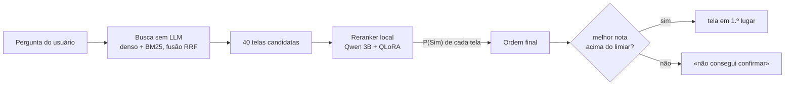

# Reranker local com QLoRA: um modelo de 3B numa GPU de 8 GB

Este repositório é um experimento: treinar um modelo pequeno, numa GPU de notebook, para fazer **um** trabalho que hoje é feito por chamadas a uma API de LLM. Esse trabalho é pôr em ordem 40 telas candidatas para a pergunta de um usuário de um sistema corporativo.

Os dados de treino e de teste são de um cliente e **não estão aqui**. Também não estão os pesos do adapter, que foi treinado com esses dados. Aqui ficam:
- o código;
- a configuração do QLoRA;
- o protocolo de teste;
- a conta do ponto de equilíbrio;
- exemplos **sintéticos** que mostram o formato;
- um exemplo **sintético** que corre de ponta a ponta numa GPU de 8 GB em menos de 10 minutos (ver «Teste rápido com dados sintéticos»).

## A tarefa

O modelo recebe a pergunta do usuário e o «cartão» de **uma** tela, com rota, menu, descrição, botões, ações e campos. Ele responde «Sim» ou «Não».

A nota da tela é P(Sim) no primeiro token da resposta. As 40 candidatas que a busca devolve são ordenadas por essa nota.

O conhecimento do sistema vai no prompt, dentro do cartão. O treino ensina só o julgamento: se a pergunta pede o que esta tela faz.



O que este experimento troca é só a caixa do meio: o reranker. A busca que monta as 40 candidatas é a mesma para todos os sistemas comparados.

## Configuração

| | |
|---|---|
| Modelo base | `unsloth/Qwen2.5-Coder-3B-Instruct-bnb-4bit` (3B, em 4 bits) |
| Método | QLoRA com Unsloth e TRL (`SFTTrainer`): r = 16, alpha = 16, dropout 0, nas projeções q/k/v/o/gate/up/down |
| Treino | lote 8 × acumulação 2 (efetivo 16), lr 2e-4 linear, 30 passos de aquecimento, `adamw_8bit`, seq. máx. 768, perda só na resposta |
| Checkpoints | a cada 250 passos; a escolha é feita no dev |
| GPU | RTX 5070 de notebook, 8 GB (7,96 GB visíveis), em WSL2 |
| Versões no log | Unsloth 2026.6.9, Transformers 5.5.0, Torch 2.10.0+cu128 |

## Resultados

### Rodada 1: o teste de 168 perguntas

Métrica: tela certa em 1.º lugar. Todos os sistemas reordenam as mesmas 40 candidatas, e o teste foi medido uma vez.

| Sistema | Acertos (de 168) |
|---|---|
| Qwen 3B **sem treino** | 42 |
| Busca sem LLM (ordem da fusão) | 100 |
| gpt-4.1-mini, rerank de 1 passo | 107 |
| **Qwen 3B com QLoRA** (500 passos, 8.000 exemplos) | **111** |
| gpt-4.1-mini, 2 passos (o sistema em produção) | 123 |

| Comparação (McNemar exato, top-1) | Só o local acerta | Só o outro acerta | p |
|---|---|---|---|
| local × gpt-4.1-mini de 1 passo | 24 | 20 | 0,65 |
| local × sistema em produção | 15 | 27 | 0,09 |

- O treino levou o mesmo modelo de **42 para 111** acertos em 168.
- Contra o gpt-4.1-mini **de 1 passo**, o resultado é um **empate estatístico**: 111 contra 107, p = 0,65. Ou seja, não há diferença significativa com 168 casos. **Empate não é vitória**, e também não prova equivalência (ver `docs/protocolo_teste_cego.md`).
- Contra o sistema em produção, que usa 2 chamadas ao gpt-4.1-mini, o local **fica abaixo**: 111 contra 123. A régua escrita para «empatar com a produção» era ficar a até 5 acertos, e ele ficou a 12.
- Treino: 500 passos em 29,9 min, com pico de 5,85 GB de VRAM.

### Rodada 2: teste cego novo de 142 perguntas, congelado antes do treino

| Sistema | Total (142) | Específicas (118) | Pedidos vagos (24) |
|---|---|---|---|
| Busca sem LLM | 74 | 62 | 12 |
| gpt-4.1-mini, 1 passo | 103 | 84 | 19 |
| gpt-4.1-mini, 2 passos (produção) | 112 | 92 | 20 |
| Qwen 3B, rodada 1 | 97 | 85 | 12 |
| **Qwen 3B, rodada 2** (checkpoint de 750 passos) | **105** | **92** | **13** |

- Contra a produção: 105 contra 112, p = 0,26, sem diferença significativa no total. Nos pedidos vagos, o local perde (13 contra 20, p = 0,04).
- Contra o gpt-4.1-mini de 1 passo: 105 contra 103, p = 0,87.
- Treino: 18.236 exemplos, 1.140 passos em 68,7 min, com pico de 5,83 GB. O checkpoint de 750 passos foi escolhido no dev, antes de abrir o teste.
- Inferência: 3,6 a 3,7 s por pergunta (40 candidatas por lote), com 4,7 a 4,9 GB de VRAM.

## Limitações

- **É uma tarefa específica.** O modelo só reordena candidatas num sistema cujo catálogo de telas ele vê no prompt. O resultado não diz nada sobre um 3B ser tão bom quanto o gpt-4.1-mini em geral.
- **Empate não é vitória.** «Empate estatístico» quer dizer p ≥ 0,05 no McNemar exato, com 168 (ou 142) casos. Uma diferença real de poucos pontos pode não aparecer com esse tamanho de amostra.
- **O modelo local também tem custo:** a máquina, a operação, novos treinos e um teste cego novo a cada rodada. Ver `docs/break_even.md`.
- **Não é mais rápido.** No notebook, a inferência leva 3,6 a 3,7 s por pergunta. O que se ganha é outra coisa:
  - custo zero por pergunta;
  - o dado não sai da máquina;
  - não há limite de pedidos;
  - a resposta é determinística.
- **As perguntas de teste são sintéticas**, escritas por agentes de LLM a partir de casos de QA e conferidas. Não são perguntas reais de usuários.
- **O baseline da API não é determinístico.** O mesmo rerank deu resultados diferentes em corridas repetidas no dev.
- **As perguntas sintéticas do treino foram geradas pelo gpt-4.1-mini.** Há um pouco de destilação do modelo de API no dado.
- **Os dois testes estão gastos** para estes modelos. Uma rodada nova precisa de um teste cego novo, congelado antes do treino.
- **O que não está aqui:** os dados e os pesos do adapter. Os números acima não são reproduzíveis só com este repositório. O que se pode reproduzir é o processo, com dados próprios no mesmo formato.

## Estrutura

| Caminho | O que é |
|---|---|
| `src/prompt.py` | o texto que o modelo vê (sistema, cartão, pergunta), o mesmo no montador, no treino e na avaliação |
| `src/montar_dataset.py` | monta os exemplos Sim/Não com negativas difíceis (fusão densa + BM25, RRF), descontaminado contra o teste e o dev |
| `src/treinar.py` | o treino QLoRA |
| `src/avaliar.py` | avaliação em listas fixas de candidatas: top-1/3/5, MRR, McNemar contra outros sistemas e o «freio». Recusa medir o teste duas vezes |
| `src/congelar_teste.py` | congela o teste cego (sha256, data, só leitura) |
| `src/break_even.py` | a conta do ponto de equilíbrio, com os preços como parâmetros |
| `src/gerar_vetores.py` | vetores de busca só com numpy (saco de palavras com hashing), para o exemplo correr sem modelo de embeddings |
| `src/exemplo.py` | o exemplo de ponta a ponta com os dados sintéticos de `exemplos/biblioteca/` |
| `docs/protocolo_teste_cego.md` | o protocolo de teste |
| `docs/break_even.md` | a conta e o que ela não inclui |
| `exemplos/` | o formato dos dados, com exemplos **sintéticos** inventados |
| `exemplos/biblioteca/` | um conjunto **sintético** maior (catálogo, dev e teste) de uma biblioteca fictícia, para o teste rápido |

## Teste rápido com dados sintéticos

Para ver o processo inteiro correr sem os dados do cliente, há um exemplo com dados **sintéticos**, inventados de raiz, de um sistema de biblioteca fictício (`exemplos/biblioteca/`):
- `catalogo.json`: 56 telas, cada uma com rota, ficha, descrição, menu, n.º de casos de QA e 8 a 10 perguntas (463 ao todo, algumas vagas);
- `dev.json` (36 perguntas) e `teste.json` (38 perguntas), escritos à parte, sem copiar as do catálogo.

```bash
pip install -r requirements.txt
python src/exemplo.py
```

O comando faz, em ordem:
1. **vetores** (`src/gerar_vetores.py`). No experimento, os vetores da busca densa vinham de um modelo de embeddings. Aqui são um saco de palavras com hashing, só com numpy, para o exemplo correr sem descarregar outro modelo nem chamar API. **Este método é só para o exemplo.**
2. **candidatas**: as 40 candidatas de cada pergunta do dev e do teste, com a mesma fusão do montador. O teste é congelado aqui (sha256 no `CONGELADO.json`).
3. **dataset** (`src/montar_dataset.py`), descontaminado contra o dev e o teste.
4. **treino** (`src/treinar.py`): 1 época, com a mesma configuração do experimento. Com este catálogo, são 52 passos.
5. **dev**: o modelo base e o treinado. O limiar do freio é escolhido aqui.
6. **teste**: medido uma vez, com o treinado e o base na mesma corrida.

Tudo fica em `exemplos/biblioteca/saida/`, que não entra no git. **O teste mede-se uma vez:** se a pasta já existe, o script recusa. Para repetir o exemplo do zero, apague a pasta `exemplos/biblioteca/saida/`. Na primeira vez, o modelo base (cerca de 2 GB) é descarregado do Hugging Face.

Medido na máquina do experimento (RTX 5070 de notebook, 8 GB, WSL2, as versões da tabela acima), com o modelo já em cache:

| Etapa | Tempo |
|---|---|
| vetores, candidatas e dataset | 1,5 s |
| treino (com a carga do modelo) | 212 s; os 52 passos levaram 141 s (2,7 s por passo) |
| dev: base e treinado, 36 perguntas × 40 candidatas | 161 s |
| teste: treinado e base, 38 perguntas × 40 candidatas | 157 s |
| **total** | **531 s (8,9 min)** |

Pico de memória: 3,99 GB reservados pelo PyTorch no treino e 4,06 GB na avaliação; 4,33 GB no `nvidia-smi`, para a GPU inteira.

Saída resumida:

```
Perda (passo: perda): 10: 0.3083, 20: 0.1839, 30: 0.1214, 40: 0.0633, 50: 0.0475

dev (36 perguntas)                    top-1  top-3    MRR
  busca sem LLM (ordem da fusão)         12     19  0.472
  Qwen 3B sem treino                     21     27  0.684
  Qwen 3B com QLoRA (exemplo)            27     35  0.843
  McNemar treinado × sem treino: só o treinado acerta 8, só o sem treino 2, p = 0.1094

teste (38 perguntas)                  top-1  top-3    MRR
  busca sem LLM (ordem da fusão)         16     21  0.540
  Qwen 3B sem treino                     21     28  0.673
  Qwen 3B com QLoRA (exemplo)            24     34  0.759
  McNemar treinado × sem treino: só o treinado acerta 6, só o sem treino 3, p = 0.5078

Limiar do freio escolhido no dev: 0.4
```

**Estes números não significam nada sobre o experimento.** O catálogo é inventado e pequeno, as perguntas não passaram por conferência, a busca usa um saco de palavras e o treino tem 52 passos. Eles só mostram que o processo corre de ponta a ponta: a perda desce, o adapter é gravado, o dev escolhe o limiar e o teste é medido uma vez, com a tabela e o McNemar. Noutra GPU ou noutra versão das bibliotecas, os números podem mudar um pouco.

## Como rodar (com dados próprios)

```bash
pip install -r requirements.txt   # precisa de GPU NVIDIA com CUDA; testado só em WSL2/Ubuntu
python src/montar_dataset.py --catalogo catalogo.json --vetores-fichas fichas.npy \
    --vetores-perguntas perguntas.npy --excluir teste/teste.json --excluir dados/dev_real.json
MAX_PASSOS=20 python src/treinar.py         # fumaça: velocidade e memória
MAX_EXEMPLOS=8000 python src/treinar.py     # versão curta, como na rodada 1
python src/avaliar.py --conjunto dados/dev_real.json --adapter saida/checkpoints/checkpoint-500
python src/avaliar.py --conjunto teste/teste.json --congelado teste/CONGELADO.json \
    --adapter saida/adapter --uma-vez --tau 0.4 --tambem-base
```

O dataset da rodada 2 acrescentou à base da rodada 1:
- mais perguntas sintéticas no grupo onde a rodada 1 mais errou;
- pedidos vagos montados por molde («quero cadastrar &lt;objeto do menu&gt;»), em que a tela principal é o «Sim».

O script dessa etapa dependia do catálogo do cliente e não foi incluído.

Os vetores (`.npy`) vêm do seu modelo de embeddings: um por tela (o texto da ficha) e um por pergunta do catálogo. O `src/gerar_vetores.py` só serve para o exemplo sintético. O `treinar.py` também lê a variável `RESULTADOS`, a pasta do resumo do treino.

Os formatos de entrada estão em `exemplos/`: o catálogo (`catalogo_sintetico.json`), os cartões das telas (`telas_sinteticas.json`), um conjunto de teste (`teste_sintetico.json`) e exemplos de treino (`treino_sintetico.jsonl`).

## Autor e licença

Fábio Festinalli. Código sob a licença MIT (ver `LICENSE`).
