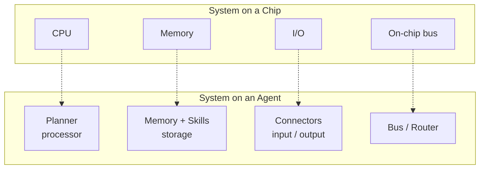

# System on an Agent

A system on a chip puts a CPU, memory, I/O, and a bus on one piece of silicon. A **system on an agent** puts the same parts into one agent:

| System on a Chip | System on an Agent |
| --- | --- |
| CPU | Planner (the processor) |
| Memory | Memory and skills (storage) |
| I/O | Connectors (input and output) |
| On-chip bus | Bus / router |

The core is only those four parts. Optional add-ons plug in later through a manifest and hook interface, without changing the core.



## Core

- **Planner.** Takes a goal, builds a plan, and runs it step by step. The default planner is deterministic and rule-based; no language model is required. An optional `LLMProvider` interface can be attached later. If the model fails to return a valid plan, the rule-based planner is the fallback.
- **Memory and skills.** Working memory holds short-lived values for the current run. Long-term memory stores facts (optionally persisted as JSON). The skill library is a set of reusable named procedures the planner can run.
- **Connectors.** A pluggable I/O surface. This repository ships a local file connector and an echo (mock) connector.
- **Bus / router.** Routes messages between the planner, memory, skills, and connectors, and fires add-on hooks around each step.

## Quickstart

Requires Python 3.10 or newer.

```bash
python -m pip install -e ".[dev]"
soa skills list
soa connectors list
soa run "echo hello from system on an agent"
pytest
```

`soa run` prints the goal, the plan, and the output. Add `--json` for a machine-readable report. Built-in goal forms include:

- `echo hello` / `say hello` — send text through the echo connector
- `remember the sky is blue` — store a fact
- `recall sky` — look up facts
- `read path/to/file` and `write hello to path/to/file` — file connector
- `list skills` / `list connectors`
- Join steps with `then`: `echo hi then remember hi was said`

## Optional add-ons

Add-ons are **not** part of the core. They load from a Python file or a directory (containing `soa_addon.py` or `addon.py`) and declare a manifest plus the hooks they implement:

- `before_plan(plan, context)`
- `after_plan(plan, report, context)`
- `before_step(step, context)`
- `after_step(step, result, context)`
- `on_error(step, error, context)`

```bash
soa --addon path/to/addon.py run "echo hello"
```

The module must expose an `Addon` class, a `create_addon()` factory, or an `addon` instance. See [docs/addons.md](docs/addons.md) for the interface and for reserved future add-ons (heatgate and the Lex loop), which are documented only as placeholders and are not implemented here.

## License

MIT. Copyright (c) 2026 Joshua Almeida.
