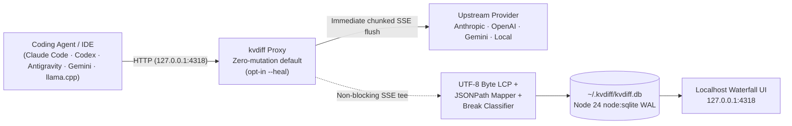

# kvdiff

**Zero-code local proxy that pinpoints the exact UTF-8 byte breaking your LLM prompt cache (Anthropic, OpenAI, Google Gemini / Antigravity, `llama.cpp`/vLLM), tallies wasted dollars, and optionally auto-heals prefixes live.**

[](./LICENSE)
[](https://nodejs.org)
[-informational.svg)](#architecture)

[](https://github.com/flipcyde101/kvdiff/releases/download/v0.1.0/kvdiff-scoped-demo.mp4)

[Watch the 15-second kvdiff demo (MP4)](https://github.com/flipcyde101/kvdiff/releases/download/v0.1.0/kvdiff-scoped-demo.mp4)


**Try the demo:** `npx @drod915/kvdiff --demo`

---

## See a Prompt-Cache Bust in 5 Seconds (Zero API Keys Required)

```bash
npx @drod915/kvdiff --demo
```

Opens `http://127.0.0.1:4318` pre-seeded with two realistic sessions:
1. **Claude Code + 15 MCP Tools (16 turns):** Turn 1 warms the prompt cache at 0%, and Turns 2-13 run at 94% cache hit. On **Turn 14**, `mcp-github` reconnects and reorders tool schemas: `kvdiff` highlights the exact red byte offset (`$.tools[9].name`, byte 1,670), calculates the wasted cost ($0.38), and shows **Turn 15** snapping back to **97% cache hit** under `--heal`.
2. **Antigravity / Gemini 2.5 Pro (5 turns):** Catches a volatile timestamp injected into `$.systemInstruction.parts[0].text` on Turn 4.


> Record the demo in a terminal with `vhs demo/kvdiff.tape`.

---

## Quick Start

Wrap any coding agent CLI with zero code changes:

```bash
# Claude Code (Anthropic Messages API)
npx @drod915/kvdiff -- claude

# Codex CLI / OpenCode (OpenAI Responses & Chat APIs)
npx @drod915/kvdiff -- codex

# Gemini CLI / Antigravity API workflows (Google Gemini API)
npx @drod915/kvdiff -- gemini

# Opt-in deterministic tool-schema healing
npx @drod915/kvdiff --heal -- claude
```

Or run as a persistent local proxy for Antigravity, Cursor, IDE plugins, or local `llama.cpp`/vLLM:

```bash
# Cloud providers (Anthropic, OpenAI, Google Gemini / Antigravity)
npx @drod915/kvdiff serve --port 4318

# Local llama.cpp / vLLM KV-cache prefix reuse debugging
npx @drod915/kvdiff serve --port 4318 --upstream-local http://127.0.0.1:8080
```

Then point your client base URL:
- `ANTHROPIC_BASE_URL=http://127.0.0.1:4318`
- `OPENAI_BASE_URL=http://127.0.0.1:4318/v1`
- `GOOGLE_GEMINI_BASE_URL=http://127.0.0.1:4318`

---

## What `kvdiff` Catches

| Break Kind | What Happened on the Wire | Fix |
|---|---|---|
| `TOOL_REORDER` | MCP servers reconnected or registered tools in non-deterministic order | Pass `--heal` to sort `tools[]` (and Gemini `functionDeclarations[]`) deterministically |
| `TOOL_MUTATED` | A dynamic tool description or schema field changed mid-session | Pin static tool descriptions outside the cached prefix |
| `VOLATILE_SYSTEM` | A timestamp, UUID, or mutable status string landed inside `$.system` / `$.systemInstruction` | Move dynamic metadata into the trailing user turn |
| `TTL_EXPIRED` | Bytes matched 100%, but `>5m` elapsed between turns | Keep interactive sessions warm or opt into extended TTL |
| `MODEL_CHANGED` | Model name switched mid-session | Keep one model per cache prefix |
| `PREFIX_TOO_SHORT` | Prompt fell under OpenAI (`1,024`) or Gemini (`1,024`/`2,048`) implicit-cache floor | Expected until context grows past threshold |

---

## Honest Comparison

| Feature | `kvdiff` | `ccusage` / `codexbar` | `ContextSpy` | Langfuse / Phoenix |
|---|---|---|---|---|
| **Install & Infra** | 1 cmd (`npx`), built-in `node:sqlite` | 1 cmd (`npx`/binary) | 1 cmd (`npx`) | Docker + Postgres/ClickHouse |
| **Wire-level UTF-8 byte LCP + JSONPath diff** | **Yes** | No (reads post-hoc logs) | No (token category pies) | No |
| **Opt-in live prefix healing (`--heal`)** | **Yes** | No | No | No |
| **Multi-provider (Anthropic + OpenAI + Gemini/Antigravity + `llama.cpp`)** | **Yes** | Single-provider focus | Anthropic/OpenAI | Yes |
| **Zero-mutation default passthrough** | **Yes** (OAuth/beta headers intact) | N/A (offline log reader) | Yes | SDK instrumentation |
| **Where competitors win** | - | Zero proxy setup; great historical billing totals across past months | High-level token breakdown visualizations | Production team evals, prompt versioning, multi-user cloud traces |

---

## Architecture



### Safety & Privacy Guarantees
- **100% Local:** Binds to `127.0.0.1` by default. Stores traffic only in `~/.kvdiff/kvdiff.db`. Zero telemetry, zero cloud accounts.
- **Strict Zero-Mutation Default:** Without `--heal`, `kvdiff` forwards your exact raw request bytes and every non-hop-by-hop header (`Authorization`, `x-api-key`, `x-goog-api-key`, `anthropic-beta`, `openai-beta`) unmodified.
- **Zero-Buffering SSE:** Streaming responses flush downstream chunk-by-chunk as they arrive from upstream.
- **Safe `--heal` Invariant:** `--heal` sorts tools and tool-definition keys, normalizes JSON formatting, and keeps the trailing Anthropic cache breakpoint on the final tool after sorting. It **never** reorders `messages[]`, `contents[]`, `parts[]`, `content[]`, `input[]`, or JSON Schema `enum[]`.

---

## Development

```bash
git clone https://github.com/flipcyde101/kvdiff.git
cd kvdiff
npm install
npm run typecheck
npm run build
npm test
```

Found a cache-break pattern or provider edge case? Open an issue at [github.com/flipcyde101/kvdiff/issues](https://github.com/flipcyde101/kvdiff/issues).

## License

[MIT](./LICENSE)
