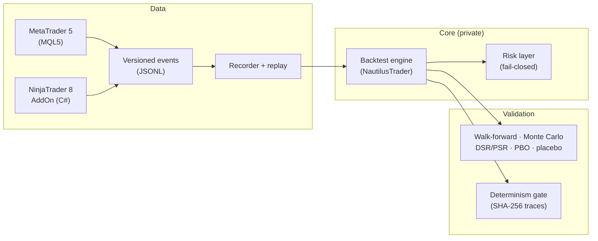

# EA_SCALPER_XAUUSD — Algorithmic trading research lab

> **PT-BR:** laboratório pessoal de engenharia de software para sistemas financeiros, mantido por Franco Mascarelo Ortiz desde agosto de 2025. Este repositório é o snapshot público (MQL5). O núcleo em Python (NautilusTrader) é privado. É pesquisa: só backtest, nunca operou dinheiro real, sem sinais e sem promessa de lucro.

A personal engineering lab for financial software, built and maintained by one person since August 2025.
This repository is the **public MQL5 snapshot**. The Python/NautilusTrader core is private.

**Status:** research only. Backtest only. It has never traded real money.
No signals, no profit claims, no trading advice. Just the engineering.

---

## Why this exists

I started out buying trading robots. I stopped when I realized that, even if one worked, I would depend on an outside developer and would not be able to explain why it stopped working.

So I built my own lab: a place to test ideas about markets with the same discipline that financial systems need. The most useful result so far is not a strategy. It is the engineering, and the list of ideas the tests ruled out.

## What the lab does

- **Event-by-event backtesting** on NautilusTrader (Python 3.14), with deterministic replay checked by SHA-256 traces.
- **Platform integration** with MetaTrader 5 (MQL5) and NinjaTrader 8 (C# AddOn). MQL5 logic is checked against a Python reference implementation.
- **Statistical validation:** walk-forward analysis, block-bootstrap Monte Carlo, Probabilistic and Deflated Sharpe Ratio, PBO (CSCV), placebo / sign-flip tests. Failure criteria are written before the test runs.
- **Fail-closed by design:** unknown input resolves to the most restrictive choice; missing data is reported as "unavailable", never silently treated as zero.
- **Test discipline:** mutation testing, property-based tests (Hypothesis), and differential tests whose references are written from the specification, not from the implementation.
- **Realistic execution modeling:** slippage only adverse, queue-aware fills, no fill assumed at probability 1.

## How it is built

I coordinate several AI coding agents in parallel. Each lead works in its own git worktree with its own plan, and I integrate the work into a central branch.

- Whoever writes the code does not approve it. Critical changes need two independent reviewers who **run** the code, not only read it.
- "Done" is only valid with the reviewer's verdict file cited. Anything that did not pass stays marked as partial.
- Claims are checked against the command that produced them before commit.

Architecture, acceptance criteria and decisions are mine.

## Scale (private repository, measured November 2026)

| Measure | Value |
|---|---|
| Commits | 5,400+ |
| Python, production and tests | 1M+ lines |
| Automated test functions | 30,000+ (static count of `def test_`) |
| Age | ~15 months (since August 2025) |

These numbers describe effort, not quality or profitability.

## Architecture (simplified)

## What the data ruled out

In June 2026 the strategy research program was closed without a proven edge: the pre-registered strategy families were rejected by their own tests. No configuration has shown a statistically valid, cost-adjusted advantage.

That is why this is presented as an engineering lab, not as a product.

## What is public and what is not

| Public (this repo) | Private |
|---|---|
| MQL5 Expert Advisors and indicators | Python/NautilusTrader core |
| Docs, CI and tooling | Strategy rules and parameters |
| | Risk configuration and live wiring |

## What this is not

- Not a trading signal, course or service.
- Not financial advice.
- Not production-ready.
- Not allowed for live, funded or broker-connected use. See [TRADING_RESTRICTIONS.md](TRADING_RESTRICTIONS.md).

## Author

Franco Mascarelo Ortiz — Computer Engineering student (Uniftec, Brazil), studying COBOL and mainframe (Enterprise COBOL, JCL, z/OS, DB2).

LinkedIn: [linkedin.com/in/francomascarelo-mainframe](https://www.linkedin.com/in/francomascarelo-mainframe)
