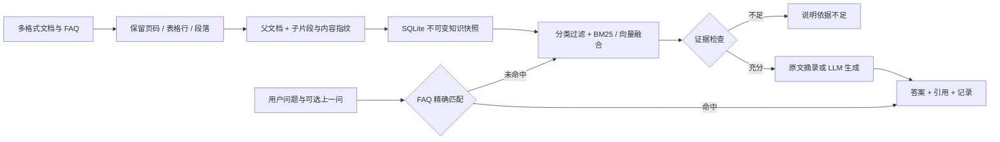

# BuildForge · 工程项目知识助手

**[在线体验](https://fxd-ai.github.io/engineering-project-rag/)** · **[公开源码](https://github.com/fxd-ai/engineering-project-rag)**

在线版是 GitHub Pages 只读演示：问答检索在浏览器中执行，不调用大模型，不开放上传与管理接口。Python 完整版包含原有的资料导入、知识版本与模型接入能力。

串联图纸、规范与现场资料，让项目问题有据可查。

独立运行的垂直业务 RAG 项目：**FAQ 直答 → 文档检索 → 证据上下文 → 模型生成 → 来源引用**。从 KnowForge RAG Platform 的业务场景与流程思路出发，重新实现轻量、可读、可测试的独立应用。


## 快速开始

需要 **Python 3.11 或 3.12**。进入本项目目录后：

```bash
python -m venv .venv
# Windows
.venv\Scripts\python -m pip install -r requirements.txt
.venv\Scripts\python run.py
# macOS / Linux
# .venv/bin/python -m pip install -r requirements.txt
# .venv/bin/python run.py
```

打开 http://127.0.0.1:8012 。Windows 也可双击 `start.bat`，首次启动会安装依赖。首次启动自动建立知识库；无需配置数据库或下载本地模型。首次安装依赖需联网，演示运行可离线。

## 运行模式

| 配置 | 实际行为 | 是否调用模型 |
|---|---|---|
| 默认 `RAG_MODE=demo` | 中文双字词 BM25 检索 + 原文摘录 / FAQ 直答 | 否 |
| `RAG_MODE=llm`，未设置 embedding 模型 | BM25 检索 + 大模型生成带引用回答 | 是，FAQ 直答除外 |
| `RAG_MODE=llm`，设置 `EMBEDDING_MODEL` | BM25 + 真实语义向量余弦检索 + RRF 融合 + 大模型生成 | 是 |

**默认演示的原文摘录不是大模型生成。** 网页与接口都会明确显示实际路由和模式。生成与向量接口采用 OpenAI-compatible HTTP 协议，可对接兼容的云服务或本地模型服务。没有配置密钥时不会假装调用模型；模型失败返回明确错误，不暗中替换成演示结果。

接入模型：复制 `.env.example` 为 `.env`，填写：

```dotenv
RAG_MODE=llm
LLM_BASE_URL=https://你的模型服务地址/v1
LLM_API_KEY=你的密钥
LLM_MODEL=你的对话模型名称
EMBEDDING_MODEL=
ADMIN_TOKEN=自行生成的长随机字符串
```

`LLM_BASE_URL` 应为兼容服务的 API 根路径，应用在后面追加 `/chat/completions` 和 `/embeddings`。不提供供应商默认值，避免误发请求；如设置 embedding，必须确保同一地址与密钥能调用该模型。配置真实服务后，问句与检索资料会发送到所配置的服务，可能产生供应商费用。

从演示模式切换到向量模式，或更换 embedding 模型 / 地址后，先停止服务，再执行：

```bash
python scripts/rebuild.py
python run.py
```

本项目面向小型作品集资料库，向量存储于 SQLite 的版本快照中、在应用内计算余弦相似度；**未接入 Milvus、LangChain、神经 reranker 或多租户权限系统**。保留这些重型能力为后续扩展，而不把未实现功能写入展示亮点。

## 业务范围

- **设计图纸**：资料目录 `knowledge/documents/drawing/`。
- **施工规范**：资料目录 `knowledge/documents/specification/`。
- **进度资料**：资料目录 `knowledge/documents/schedule/`。
- **质量验收**：资料目录 `knowledge/documents/quality/`。
- **安全资料**：资料目录 `knowledge/documents/safety/`。

内置 **15 份文档、11 条 FAQ**，覆盖 Markdown、CSV、XLSX、DOCX、PPTX、文字型 PDF。业务资料为原项目提供的教学演示内容，未作为现行法律、实际工程标准或正式审批意见核验。

## 演示顺序

1. 点击示例问题，展示 FAQ 秒级直答和来源行号。
2. 勾选“仅检索文档”，再次提问，展开 PDF 页码 / 表格行号 / 文档原文。
3. 选择一个业务分类，演示检索范围隔离。
4. 输入“量子纠缠的数学公式”，展示知识不足时拒绝强答。
5. 在“知识资料”查看所有文档；在 `.env` 配置 `ADMIN_TOKEN` 后可导入新资料、重建或回滚版本。
6. 已配置 LLM 时，勾选“仅检索文档”可确保经过真实模型生成路线。可通过 `python scripts/smoke.py --url http://127.0.0.1:8012` 验证运行接口。

## 架构与实现



- **检索**：中文双字词与英文词分词、BM25、可选模型向量、RRF 排序、父文档去重。
- **文档处理**：500 字子片段、60 字重叠；短文档回填父文档，长文档回填局部上下文。保留原始标题、分类、页码/段落/表格行与文件指纹。
- **版本**：内容与检索配置产生快照指纹；构建成功后原子启用；失败保留旧版本；回滚切换快照不删除磁盘文件。
- **质量**：FAQ 精确命中、检索证据门槛、生成引用编号检查、业务分类过滤、失败显式上报。
- **交互**：中文响应式页面、示例问题、上一问关联、证据展开、回答导出、反馈记录。
- **存储**：SQLite 持久化知识快照、问答记录与反馈，不依赖另一项目目录。

引用编号有效性检查只能确认编号存在，不能证明模型每句话都被原文支持；提示词约束也不等于完整的提示注入防护。匹配阈值在小规模演示集上验证，实际资料需另行评测。多轮功能为显式附加上一问，不是模型语义改写。

## 测试与评测

```bash
python -m pip install -r requirements-dev.txt
python -m pytest -q
python scripts/evaluate.py
python scripts/smoke.py --url http://127.0.0.1:8012
```

`eval/cases.json` 含 34 条固定样例：FAQ、强制文档检索、改写问题、PDF / Excel / CSV 内容定位与领域外问题。评测生成 `reports/evaluation.json`，报告分类级 Recall@5 / MRR@5 及逐题结果；这不是行业基准或 LLM 质量分数。CI 配置在 Windows / Ubuntu、Python 3.11 / 3.12 上运行测试与离线评测；实际本次验收环境见 `docs/VERIFICATION.md`。

模型与 embedding 的自动化测试使用受控响应验证接口、排序与错误处理。真实服务是否已测试以验收文档为准，不能把测试替身通过当作真实模型验收。

## Docker

```bash
# 先将 .env.example 复制为 .env
docker compose up --build -d
docker compose logs -f app
```

访问端口仍为 8012。两个项目 Compose 使用各自目录名隔离容器与命名卷。资料与 SQLite 使用独立命名卷持久化；首次运行将镜像中的演示文档复制进资料卷。之后修改源码资料不会自动覆盖已有卷，可通过上传功能导入。

## API

交互文档：http://127.0.0.1:8012/docs

| 接口 | 功能 |
|---|---|
| `GET /health` | 模式、资料数量、检索配置与当前版本 |
| `POST /api/ask` | 问答与来源引用 |
| `GET /api/knowledge` | 当前文档目录与版本列表 |
| `POST /api/feedback` | 保存回答反馈 |
| `POST /api/admin/upload` | 上传并建立新版本，需 Bearer 管理令牌 |
| `POST /api/admin/rebuild` | 重建当前磁盘文档索引，需令牌 |
| `POST /api/admin/versions/{id}/activate` | 切换已有快照，需令牌 |

请求示例：

```json
{"question": "图纸变更后旧版本还能作为施工依据吗？", "source": null, "documents_only": true}
```

问答与反馈保存在本地 `storage/rag.sqlite3`；该目录被 Git 忽略。默认监听 `127.0.0.1`，管理操作默认禁用。本项目没有用户登录、租户鉴权或公开接口限流，不应未经加固直接向公网开放。GitHub 展示代码不需要公开部署接口。

## 目录

```text
app.py / run.py       API 与启动入口
rag/                 配置、解析、检索、模型适配、存储与问答流程
knowledge/           独立 FAQ 与五类业务文档
static/              中文页面、交互脚本与主题样式
tests/               功能、接口与失败场景回归测试
eval/                固定评测题集
scripts/             重建、评测与运行冒烟测试
docs/                展示截图、验收记录与发布说明
```

## 上传 GitHub

本目录可直接作为一个独立仓库。上传操作步骤见 [GitHub 展示指南](docs/GITHUB.md)。`.env`、虚拟环境、数据库、日志与运行中上传的资料默认忽略；提交原始演示文件和代码即可。

新编写的应用代码采用 MIT 许可；业务示例素材的来源及授权范围见 [NOTICE](NOTICE.md)。
